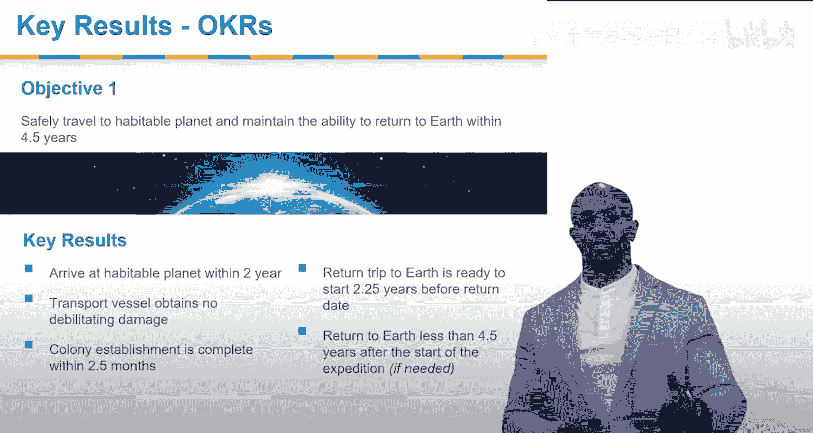
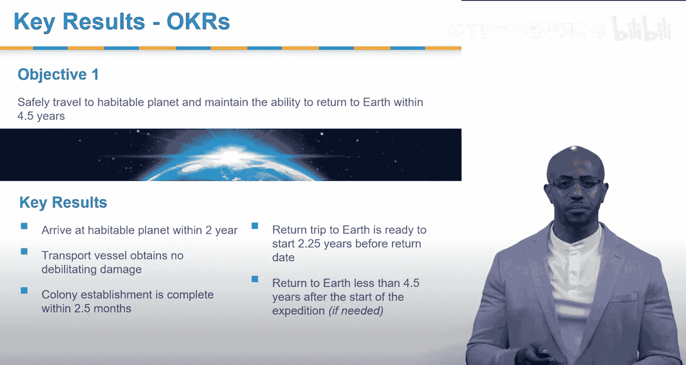
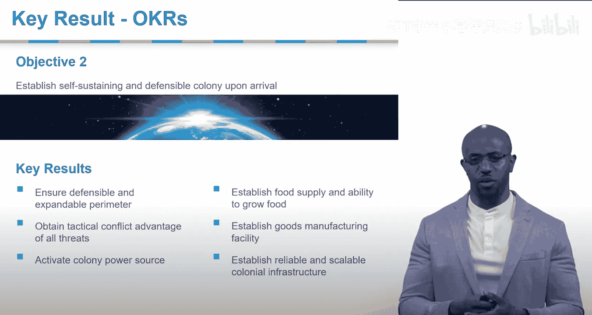
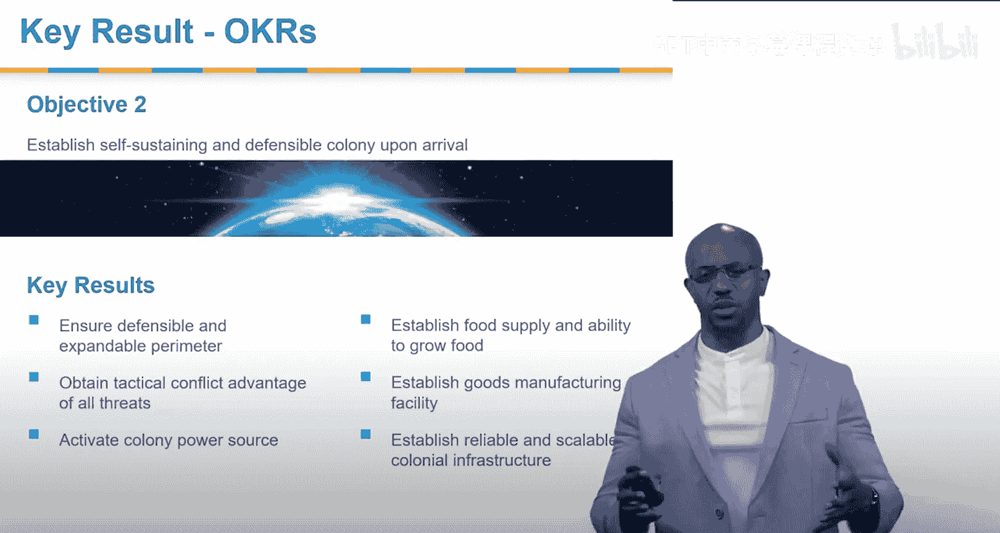
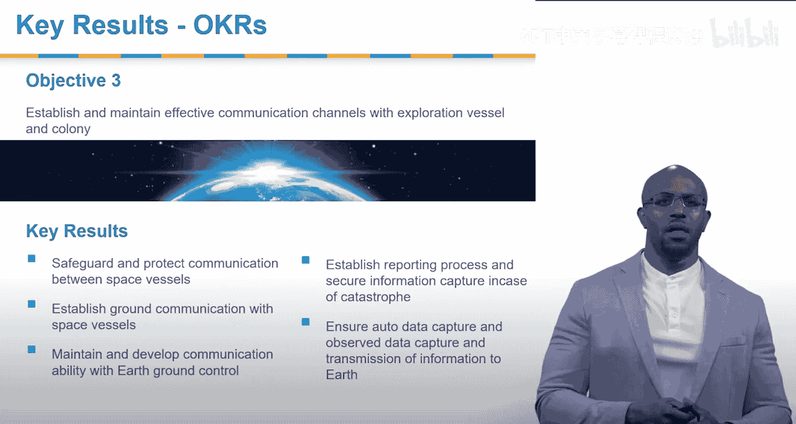
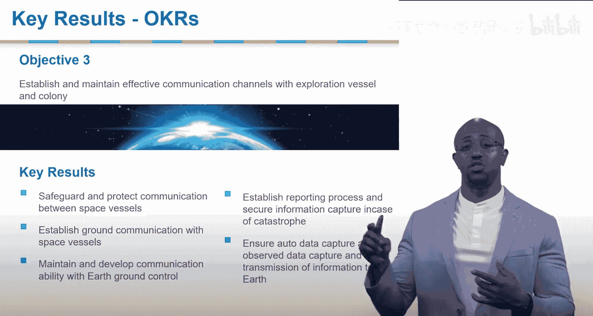
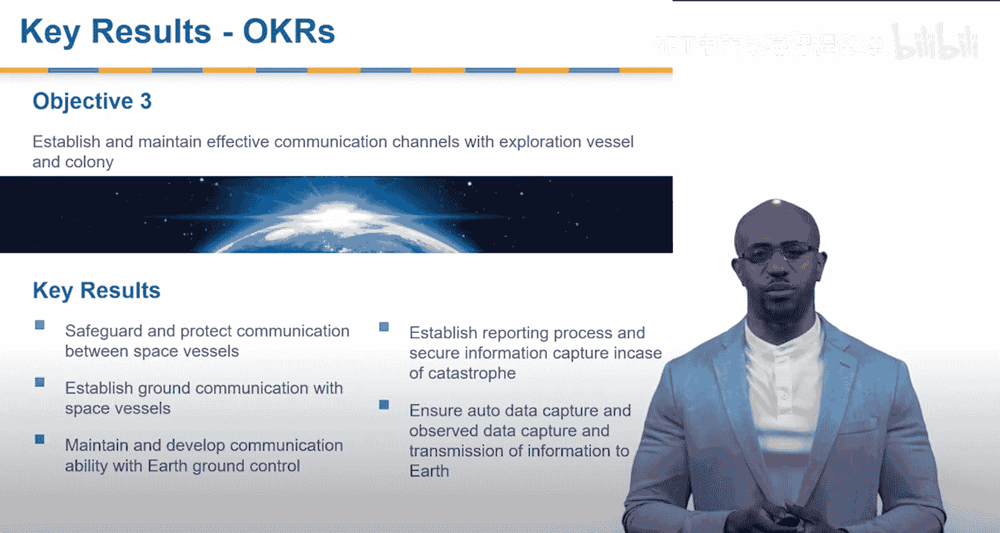

# 亚利桑那州立大学《黑暗数据迁移与架构｜Dark Data Migration and Architecture》中英字幕 p37 36_太空旅行目标与关键成果.zh_en [BV1TkurzMEmm_p37]

Welcome in this lesson we're going to use what we've learned about computational thinking and apply it to space travel。

 interstellar space travel that is， so we're going to take first a look at the OKRs。

 the outcomes and what we expect from space travel using computational thinking to solve the problem so we're going start with the problem statement in 2050 the Earth's resources have become inefficient to support human life so experts calculate that in 20 years from 2050 the Earth will be uninhabitable。

We've already conducted a expedition to Mars， the Mars expedition failed。

 we weren't able to generate a life-staining atmosphere。

 however they do have a colony on Mars and that colony is there but it can only hold a small amount of people for a temporary time and they estimate that if they continued working on Mars it may take another 500 plus years to generate an atmosphere which is not conducive for what we're trying to do trying to save the human species in human race also we've conducted a trip to Jupiter's moon and that one failed as well and we know the closest seemingly habitable planet is proxima B。

 but there are other planets that seem to be habitable and we have a list of them in our data sets now some of the key decisions that we'll need to make are around which planets would we send our primary ships to or will there be any contingent planets or do we put it all in in one go in one vessel。

What type of space vessels should we use， what should be the shape and fixture of it and how how should it be proposed through the stars what type of protective mechanism should we use shielding。

 deflecting rays beams and our own artillery on the space spaceship and what should we what should be the make of the travelers on the journey to continue the。

To continue the human experience， obviously we have to have a makeup of male and women。

 but we also need to consider the skill sets that take precedence on the vessel itself。

Now primarily these are the three objectives that we'll have。

Safely travel to the habitable planet and maintain the ability to return to the earth within 4。

5 years for the purpose of coming back to the new planet with more people。

 establish self-sustaining and defensible colony of 2000 men and women upon arrival。

 so that means the vessel has to have upwards of 2000 men and women。And when we get there。

 we need to be able to establish the colony and safely defend it against whatever threats may be out there in the universe or on planet。

Objective three， establish and maintain effective communication channels with the exploration vessel and the colony。

 so the vessel that's going， the colony， and then if we're having any other ships that are going so if it's not just one ship if it's multiple ships。

 we all need to have communication channels throughout the entirety of this project and of this journey。

Now breaking down these OKKRs， looking at the first one。

 the key results that we're going to look at arriving at the habitable plant in two years。

 transport vessel obtains no debilitating damage。

If we have a shield， you can expect the shield to have some damage as it traverses through gas and particles in space。

 depending on the rate of speed at which it's moving， the return trip is ready to start in 2。

5 years because you need 2。25 because you need time to build the colony and can we do it in the year。

 two years， a month， four months。How can we spin up that colony fast？

So when you look at this the colony needs to be completed in about 2。5 months。

 we would like to have some burn in time to stabilize ensure defenses， so establishing the colony。

 getting it up and running and then being able to explore and ensure that threats are neutralized。

 right， return to the earth in four to five years to start at the next expedition， if needed， right？

Now objective to establish self-sustaining a defensible colony right so now we're looking at the key results for this。

 ensure defensible and expandable perimeter， obtain tactical conflict advantage for all threats activate colonial power source。

 establish food supply， ability to grow food， create food。

 and go hunt food if food is there for us to capture establish goods manufacturing facility so we can continuously build and it can be self-sustaining。

 there may be new types of tools that are needed to be built on that type of planning in terms of excavation ground materials and pulling out resources from the ground etc。

Ittop with reliable， scalable colonial infrastructure， sewage systems， water， running water。

 et cetera， all that stuff。

Going to objective three， establish maintain effective communication channels with the exploration vessel and the colony。

 so safeguard and protect communications between space vessel。

 the colony and any other vessels communication is critical if you're flying blind you' run into a lot of issues when the communication with the other vessels could have help prevent some of the issues that you'll run into or the communication with ground control back here on the planet establish ground ground communication maintain develop communications ability with the ground control once you land so this is the ground control with the colony the ground control with us here on earth plus the vessel establish reporting process and secure information capture in case of catastrophe part of the communication piece is being able to capture information and data and store it and use it to create new information and use it to identify that dark data that we definitely need to use definitely need to report back once we get to the planet because there's gonna to be tons of dark data tons of unknowns。

When we get to that planet， so we need to capture all of that data and be able to send it back。

And ensure auto data capture for things that are there and also observe data capture。

 so both when we can automate the capture of data and then transmitted and get that data cooked up that would be that's awesome and that's going to help the future trips to the planet。

Thank you for your time。