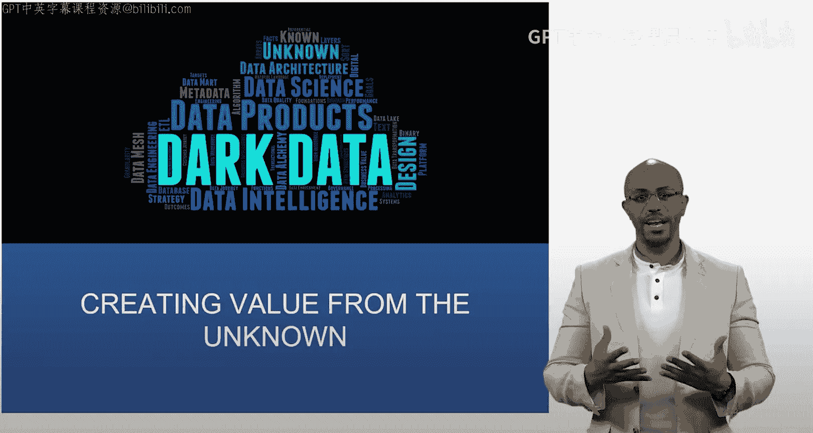
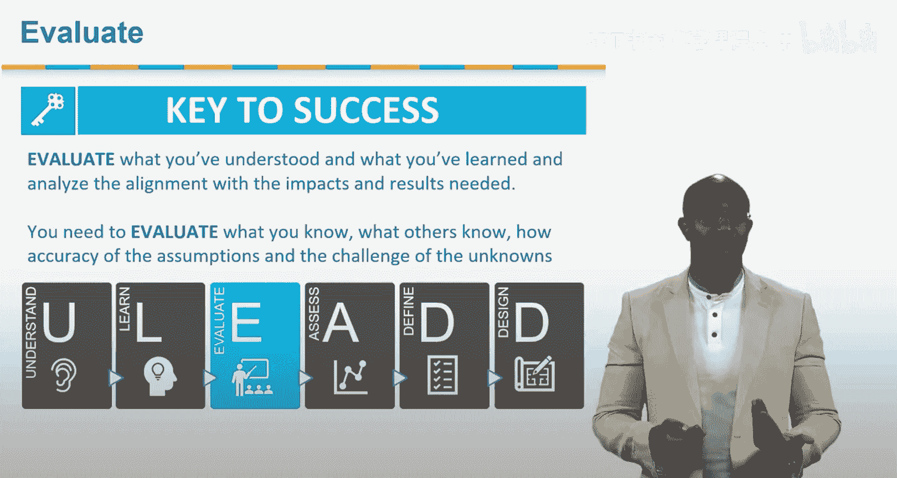

# 亚利桑那州立大学《黑暗数据迁移与架构｜Dark Data Migration and Architecture》中英字幕 p40 2_ULEADD解析第一部分.zh_en [BV1TkurzMEmm_p40]

Welcome。We're going to talk about my approach to creating value from dark data。

Now， over the past 15 plus years， I've worked in corporate America in various settings and delivered a number of technology solutions。

Now when I first started， I started as a UI engineer， and now I'm more so focused on data solutions。

 large system integrations， inclusive of UI， transformations。

 and understanding where and how to get value from dark data。So over the years。

 I've learned many of the different challenges that we face， both technical， both it's social。

 political， and just dealing with the human experience on how we build。

 create and engineer and find these solutions and most of the opportunities that I've seen。

 come in the realm of understanding where those gaps are。

So through the years I' developed this framework that I use sometimes just mentally if it's a small project。

 but most times I'll write down the steps and go through them with the team or with whoever else I'm working with integratively。

So quite simply， it's a six step process， understand， learn， evaluate， assess， define and design。

Now looking at this， the first two， second two， and last two。Our partners， they go together。

Although it is sequential， a lot of times you can do those pairings。Parallel。

So the thing you want to think about when you take these approaches to solutions with dark data。

Is a lot of times the failure really happens up front。The failure to understand。

Learn what the expected solution is， evaluate what was understood and learned。

 assess what's possible， go into the define and design and if you noticed。In this approach。

 there is no development or delivery。There are many project management frameworks and process management change management protocols that are very good and successful at delivering the project。

 we are really talking about that entire process all the way up to development。

So this is that deep dive into solution and into discovery into planning those stages。

So as we dive deeper into this， I want to focus on those first too。

 and look at how sort of the mindset that you have to have when taking on a project if you're looking at extracting value from dark data。

and the key focus is understanding what's possible now to do this。

 you must both be pragmatic and idealistic， although those sit on the opposite sides of the spectrum。

They work very well here because you have to get to a point where you can figure out what is that Nirvana state。

 how can we get to a place where we're getting the solution that we need。

 getting the value that we're trying to attain and then work backwards from there to strip out all of the ancillary things。

And be able to deliver an MVP fast with value and be able to grow that over time in an iterative fashion。

But speak to the core needs of the organization and the business that you are delivering for immediately。

So when we look at that first stage， the understanding phase。

This is an in depth dive where the data scientist， the engineeringly。

 the person who is looking to be that person to lead us through sort of the treacherous valley that you have to go through to get to the dark data。

 that person must really take the time to understand what's being expected， what is the vision。

 and be able to translate that。And then also guide and show where we need to go with the dark data and how we integrate that into what's known and how we integrate that into the core mission and vision of the organization So understanding is the first layer and the first thing you must do and as we're looking at you lead what we're doing with understanding is we're saying。

The other side needs to take that lead in directing and showing the way。

 and from there we'll translate and continue work going down that path together。

Now going into learning phase， this is when you take what's understood。

You internalize it and understand what's really being asked because somebody can ask for a widget with you know。

 four fields for you to extract values or pull from a database。

But based on how their users consume the platform， they really might be asking for two fields and they may be looking for data from a different source or transform data。

 or in our case， dark data。And there's many different ways and many different types of the data that we're looking for。

 but it's key to really understand what's going on， learn which way they're trying to go。

 and learn the people right and learn where they've historically had challenges and opportunities and how that impacts us today。

 and then how that will impact the solution or the future that we have。

So quick I want to go over a quick example of how not understanding what a user needs can really impact us。

 right。I took this picture on a trip to Rio de Janeneiro I got an elevator and I didn't know which button to press so if you look at this these buttons both there's the core buttons for the on the elevator and then there's these red buttons to the side now each floor has two different values if you look at floor eight it could be eight or nine or nine or 1 or eight or seven right？

If you ask most people， they'd say they press the button for the actual button with the number that's on the sign and not the button or not the number of the floor that indicates next to the button。

And especially if you are a foreigner and you come in here and your Portuguese may not be as great。

 you sort of have to take a guess， but the sign on top says。In red color。

 so they want you to press the button that corresponds with the color red。

 but if you hadn't seen that or like I said， if you're a foreigner， you may press the wrong one。

This was obviously placed on the elevator to solve the problem that they initially had in the design。

They didn't actually label the buttons correctly。So when you think about something like this at the beginning of the design process。

Somebody， most likely。Place the buttons on the elevator the way that the country typically does it。

 and if you've been to Brazil， the numbers that are on the elevator are actually labeled and placed how they normally do it。

And the red signs are different， most elevators don't say Saita， which means exit in Portuguese。

 so this is a good example of a design flaw and the miscommunication or misunderstanding where people just took how things normally are done。

and did it that way so there's that disconnecting the understanding and learn and then as you went through the execution now you have a real world issue that doesn't solve the problem that you intended it to have。

Now， as we go into the next two， evaluate and assess， once we move to these two phases。

 you've taken what you understood， what you've learned， and now you're evaluating。

Are my assumptions correct。Is what I'm thinking， correct。Its how I'm approaching the problem correct。

 and do I understand the outcomes， expectations， objectives。

 key results that our business or organization are looking at attaining。

This is really key because this is one of those phases where you have to solicit feedback。

 solicit opinions， talk to other folks。Because intrinsically we look at things from our own view and once we if we're looking at things from our own view。

 we will most certainly have gaps in miss areas， so we have to have our view， stay open， stay wide。

 get the feedback from others， talk to others on our team。

 make sure our team has people who are more open and openmined and thinking in a more collaborative and cohesive way。

But this evaluation process is key because otherwise you have to go back up the channel if you hadn't done the first two steps correctly and didn't ask the right questions。

