# 亚利桑那州立大学《黑暗数据迁移与架构｜Dark Data Migration and Architecture》中英字幕 p41 3_ULEADD解析第二部分.zh_en [BV1TkurzMEmm_p41]

Now assessment， this includes analytics and analyzing doing you know sort of those those you know those minor tweaks and adjustments to numbers and data sets to see what's possible so from here what you're doing is you are beginning the process of validating what you understand as possible upfront and there are many examples in the real world of this and one here is an example of how these things happen in a marketing group so you would have a marketing analytics group。

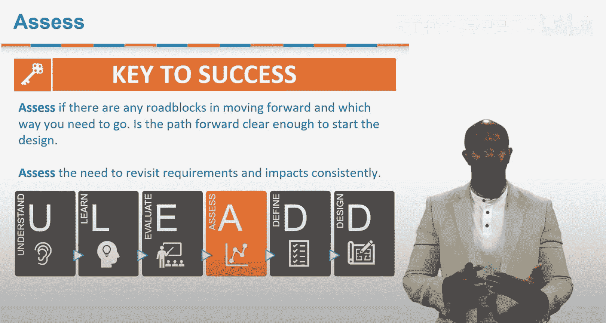

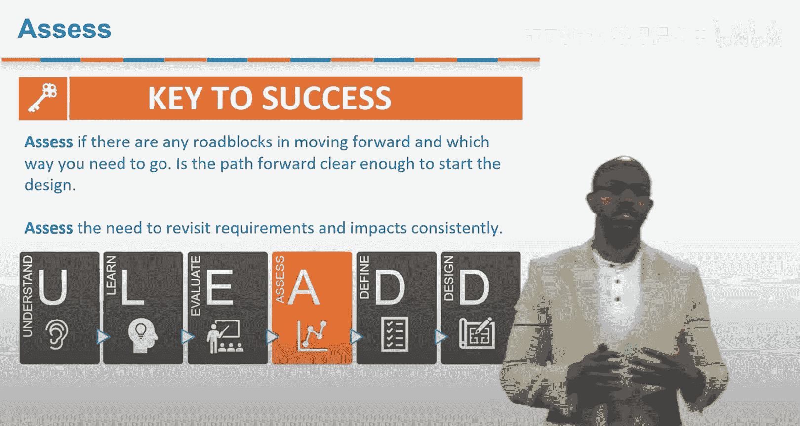

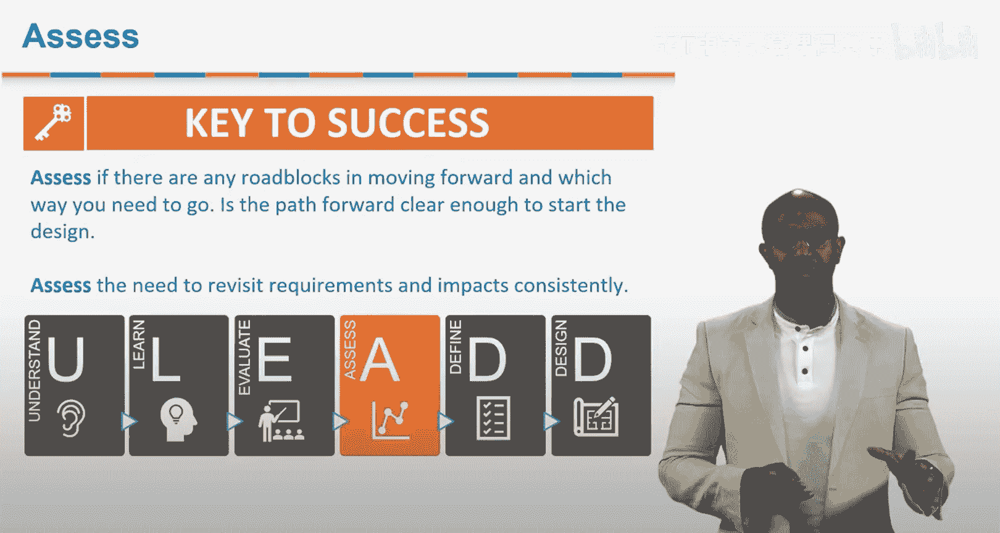

And they're dealing with the technology organization and they want to build a platform to help them better do analytics on marketing analysis。

 segment analysis， they want to target the customers better。

In the same vein as most leadership discussions， they keep it completely high level。

 so as it goes down the ranks and the engineers get to it and try to build something out。

The view or vision of something can be very vague at times。

Especially if folks sort of just know what they've seen before and want something similar but better and a lot of times we get those type of conversations where people sort of think and look at technology or dark data and data in general as you put some information in and you get a different result out that should help you better make decisions better position and better perform right so here you pretty much have the CMO asking for a UI for marketers that helps them help them better target prospects in any specific market。

嗯。And a lot of times when an engineer or technology organizations or people who are more data centric here that someone needs a UI that helps them you know look at information。

 you know we sort of think here's some data， let's build out a UI that allows them to query and you get these user interfaces that are pretty much totals like it's a total of total number of prospects。

 total number of customers here's your trend line or trend analysis over the year and this is how that differs from the year before those are the types of things that you typically see and that's sort of what the CIO looked at what was asked and put back out。

But the thing is。A lot of times those things are sort of at this point in the landscape of technology。

 those things are sort of normal right so when you think about a dashboard。

 everybody's going to have a trend analysis everybody's going to have a total number of customers versus this year versus last year last month versus this month those are your standard analytics those are not really numbers that you can use to gain a competitive advantage against a different company so at the end of this dialogue here you sort of see the CIO saying well you need to be more specific。

We don't have prospect data， and that's something we'll have to go get and build a whole new data layer so the build is different。

 there's a lot more effort involved。Something like that that actually provides a competitive advantage could take a year or more。

One thing that you would want to think about is。Are you looking for a competitive advantage here。

 that's a question that you should ask at that understanding phase。

 at the learning phase when someone asks for something。And then understand what the competitors have。

So this way， you can see okay， they just want the basic bare bones type of thing。

 or do they want something that gives them value where you are transforming data using data that is unknown and then creating data that was unknown before。

Such as taking。You standard customer versus your prospect and understanding which prospects didn't actually get approved。

 How can we cross sell them。Which ones have more of a probability cross sale。

 and then what attributes are we using to determine the probabilistic nature of any prospect？

Those are the type of metrics that would give you a competitive advantage because from the lens of whatever organization you're in。

When you think about prospects in converting， depending on your application。

You could have specific things related to your company that can allow you to gain a competitive advantage and allow you to move forward better in that space。

So moving into the last two， define and design， these two are more well known。

 a lot of people know how to define a problem or define a solution， going to solution management。

 and then going into designing a solution。

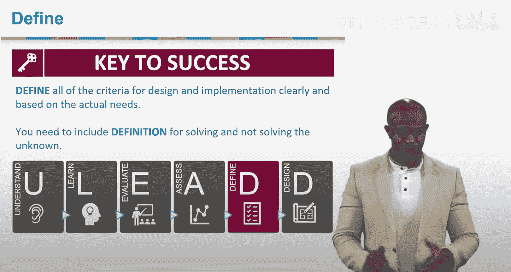

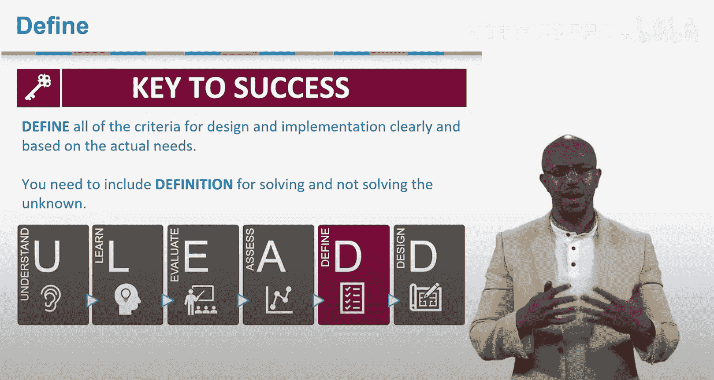

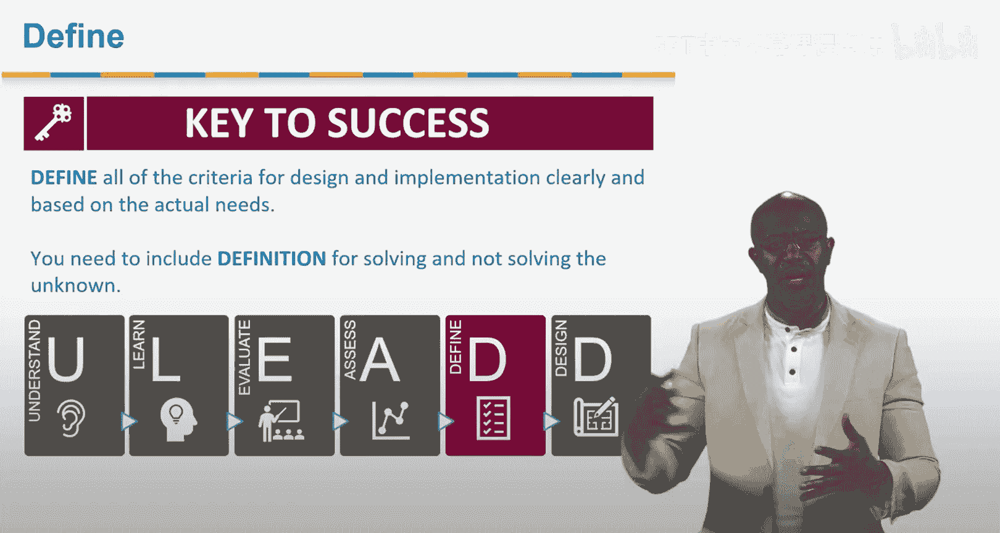

So to some extent these the definition or the walkthrough of these two will be a little bit more simple。

 however， I do want to call out a few differences， so when we think about define here is。

We are again taking that look back to making sure we understood what what was really needed。

 Are we looking for a competitive advantage are we not are we looking for MVP。

 are we looking for an expanded MVP or a narrow set are we trying to build the plane while we fly it right and most organizations sort of do that So when we think about define once we define it we still need to consistently validate So within these two stages。

 there's an iterative validation built into them right so as I define I'll define a solution Here goes my full view solution like beginning to end what does the full picture look like。

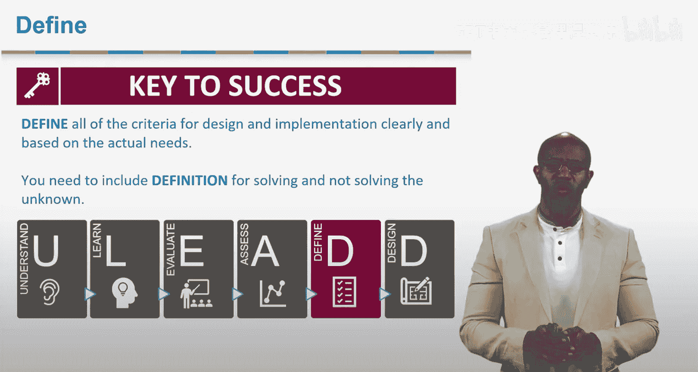

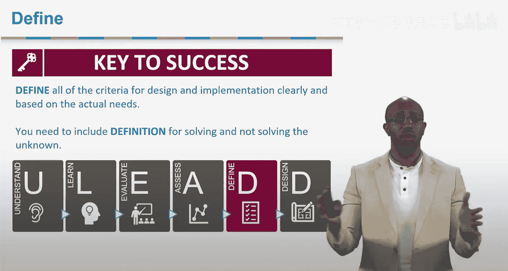

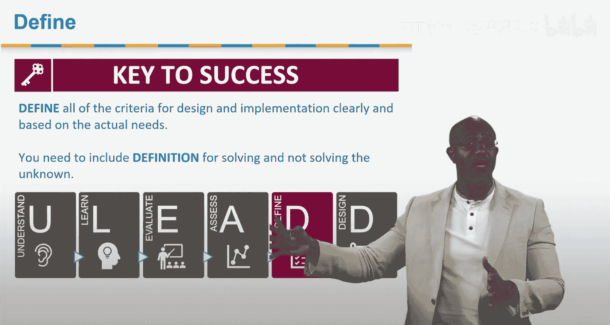

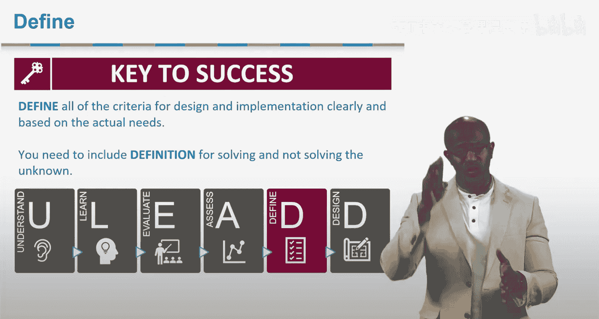

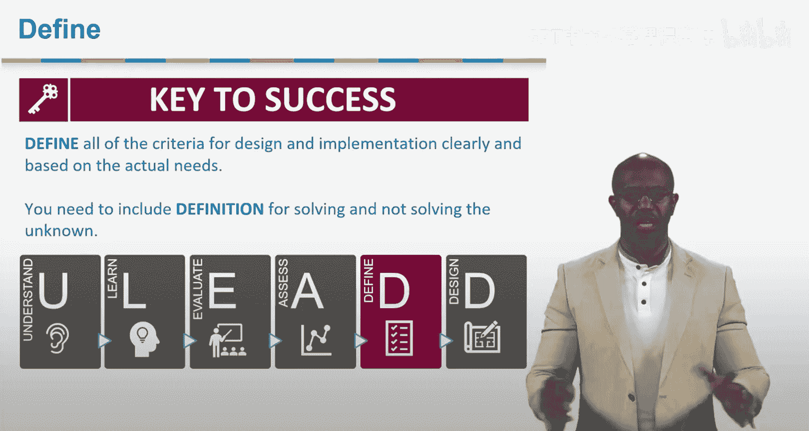

And then from there， we're defining the different stages and all of that's based on the outcomes that we've identified in the beginning and the understanding and learned。

 the OKKRs that we've identified in the analysis。What do we project to happen？

Do we actually plan on gaining sales， Do we actually plan on growing membership。

 Do we actually plan on having a bigger impact and if so。

As we define what we're going to do and list these things out， does that speak to what we expect？

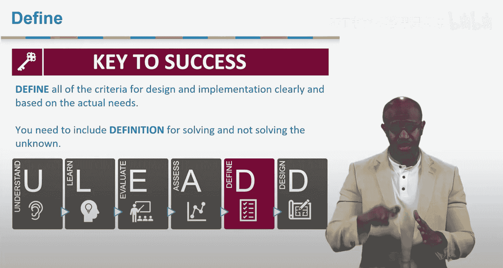

Lastly， as we go into design， once we start building the solution。

 does this speak to that definition， those OKKRs， outcomes， expectations。

 the impacts that we want to have， the overall culture of what we're trying to establish here。

Does the design do that， Is it a system， Is it multiple system， Is it tiered architecture？

 How does that work， Does the performance work， as we use it in terms of internally to the organization。

 Is it fast enough。Can we rely on the system to work more consistently， what's the uptime。

 all those things because all that impacts I then externally as it faces the real world。

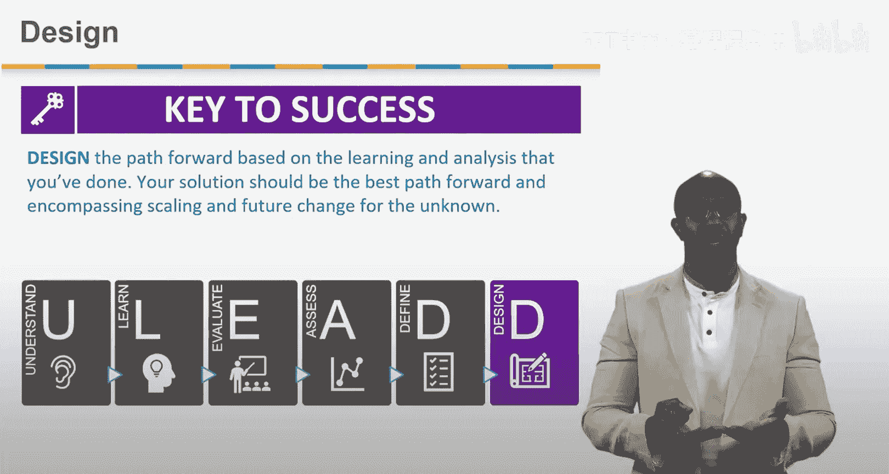

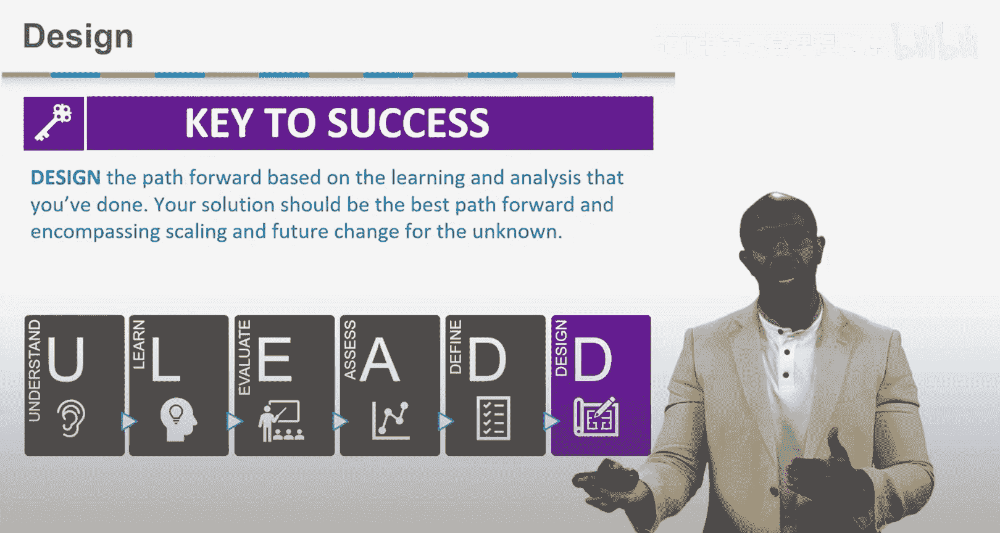

Does it speak to the problems that the real world has and does it perform as they expect or does it perform beyond what they expect？

And what are our expectations for that？Understanding， learning， evaluating， assessing。

 defining and designing， they're all iterative。And they all require validation of each step。

 specifically defined and design， you don't want to get into the design phase and then at that point realize we have to back all the way up to understanding。

 right？

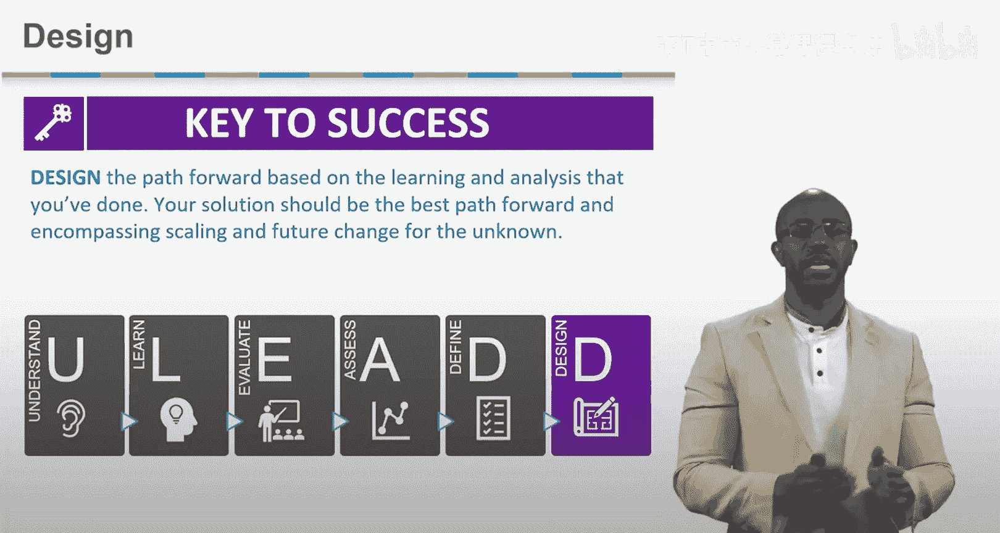

Once you leave that understanding and learning， it's best if you've done that very well and if you need to turn back。

 turn back right and evaluate and once we get to that last defining a design and once we get the sign off for the design and the roadmap for that design。

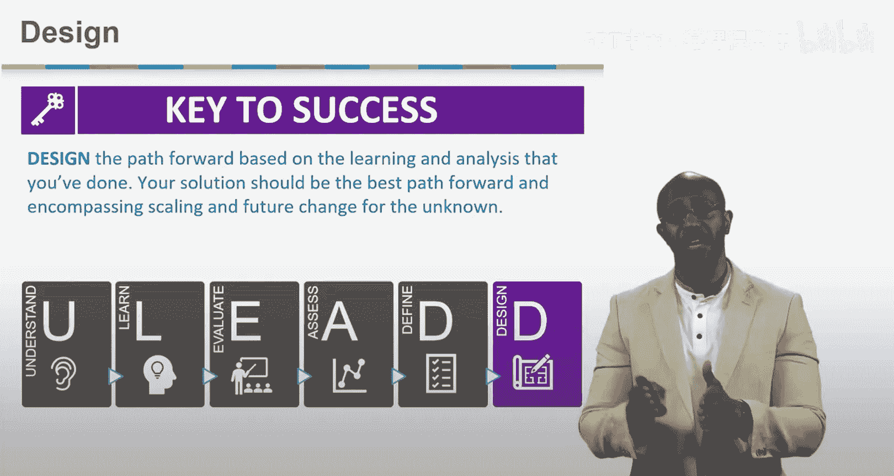

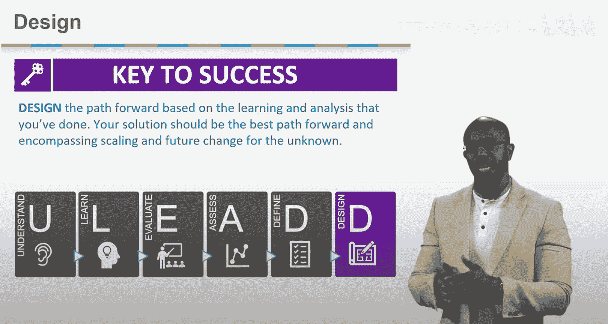

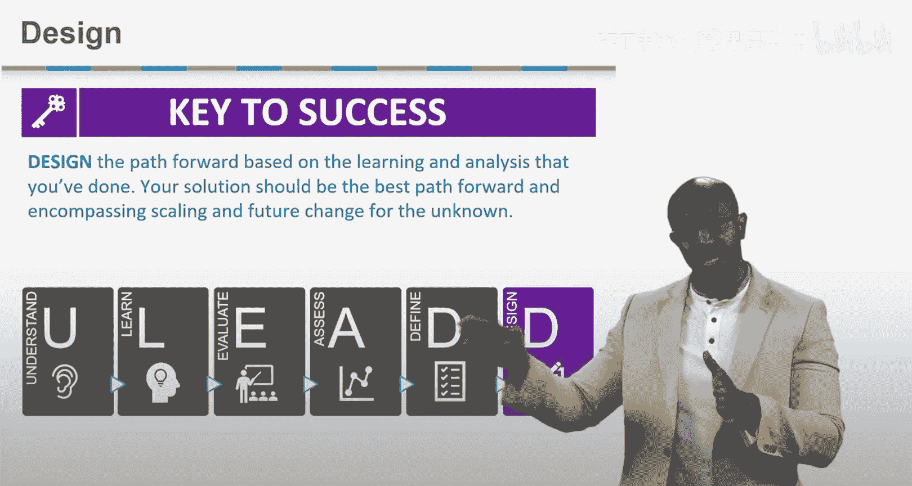

We want to make sure we can go right into development and we can use a number or a multitude of different theories or frameworks to deliver a solution。

 waterfall， safe， Six sigma， scaled agile， all these different all these different ways to deliver something。

 and we'll go over that more in some of the other lessons。

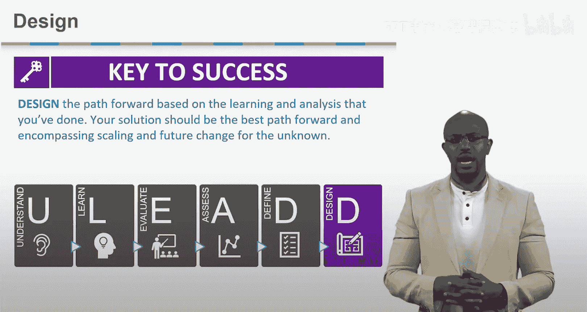

Thank you for your time。