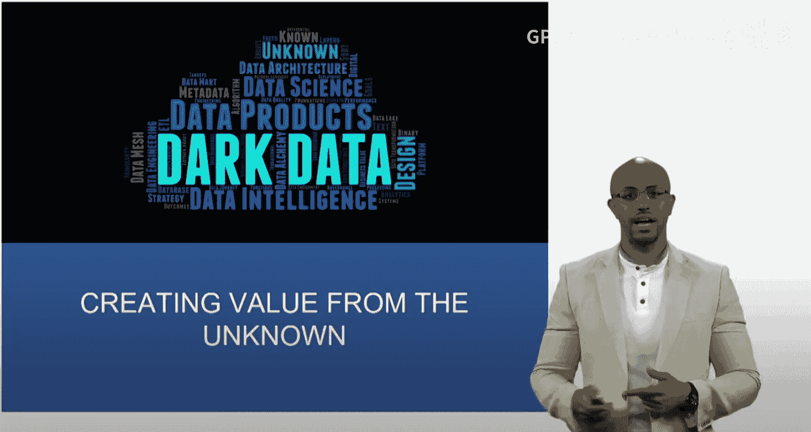
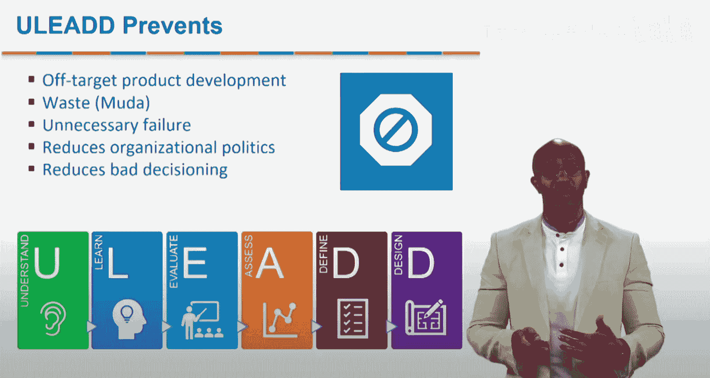
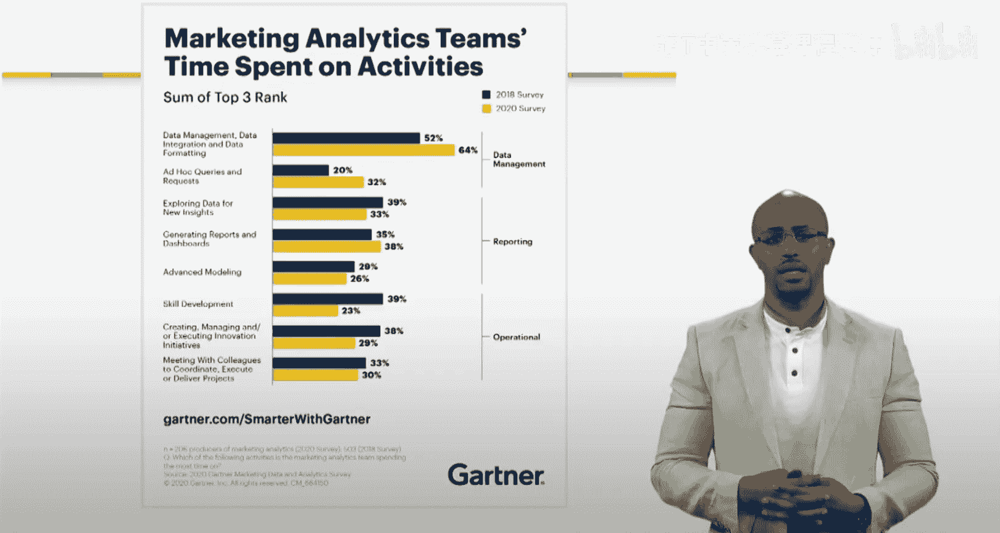

# 亚利桑那州立大学《黑暗数据迁移与架构｜Dark Data Migration and Architecture》中英字幕 p42 4_ULEADD对企业的重要性.zh_en [BV1TkurzMEmm_p42]

We're going to talk about why U lead is important and how to use it to extract value from dark data。

We believe we know what we know。 We believe we know what we don't know。

 We believe we know things that are actually unknown to us。We know that there are unknown unknowns。

 Our competitive advantage resides in our ability to rapidly learn the unknown and the ability to create value from it。

Now， this serves as a basis for how to approach dark data。 why it's important。

And how we should look at gaining that competitive advantage through the use of dark data and through the use of the unknown。

Some of the benefits of using you lead。For the purpose。Of creating value。Are quite simple。

 and I look at it as four different prongs。It's a clear framework for discovery。

 standardized approach to problem solving。Helpful strategies to navigate cultural challenges。

And it allows for a flexible， personal touch。😊，Where you can use your personality， make adjustments。

Work with the personalities of others and figure out how you need to look at solving problems。

 diving into the unknown and navigating the differences between each culture。

And using dark data to extract that value。Now some of the things that dark data prevents。

Are just listed here。 These five plus a few more。So when we look at product development。

 delivery waste。Unnecessary failure。And failure in general。

ULD allows you to take a standardized approach that others can rally around。

 and that also creates more of a team cohesion where we've listened to the different points of views where we've learned from each other and taken the time to do the evaluation and assessment upfront so that we can learn from the data that's out there。

Then we can go into that design and define solution and really start looking at how to create up that business value and drive solutions for others and for the organization。

Now I've taken some data from Gardner。And I wanted to go over some of the reasons why analytics aren't used and informed decision making for large corporations and other organizations。

So when I look at just the top three， data findings conflict with intended course of action。

 poor data quality， and an analysis does not present a clear recommendation， just those top three。

With the exception of data quality， dark data has a huge impact on the top two if you're able to extract value from it。

Furthermore， looking at data quality， there are some edge cases where dark data could help improve data quality in a creative manner。

So when we look at the resulting value。Does not align with the course of intended course of action。

A lot of that can be solved in the very beginning of a project when we start looking at Uli。

Because in most organizations， people already know what's somewhat possible。

 people know what the data says in general， obviously more of the explicit data versus the data that's hidden。

But if dark data is used appropriately， you can extract that value furthermore。

 if you take the approach of UL where at a decision making level， we looked at all possibilities。

Listen to all sides， understood what was going on， learned， and then did the analysis。

It's more probable。 You'll take more courses of action。

Where people can align and rally behind because it's understood where we're going。

Most angles have been analyzed， and we've defined a solution that benefits the enterprise as a whole。

And in the clear recommendations， this happens a lot of times， especially in the absence of good。

 clean data and data that is generally unknown。We face this challenge many times when you the clear path is vague or ambiguous。

 a lot of times we need to be creative in where we go to look for data and where we go to understand the path forward。

And just a quick overview of some of the things at the bottom right analysis taking too long。

 multiple sources of data that conflict the calendar。

 sometimes solutions and in dates are driven as your standard waterfall approach and you know the calendar doesn't sort of fit in with when the solution should be maintained and when you think about that that itself is a form of data。

So when an enterprise says we have problems fitting it into our calendar。

 whether it's promotions or whatever it may be。My first question is。

 but what data do we have around that problem before we can get to a problem of creating value out of。

Other data that's unknown， are we actually understanding why we're not fitting into that calendar or how we can。

Is there any proactive steps we can do to fit solutions into a promotional calendar。

 These are all types of things that questions or questions that aren't typically asked up front。

A little bit more into the marketing analytics and we're talking about you know business intelligence。

 actionable intelligence， decision making data quality， organizational growth。

 etc cetera if we're thinking about how the unknown can help this paints a really good picture of the lack of understanding or the lack of each person looking at the other person's view when you look at your sort of midlevel manager versus your senior management right senior management。

Says that marketing analytics。You know， has not had the expected influence。

 and then conversely middle managers think that more so it has actually has actually hit the expected influence。

And then when you think about the roles of your senior versus your mid levelvel。

 the seniors are always focused on the value focus of the growth， how can we get more out of things。

 so they're more driving the vision and if in their view the vision hasn't been met by analytics。

You could skew that that view is at least more aligned to what was the thinking of the direction of the company。

 And then when you think about mid level。Typically， mid level is more so in the weeds。

 so they're more focused on the success of delivering a solution that then drives the value to a vision。

 which is why they would have more of a positive outlook on it influencing as expected。😊，嗯。

And if you look at this， it sort of gives credence to the view that we might need to take more time to understand and learn。

When we start a project so that both senior mid levelvel and your engineering， data science。

 data engineering staff， et cetera， have a better understanding of where we're going so that these bars can balance out a bit more。

All right， and lastly， when we look at the analytics and the time spent on activities。

 this is really telling as it's looking at 2018 and 2020，2018 in the blue， 2020 in the yellow。😊。

When you look at the data management integration。Activities。

Those activities are consistently growing， and in most of these companies。

 especially with the regulatory environment spinning up and being more stricter。

 those activities are growing more and more and more。So what you're getting around。

 especially let's say， Fintech companies， you're getting regulatory compliance。

 compliance related work being the top priority。Although they're highly important because these companies have to deliver to a certain standard。

 they're not necessarily growth items。They are compliance items。

But that's where more effort and more activities are going steadily each year， each year。

 and then you look at things like reporting， advanced modeling， skill development， creating。

 managing， executing initiatives， things like that， less time are going to growing the business。

 but more going to running the business， keeping the business solve and keeping the business in compliance。

And that also not only speaks to a value statement。

 it speaks to the growing need for business businesses and organizations to gain a competitive advantage。

 So if you're not focusing on these creative things。

 if you're not focusing on advanced modeling AI skills and skills for the staff that actually do this work you can't be gaining a competitive advantage and therefore you can't really be exploring dark data too much Furthermoremore。

 the companies that do have the opportunity to explore dark data， do advanced modeling。

 creative creative works are gaining a competitive advantage。

 So these are some of the things that you'll want to think about。

 as we look at what is the importance wise and impactful。

 like how are we going to do different things， we obviously have to do compliance and sort of the run your business work。

 as it's critical to staying solving but also。When we lose that competitive advantage。

 where do we turn at that point at some point， we have to look at how we can use these new tactics and strategies to then grow the value of an organization。

So thank you。

