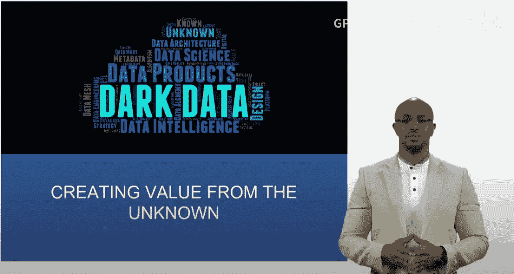
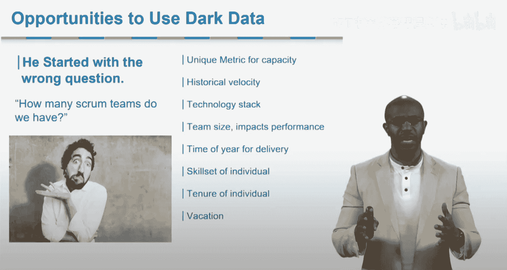

# 亚利桑那州立大学《黑暗数据迁移与架构｜Dark Data Migration and Architecture》中英字幕 p43 5_ULEADD的个人效用.zh_en [BV1TkurzMEmm_p43]

Hi， let's talk about how you lead will help you。

I want to start by identifying the challenges that can lead us to the opportunities。

And then we'll go ahead and figure out directionally。

What may be a good path for you and what is a good path for your organizations now when we think about challenges。

 there's a litany of them these are just a few just 13 that I typically run into there's definitely more and these aren't in any specific order。

Between the people， the humans that work on any project， any deliverable， miscommunication。

 confusion， misalignment， things like that， loss of synergy， non ideal decision making。And as always。

 lack of knowledge in the B game， these are all things that can cause challenges and when we think about how you lead can help。

It by design， encourages teamwork because it encourages us to understand each other fundamentally。

 understand what we're trying to achieve， understand the objectives。

 the outcomes that we expect something to have。And in between all these different areas。Always， lies。

A large amount of dark data。And the opportunity to use that dark data for that competitive advantage。

So when we think about being overworked， not having a single source of truth for things。

 a lot of this can be solved by using you lead as a conduit。To making the connections。

 pulling value from the unknown， injecting that unknown into what we do know and creating more of a cohesive view。

Now when I look at how you leave to help I typically look at these six steps and there are more as well。

 but these are some of the six primary things and they sort of serve as overarching a model for how it helps right because we're typically when we're going into dealing with dark data dealing with creating a competitive advantage dealing with value creation。

 we want to have an impact whether that's societal， cultural， emotional， financial。

 you want to have some type of an impact you want to reduce failure that's another key feature that we want to attribute to the reason why we want to use this and how it will help you supporting efficiency I'm a big automation person automating where it makes sense。

 obviously not where where it doesn't but efficiency。

 automation that's critical the more time you save the more time you can focus on how to approach things and the thinking and then these last three are all about how you think because。

Thinking your thinking， your understanding and what you know help drive the path forward because what you're thinking is actually where the organization goes and I'm talking about collective thinking of the organization So directional thinking computationalal thinking design thinking and under all three of those is your critical thinking right so computationalal thinking is key because we're thinking logical steps。

 orders what can happen thinking through probabilities。

 things like that design thinking helps open our minds to what's possible and directional thinking helps us identify the direction that we want to go and like we said。

 critical thinking applies to each and every single one of them。嗯。So now。

 as we look at the other complementary strategies， These are more focused on the delivery end。

 We're thinking about safe waterfall， rolling wave estimates， three point estimating six sigma。

 the different things that go with six Sigma。 if you need to design for six sigma I， Doard。

 As many of you know， if you've been if you've done any six sigma class。

 Do really is recognize the problem first， then define measure analyzing improving control。

 That's really the approach there。 And all of those help。

 once we come through that define and design phase。

We can pick up right into any of these approaches to help deliver。

 which is why I'm saying when we look at， understand， learn， evaluate， assess， define and design。

 those are more on the spectrum of that discovery， getting us into the right frame of mind。

 getting us on the right path， going through those three thinking stages and pushing into that design so that when we go into delivery。

 we're better positioned， we can do it faster， more effectively and more efficiently。

Now I want to give you this example， this is a typical capacity conversation at a lot of corporations。

 I'm not going to say all but the majority of your corporations。

We'll have capacity conversations that typically start off like this。 your VP comes in。

 asks how many scrum teams do we have or they might ask。

 you know what's our headcount in a scrum team， something of that nature。

 then your directors will just hop right on in there and start giving their numbers。

 their percentages， how their team is allocated you can go down the list the app engineering and this example is the app engineering director here is saying they got five scrum teams。

 three products， know some of the people work dedicated and some of them don't， some of them are 50%。

 the director of cloud engineering， same thing he's going through his two teams。

 the breakout between the different apps， etc。 And then as you look at architecture。

 typically architecture goes across。 But depending on things you could have architectures that have a team that focuses on UI and all these other things。

 but they split between many different projects。 So your architecture team could split between up to 10 projects depending on how your organization is set up。

 And then if you're starting to talk。Capacity and you start off the conversation with Scrum or headcom。

 how do you identify the amount of work going to any product so if you're taking the standpoint of。

I need to understand where our capacity is going because when I look at the prioritization of the work we deliver。

 we need to put the majority of our capacity on the highest prioritized items。Now。

 the big flaw that you see here this example is the Vp didn't start by saying。

We need to put our capacity on the highest prioritized items so that we're delivering towards the company's vision。

And then what you get is a conversation just about headcount。

 And then what happens is people start arguing or debating what the splits and percentages are versus taking a step back and saying。

 you know what， if our goal is to understand how we allocate capacity towards the highest prioritized items。

What do we need to know， understand how do we want to measure and what should be this measure of unit that we're calling capacity so that as we continue down the path。

 we don't spend a bunch of time and wasting time talking about headcount and teams and where people go and we can quickly and easily adjust to the capacity as we need。

So。Opportunities to use dark data in this example。 First thing is， like we said。

 he started with the wrong question。How many scrum teams do we have is definitely not the right question If you want to start with the question。

 what's the outcome。what do we need to do to identify。

If we're working towards the highest prioritized items。

 have we identified if we're working towards the highest prioritized items and how do we know this to be true。

And if we don't have any understanding of it， what are we using or how do we want to think about doing it So a few opportunities do we want to make a unique metric for capacity and if we do。

What do we wantan to use to go inside of this metric， What contributes to it。

Where is the data and how do we want to digest it， transform it， visualize it。Right， now。

If you take this conversation on face， sometimes it looks like you might be starting to create a new system itself to measure capacity。

 maybe， maybe not， maybe you can create a process， but that's part of。

The understanding and learning process， right。Do we need to make a new system or do we need to just piggyback off something that's there。

 Can we use the data that's in our agile management tools or any type of project management tools。

Historical velocity。 What was the velocity of each team team sizes are different。

 How do we want to quantify that。 What's the tech stack。What are the impacts and performance。

Does the tenure of individuals count， Typically， a senior engineer should produce more than a junior engineer。

 but that may not always be true because the senior engineer might be busy helping folks。

Vacation time。 What's the skill sets of individuals。

 What's the tech stack and how does that tech stack impact。The velocity， lastly。

At no point in most of these conversations， do they say。What is the actual work we're working on？

Because that's what we're delivering to。So how do we assess that effort that we have that's applied to the actual delivery。

 the capabilities， features， and bigger work items that we're delivering towards any initiative or company vision or goal？

There's many ways to dissect a capacity conversation。And at the core crux of it。

It relies on that design thinking， that computational thinking， the directional thinking。

And fundamentally， that critical thinking that says were the outcomes， objectives， key results。

 expectations， deliverables。 How do we want to look at this。 What's most important。

How much time do we want to spend on this Because at the of the day at the end of the year。

 we have to deliver on our goals So we have to spend just enough time that we get enough value out of it to better deliver on our goals。

 So these are all questions that you want to ask when you start talking about dark data and just not get into we're thinking about a capacity conversation。

 I get directly into just， hey， here's my team size， and then two weeks later。

 as you saw of that example， two weeks later， come back with the same picture or a worse picture or a picture that we sit there and debate about even more。

嗯。In some of the companies we worked on， we've created ways to create unique metrics for capacity where it might have taken us a month to develop how this works。

 But after that month， decision making became fluid。 Team sped up。嗯。

Organizations were able to pivot on a dime and everybody understood capacity。

 and everybody understood how to adjust their capacity and it was very very fruitful because it allowed folks to for the first time see are we actually working on what's prioritized and are we not？

And can we make those adjustments， deliver faster or deliver more。

 make more change and have more impact。 That's what we're really going for。 So thanks for joining。

 Thanks for your time。😊。

