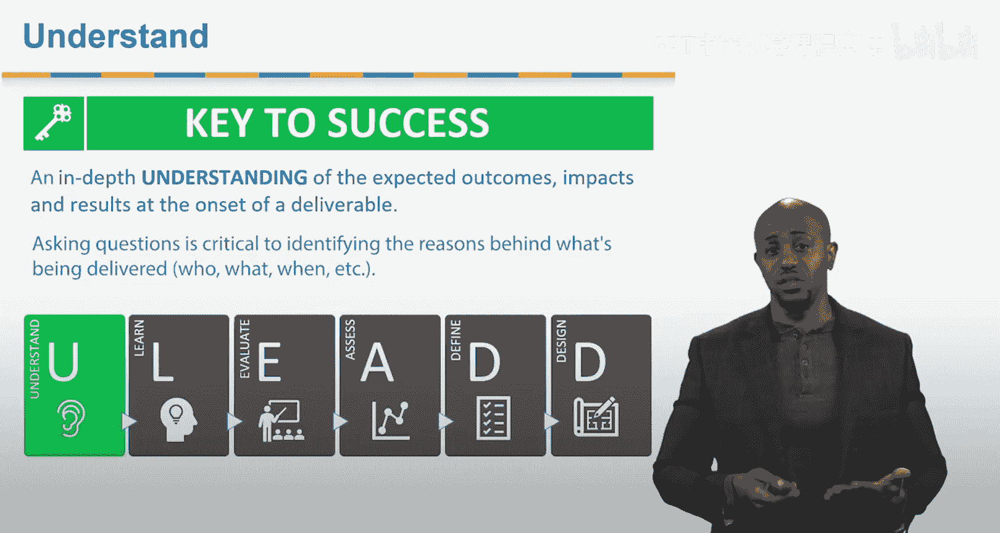
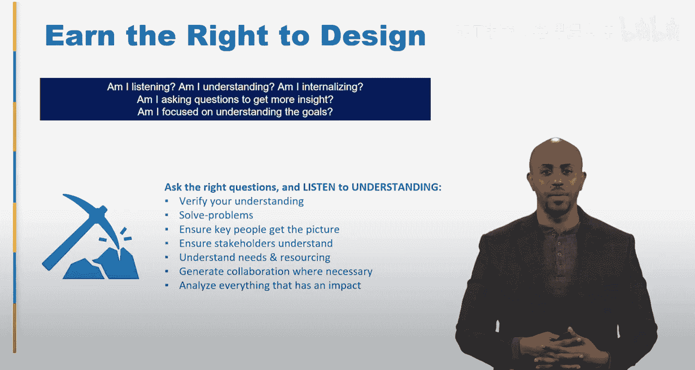
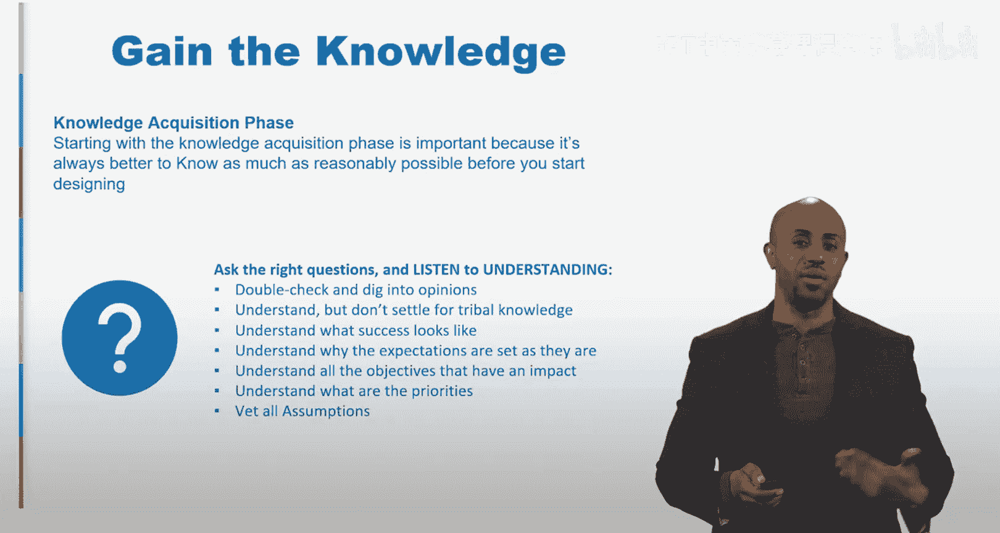

# 亚利桑那州立大学《黑暗数据迁移与架构｜Dark Data Migration and Architecture》中英字幕 p44 6_ULEADD理解阶段框架.zh_en [BV1TkurzMEmm_p44]

Welcome。Today we're going to talk about the first leg of you lead， which is understand。

So in dark data and dealing with anything with the unknowns。Our approach is understand， learn。

 evaluate， assess， define and design。Now this first phase is where we kick off and set the tone and set the precedent for how we're going to approach these problems so that we can position ourselvesse for success early and often。

Um， when we're looking at delivering on projects and we're delivering on things where we're dealing with a lot of unknowns。

We want to think about taking the time to set up the business case。And or the problem statement。

 in a way that we all understand， we all can learn what's missing， what's not。

 and we can all integrate and work through the assessment phases to define what the actual problem is。

 define what the solution should be， define the expectations and then be able to deliver a design through a design thinking。

 computational thinking session and or follow it up with critical thinking to then serve to the end consumer so when I start a new project and we're trying to deliver to something with a lot of unknowns。

 one of the first things we do is look at how do we frame our mindset to approach the problem open without getting into early decisioning。

So one of the things we think about is earning the right to design。

And starting with asking ourselves an introspective questions such as am I listening am I understanding。

 am I internalizing what's being said and what's being given to me as a problem statement am I asking the questions to get more insights and dig deeper am I focusing on understanding what the goals are to the end consumer and to the user of what is being produced thinking through the unknowns requires us to better understand the gaps in our thinking and the gaps in the thinking of our audience So one of the right one of the things you want to do first is listen early and often take time to understand and internalize what you're doing look at how you want to go about solving the problems there's also the the concept of looking at the how in solutioning。

 but there's looking at how in understanding and solving the problem as well So we want to make sure we ensure。

Ensure that the key people， the right people are in the picture to help frame up the。

 the problem statement and what we need to do， and we're collaborating。Early and often as well。

 right， because we need to get into a place where we're set to begin the analysis process as soon as possible。

The next thing is really。As a part of this understanding process are you gaining the knowledge that you need So not only are you working with your team and the people there。

 everybody in the room doesn't know everything that needs to happen and everything that needs to be known when going through these types of processes So one thing you want to think about is gaining knowledge from outside sources or not obvious sources to help with solving the problem right So if you're working in a corporation。

 if you're working in a project team and you're doing science work。

 whatever it might be you and your group still are always operating on limited knowledge So one thing you want to think about or what are the things that we're not thinking about what are the expectations。

 how do we bring in new understandings that will allow us to operate better and what does success look like how do we get to the place where we meet expectations where we have an impact and where we can get to success that people wouldn't think we could achieve it's always。

Good to perform。Perform well， but it's another thing to perform to a higher level and a higher standard。

So there are some people on this planet who typically defy the odds and when we talk about what are expectations。

 people don't typically expect athletes such as Tom Brady to come along and become one of the greatest of all time。

 not very athletic。But he's definitely proven his worth people don't expect people to perform well into their 40s when it comes to athletics and some people step beyond what is expected of themselves。

 make no excuses， so one of the things that you want to think about is as a team and as a group as you're working together are you surrounded by the right people。

 have you yourself take it upon yourself to go outside and get the information and knowledge and understanding that you need to add value to the team。

 and once you've added value， how are you guys going to move forward， meet expectations。

 overcome the odds， get to a place where you're gathering the information from the unknown and getting in a more competent space where you can move forward from that understanding phase and into that learning phase。

Thank you for your time。