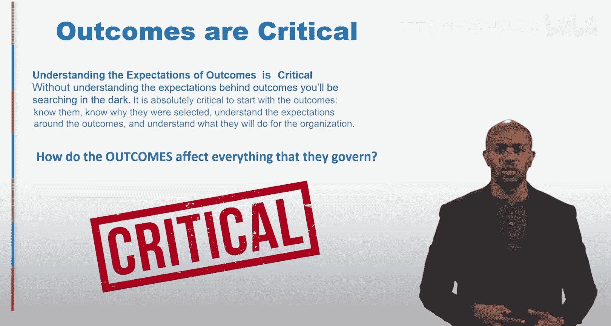
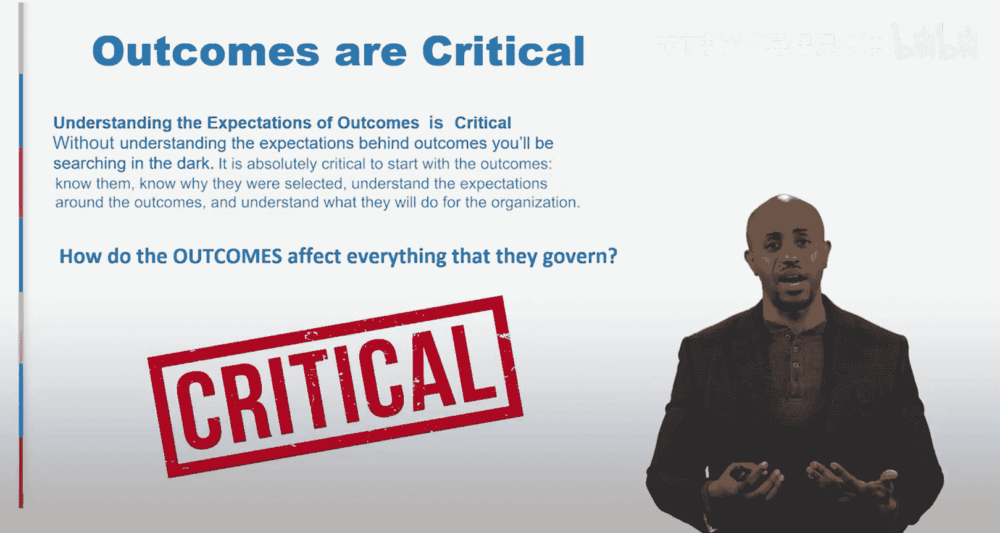
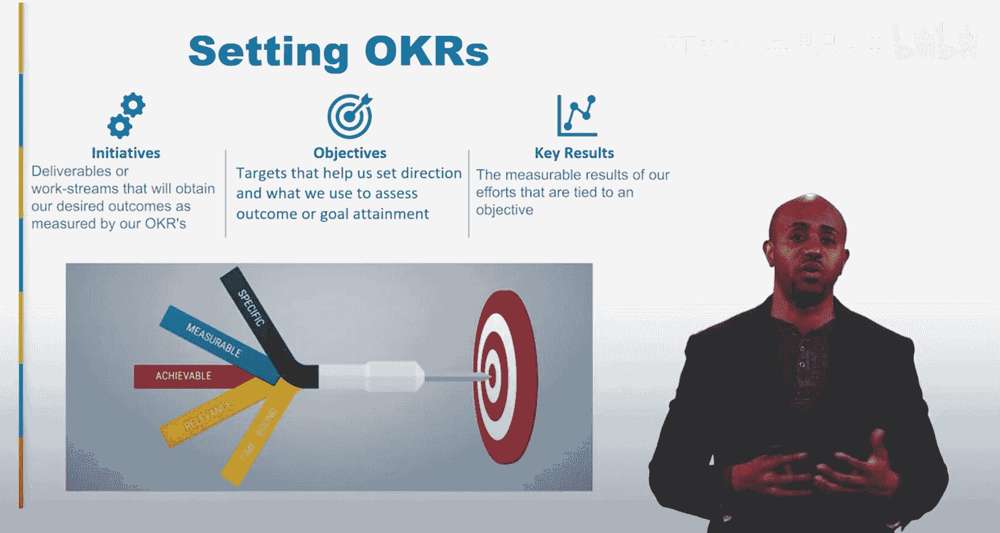
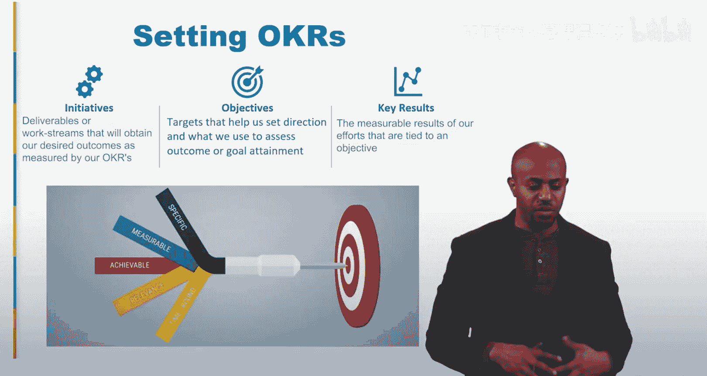
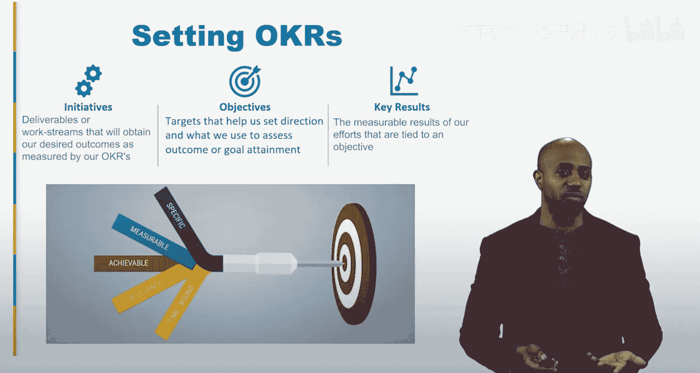
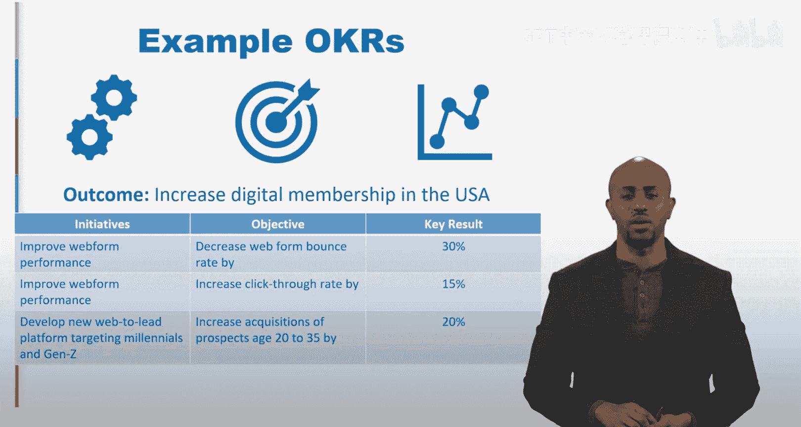
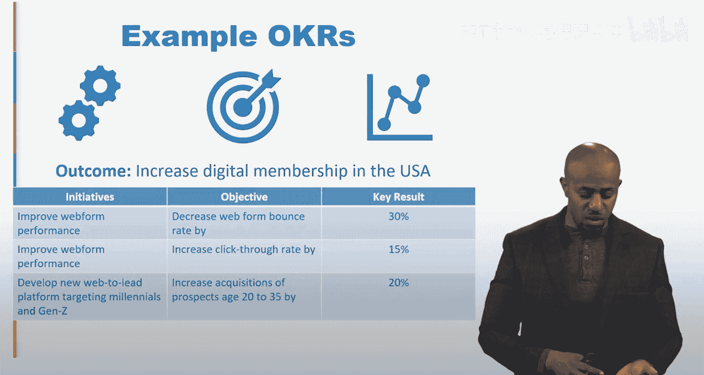
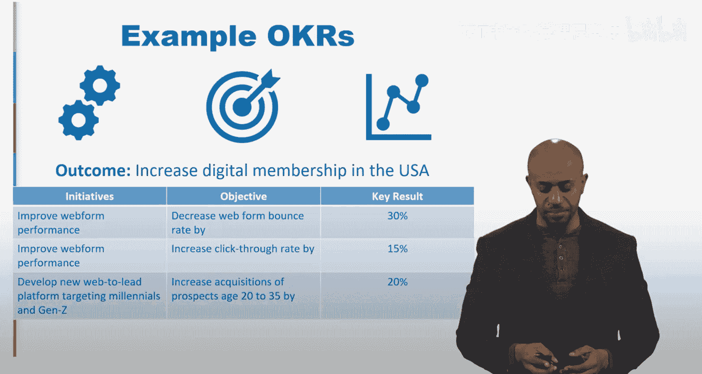

# 亚利桑那州立大学《黑暗数据迁移与架构｜Dark Data Migration and Architecture》中英字幕 p45 7_暗数据价值目标设定.zh_en [BV1TkurzMEmm_p45]

Welcome， we're going to talk about understanding the expectations behind outcomes and how they relate to OKRs and the objectives that we have when we're dealing with dark data and approaching problems and solving for the unknown so outcomes are critical one of the things that we want to focus on is really understanding what the expectations are at the end of whatever we're doing。

And how we can chunk things up so that we can deliver over time and deliver in a more productive way。

 allowing us to use the dark data， the unknown elements， to amplify the value that we can provide。

So one of the things we want to think about as we look at outcomes is how do we deal with setting the objectives and key results that ladder up to them？

So。There's a slight difference when we talk about objectives and key results and outcomes。

As outcomes are a larger subset that are very qualitative and high level in nature。

 such as improving speed to market， such as improving operational and business performance at a root level。

 and other things such as gaining a competitive advantage in a certain industry or marketplace。

 that's a high level outcome， and then we need to understand what those expectations are。

So starting with these OKKRs， if we're looking at initiatives， objectives。

 the key results that ladder to them， we need to figure out what work stream we're talking about。

 so at a high level an outcome that a CEO could be looking at could be you know currently we are number 100 on the Fortune 500。

But in five years。I want to be number 50。It's very aspirational， very difficult to attain。

 It's a very competitive landscape out here。 So some of the things you want to think about is how do we want to frame our mind around doing something like that。

 looking at coming down the Fortune 100， obviously new accounts billing the Ri of our products。

 all those things come into to effect。 So you need to start setting setting goals and metrics that will allow you to attain such an aspirational goal if you're doing something of that nature。

 So things like a brand new product or a product that creates its own new market or new industry or ecosystem。

 Those are the type of industry changing products that could deliver a result of that nature。 Now。

 if we're not thinking more creatively or thinking in the realm of understanding dark data。

We could unintentionally set our OKRs too low， thinking that business as usual with slight improvements could help us。

 it may garnered some results， but it may not deliver on the results that we need to attain the expectations that we set in those outcomes。

So from a standard perspective here is a sample of just three OKRs Now these are objectives and key results with the objective being qualitative。

 the key result being quantitative together they make that OR and together they become a quantitative thing so when we look at it as decreased web performance bounce rate of 30% great we know that's going to help the business we're going to know what's going to help it perform we should garner more business and more profitability off of that same with the clickthrough rate decrease by 15% and same with the acquisitions of a certain target demographic。

And then increasing the acquisitions on that demographic。

 there are a few things you may want to note here when we think about how will we achieve this and are these ORs achievable。

 reasonable。

The first question that comes to my mind is that this example is missing a baseline。

Do we know where we're starting from？If we don't， we wouldn't know what to do to achieve this OR。

So by default what we're seeing here is flaw， we should have a baseline。

 we should understand what the initiatives are that are going to deliver on this and do those initiatives line to it so when I see an initiative like improved web performance and then the objective being decreased web form balance rate by 30% my first question is is this the thing that is most important？

Is it highly prioritized and why？If the CEO's goal is to go from 100 to 50。

In the Fortune 100 or the Fortune 500。My question would be improving performance is at the right initiative。

 improving web performance， will we actually substantially help？

Getting to that outcome with this objective in this key result， ideally no。

So my question would be if I'm working in the web team。

 what should we be doing to help achieve the outcome of moving down the Fortune 100 by 50%？

These are things that you' want to think about as you go through this phase because once you start asking those questions。

 that's when dark data just starts popping up right so if I was to ask this question people will say well we don't have that data we don't have the baseline well we need to go get it。

 we need to go find it right and do we know what the industry projections are for the next few years。

 we need to go get that data and there's tons of data that we need to go find to better align ourselves around the right ORs。

 the right outcomes and then reach those expectations that we want to achieve。

Thank you for your time。

