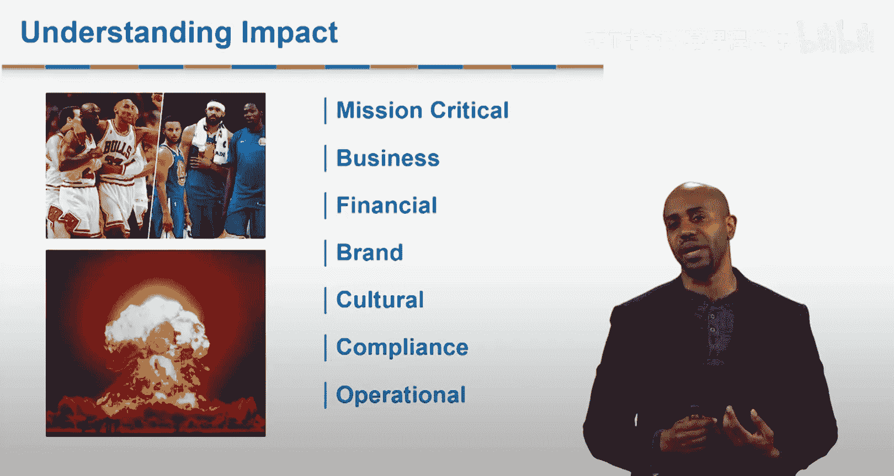
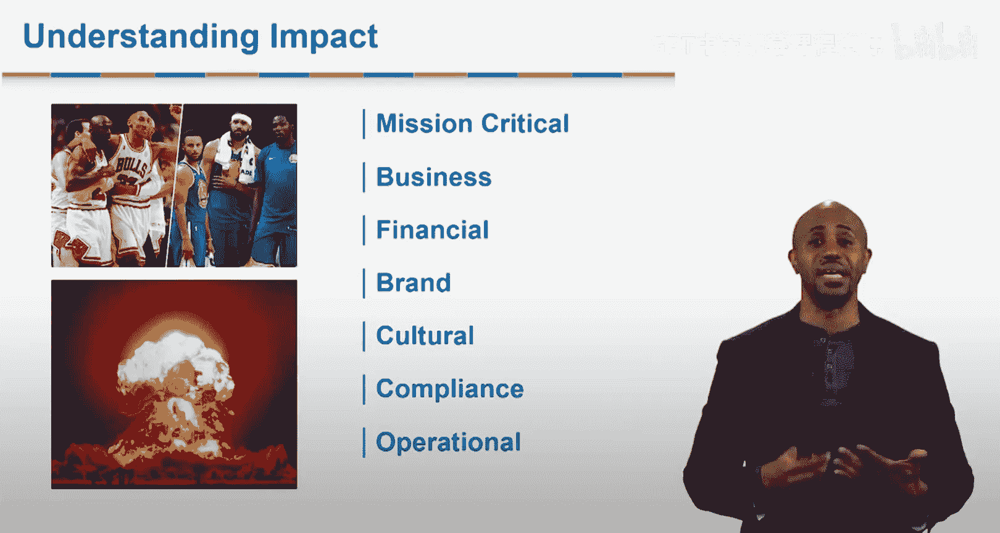
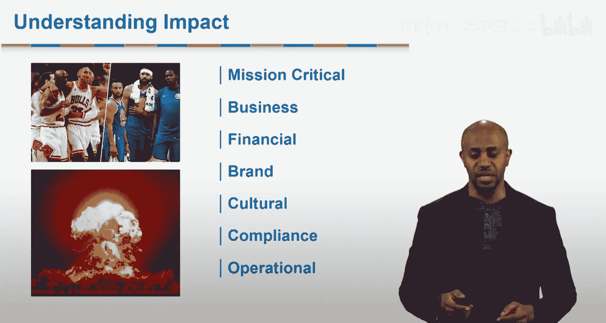
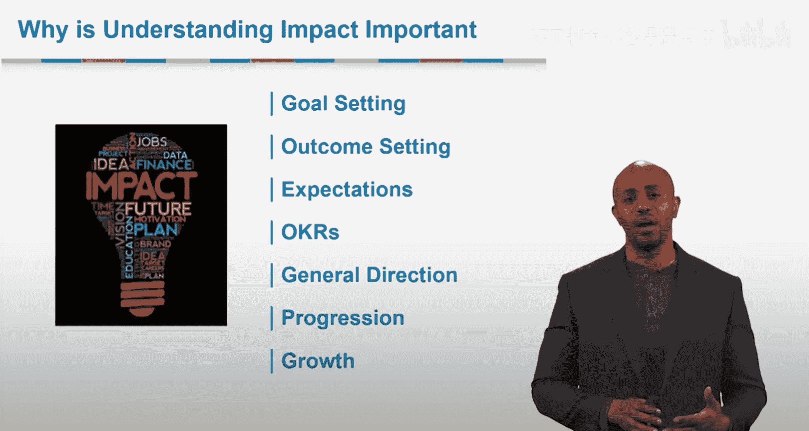
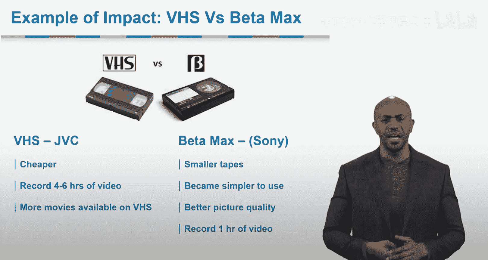
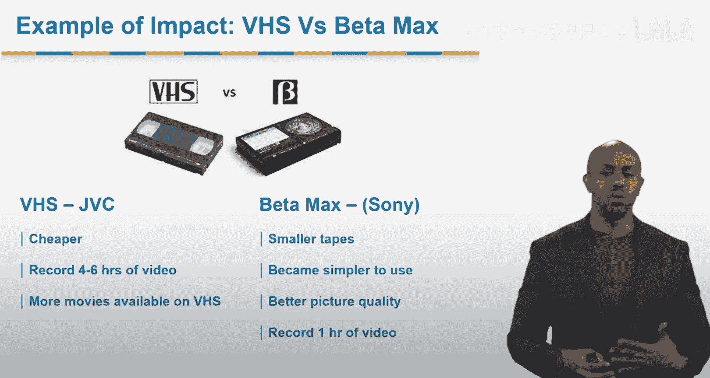
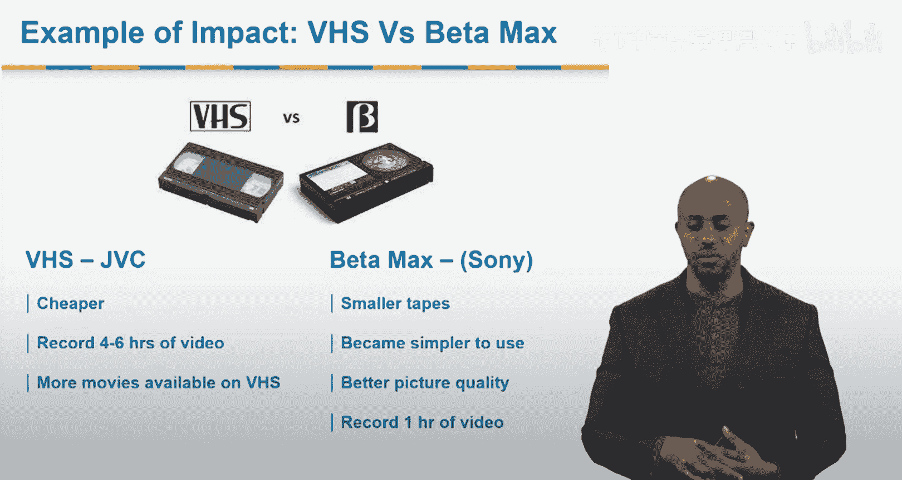

# 亚利桑那州立大学《黑暗数据迁移与架构｜Dark Data Migration and Architecture》中英字幕 p46 8_影响认知分析.zh_en [BV1TkurzMEmm_p46]

Welcome。We're going to talk about the impacts。Of dark data and the impacts of understanding how to get to the useful dark data at the beginning of an endeavor。

So。There are a few ways to look at how you can impact a project， however。

When you look at the spectrum of the types of impact you can have。

 you can have one where you can be Michael Jordan， Scotty Pippin。

 or you can have another where you're Steph Curry， Kevin Durant and the whole Shashooters in Golden State。

Um， you definitely don't want to be the atomic bomb。And far too often in projects。In teams。

A lot of times not really understanding each other， not really planning right。

 not really understanding expectations can cause that whole atomic bomb scenario。

 so some things you want to pay close attention to。

Is what you're working on mission critical and if not。

 what is and how do you frame the minds of the people around you to focus on what's mission critical and how to achieve that？

It is what you're focusing on more business focus， financial， brand， culture， compliance。

 operational， what is the focus that we should have and how do we make sure everybody is playing their roles and understanding the things that we all don't know and bringing everything in together。

Looking at why we understand the importance of impact， right？Looking at goal setting。

 outcome setting expectations， OKR and then the overall general direction。

 these are ways to really dive into how we're going to be successful in the long term。

When we think about dark data， when we think about the unknown。

 there's a lot of analysis and research that needs to be done up front to understand those baseline。

 understanding how we're going to achieve， what's achievable and how to break that out in a way that we can achieve successfully over time。

A good example of impact is VHS versus Beamax。Beamax was in the industry first。

 Beamax was leading the industry at one point， Beamax was made primarily by Sony Beamax itself was a simpler tape to use。

 it was more friendly to the user， it was smaller， more compact。Honestly。

 beamax was overall a better product。At face value。But the thing that really took VHS to the top。

 not not just the fact that it was cheaper， they competed on cost， yes， but it was the fact that。

You could record。You could do your home recordings for four to six hours and there were a ton of people My family included back in the 80s that had these long VHS tapes of you know family picnics。

 birthdays， Hanukahs and things of that nature and then they also had a larger catalog。

 there were more movies available on VHS so with Beamax， I mean you got one hour of video。

And the picture quality being better was of no consequence。

 It was the fact that there was more utility for VHS than there was for Beamax。

Regardless if the product was better。 Furthermore， there was also more content available on VHS。

 So when you think about the utility of the product。

 VHS was head and shoulders above While Beamm had VHs beat on everything except for utility and price。

But that's what the consumers wanted at the time， so VHS won the war versus Beamax。

 there's other examples， I'm not going to go through all of them， but when you look at the evolution。

Of products over time， VHS then lost out to DVDs， blue rays as you go up the line。

 And now when you look at content of movies， etc cetera。

 you're doing all the recording on your phones， and then you're looking at the content online through streaming services now So over time there were other wars other media awards。

 recording wars， etc cetera， similar to VHS and Betamax but VHS and Betammax are one of those business competitions that are sort of synonymous with failure and success synonymous with impact that can be atomic or impact that can be more of the synergy of Jordan Pippin or Steph Curry and Kevin Durant。

Thank you for your time。