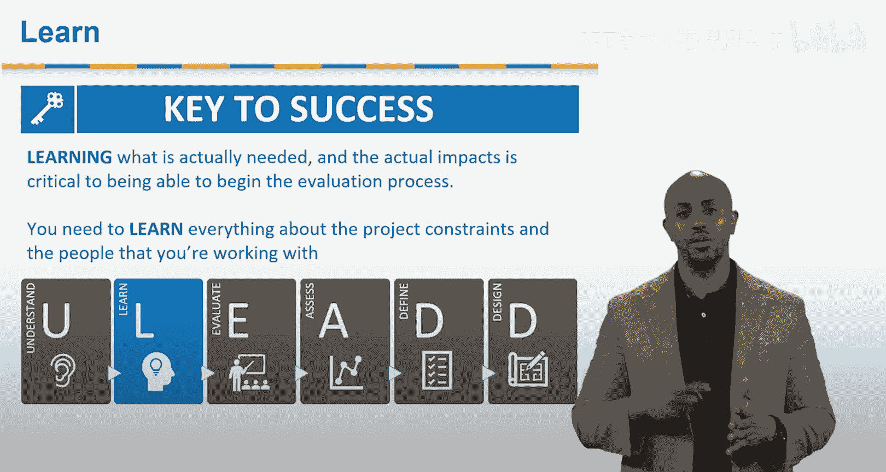
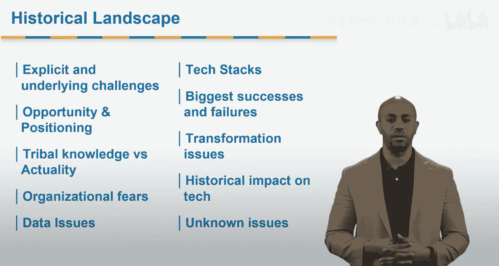
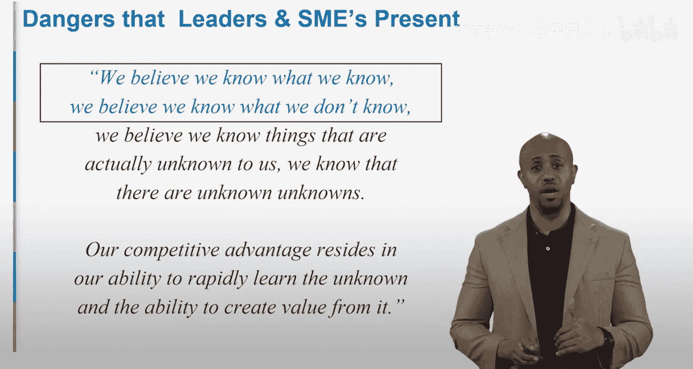

# 亚利桑那州立大学《黑暗数据迁移与架构｜Dark Data Migration and Architecture》中英字幕 p47 9_ULEADD学习阶段总览.zh_en [BV1TkurzMEmm_p47]

Welcome， we're going to take time in this lesson to focus on the learn aspect of you leadE and we're going to have a laser focus on learning the landscape as the first thing that you need to do when you enter this phase Now the reason why this is critical is because this is where you start to weed out tribal knowledge things that you know people might say that are 100% true or partially true and be able to understand where you can inject dark data as we start going through the evaluation。

 assessment， define and design phases。

So taking a step back and looking at the landscape。

 there's many things we need to focus on more specifically if we're talking about technology。

 we're looking at tech stacks there's always explicit and underlying challenges typically you can get some of this from the people。

 some of it's going to come out of data， some of it's going to come out of materials that you can gather that have been presented previously to you what are the opportunities in positioning for the team for dark data to help the success of whatever it is that you're trying to do and how can you cut through that tribal knowledge。

 these are a lot of things that you want to think about and one of the biggest things that you'll want to think about as you take over a new project or deliverable is the historical impact of what people have tried before have done and how that has been viewed and what is some of the language that people are receiving or know about what was done before because if there was negative impacts you could come in with us。

That's different， but be saying things that reminds them of the failure and that could cause hesitancy and pause。

So moving forward， I want to revisit this quote and say that with this lesson in this segment。

 we're going to primarily focus on the first two lines。

 we believe we know and we believe we know what we don't know。

This happens a lot in the learning phase， you're going to work with a lot of SMEs， a lot of leaders。

 a lot of VPs and directors and C level folks who you know have been working in industry for years。

 their current knowledge base maybe valid or may be antiquated but a lot of times there's always those SMEs and leaders who can get in their own way and in the way of progress。

 ignoring the dark data that resides because they've been successful over the years and that success is now acting as a hindrance to progress so I want to revisit this example with the CIO and the CMO where they built a useless product。

So the CMO makes a request， the CIO fulfills the request。

 the CIO's team worked about three to four months and built a product that pretty much tells them things that they already know。

And it doesn't provide any extra value， so the organization is not freeing up the capacity to grow bigger better and faster。

 the organization is in fact wasting its capacity for things that don't provide any value Now in this example that we talked about in the earlier video。

 neither leader took the time to learn what the other one was really asking for and what the other one was trying to build。

So in looking at this example， this is an opportunity for the CIO to take a step back。

 ask a few questions， look at where dark data could have an impact。

And then advise the CMO on which way we need to go just based on a few questions in identifying what gaps are there and understanding of what needs to happen so if you look at the conversation here it starts off where she's asking for the simple UI。

 the CMO just simply responds， okay， so this is what you're asking for。

 what do you want to do with it and what do you want it to do for you。You know。

 typically when you ask that question， people pause for a second and think。

So the CMO comes back with， you know they need to have their analysts focus more on digital products that allow them to see the impact that they have in the market and impact is big。

 impact is a wide category， it could be financial so societal competitive landscape。

 product performance， many different things segments of markets industry。

 the competitive impacts of not having a solution that people need in the market that's a big one that companies don't even focus on so then as the conversation progresses。

 the CMO basically says yeah we need all of these things we need to understand how engineering impacts how engineering is tied to the cost。

 the efficiency， the effectiveness as well as the product folks。

Then as the conversation proceeds the CIO simply says， hey listen， we have some of the data。

 but there's there's stuff that isn't productized yet for your use so the data needs to be created some data needs to be found now we're starting to get into the dark data that's where the value is because that's where most people don't explore so when you go find the dark data that's needed when you've created new data and have enriched the data by relationships that were not obvious those are ways to bring dark data to light and lastly there's just going to be some data that's not captive so then in the planning process you'll want to start thinking about how do we solution for that do we simply call it out。

and use like sentiment analysis and things like that。

 or can we find ways to create views based on speculation and speculation that's at least nearer to accurate or nearer to real life So these are things you want to think about when we're thinking about how we can use dark data and how we can leverage just the information that's in front of us from a conversation and the learn aspect of it once you identify what needs to happen。

ItIt's easier to go to the places that you need to find， find the data that's there and available。

 and have that data added to what product you're trying to build， what solution。

 what intelligence you're trying to create out of it。So thank you for your time。

