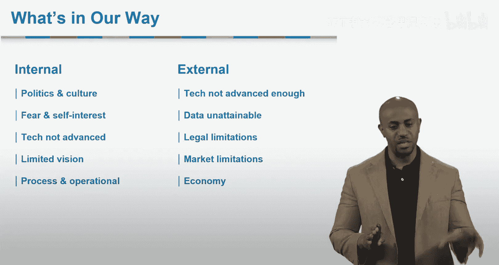

# 亚利桑那州立大学《黑暗数据迁移与架构｜Dark Data Migration and Architecture》中英字幕 p48 10_学习障碍识别.zh_en [BV1TkurzMEmm_p48]

welcome， let's talk about road blocks to stop us from using dark data in a way to provide value。

Now the things that are in our way are twofold， internal。

 external in those categories you can look right down the street。

 you have things like politics and culture internally， fear。

 fear is huge among dealing with organizations that are highly relationship based technology not being advanced and then process and operational issues severely limit the speed which you can innovate。

 use dark data creatively and basically grow an organization bigger， better。

 faster by freeing up the capacity that it takes to fulfill these processes and operational procedures Now if we look at an external。

External impacts and external roadblocks， things like data not being attainable， legal limitations。

 market limitations， and again tech that is in advance to the level to which competitors are。

 which is a slight difference in the tech on the other side， one is specific to the company。

 one is related to the external environment。

So the first example I want to go through is internal challenges when we think about internal challenges you're looking at in my opinion。

 one of the number one challenges is related to fear。

 although tribalism and culture are different fear sort of spans across both and impacts culture and impacts tribalism。

 so understand if you're going to the organization especially if it's a highly relational organization where people have been moving within the company or organization based on who they know more so it's highly probable that the company is going to be highly conservative。

 highly highly fear motivated so in this example。The CDO of an organization， the chief data officer。

 they made some mistakes on previous launches have performed pretty poorly。

 but they have great relationships with the other leaders so they're sort of in a space where they're sort of comfortable they're safe but they don't want folks to know that they've had these mistakes in these faults so a lot of times in some organizations。

 they'll lock down segments of data or systems that have issues and don't allow other groups to really get a view into what's going on and especially if you're a critical position like the CDO。

 you having that transparency of sharing data， creating data models that are federated where people can freely interact with the data throughout the company is critical to the success in the growth of a company so this type of a scenario can stop the use of dark data。

 stop the minds who have the creativity and the power to expose that dark data and。

poose the value in it stop them from being able to apply to company products。

 a company growth and etc cetera so it's one of those things you want to really think about。

 especially when you approach problems with dark data， fear。

 tribalism culture obviously guided by fear is a bad place to be and something you want to watch for and figure out how you can work your way around it and still have the impact that you need。

A little bit more in the culture and looking at this image here。

The people are going to be your greatest asset， the people are going to be the greatest thing that you can use to push technology forward so when you think about the groups of that big data groups the analytical groups。

 people having knowledge of their area， people being fearful of people seeing their mistakes and if you come in with some good ideas on how to use dark data。

 you have to be strategic in how you approach things you have to be really strategic and how you bring people together。

 understand that fear is one of those things that folks shy away from。And。

Be creative in how you collaborate and keep people involved。

 but make sure you don't push those triggers to stop them from allowing new and creative uses of dark data。

So the last example is an external example， external challenges， so with this one。

 we're looking at how the market is performing and how you can grab dark data from the market and use it with your company so thinking through that and looking at data that you can pull from videos right so there are softwares out there that you can use to give you sentiment analysis。

 go through videos identify certain things that you may be looking for in a video in a more automated way。

 pull that data out and be able to put it into your database and then run some analytics I want to put together some algorithms put together some dashboards that allow maybe how you want to see the results of a set of videos or suite of videos and how they've impacted the market this type of new and advanced technology is nothing I wouldn't say completely new but it is partially new on how we're using it right but a lot of this software still needs improvements there are still errors。

There's still some softwares that use video to capture face recognition that have a number of errors allowing for misdiagnosis of individuals when they're coming through an airport or something。

 so it's one of the things you want to think about， stay on the curve。

 the leading curve of these types of technologies and then figure out ways to integrate that dark data into your organization but just don't let the challenge of the software or the application that's generating the data from the video be something to stop you figure out ways to get around the quality issues being。

Data quality checks， finding out which things are wrong or which ones are correct and being able to automate a solution to fill those gaps in data so these are a few of the tactics that you can use dealing with some of these more advanced techniques and thank you for your time。

