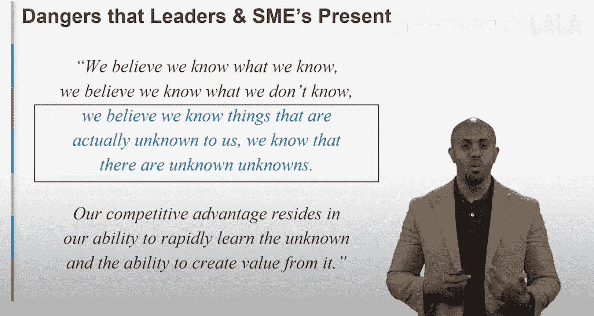
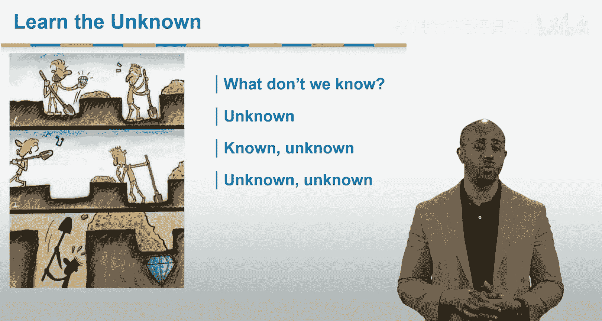
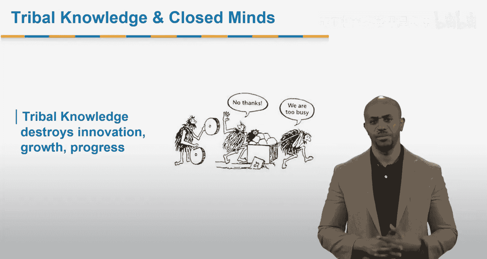

# 亚利桑那州立大学《黑暗数据迁移与架构｜Dark Data Migration and Architecture》中英字幕 p49 11_暗数据潜在价值探索.zh_en [BV1TkurzMEmm_p49]

We're going to talk about what's possible with dark data。Coming back to this quote。

 now I want to focus on a view from leaders and SMEs and the dangers that they can possibly present in working with them on projects dealing with。

Typically dealing with large amounts of data， dark data， unknowns and unknown unknowns。

 So when we look at it， this section of the quote， where we talk about。

 we believe we know things that are actually unknown to us。

And we know that there are unknown unknowns。A lot of times when you're coming into a new group or forming a new team。

 you have people who naturally take on certain roles。

 maybe leadership roles or roles where they may be the high point of knowledge。

 and sometimes the success that they've had will cause failure because they may believe they know things that are not that they do not。

 and then if the group follows them down the path without doing a proper investigation。

 they could have challenges and same with the unknown unknowns。

Even in those cases where we all know we don't know。

 we still typically tend to follow the individuals who have more knowledge on a subject than others when it's best to take a step back and really do that investigation and try to learn what's needed to move forward。

This is an image that most of you have possibly seen and if you haven't seen this image you've seen a version of it。

 it just sort of shows a guy or two guys digging for diamonds。

 one guy hits a small diamond really fast， the other guy sees it and says。

 oh well let me go over here because I haven't found the value that I'm looking for。But in reality。

 if the guy stays in his hole， you see he can have a bigger prize than the first guy who has already left。

The reason why this sort of goes with the dark Davis theme here is because。

When they first started digging， neither of them knew for certain where the treasure was。If they had。

 they would have both tried to dig at the same spot， and even as they keep going， what this guy does。

 he makes the critical flaw of seeing somebody's success and immediately going down their path。

Sometimes that's good。 Sometimes it's not。Typically what's best is to take a step back。

 think about what is the path where you can find your value and it may be following the path of someone else or may in your own lane。

So when I when I look at this image， I think about a few things。

 if I'm digging on side this guy and he finds his value， I would then say。What don't I know。

What's unknown， What do I need to know。And what do I know that's unknown right。

 so thinking through these issues and this issue sort of with the dark data and trying to understand what's the best route。

My first all will be is could I get more people out here to help and share in a prize because some value or some prize is better than none and if we share in it because we're able to get to it we might get to something bigger or otherwise I might get nothing out of it so there's many ways you can go about it maybe you dig up。

Dig down to a certain level in one side and go back to the other， many different ways。

 but there's no sure way unless you took a step back and try to assess what's the best path。

m going in a little bit to what's possible。I run into this mindset a lot in corporate America。

 we need to know what to ask and what to understand， what don't we know what's possible。

 what's possible is typically going to be better than's in what you have in store what you have in mind right so getting more information is getting as much information is possible。

 allows you to understand what that view and what that landscape is。

 and this is the mindset that destroys everybody。Understanding if you're taking the easy path or the best path。

 most people default too easy pressing that easy button if they can and just moving on to the next in the two images。

 you see one image is a bowl of porridge。The other is a feast of seafood， fries， burgers。

 vegetables and other things。Both can satisfy your hunger。

But if you had to choose between the two meals， the majority of people would choose the smorish board in the lower right of your screen。

So when we're looking at what's the best path and what's the easy path。

 you want to stay away from defaulting to easy。Unless it is actually the right way to go。

my thought in as I'm delivering technology and data products。

 I always take the time to understand what's possible first。

 what's the best path and then how do I break up that best path so I can get quick wins on the way that's typically how you go about it and when you're looking at the value creation aspect and you're breaking out that best path you have to find all the value ads where you go and dig into the non obviousvious relationships and pull the dark data in。

Last one， I want to go back a little bit to tribal knowledge and talk about closed minds。Um。

 the first guy who invented the wheel had to deal with people who didn't understand what a wheel was。

So we're all busy trying to go through our daily lives， working on， you know， progressing in careers。

 creating something new and innovative， being able to hit the market with a product fully fully up and running and operational and trying to improve on it consistently do not。

Take the successes that you've had and the work that you had and be close minded to a better idea。

 better possibilities and better ways to deliver your work You definitely do not want to be these two guys on the right。

Pushing a cart with a square wheel， it makes it more difficult for you。

So just understand the tribal knowledge destroys innovation， growth， progress， capabilities。

 things you can do， growth the growth of an enterprise as a whole and individuals and your teams。

 so things to keep in mind and ways to bring in dark data and new aspects of how you deliver something thanks for your time。

