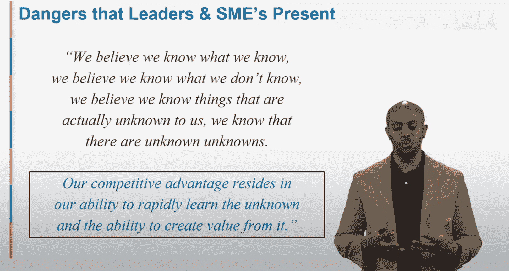
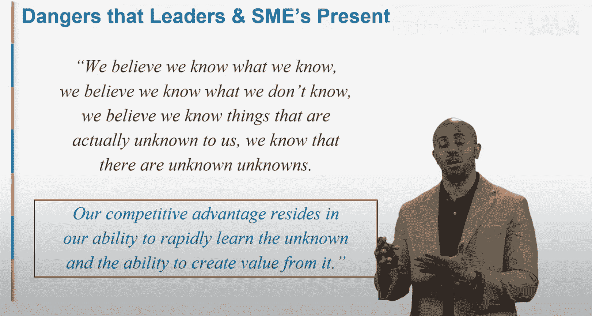
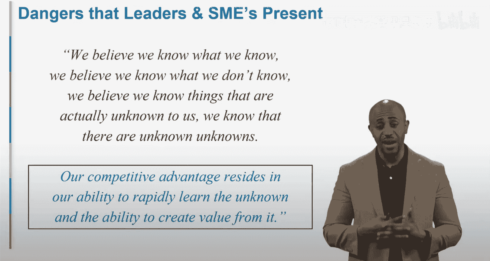
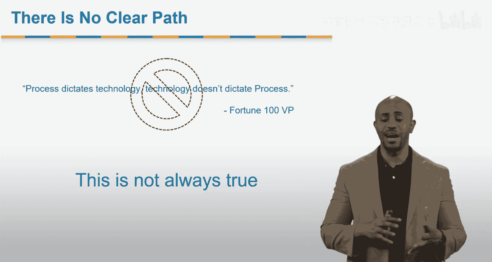
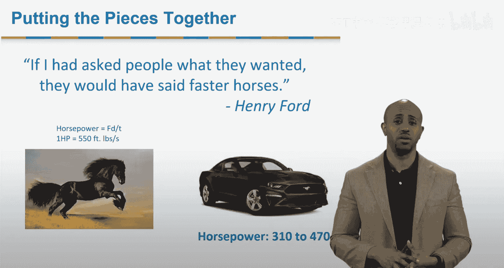
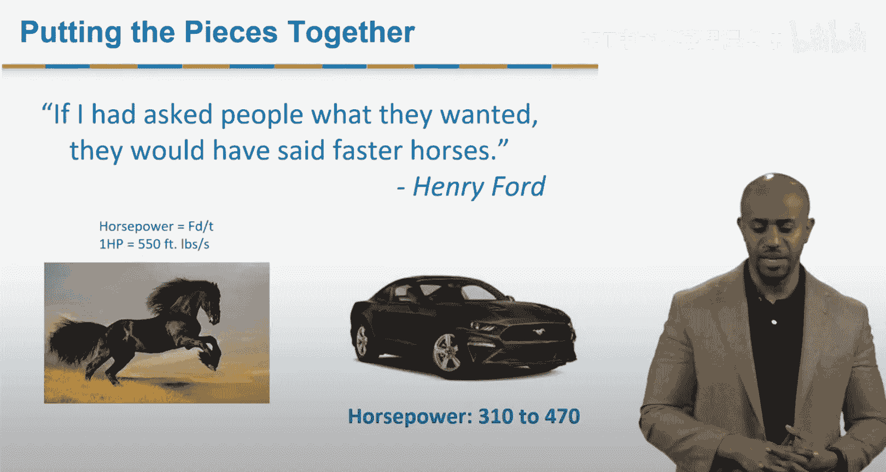
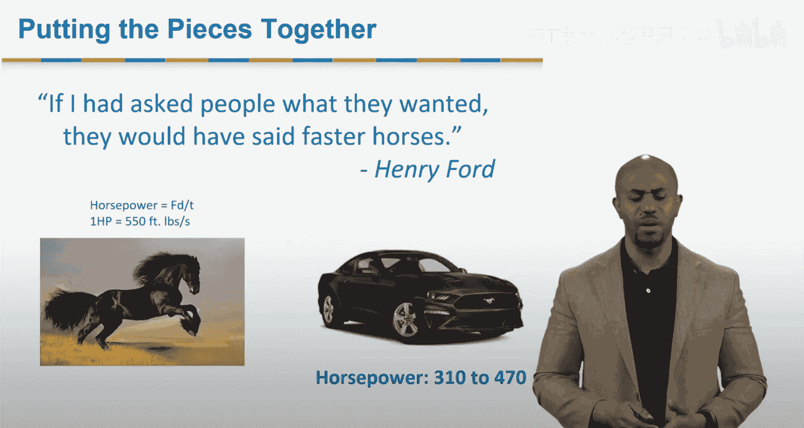

# 亚利桑那州立大学《黑暗数据迁移与架构｜Dark Data Migration and Architecture》中英字幕 p50 12_未知领域认知提升.zh_en [BV1TkurzMEmm_p50]

Welcome， we're going to talk about how to learn what you may not understand。So。Back to this quote。

 our competitive advantage resides in our ability to rapidly learn the unknown and the ability to create value from it。

In many cases， people like to rest on the things that they know and the things that they are comfortable with dealing with。

It's typically a hard process to get people out of those comfort zones and dive into data and processes and changes that aren't familiar。

But if you're dealing with dark data that's something that you're gonna have to do regularly。

 you' got have to figure out how to get people's minds wrapped around it and you're gonna to have to figure out how you're gonna to get your mind wrapped around it because a lot of times in this digital age that's where the value lies so looking at this example disasters with dark data digital RI and this is what a typical product meeting looks like when it goes off the rail because people didn't think about the dark data at the set of a product onset set of a project to deliver a product。

So this is a conversation， a sample conversation that I've actually had or that I've actually sat through with a VP of engineering。

 VP of products and going through the conversation。

You can see where both Vps had the opportunity to turn， turn the ship。 But due to possibly laziness。

 comfort， fear， many other reasons， nobody stepped up asked the right questions and dug a little deeper。

 So starting with the Vp of mobile products， the idea what of this project was to focus on。

How are we going to determine Ri from our products。

 giving the suite of things that go into delivering a product。

The purpose of something like this will be to understand not only if we have an impact in the market but also what are the things we should be delivering。

 how we should be delivering them， when we should deliver them and which things actually have more cost than we know actually right so thinking about product costs and things that are explicit are how much to software costs in general what are the salaries right if there are external partners what do they cost these are things that are traditionally known however some things that aren't known are the cost of the integrated teams。

Typically， if there's one primary team working on something， depending on what the deliverable is。

 there's going to be a number of highly integrated teams So what is their cost to the product Also。

 what's the time cost。And in thinking about this， what are the things that slowed down production of this product and then synergistically the products that are running parallel。

 did the release of this product slow everything down， did it cause problems with the system？

Did we build tech datanecessarily， These are all things that impact Roi when we think about it in the long run。

 So in building a product that is meant to determine Roi。

 these are all the conversations we have to identify and then how are we gonna get that dark data from integrated teams right because from integrated teams。

 you can't cost the whole team， you have to cost part of the team and then in dealing with random software packages。

 ones that are small and large， you got to bring those in and then dealing with the time value of money you know。

 because people come on， people come off of a product。

 if something if something went longer than expected。

 could we have delivered something more impactful in a shorter period of time。

 maybe iteratively and could we have delivered the core product in a shorter time iteratively。

 these are all things we got to think about when we think Roi So when they started this conversation。

The engineering VP ask， how does he want the cost calculated？

And the the mobile Vp just said total up the three main things。

 nobody asked about all these other details， the things that are typically unknown。

 So as they went through the process， they really， they ended up finding out that。

There's data that's unstructured that they need to add。

 there's data that should have been structured in a certain way that they need to add to the equation and there's things that they need to go find out。

 and then the product VP simply ask， well why isn't the data structure that way and the whole purpose of the product is to return ROI and consequently the response is well you're the product VP you should prioritize that。

Which typically makes sense， however， if we're working in a partnership we both have to have the conversations be open enough to explore the possibilities so this is how disaster happens is how disaster strikes。

Moving forward， this isn't one of those things that just has a clear path。

 you have to know how to dig into the answers and this statement comes from a VP of a Fortune 100 Finech Fortune 100 dumps working with her on a project and。

We identified how we can eliminate an entire process using technology and get better results。

And before we implemented it， her first comment was process dictates technology and technology doesn't dictate process and she did end it also with always。

I thought about that a lot because you know， when you go through school and business school。

 you know， you hear that comment a lot that。Process dictates technology。

 but the core fact truth of the matter is that that's not always true。

Depending on what the product is， what the project is， what the process is。

 and specifically if you're in engineering and engineering and in a lot of cases it's not always true because you can engineer a new technology or you can engineer a new process that can replace the old one。

For example， if we think about things like travel process。At different times in the world's history。

The process to get from New York to Georgia was completely different in 1805 than it is now。

If we let the process dictate the technology， we'd still be using horse and carriage。

 so that goes into the next example from our good friend Henry Ford。

 and when he launched the Model T， people asked， how did you come up with this and you know he went through a whole news presser and he simply said if I asked people what they wanted they would have told me to give them faster horses"。

So I know we're all somewhat thankful that we're not riding horses now。

 but now we have things like the Mustang， Shelby， camas， you know。

 all different types of cars that you may want， but the point is，Historically。

 we use horses to travel or land。Given technology， engineering， process engineering。

 we were able to move from that to cars， cars had been around before Henry Ford。

 but he put together the assembly line， which put together a number of processes that were preexisting。

 he added a few and was able to start mass producing cars for the public where previously people thought cars were luxury items that only the wealthiest could afford。

Later down the line， airplanes became a very fast mode of travel。

 so if we want to travel from Hong Kong to New York， we can catch a flight。

 be there in a day less or less， right？

Historically before planes you have to catch a train across the country。

 go from New York to LA in LA you have to take a boat across the Pacific and get to Hong Kong that would definitely take you a substantial amount of time so even when we think about the travel process。

Understanding what people want， understanding what's possible。

 taking the dark data that's out there and putting non obvious relationships together like Henry Ford did。

Saw different processes that were made in other companies。

 put those nine obvious relationships together， made new processes。And created the assembly line。

And from there， we're able to get cars just using simple， dark data。

 common sense and keeping an open mind of what's possible。

Thank you for your time。