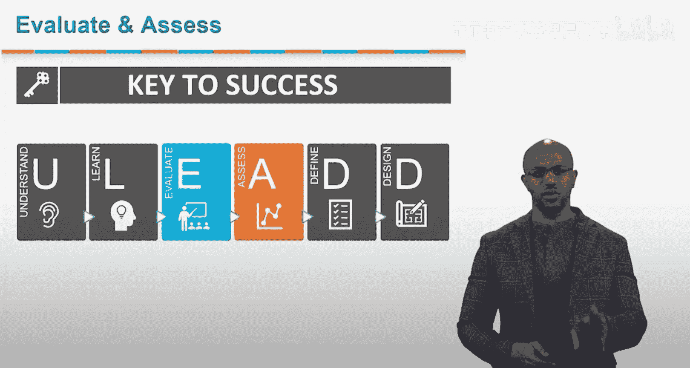
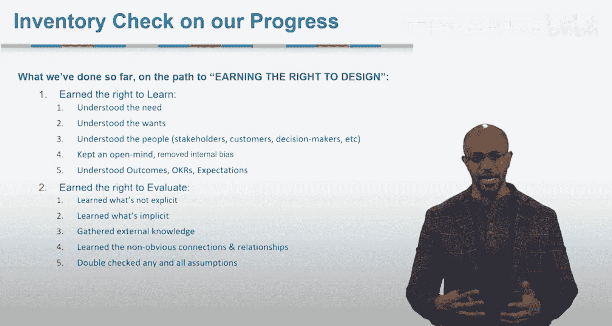
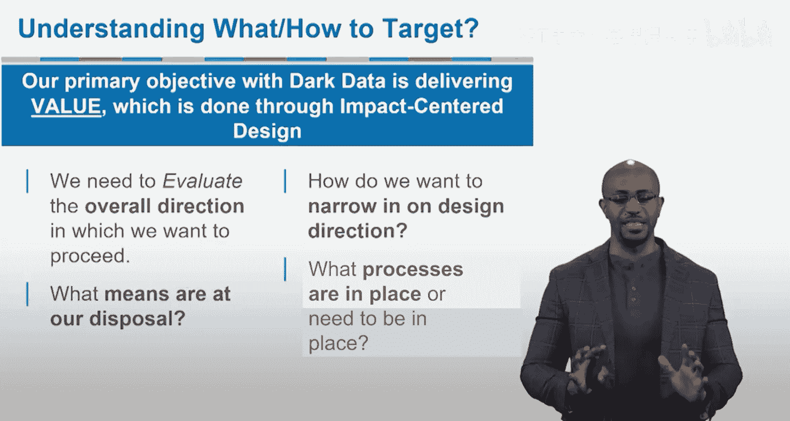
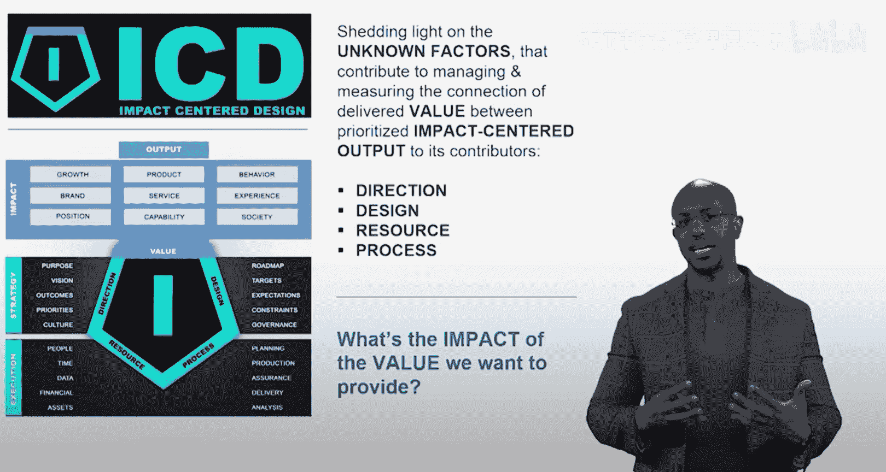
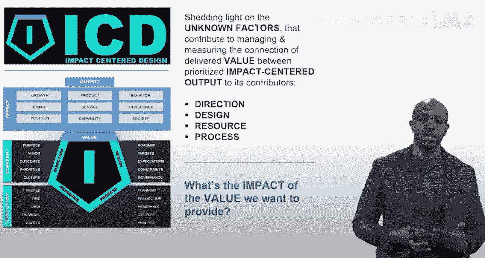
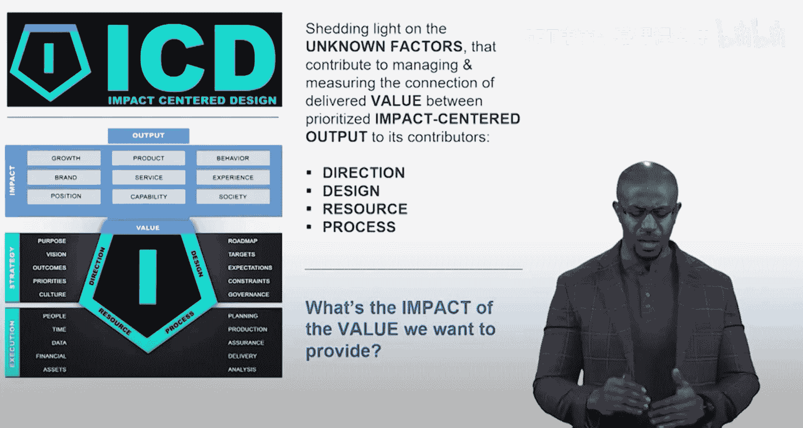

# 亚利桑那州立大学《黑暗数据迁移与架构｜Dark Data Migration and Architecture》中英字幕 p51 13_影响中心设计：暗数据目标定位策略.zh_en [BV1TkurzMEmm_p51]

Welcome in this module， we'll focus on evaluate and assess and how that will lead us into an impact center design so we can deliver value to the end customer and for our enterprise。

So。The standard you lead， understand， learn， evaluate assess， define and design。

 we've now passed that first segment of understand and learn and now we've earned the right to evaluate and assess so just a brief overview。

 we understood the needs， the wants， the people， the hurdles and we've understood the outcomes。

 OKKRs and expectation we learned from those and we've also added value to the process upfront。

And then as we've moved through， learn and got to evaluate， we learned what's explicit， implicit。

 we gathered external knowledge to add value to the entire process when we want to pull in dark data and use it to create value。

Now with impactmp center design that's going to help us understand how well target how we'll target the dark data that we want to use one thing to remember and keep the back of your mind is that dark data is typically not an easy thing to use and create value from a lot of times it requires。

A plethora of setup to capture the data， if it's something that we don't have and if it is something that we have。

 it does require expert knowledge for us to go in and use it。

 create the referential information to then derive value and create the derivations that are necessary so when we look at the evaluate phase we're starting to talk about how can we evaluate the overall direction narrow our design direction what means are at our disposal and what processes are in place or need to be adjusted。

 edited， changed or even removed to deliver the value that we need。

So this diagram here is the premise for impactmp center design and allows us to start thinking about how we can bring dark data into the fold so at the top you see output and typically from any enterprise you're going to have a product service or capability that you're trying to bring into the market now that product service or capability is going to have an impact it could be growth。

 it could be brand recognition it could be positioning。

Behavioral experience in society right does the product or service change the behavior of the consumer add to the behavior of the consumer or enhance the behavior does it how does it how does the customer experience it right and what is the overall societal message impact and change in norms that the product or service or capability that we provide has now below when you look at the chart you see strategy and execution。

The two main segments of getting that value out the door Now we're grouping strategy in the two sections direction and design direction typically driven by leadership design delivered typically delivered by the leadership that's a ti or two down with SMEs architects etc ceter then when we look at that execution space we have resources and processes right so resources are typically going to be people time。

 data， financial assets which include raw materials and other things and supplies。

 etc cetera when you look at resources， time is a constant。

People are always going to be your greatest resource or your greatest hurdle。

 you typically want to have them in the you typically want to position them in the arena of greatest resources and data。

 data is always going to be that piece， that resource that amplifies your value。

 amplifies your ability to deliver。Looking at process process is also important in the like we said in the previous module when we looked at that example of Henry Ford。

 he was able to reduce entire segments of process when you talk about transportation if you're looking at getting from point A to point B on a horse versus in a car typically in a car you just need gas。

 you get in it with the key and you push forward the horse you get the horse shoeses。

 you have all the issues that come with the horse making sure the horse has water， etc ceter。

 so when we think about process。

If we've engineered things right， sometimes process can be defined by technology as inversely by process defining the technology。

And lastly， the question we want to ask at the bottom of it is。

What's the impact of the value we want to provide and how do we shed light on those unknown factors so that we can deliver output？

Focused on specific outcomes。Now this is just an expansion of that diagram。

 this is sort of the full view our goal listing is to。

Increase the enterprises or the person's ability to grow bigger better faster and then on the right here we have those tools and tactics and these tools and tactics。

The tools and tactics you can use to deliver in a strategy space and the execution space are not limited to these。

 but these tools and tactics are definitely ones that you would employ and use as you move forward to delivering value to delivering output and then integrating dark data Thank you for your time。

