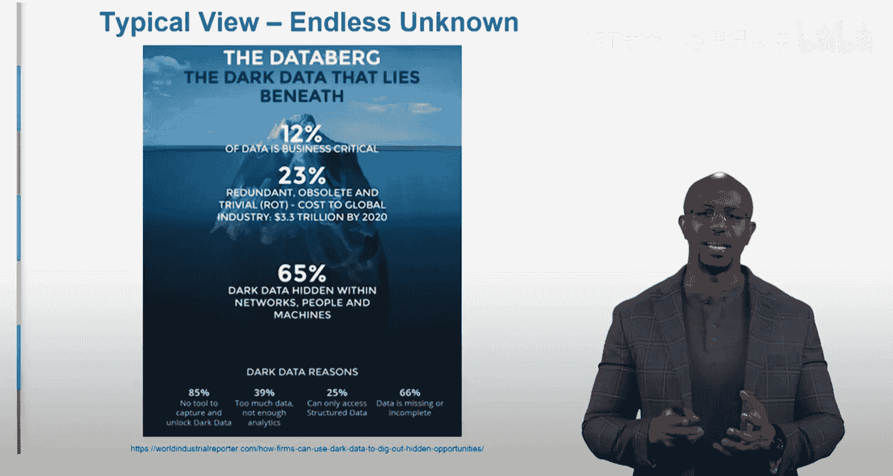
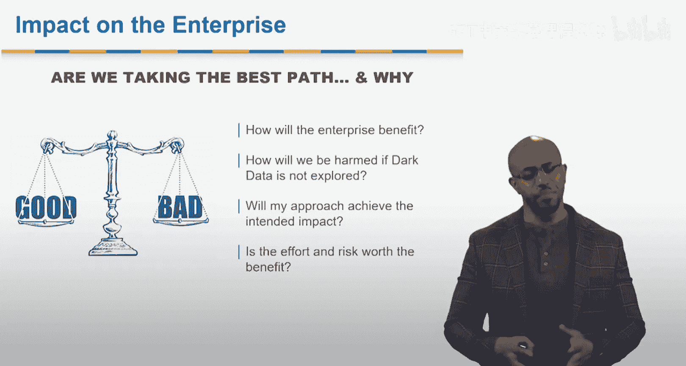

# 亚利桑那州立大学《黑暗数据迁移与架构｜Dark Data Migration and Architecture》中英字幕 p52 14_暗数据范围界定方法论.zh_en [BV1TkurzMEmm_p52]

Welcome。Sincece dark data can be endless， we're going to talk about how to scope dark data for your purposes to derive value。

Now we're going to start with a glass half full glass half empty example。

If you search dark data on the internet， typically you're going to find an image something like this where you have the iceberg。

 it's just a classic iceberg image where at the top you can see what's explicit。

 and then underneath the waves there， underneath the water level， you can see what's implicit。

Right so looking at this， you can see 12% of data is currently being used for business use。

 business critical， typically regulatory compliance。

 you also have things that go out into the software products into applications， your website。

 your mobile apps， etc， and the business position has a ton of infrastructure underneath the hood to deliver it end result that pushes data to a large number of consumers into a mobile app。

 right？Then that first tier under the water there， you have 23%， which shows what we call rot data。

 redundant， obsolete， trivial。This typically cost the industry a lot。

 some of the right data is actually useful depending on what it is and depending on what you're trying to do。

Most companies sort of put rot data sort in the background and you know it's something that they have to have for audit purposes regulatory。

 they never check it， they never use it， they never use it to add value to understand how their systems are operating and how they can operate better that's one of the first opportunities now the last segment is that 65% where the majority of your data is and it's hidden within networks。

 people machines， emails， text messages， conversations not captured It's just a plethora of available information。

 data insights or intelligence that could be created out of this if identified， captured。

 stored and transformed appropriately there are a number of reasons for dark data I want to get to the next slide to discuss how we should be looking at it because this view creates the mindset that it's difficult to deal with and it's very hard to get at that data so with this view。

You want to sort of turn the paradigm on its head and say that it's a diamond mind of value and we want to look looking at the image you can see sort of the value is in the back where you get a little bit of value in the front so what we're expressing here is that most companies are just at the bare minimum sort of the edge of getting the value that they can get。

You have the 12% critical data 23% minimal value and then 65% dark data so for those companies who forage out into outside of those gates and into those mountains and figure out how they can start pulling some of those diamonds in。

They'll start decreasing those reasons that you see at the bottom of the screen as to why data is dark。

 such as lacking the capacity needed， right， that's one of the big things。

Capacity can be used better and then if you hire and train up your staff better。

 they can get at that dark data a little bit more efficiently reducing that 85% down to somewhere in the 50s etc right than the volume of data larger than capacity is available right that's another one how can you structure the data to automate certain things certain things that you're targeting out of those rot systems out of those deep systems and then capture set of better capture mechanisms and structure it in a way where referential data can help to provide insights and intelligence right and then those last two segments data is missing or incomplete and can only access structured data right the missing one is critical because when you're dealing with missing the missing component。

Data could be anywhere。Nobody truly knows and you're dealing with opinions on how to get it sometimes you can use data that's available to derive a path forward。

 but most times it is more of a test and the guess type of a thing。

 but typically our intuition can help us develop the algorithms and AI intelligence to go gather that information。

 set up the capture mechanisms and add value。So there are some standard artifacts to help guide us when we think about that with this glass half full view you can use design thinking and computational thinking those are two key ones to help in any planning exercise in terms of gathering value from the unknown right SWOt analysis。

 business case， swo analysis is critical because that allows you to see where your opportunities and weaknesses are so that you can then go out get the information and use it to add value prototyping use case。

 solutioning etc cea the list goes on are some of these are even project management tactics so when you when you think about it there's many different ways to start forming your mind around how to get to that data and get that value applied and impact centered design manner。

Now， going into how to target it， the first thing you want to think about is what is possible， right。

 You need to figure out what's possible and evaluate what's possible right now。

 you're looking at how can you get the biggest view。You can， what's the landscape。

 most of you may have heard the term， hey， we're not trying to boil an ocean。

Here you're at least trying to heat up the ocean right understand that once we figure out what's possible。

 we won't be tackling it all at once we understand that。

 but you do need to see that entire view what's beyond the horizon etc cetera because you need to have a good understanding of what specific spots in that ocean to heat up right so。

Things to think about and when you're trying to figure out what's possible and evaluate are what deliverables align to outcomes。

Do the O rs aligned to what's possible。And how do I narrow the targets of those ORs right so once I'm looking at the big picture I'm trying to make sure that the critical OKRs are aligning to what's possible here and does it make sense and then how do I narrow my gaze over time and we'll get into that with the assessment piece a little bit more and then you'd be moving closer into the earning the right to assess and remember these。

 although typically you always want to start with evaluate。

At times evaluate and assess can run parallel， they can run iteratively。

 obviously for the purpose of this for this session we're going to talk about them head head to foot right start to end。

 but can run they can run parallel。So the last piece that we want to talk about is are we taking the best path now we talked earlier in the earlier module about not going the easy way and taking the best path。

 but now we're talking specifically on impact， looking at the full picture。

 narrowing our gaze and figuring out if we're taking the best path， the easy path。

 is sort of we've already passed that that sort of behind us and now we're trying to understand why。

So。There's four things you want to think about how will the enterprise benefit。

 which ties into those OKRs and outcomes and do they all line up and make sense。

 how will we be harmed if dark data is not explored and then also how will we be harmed if dark data is explored？

And then will my approach achieve the intended impact that's really key。

 you don't want to spend a ton of time pulling out that dark data， transforming it， enriching it。

 cleaning it， etca， pushing it up into the production environment and then not achieve the outcome so you want to make sure that that impact and outcome that you're looking for is achievable via your process and then lastly is the effort and risk worth the benefit。

That's the big that's the big question what's the ROI of our efforts there's always risk to something that you're doing anything worthwhile typically has risk and as you're looking at the dark data that you want to apply to any solution。

 you'll want to measure， is it worth the effort， is it worth the risk。

Will we be able to fundamentally change how we do things or change the impact that will' have。

Thank you for your time。

