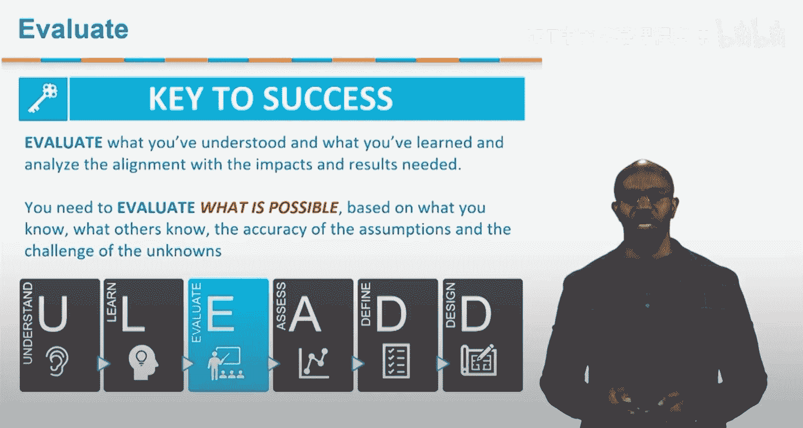
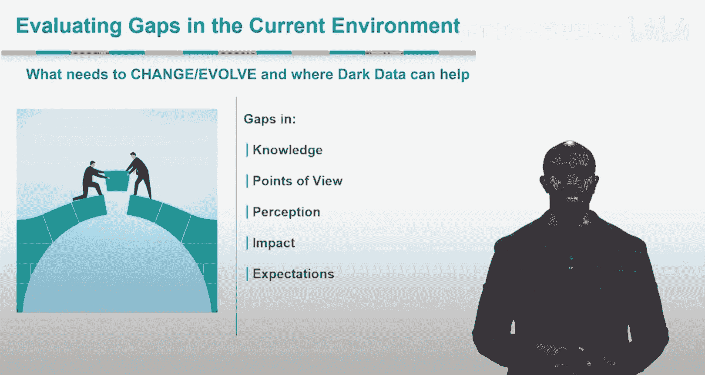
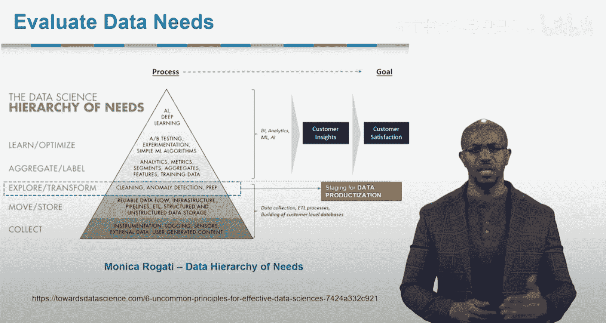

# 亚利桑那州立大学《黑暗数据迁移与架构｜Dark Data Migration and Architecture》中英字幕 p53 15_差距评估框架.zh_en [BV1TkurzMEmm_p53]

Welcome。We're going to talk about evaluating the gaps as we create the view of what's possible。So。

Moving in to evaluate substantially here， we're going to look at primarily how do we determine what's possible。

 how do we evaluate the gaps。And how do we shift into assessing， which is where is the way to go。

 which tactics and tools do we use， and how do we deliver towards that outcome？

So starting plainly here at the high level， if we're looking at the gaps and any possibility。

 there are a few things and they're not limited to this list。

 but these are five ones that I've noticed。Actually have a bigger impact than most people think when you're starting a project and you're trying to generate more value than expected。

So there's typically gaps in knowledge， points of view， perception。

 definitely big gaps in impact and expectations， depending on your organization。

 the expectations conversation can really get unwieldy when you start digging in and saying things like okay。

 your goal is to reduce complaints， but is your goal to reduce complaints in a specific channel for a specific product because it's all different types of complaints。

 and that's when you start digging in and understanding where are they gaps in what people are asking and what people are expecting to happen it。

So this is just your standard view of a sample gap analysis， you start with these focus areas。

 you look at the desired future state， what's your current state， and then the identified gap。

You can a lot of companies look at this is a PD point of departure versus point of arrival。

 some companies look at it as a2 be as is should be and will be state that's typically more of six sigma thinking there。

 but either way at a high level you're looking at where are we， how do we get here。

What is our future state， how do we get there and what's stopping us from getting there？All right。

 so looking at data science hierarchy of needs， this diagram。

 the core triangle was originally published by Monica Rogati so I took this diagram and just sort of added this little dotted box around that middle explore and transform phase I'm going to go through it and then talk about what the dotted box really means so when you start at the bottom。

 you're looking at the overall infrastructure， the systems the mechanisms。

 although it's not explicitly mentioned here， what are the touch points to collect the data right like how are we gathering that information and are we doing it in the best way that doesn't give us a biased result then move and store how did the data initially come from those transactional systems from those SOOs。

 those systems of origin and go into our systems of records or SORs and then go into our other processing systems and into fulfillment type systems。

Go further into our analytical side of the house and then we start looking at that data science piece right so when we look get to that explore and transform a layer。

When it comes to intelligence， making better decisions， understanding where to go and what to do。

 this layer is super critical。Because if things aren't really thought through here。

 if things aren't done correctly， you can end up with just basic insights and you most companies that I've worked with and worked for。

Those companies typically when they talk about they reporting their analytics。

 it's usually a total of things right， they'll total up in a certain market， how many new accounts。

 how much billables， how many people fulfilled on rewards， etc cea。

 Those are all good insights and you want to see that because then you can see the trends over time。

 how much it something cost， but it's not getting into the core intelligence in telling you which products are actually performing better。

 simply giving a total of sales doesn't tell you if a product's performing better。

 because there's other influences involved， the product could have a product that's not selling as well。

 could have poor foundation could have bad user experience。

 So you also need to understand what are the metrics from the user or the metrics from the product performance。

 what's the availability， performance time， how useful is it as a utility for what it's supposed to be。

cause the product could be better but since it isn't we may invest in what is and that may not actually be the way to go So it's one of those things you'll want to think about when you talk about this explore transform。

 this is data cleanss， data enrichment transformation obviously referential data sets to then provide more value to the next level as we go to the aggregate level now this aggregate and label level。

 this is when you start getting into the analytics， the BI， the intelligence， the data science， etc。

 this is when they start looking at training data and putting the other algorithms to further grow what's there。

 but the challenge that these folks will face a lot of times is if the data hasn't been transformed。

 cleaned， enriched， etc ce， appropriately before it gets to this stage if it hasn't been positioned correctly if we don't have this suite of key indices that are needed to create a more robust view of what's going on they can be。

Limited。And then the second to last second to the top there， the AB testing experimental。

 so now we're getting into pre and post testing， testing to understand should we do different things or different segments of the market doing things multivariate testing and then last AI and deep learning when you're starting to have the machines do learning and intelligence this field at the very top is still growing and that piece there is one of those things that is still requires a lot of adjustments to those algorithms to get it right。

嗯。So at that middle stage there exploration and transformation as we're using that to evaluate needs。

 that's where a lot of the data productization takes place and that data productization is what allows our data analysts。

 our scientists， even our citizen data scientists， etc cea， to perform better。

 our administrative staff， people who just take the data and make small adjustments and changes in their daily schedule that work to perform better in dealing with customers。

 all of that stuff。As you think about it， this triangle is a core foundation for the process of data science analytics and how that process then delivers on an end goal。

 so this is really critical， it's one of the things you want to think about and also look at as we bring in dark data from those collect and store layers and then how do we want to transform。

 use， clean and rich， etcter。

Now I want to give an example of measuring impacts， this is measuring an impact of。

Of complaints so looking at this I have the CFO talking to the VP of enterprise experience。

 the CFO is beginning sort of having to deal with a lot of regulatory agencies etc cetera from the government that their complaints are on the rise with the company and looking at the verbiage here。

 his his core mission in this conversation is to get to a place where he can understand。

If the complaints are rising exponentially in comparison to the volume of business that they're doing。

Or are the complaints rising slower than the growth of business or are they or complaints rising to the same level Furthermoremore。

 you always want to reduce complaints， you always have some complaints if you're in business but you want to keep those to a minimum either way he's trying to understand how big of a problem is it now he never explicitly says he's trying to understand how big of a problem is it he never explicitly says he needs to understand the rate at which it increases as it pertains to how the business is growing and if it's leveling off then can we see those numbers as well he speaks about it a bit but not too much and then as we go into the VP of enterprise experience and this basically she's rattling off like we said in the before example just the total of numbers like total number of complaints。

 the percentages that were in a certain channel that they receive complaints but nothing is really an intelligent view of the numbers where we're relating it to。

how certain channels and how things are impacted across the enterprise and why some complaints may be more or less for certain categories or why some complaints may be more or less for certain channels。

Um， so as you get to the bottom， you get to the real problem。

 the real problem is the systems aren't set up to handle the dark data that would allow them to really understand。

What's going on with the complaints， those complaints are key not only from a regulatory and compliance perspective。

 but those complaints tell them things that are going wrong with their products that they may not be aware of。

And as we discussed before， when we're talking about product performance。

 just simply looking at the totals of how much sales or how much traffic et cetera a certain product is getting is not really a good view to say if the product is performing well at its core right there are many different dependencies。

 there's market shifts et cea， external data that you have to have as well， but at the base here。

 the VP basically says。That the systems aren't set up appropriately。

 the elements can't be mapped the data model isn isn't pervasive across the enterprise。

 so it takes a lot of referential data to start bringing those points together and then also they don't have the staff capacity and expertise to get to。

The higher level of analysis that they need to。So these are some of the things that we need to think about as we're looking at bigger business problems and solving and delivering better value to a customer。

All right。So in this example， we talked about。What the VPA Enterprise Exper said they had。

 what they didn't have in the top blue box there you can see just a quick call out of the numbers that she rattled off。

When we think about business needs， technical needs， user needs， user being consumer， customer。

 et cetera， even prospects。We start thinking about， okay。

 what at a granular level will help us derive actionable intelligence right。

 so thinking through this piece， some of the things we need to know is what are the total number of customers。

 what are the total number of prospects that have touched our frontline colleagues and employees or have touched our apps？

How much interest did we garner right and how does that trend year over year month over month week over week。

 etc ce， the ratio of new versus existing customers。

 what are the attrition totals for customers and what's the bounce rates that we have for customers and for prospects the total number of new customers by product channel market。

 all those different intersections these are data elements that we need to have captured and although I'll continue through the list one thing to think about is。

At the core of understanding that you need to know these things。

That also lets you know how you need to start at the capture point。

How that data needs to flow through your SORs， SOs， how you need to store， catalog。

 enrich and grow that data at that transformation level that we discussed in and the data science hierarchy of needs diagram right and then continuing on this list here another thing they need to know is the cycle time for the speed to market of products Sp to market of ads speed to market of incentives and rewards。

 if they're getting complaints if they're getting complaints specifically to some of the wars that they're providing。

 people will definitely complain if they're supposed to get a reward from your company and they're supposed to receive it on a certain day and they don't get it for another three or four weeks so if they don't know that some of the complaints are for that they could end up just simply working on product performance versus fulfillment there are many different things that you want to think about year over year comparisons。

 comparisons the market trends， how are they comparing to the complaints that are registered for other companies and how can they get that information if it's possible。

Can they write Python scripts to scrape Google reviews， can they write Python scripts to scrape。

 Yelp， et cetera？These are all different things that they'll want to think about at how can they get more data。

 more information to better understand what the challenges are。Thank you for your time。

