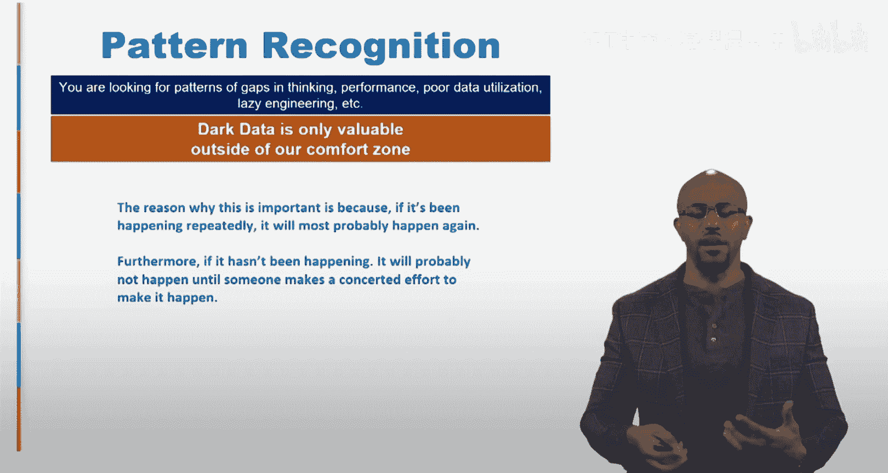

# 亚利桑那州立大学《黑暗数据迁移与架构｜Dark Data Migration and Architecture》中英字幕 p54 16_已知SWOT深度分析方法.zh_en [BV1TkurzMEmm_p54]

Welcome。😡，We will dive into a SWT analysis on the known data and the complaints example that we discussed in a previous module。

So this is that example about the business complaints where we got the totals from the enterprisese experience VP。

 and the CFO was requesting information about the complaints versus the growth in business。

As we look into the SWt analysis here， talking about the known data at the top level you have the internal。

 at the bottom， you have the external。The left column are the positives and then the right column are the negatives。

 so you're looking at your standard strengths， weaknesses， opportunity and threats。

 quadrant so there are a few things that are pretty explicit when we talk about the strengths from that example the organization is generating insights which is good they're focusing mostly on things that are more explicit。

 more easy to get to more already sort of in the sunlight and things that aren't going to really add too much value besides telling the totals of things。

 but they are doing some analysis to better enable the decision making that they have。

The analytics team does know there are gaps and they have communicated them that's key。

 it's an organization that is transparent about where there are problems if you don't know where the problems are。

 you can't start to solve them so it's crucial that they're open about where the challenges are。嗯。

They also can analyze the complaints at a high level。

 and they at least have one of their complaint channels completely accessible for analysis that they can rely on the quality of that analysis。

嗯。Given analyticsnalytic space， there has been a lot of developments and for this group。

 they can just start specifically from scratch because at their company。

 their analytics space is very razor than it's more data bubbling up。

 they're getting data and they're just scrubbing it through it on spreadsheets。

Let's talk about the weaknesses because we're focusing on the internal so the weaknesses when we look at the gaps right the you have an understand a misunderstanding of intelligence。

 what that is， what compromises it and how we can really get to it right prioritization of the value of data centered decisions given the state of the group。

 it is very clear that。Data center decisions have not been prioritized。

 Most folks will trust you as long as you have the data there。

 So that's one thing you want to think about is the data information intelligence readily available so that I can roll that up to leadership。

 right。There's a clear missing data strategy here right it's clearly missing right there's no view of how we're using our data to better our products。

 how we're using our data to interact with our customers better。

 how we're using our data to continuously improve internally those types of questions and thinking aren't there。

And then systems not optimized for data productization。

 that's key and as we looked at that hierarchy of needs for data science， that triangle。

This piece is really critical right so the data has to be productized， it has to be transformed。

 it has to be modeled up against data that is known to be fact right things those things have to be there for us to really get value out of that analytics。

Lastly， the interaction points at which the dark data could be captured are just not ideal right so when we're talking about the phone channels。

 people coming into maybe the store or wherever their colleagues interact with the public or the consumers or prospects。

 are we able to capture information from those interactions and how do we do it？

Now let's start talking about the external stuff， the opportunities and threats both good and bad right when we look at the opportunities。

 the opportunities are abundant that's something that's really good they't they're nowhere near hitting a peak there's tons of opportunities in AI to help mine for dark data advanced data capture tools right there are plenty of talent in the market that can help the decision making help the thinking and help grow an intelligent pipeline and not many companies have grown their data strategy to the point where they can capitalize on dark data so there's still a lot of opportunity for them to catch up to the curve and then take that curve and grow it a little bit more exponentially than their competitors now threats one of the things you want to think about are major competitors have already optimize their systems for data productization now are they getting to the point where they're really digging into dark data some companies are but it's very few。

But that's a huge threat if other companies already optimized， their data is productized。

 they're making better decision， their products are performing better。

 their staff and frontline colleagues are better able to operate。

In the business environment with consumers and prospects。The Omni Channel， digital experience。

Is the norm now right so since omnichannel is sort of the norm that singular F feel across that digital touch points with a company。

 that's something that these companies want to really think about how do they do that because that's a lot of these Fortune 500 Fortune 100 and even a lot of these new startups are already launching in with omni channelnel experiences。

Custom customers in general expect a modern digital experience。

 so that's something they want to think about plus cryptocurrency is enabling datacentric companies to grow faster especially when it comes to financial transactions。

 a lot of fintechs are starting to think about cryptocurrencies and there are a lot of startups around cryptocurrencies。

 payment new payment platforms， ways to exchange dollars and you know foreign transactions et cetera。

 so those are something you'll want to think about now moving a little bit past the SWT analysis I want to point out one key thing that you'll want to really get into is pattern recognition。

And this is more around enterprise behaviors because those enterprise behaviors will impact how you move forward and how impactful that dark data is。

 so it's only valuable outside of our comfort zone and this is a general premise forward。

 but it's easy to get some dark data that's just sort of there， it's accessible。

 but the ones that's there typically somebody's already used them。

 seeing it and saw that there's not much value。But the dark data that is internal that is captured that isn't too comfortable and to figure out is a lot of times derivations from data that's not being used or enriched data。

 data that's made it more expansive and then obviously as we're talking about pulling data from external sources。

Enabling better touch points with customers and gathering more information。

 that data is extremely hard to get to as who is extremely outside of our comfort zone。

 so when we're thinking about the standpoint of data is only valuable outside of our comfort zone。

 you'll want to look at the enterprise and understand what the behaviors are。

The reason why this' is important is because if something is happening repeatedly。

They will continue doing it so if the reports have been generally viewed as oh the reports are good。

 they're generally good， we can see clearly how much a product is performing。

 the mindset will be that that's okay。But in reality， somebody needs to start asking those questions。

 is this truly giving us that view of product performance。

 can we see everything that touches that product？Or do we have all the data touch points available and if not？

It may have worked well in the past to some extent， but we don't know if something can work better。

 And typically if it doesn't have all those touch points， something else can work better。

 So you'll want to see if that's a pattern of thinking where people are settling for average more so than looking for how they can continuously improve and do better。

 And then lastly， if it hasn't been happening it probably will not happen until someone makes the effort to make it happen。

 So this is the inverse of the first one when you see something happening that sort of an average performance where you just have these totals laddering up。

Somebody has to take the initiative first， ask the questions， push the envelope。

 get people's minds open and evolving， and then take that next step into actioning what are we going to do to make the change。

 how are we going to improve， how are we going to impact， how are we going to deliver that value。

 receive the value back from through dark data through data transformation through enrichment etc cea。

 and then bubble that up into our analytics into our products and service our customers better？

So remember， pattern recognition is critical， but it's although we're looking for patterns and data。

 the first solution you want to look for is the pattern in the people that we're working with so that we can work with them better and improve our overall performance。

Thank you for your time。

