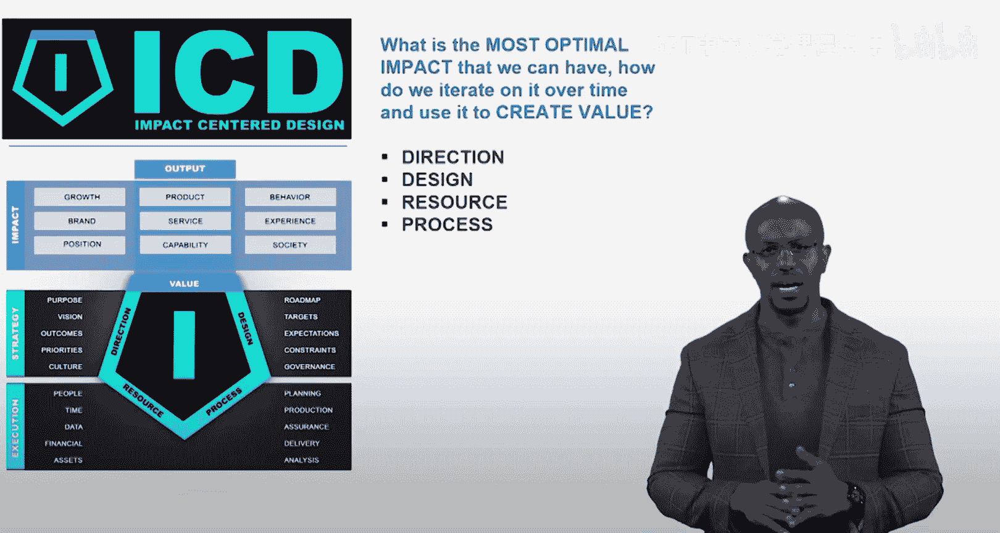

# 亚利桑那州立大学《黑暗数据迁移与架构｜Dark Data Migration and Architecture》中英字幕 p56 18_组织定位评估方法.zh_en [BV1TkurzMEmm_p56]

Welcome。We're going to continue diving into dark data and talk about a positional evaluation based on that swat。

 the gap analysis， et cetera。So I want to start with that triangle。

 that data hierarchy of needs and focus on the resources that the company has right so the difference here you'll see the red boxes and the red arrows pointing to position type right like our position titles you got machine learning engineer。

 data science analyst， data engineering， data infrastructure also software engineer systems engineer sort of still at that level where we're talking about collect move store and then also this is that Exp and transform portion that's definitely going to be a lot of software engineering in there as well that level again is that key level and one of the things you want to think about you'll need a mixture。

Of skill sets right there， you'll need some data scientists because you'll need their view。

 you'll need analysts because you'll need their view。

 you'll need software engineers because those are the ones who are going to engineer the systems to deliver the data in a productized manner。

 where we can then allow our scientists and our analysts to move forward and make the progress that's needed for the company。

 at that top level yet at that machine learning engineer that's going to work on algorithms that's going to work on algorithms。

 AI， deep learning， etc。So this is critical to understand if you've positioned your people right with the right systems。

 the right class of systems， in the right place， you really want to think through this and make sure that your organization is set up for success and understand that you can't just hire data scientists and data analysts and expect to get robust intelligence。

 you have to have that full stack there， that those engineers， those infrastructure folks。

 the software people， and then the UI people as well。

 you'll need all of those different skill sets to then deliver on dark data。

All right and then as we're looking at our processes right so now we're moving from resources primarily we talked about positions and the systems and materials et cea that are used now we're looking at the processes this is key because a lot of times processes can stifle companies if your processes are too laborious like if your release process requires a million different signoffs you know you can burn out your engineers easily you know they want to build and they're busy working on signoffs and release engineering right so one of the things you'll want to think about is how is our project management process are we using agile。

 safe lean waterfall our systems lean， have we thought through to make approaches and continue to improve on processes when we look at toeG right and look at enterprise architecture and looking at business architecture。

 system architecture technology。itself， architecture， governance。

 the architecture of change management， and then migration planning right so when we're doing migrations and we're running systems in parallel。

What is that process and how are we optimizing our people inside of these processes and which processes are unnecessary。

 are some of those sign off processes truly just irrelevant。

Some companies have manual processes and I've had these conversations with folks where they say they have a manual process so that they reduce errors。

 but by default， manual processes are going to have human error。

How are you really going to account for that right so how can you automate and also pull out data quality views to ensure that your processes are running right are running correctly。

 the data is flowing through correctly the proper cleaning mechanisms are happening transformations etc so you want to think through all those checkpoints and make sure those processes are reduced if we're using agile print to waterfall。

 six Sigma safe scrum at scale， whatever it might be really think through it and then think through that architecture and how your processes wrap around the architecture of the company and the individual systems organizations in teams。

So now moving into this positional piece so we talked about the tactical area we started with that because we in evaluation since we spent a lot of time at the front with Under and Learn we spent a lot of time at that strategy space we went through evaluated that tactical area now we're taking that view of tactical area understood how we're positioned and going into looking at how we did the gap analysis SWOT analysis and reevaluating and assessing how the outcomes OKR's initiatives and data strategy align to all of these right so are we positioned well with the resources are we positioned well with our processes right and then are we positioned well in understanding our strengths。

 weaknesses， opportunities and threats。In which opportunities are best to work on。

 which weaknesses are best to work on， Which strength strengths do we need to amplify or don't need any work。

 and which threats do we need to really think through and figure out how to manage。

Bring us back to impacts center our design right， so bundle everything up， we went through resources。

 we went through processes。In resources， we talked about。The people。

 the time it takes for them to learn， grow， the time it takes for them to build systems。

 the data that flows through。The explicit， implicit data， the known， the unknown。

 the collection points， what is the impact when we talk about people in terms of financial？

People look depending on the company。A lot of companies look at the technology resources as a call center。

 how can we change that paradigm， drive value from the data。

 drive value from the system and turn the technology teams。

 into revenue generating teams and then generally the assets right the company assets。

 the material supplies， the actual tools that we use the software， etc， then processes。

The planning processes are they streamline， do they make sense do we take the time to plan the time and reduce the planning time？

Do we have the right production in place， assurance deliverables and analysis。

 these things are critical， the process around analysis is what sits on top of that data productization and that's where our data scientists come in。

 that's where our data analysts come in。So as we move into that strategy space。

 we'll redirect a lot of that energy， a lot of the stuff that we discussed and figure out like how we're going to have that impact move into the assessment phase and narrow things down right so one thing to make sure we think about as as we as we conclude is。

What is the most optimal impact that we can have， how do we iterate on it over time and use it to create value？

So closing out that evaluation， we're thinking about optimal impact， creating value， the big picture。

 and then looking at how we're going to narrow it down using direction design。

 resource and processes。

Thank you for your time。

