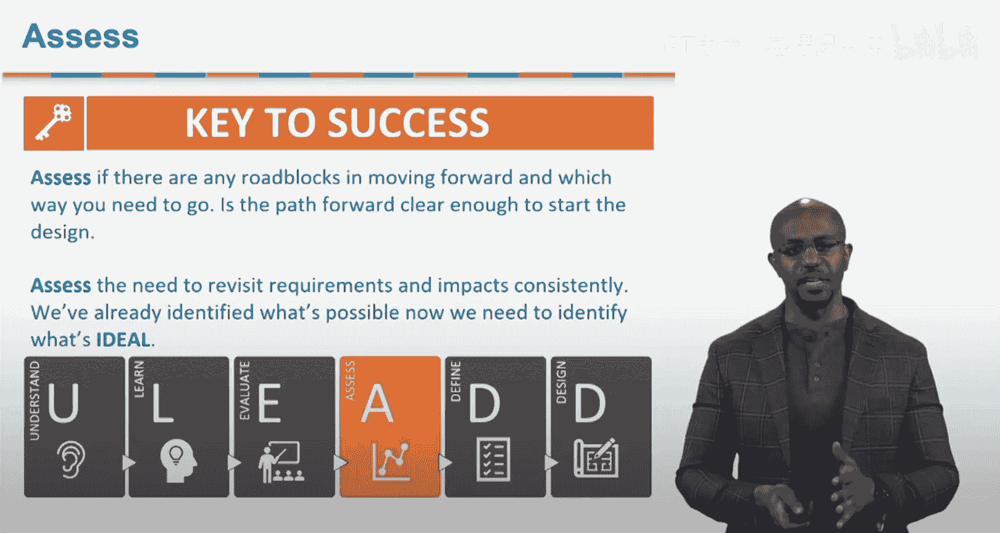
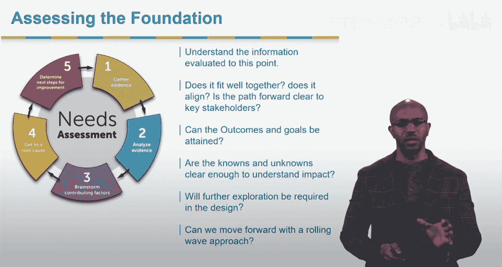
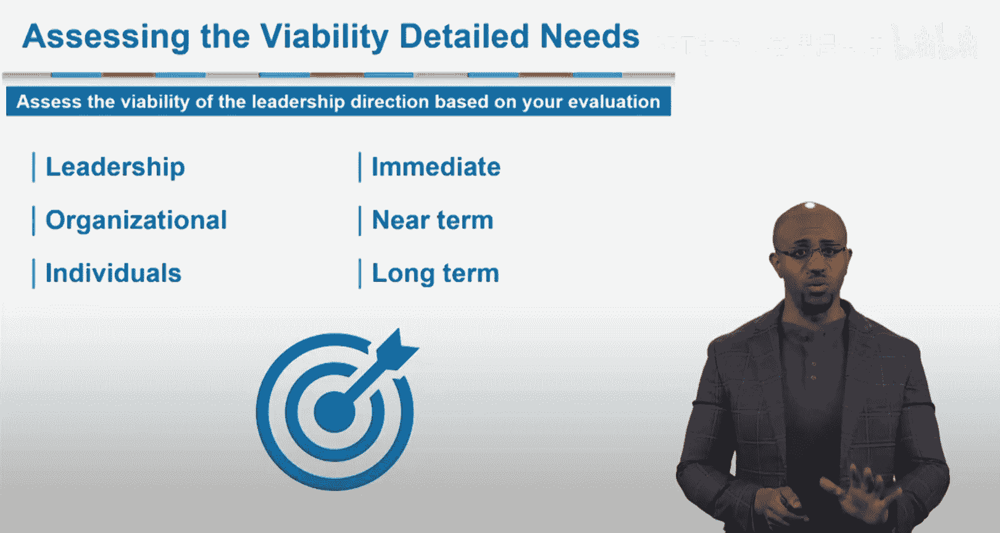

# 亚利桑那州立大学《黑暗数据迁移与架构｜Dark Data Migration and Architecture》中英字幕 p57 19_组织需求评估框架：紧急-近期-长期.zh_en [BV1TkurzMEmm_p57]

Welcome。We're going to go into a needs assessment for dark data implementations and talk specifically about getting started in that assessment phase of UL right so understand learn。

 evaluate assess， defined and design where're at that a portion where we're talking about assess and one of the main things we want to focus on is as we're moving from what's possible in that evaluate phase now we're moving into what's ideal so we're taking all those possibilities that we uncovered when we evaluate now we're looking at what's ideal。

 what's probable what's the best path forward tactically and how we're going to design a solution around the strategy and get into the output that will be defined by the outcome that leadership and the standard mission and direction of the company。

So first you want to do a needs assessment， there's many ways to go about needs assessments and we're going to assess the foundation of where we're going cutting down into the different silos of the possibilities so one of the things you want to do if you look at this standard view of a needs assessment is gather evidence。

 analyze evidence， brainstorm contributing factors get the root cause analysis and determine next steps for improvement right like just straight iterative cycle。

 how do we go to the next steps and what do we do to help our teams our company our products better perform so understanding the information evaluated at the current point。

 do things fit well together， what outcomes and goals are attainable。

 what okay Rs are attainable which when we're looking at the criticality do we need to adjust some of the targets of the key results should they go up should they go down should we restrict them or should we prioritize other ones or look at others is more critical。

Then we need to know what's required to go into the define and the design stage right and then lastly how can we get to a rolling wave approach which is similar to an iterative approach and then can we see a little bit beyond that horizon with that rolling wave approach so we're talking a bit of the resources。

 the processes as well as the strategy looking at the direction that we're going and thinking about that design。

So a little bit more about the viability， right， we need to really understand that leadership direction。

Think through those tactics so we'll be working on leadership organizational individual intermediate near and long term so when we look at the OKRs did we assess what's sooner deliverable versus a later deliverable near and longterm views and then delivering towards those these are some things that you'll want to really consider as we move through the viability phase looking at the landscape of ICD one more time the impact center impact center design remember we're trying to grow bigger。

 better faster， whatever the definition that we've defined as bigger。

 better faster for our endgos for our outcomes and we're looking at the unknown factors。

 unknown factors will trip us up stop us this is that dark data that is centered around what we're doing on the peripherals I mean of what we're doing and then using our direction design and then the resources and processes to implement so that assessment will。

include the tools and tactics we'll bring that in and make sure that we choose the actual tactics and the tools that we need to execute on our definition and our design thank you。

