# 亚利桑那州立大学《黑暗数据迁移与架构｜Dark Data Migration and Architecture》中英字幕 p58 20_隐性需求评估：紧急-近期-长期.zh_en [BV1TkurzMEmm_p58]

Welcome we are going to go through a detailed needs assessment as we continue our progress through the iterative。

 evaluate and assess processes。 we've already talked about what's possible now we're going to into what's probable and what's most ideal and you guys will remember this view from earlier and a few of the earlier modules that we talked about simply just having the transactional data analytical data and all of that being in the captive data systems that we're already using and getting insights and value from in our data products are already getting value from as well tied in with our consumers now we're going to look at that tier too the generative data some of this will already be captive some of it will already be going through our analytical transactional systems but some of it will need to create and understand that is there and we'll need to create with reference tables using some logic maybe using algorithms added data sets and even other dark data that may be outside the organization so this view is everything that。

inside the organization that we have access to currently， we don't need to go outside。

 we don't need to create new points of capture， none of that is needed for this。

 but as we look at the generative portion，When we're going through that risk reward。

 we're going through that assessment， we're going through what's possible。

 we need to understand what's currently there and what we need to add to it。

 and that's the first step in going into looking at the external data is first getting the internal data identified and understood which pieces of the dark data we'll be pulling in。

So a little bit more on the detailed assessment as we look at risk reverse reward。

 the first thing we want to think about is your standard ROI of the time cost scope。

 your old school triple constraint time cost scope of a project also risk quality reward resource etc so we go through the action steps of the probable challenges。

 the action steps of dealing with the unknowns and then the unknown unknowns and protocols for unknown circumstances like what will be our action steps forward this is that last bullet is really reflective of how do you plan for the unplanable。

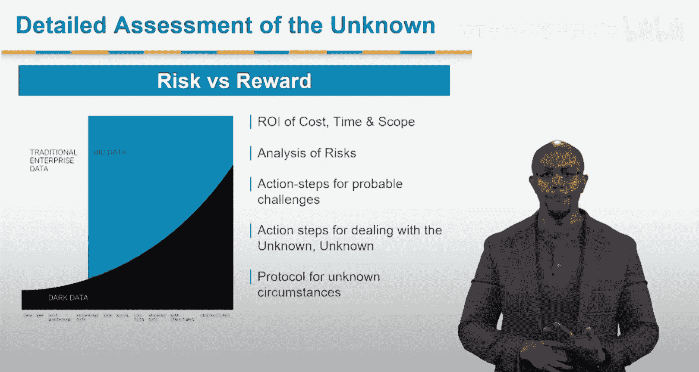

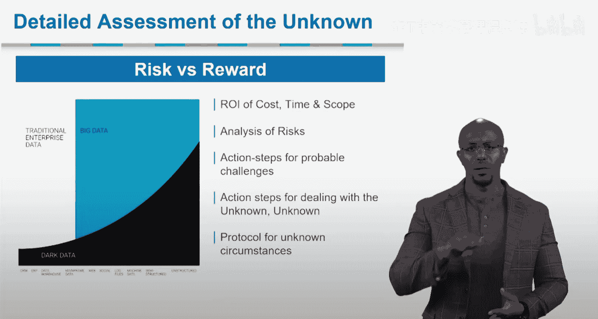

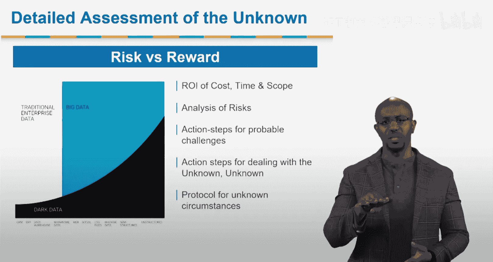

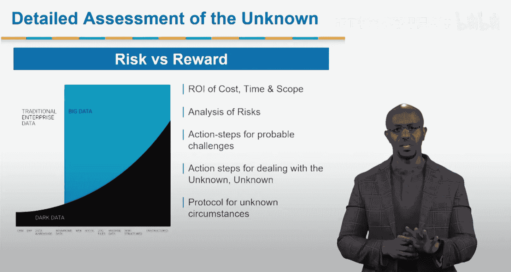

So what that means is I' will give you a quick example。

 you're working with a team and you're working integratively with other groups， let's say there's a。

 let's say you're an analytics team and you're requesting some data that has to come from the data group that you typically work with。

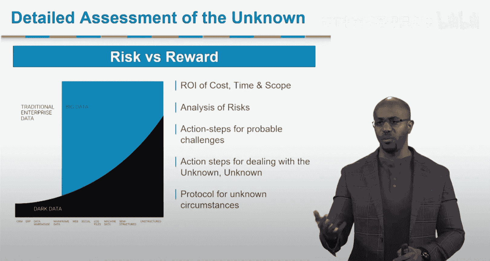

And they have to send the data to you through in another team who does the ETL process。

 extract transform and load and then once it gets on。

 let's say a data marked or somewhere where you have reference tables already set up the data will populate and grow and you'll see the enriched data some of the new transformations etc however。

 how do you plan for the uncertain unknown circumstances in this scenario。

 let's say the ETL team says their SLA is 24 hours you already know it's going to be 24 hours but what happens if it takes them longer。

 what happens if they load the data incorrectly， and you spend time working with flawed data that isn't transform correctly？

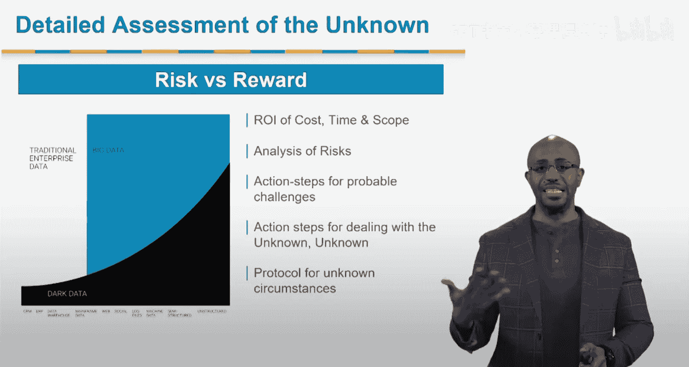

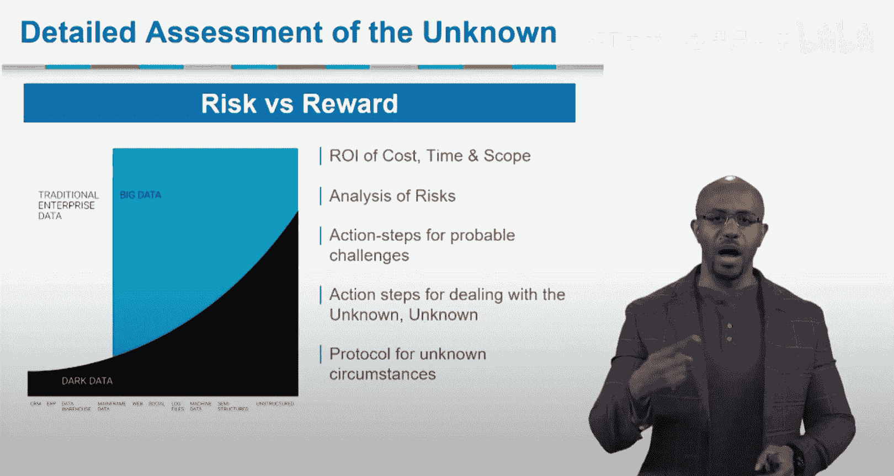

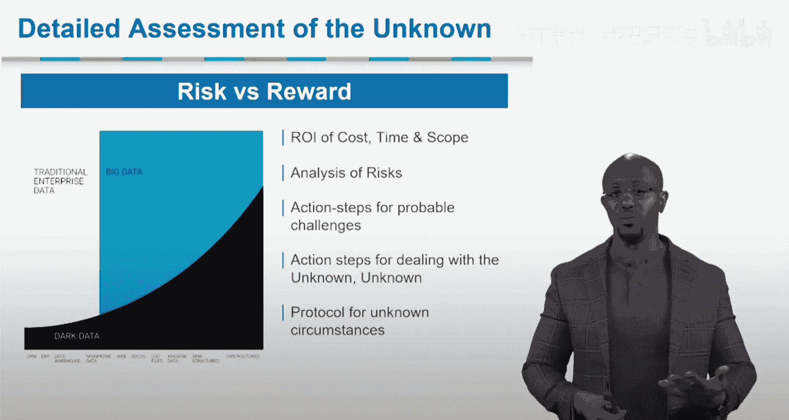

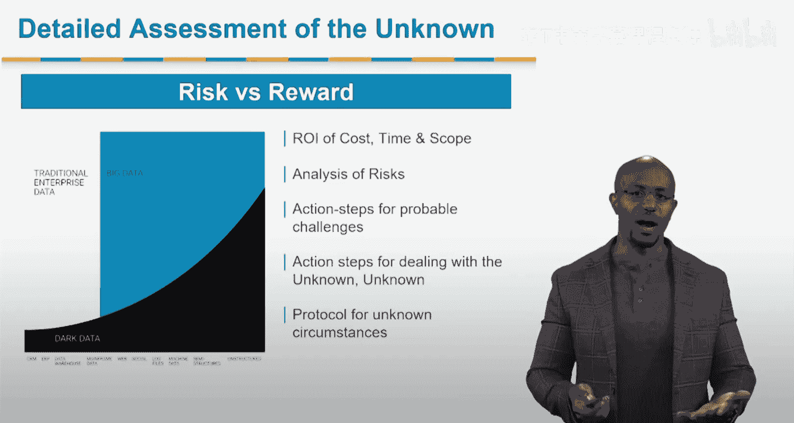

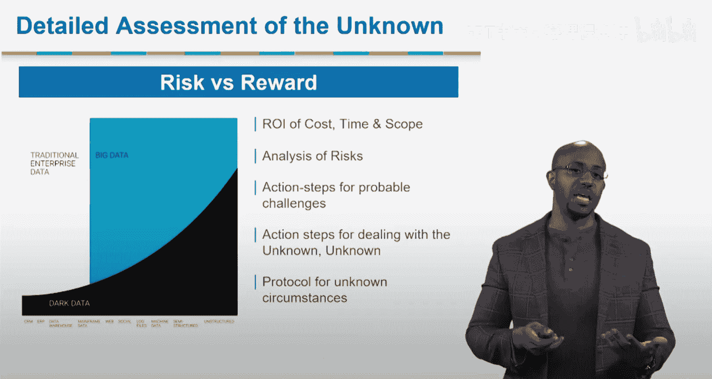

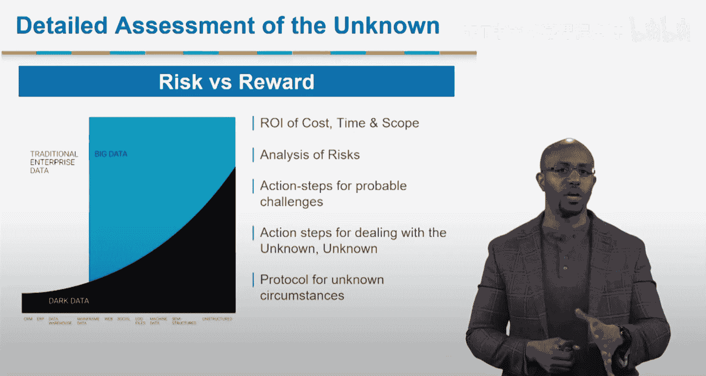

Are you able to see it fast， are you able to recognize that the data is flawed in a quick manner？

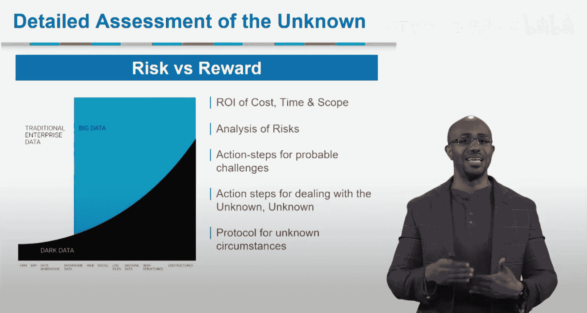

Or will you not know and continue your process and then deliver intelligence and insight based on flawed data not due to your design。

 but due to the ETL team doing their job improperly。

 you'll need to be ready to understand the riskverse reward in that scenario and figure out how can you set up guardrails on your side to quickly see if the data came through correctly can you set up a dashboard to review data quality。

 can you set up some some algorithms or transformation process is to run through the newly received data and ensure that standard data quality measures or had have been explored and then can you work with the data team that originally own the data and give them a view to allow them to see if it had been transformed from their perspective correctly because there will be things that you won't know？

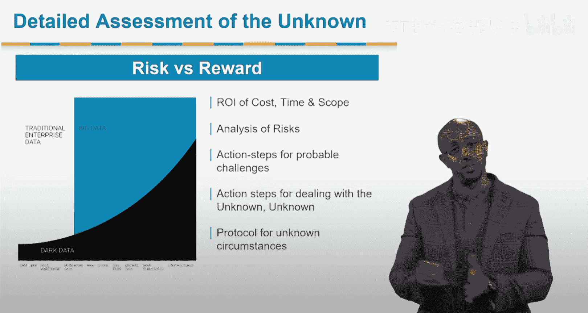

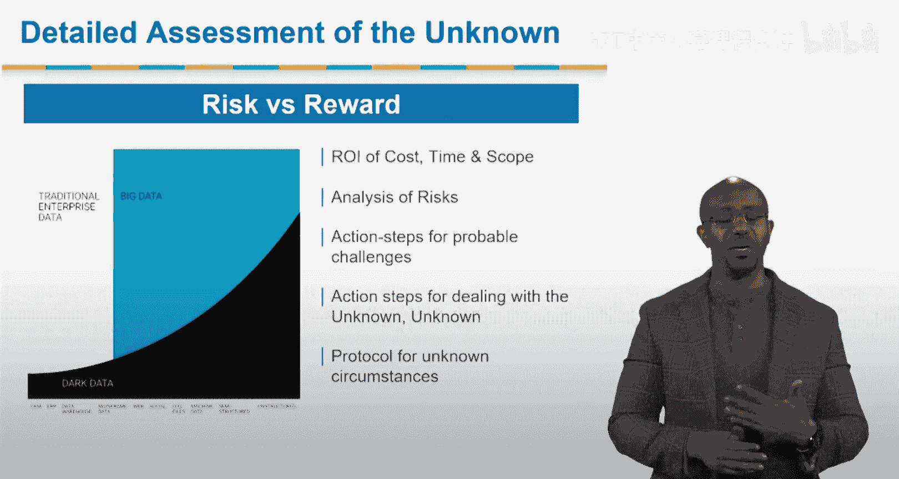

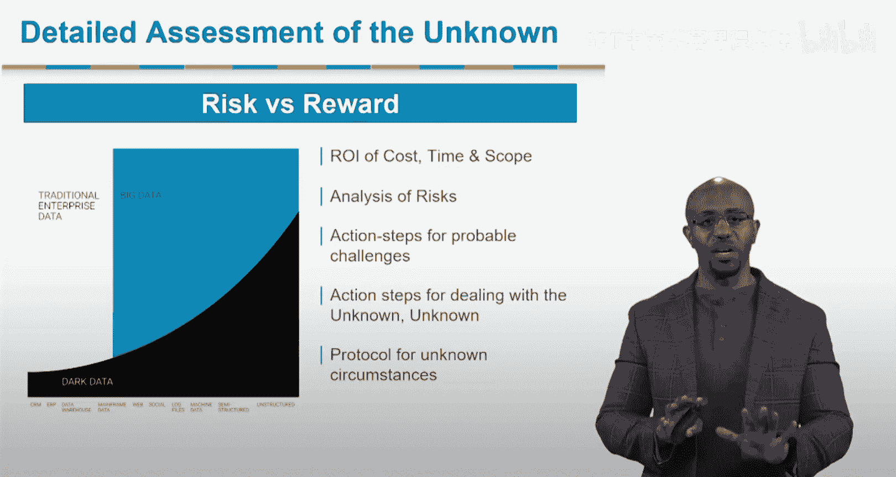

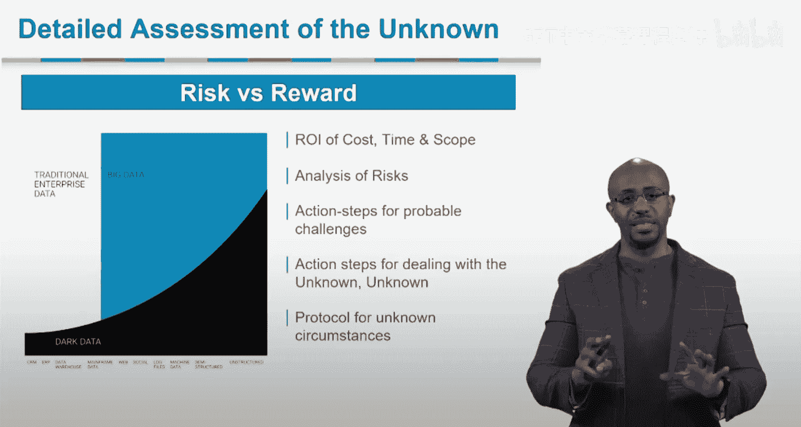

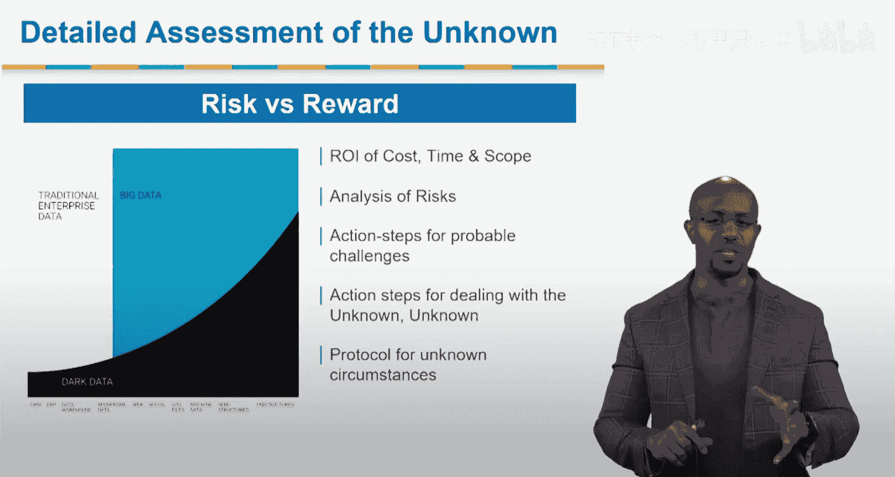

That they know that they have to validate for you。

So these are some things that you want to think about when you think about protocols for handling the unknown when they happen。

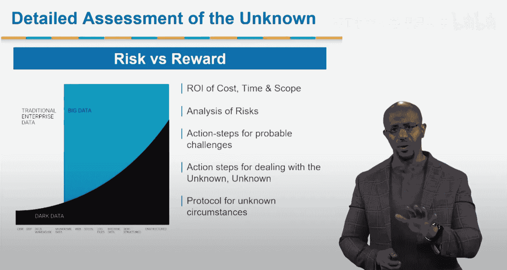

You may not know immediately but what protocols you have in place to immediately assess， correct。

 adjust and get things done the correct way so now moving into assessing the external needs we're talking about that dark data that you're completely unaware of so that's the uncaptured unattainable and nebulous data so。

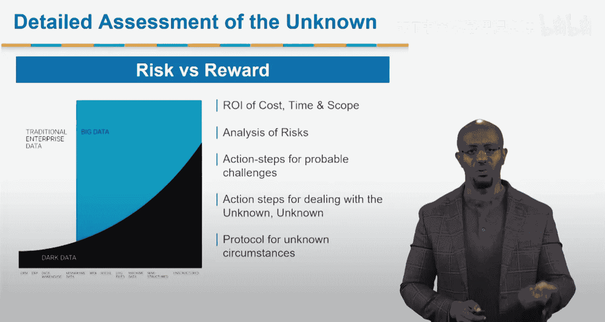

Before we were looking at the captive and generative data， which is inside of a company。

 when we look at this uncaptureed data， these are things that we can easily get to with new captive points。

 having monitors and things that we can measure interactions with customers。

 or having more or better web forms， mobile web forms， and other things of that nature。

And then we look at unattainable and nebulous， right。

 the unattainable data are things that we just can't reach and then the nebbuulous are things that are the primarily unknown。

 unknown， like we don't even know we can grab it， we don't know it's there， we don't know it exists。

So as we do an assessment of what's external。We first look at where are the gaps。

 we've done the gap analysis， we look at those sWt pieces。

 we figure out what are the pieces of number three。

 the uncaptured data first that we can set up some data capture points and then we plan down down the line in the future for things that are currently unattainable that we can't reach because the technology may not be there our knowledge isn't there whatever it might be and then the nebulous data how do we plan for things that we have no clue there that requires a larger and more complete creative process where we're looking at the data but we won't have any information or we won't be ready for number five until we get the uncaptured data in parts of the unattainable data right in our system and start gaining knowledge and intelligence from it。

So going back to the the piece on how do we plan for？The unplanable。

 I want to give this example of the Navy seals and that they operate in a state when they're doing operations of constantly unknowns。

 so they plan for the unknowns， they plan for the unknown unknowns。

There's a number of seals if you have a conversation with them， they'll drop into a war zone。

 they'll have some intelligence telling them their target， their primary objectives。

 things like that， the layout of a structure or a town that they have to go through and how to get to where they're trying to get to but。

From the time that they deploy to the time they get there。

 the intelligence around the individuals that they have to deal with may have expired or maybe partially or fully expired。

 right， So when they hit the ground， they have to operate in a state of。

How do we deal with these things that randomly pop up in our way that can stop us or help us。

 and how do we turn anything that stops us into something productive that can help achieve our goals in our mission？

So they have standard operating procedures， SOPs of how they move and maneuver through obstacles。

What are the standard things that they say and use to communicate with each other。

 all these things help them know what to do furthermore， since they operate as a team。

 they know when certain things happen， the default response for any individual and team should be X。

Which allows them to better operate and maneuver around things。

So when we think about that and use that type of thinking around flawed data in our example before。

 hypothesis that are proven incorrect， that we believe were correct， pivoting mid project。

 being able to adjust when things change， how are we set to do that？

Can leadership change on a dieme right when priorities change。

 can they make that change in a day versus making that change over a month and a half and losing all the work that comes with that。

 losing all the progress that comes with that， because movement is not the same as。Progress。

 those are two different things。 we can work on something and have movement and get some things done。

 but not actually have progress towards a goal， so we want to make sure that we're always having progress towards a goal。

 we to make sure that the movements that we're doing are contributing to the in value that we're able to pull the data together that we're constantly being able to position ourselves operating the unknown and the data that we're pulling in the dark data。

 the captive data， both sides of it internal and external that all of it that's coming together to consistently provide us that view so we can continually adjust and position。

 reprioritize and move forward as a cohesive unit as long as we have those standard operating procedures。

So that wraps up how we look at assessment， how we look at the evaluation。

 and then moving into the define， and once we have those standard operating procedures set up along with knowing what data we've narrowed our view down to and how we're going to use it and move forward with it。

 then we can start saying that we've earned the right to start defining the actual problem。

 defining finally the end result of the OKKRs， the outcomes and defining what our tactical view should be narrowed towards for the purpose of getting to a point where we can design。

Thank you for your time。