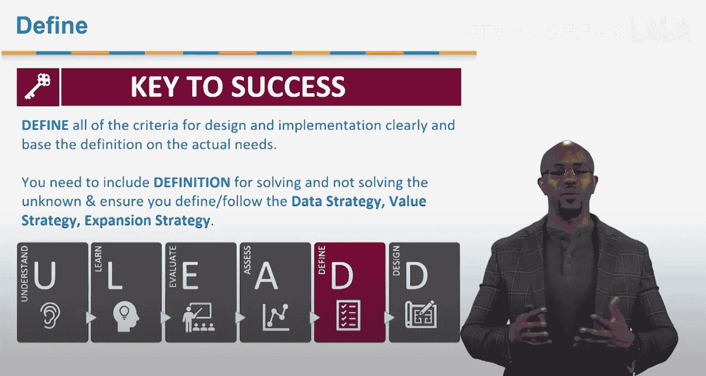
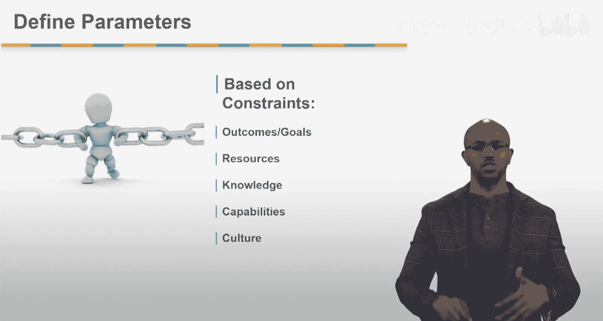
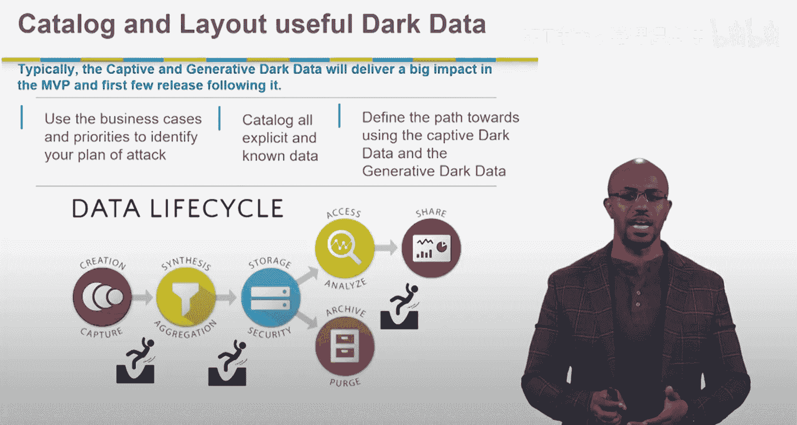

# 亚利桑那州立大学《黑暗数据迁移与架构｜Dark Data Migration and Architecture》中英字幕 p60 22_定义与设计阶段总览.zh_en [BV1TkurzMEmm_p60]

Welcome， this will be our intro to the design and defined stages of Uli。Now。

 our definition will include us working on solving and not solving for the unknown。

 making sure we define or follow the current data strategy， value strategy and expansion strategy。

 we want to think through all of these as part of the overall business strategy。

 the data strategy being critical because the data strategy is that lifeline that flows through the ecosystem and lives in our digital applications in our in user applications。

And in a more gray or more theoretical manner， we're looking at the value strategy and expansion strategy。

So we're starting with the parameters right what is going to be the parameters of our definition and what constraints are defining those parameters so we can define what we are doing。

 what we're not doing， defining what should be known， what should be unknown。

 what is intentionally left dark， what is unknown is left dark so outcomes， goals。

 resource knowledge capabilities， culture， these are all things we've talked about throughout these sessions。

 so you should be very familiar with these concepts。

 but all these concepts are going to serve as plugins and constraints to identifying the parameters to which we use to define our design and define our end goal right so。

Some people work at companies where when you come in， you start。

 you see an architectural diagram like this expressing the technology， ecosystem of the company。

This itself presents a problem and I wanted to show this because sometimes you come in and it's you know the box down to the right is the left。

 maybe a black box to half the organization and only certain people understand it or know it and it's all types of confusion and chaos going on and they're trying to get to a place where they can centralized and understand the architecture as it should be and as it is your first step on something like that when we get to trying to define a parameters is we have to clean up the architecture。

 as is architecture and it should look something like this when we're talking about the enterprise architecture and we're looking at things like what's being developed。

 what are the consumers touching what are our SoOs， our SRs， what is our cloud strategy。

 are we a hybrid cloud， are we onprem， how are we doing these things where is our API strategy what's our service oriented architecture。

 how are we doing our microservices and where do they fit in。嗯。

How are they providing that near real time information and data and integrating into the overall ecosystem of the transaction systems。

 plus the analytical systems simultaneously， these are all things we want to think through and we want to get to a view that's cleaner similar to this。

 not necessarily exactly but similar to this。And then things we want to think about when we start cataloging and laying out useful dark data for the organization and we're defining what is dark and what is intentionally dark and then what is not dark and what are we going to go get and uncover and bring to the light we want to use those business cases as our priority and identifying our plan of attack we want to catalog the explicit and known data and then we're going to define that path forward so we're looking at the creation synthesis storage access and sharing and then at the bottom we also need to think about that lifecycl that full life cycle。

 that data life cycle of archiving and purging data and what is going to be our governance and positioning around that so this is at a high level we're going to be looking at and the design and define phase we'll go through architecture later on in the design phase but currently we're going to focus on the parameters constraints etc to define what we'll move forward within a design。

 defining that problem that solution that opportunity and moving forward into the design so thank you for your time。

