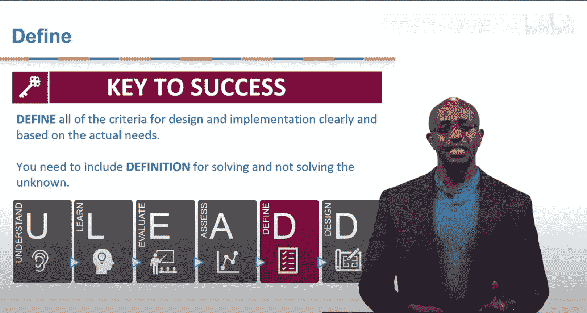
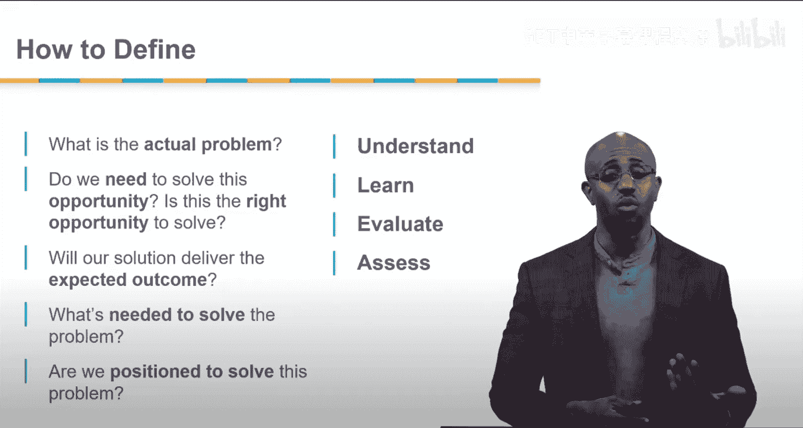
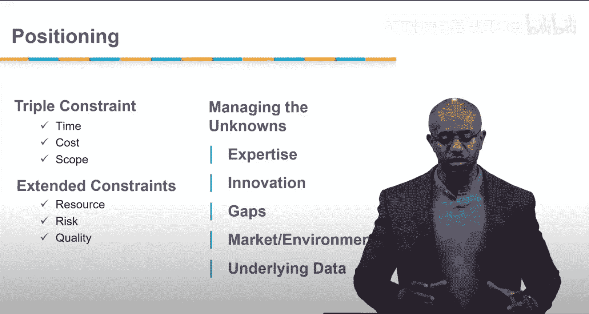

# 亚利桑那州立大学《黑暗数据迁移与架构｜Dark Data Migration and Architecture》中英字幕 p62 24_机会界定标准.zh_en [BV1TkurzMEmm_p62]

Welcome in this lesson， we're going to go over an opportunity definition。

So when we think about the whole U lead concept going from understand， learn， evaluate， assess。

 define and design， this is that critical stage where we're looking at how do we define the opportunity ahead of us right we're looking at we've worked with the business。

 we worked with our stakeholders we really took a good gauge and assessment of what the issue is in front of us so with that being said。

After understand learn， evaluating assess， we're going to start asking questions like what is the actual problem using the data that we've collected。

 using the dark data and information that wasn't privy to us at the beginning of the process then we're going to look at do we need to solve the opportunity or is this the right opportunity to solve sometimes you do not want to solve the opportunity that's presented and sometimes it may even be the wrong one you may need to actually shift course and do it differently and there may be skekus in between it never black and white it's sort of grayish。

Will our solution deliver the expected outcome and what's needed to solve the problem right so when we think about our solution。

Will our solution that we're driving towards solve and deliver on that outcome and then lastly are we positioned to solve the problem and this is a key one this goes in expertise in many other factors you're thinking about if you're thinking about project management looking at the triple constraint and now the triple constraint has six face it's time cost scope resources risk and quality these are all things that you'll want to look at and think about what is our positioning do the resources have the skill and acumen right so thinking about that positioning。

There goes those three plus three more six constraints and then looking at managing those unknowns。

 the expertise， what is the market innovation， what is our level of innovation our rate of innovation are we competitive and if we're not how do we become competitive and it doesn't always have to be specifically technically it can be in marketing and other softwareer areas that can give you the van even down to how you implement what are the gaps that we have the underlying data and the marketing environment what are the things around us that impact us impact our positioning to execute these are all pieces we want to think about even as we deliver right。

And so what we also want to talk about is defining that opportunity we have a picture of the Constitution here because when we put together that opportunity statement。

 this sort of act as our Constitution moving forward。

 it is amenable just like the Constitution we can put amendments on it we can adjust that we can change it。

 but we wanted to act as that foundational document that allows us to move forward fast and with minimal failure because we would have already failed somewhat in our discovery。

So we want to list out clearly the opportunity statement as is the business expectation。

 inclusive of targets， OKKRs， KPIs， dates， roadmaps， et cetera， high level roadmaps at this point。

 risks， gaps， constraints and then any data challenges。

 data challenges are critical where we don't know something that is where we will fail so these are a lot of things we want to think about so。

Defining the opportunity is critical and these are the pieces that we want to execute on to be able to do that so thank you for your time。

