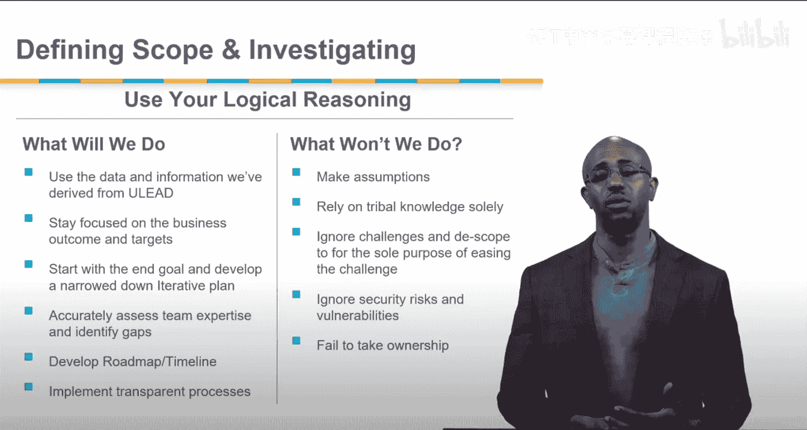
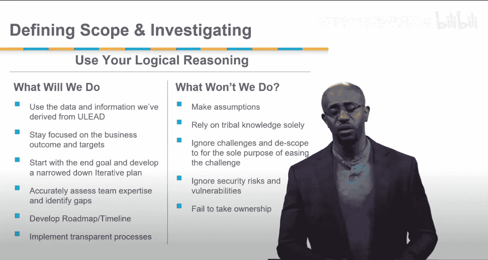
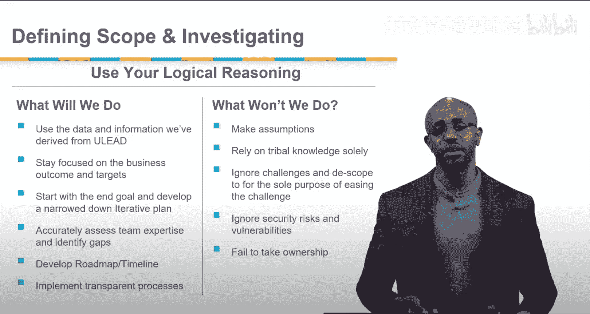
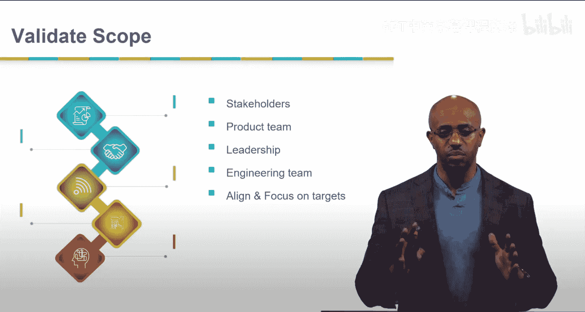
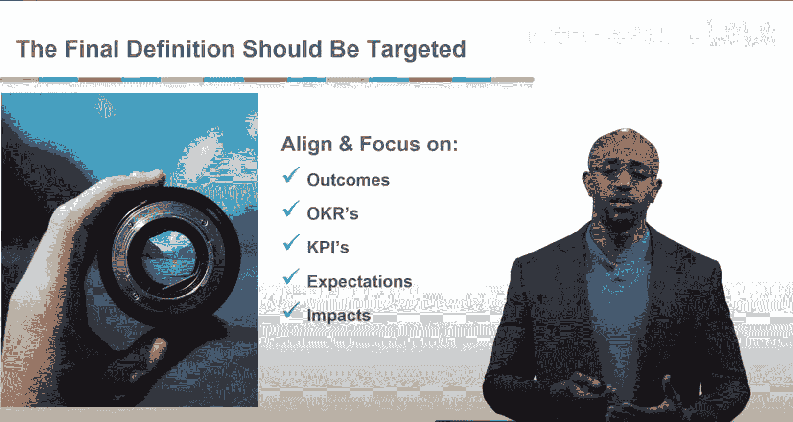

# 亚利桑那州立大学《黑暗数据迁移与架构｜Dark Data Migration and Architecture》中英字幕 p63 25_机会定义验证流程.zh_en [BV1TkurzMEmm_p63]

Welcome， in this lesson， we're going to briefly go over the validation of our definition。

So when you've defined the scope and you finished your investigation。

 we went through those stages of you lead， understand， learn， evaluate， assess。

 and now we're defining。So we've defined the opportunity statement。

 we get all the pieces in there KPIs， OKRs， et cetera。Now we want to go back to our stakeholders。

 our product， our business people， even our tech folks。

 and evaluate what we came up with the definition and how we're going to move forward right so we're going to use our logical reasoning and we'll identify clearly what we will do and what we will not do。

So first we want to look at the data， the information and what we've gotten from you lead。

 we'll look at the actual opportunity statement we'll look at all those gaps where we narrow down how we look at the planning right so we'll have the high-level roadmap not the detailed one but the high levelvel roadmap with the timeline and we'll implement transparent processes these are the things that we will do the things that we won't do is make assumptions anytime we start thinking that we believe something will happen or we will assume something will happen we need to clearly draw a line in the saying will it or won't it and if we don't know we will say we would like it to happen。

 we don't know and we need to make sure we keep a watch item on this we won't rely on tribal knowledge we will validate and check everything with data and facts tribal knowledge is definitely a place where failure happens we will not ignore challenges and decope for the sole purpose of easing the challenge right。

It's fine to descope things so that we get to the next place， but it has to have a purpose。

 it can't be solely just to make things easier。

嗯。We will not ignore security risks and vulnerabilities。

 we'll make sure that everything is secure we've taken account of vulnerabilities and we will take ownership failure to take ownership means we plan to fail so these are the things we will do and some of the things we will not do。

Now looking at validating scope。Again， our stakeholders， our product team， our leadership。

 our engineering team all need to align and focus on the same targets sometimes when we define things。

 we can leave those meetings those conversations and be in two totally different places as teams。

 we need to be one we need to be together and we need to make sure that everybody understands what we're doing moving forward。

Lastly， the final definition should be targeted， we need to align clearly on those outcomes。

 OKRRS KPI's expectation impacts， those are our North star that's our guiding principles and that's how we will be successful。

 so make sure you validate on all these pieces along with the opportunity statement and you should be clear to go and you should move forward with very minimal failure versus large failure。

Thank you for your time。

