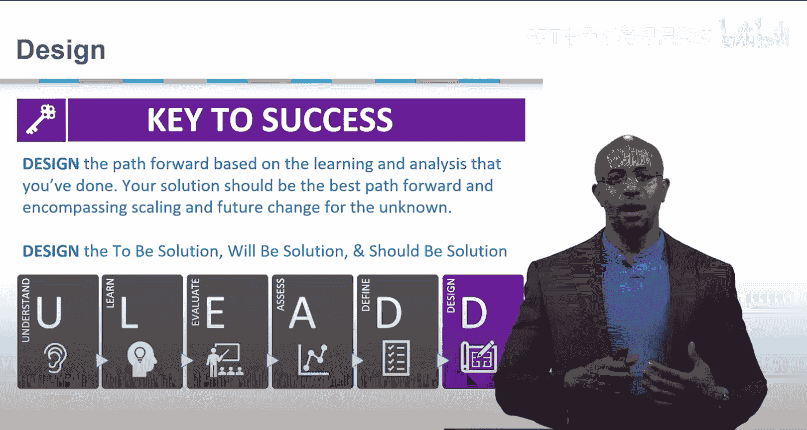
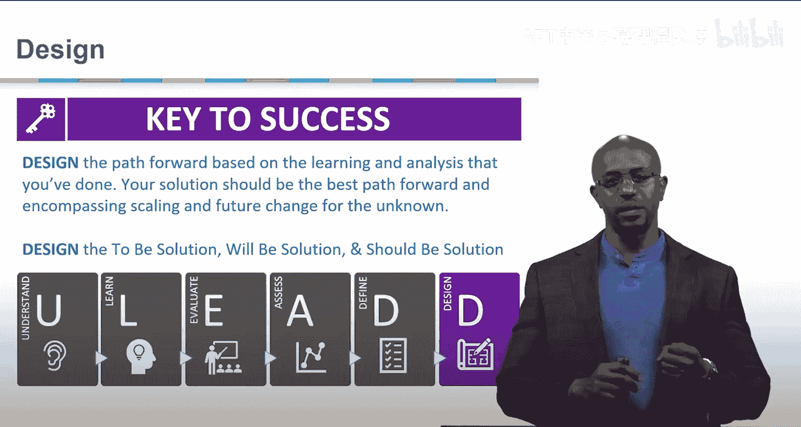
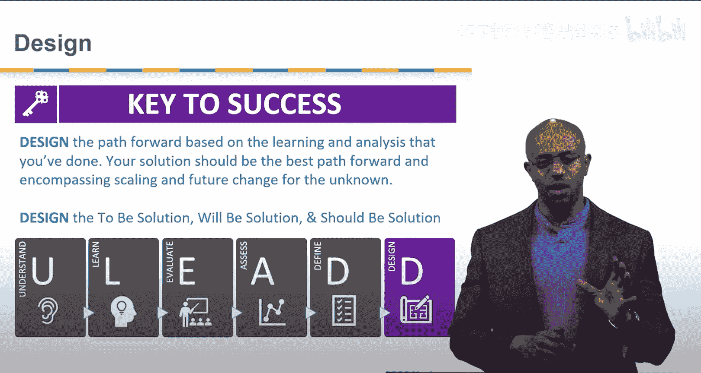
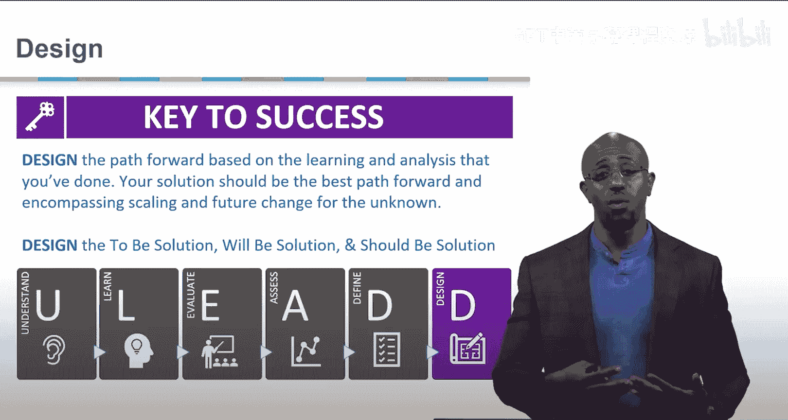
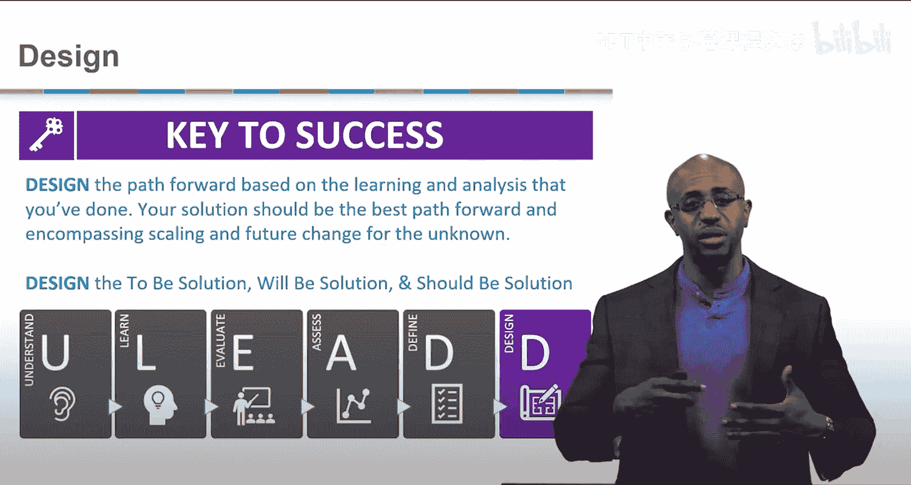
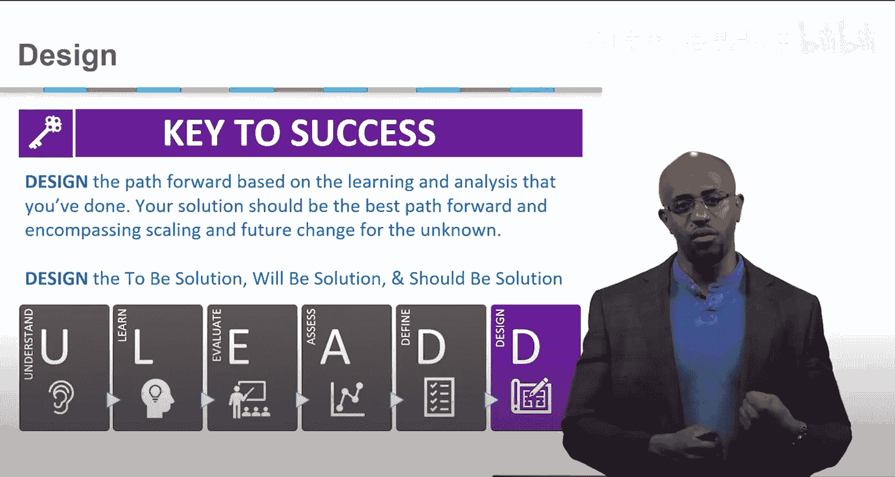

# 亚利桑那州立大学《黑暗数据迁移与架构｜Dark Data Migration and Architecture》中英字幕 p64 26_发展路径设计.zh_en [BV1TkurzMEmm_p64]

Welcome， in this lesson， we're going to design the path forward。

Now the design is what's going to give us that visual representation and that physical element of understanding what's going forward。

 so in define we've put the baseline we've made our constitution of how we're going to proceed。

 but now we are putting things to paper where we can now see and understand and visualize what the process is going forward and this will help us start breaking down that work iteratively so that we can pull together all of the unknowns and easily place them on that timeline for us。

Designing the path forward， this is one of the things that you're going want to look at as step one and step two once we get out of the evaluating assess phase defining and design so now at this point we finished the definition we have our logical and functional decomposition of the opportunity and now we're looking at the logical and functional creation of the path forward right so this is the go forward implementation and this is we're going to start looking at our expected outcomes and targets okay so designing the path forward。

Looking at conceptual design， solution design， architectural designs， roadmaps， value streams。

 and journeys。So many folks as we're looking at this we look at those last three roadmaapps。

 value streams and journeys and say they're not technical designs that's true they are not。

 but they help govern the technical designs， they are critical to help to help us understand the path forward to help us understand help our architects and engineers understand what we need to do and how we need to construct things these things work synergistically right so when we think about value stream mapping。

 we are actually designing how the value comes in and goes out when we think of the journeys the customer journeys。

 the data journeys and even the value journey which is highly similar to the value stream mapping these are the flows to which customers interact with us the flows to which the data journey have and the flows to which value changes over time intricately through our systems right now。

Going back up to conceptual design， solution design and architectural designs。

 there are many different facets of each of these， the conceptual design。

 like as you see the conceptual design on the left with our standard generic conceptual design at the top。

This helps us get that first path forward of understanding。

 what does the landscape of the enterprise look like and how do we manage all of the facets that are in between。

Along with the data and data gaps that come with it。

Thinking of solution design as we look at the different segments。

 how do we solve for innovation and how do we solve for for new systems coming online or new upgrades to whatever systems that we want to have and also integrations right so integrative designs that roll up into our conceptual designs and lastly there's a litany of different architectural designs right one thing you don't see listed as physical designs physical design is important as well but there's a ton of different type of architecture that we could add so I just put some of the top three and business architecture is important although that's more or along the lines of toegraph and enterprise architecture these things all map together right so the data architecture system information that is it rolls up into that enterprise architecture it's one of those things we want to consider as。

Highly integrative and when we think of toeGff， we want to think about how we bring everything together and move forward with our designing based on what we defined in the previous phase using the integrative different facets such as roadmap value stream journeys。

 conceptual and solution so thank you for your time。

