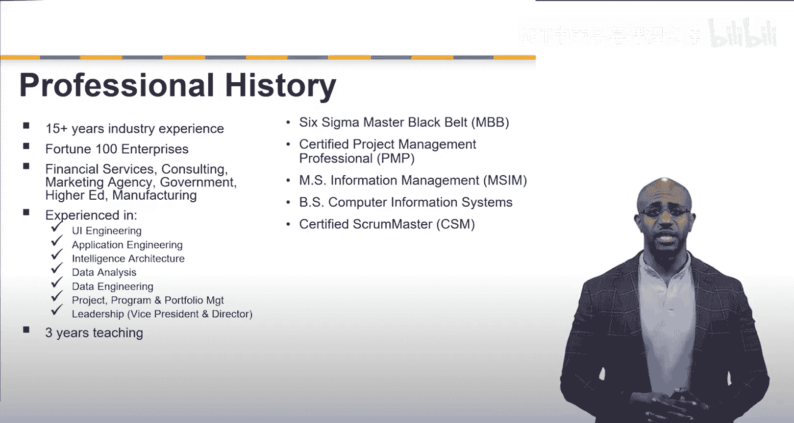
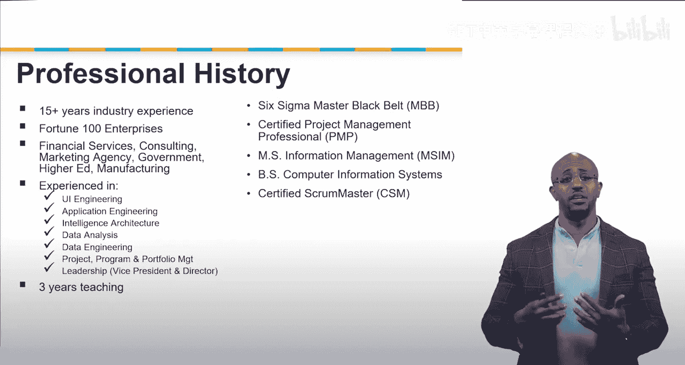
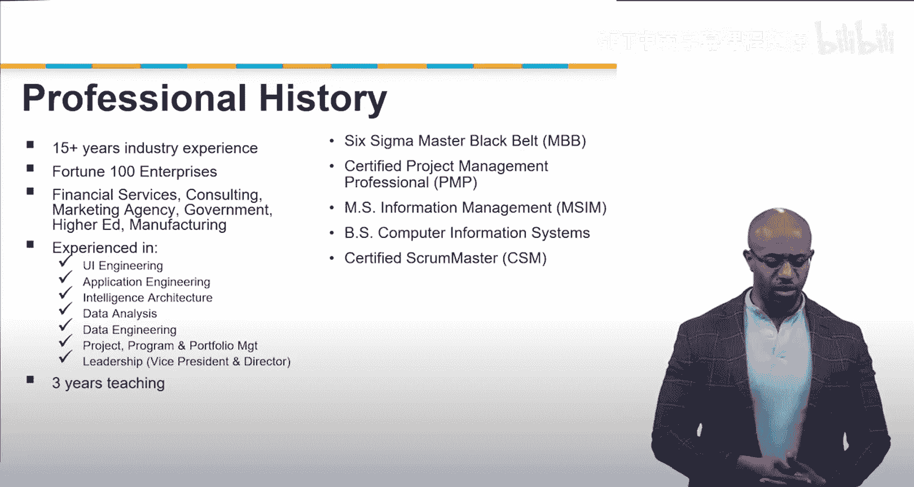
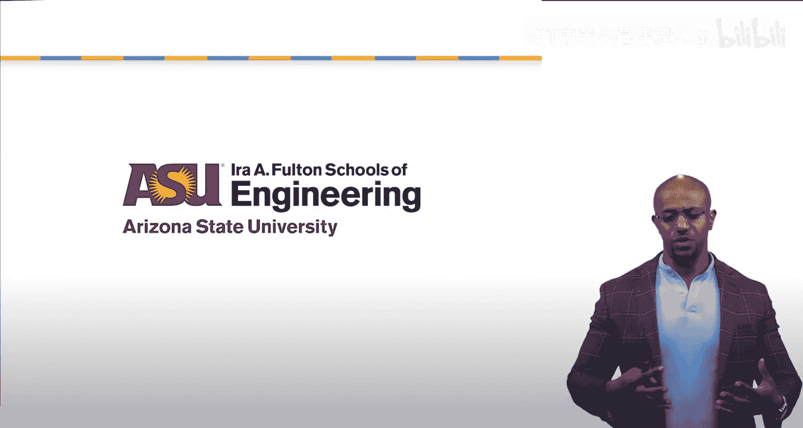
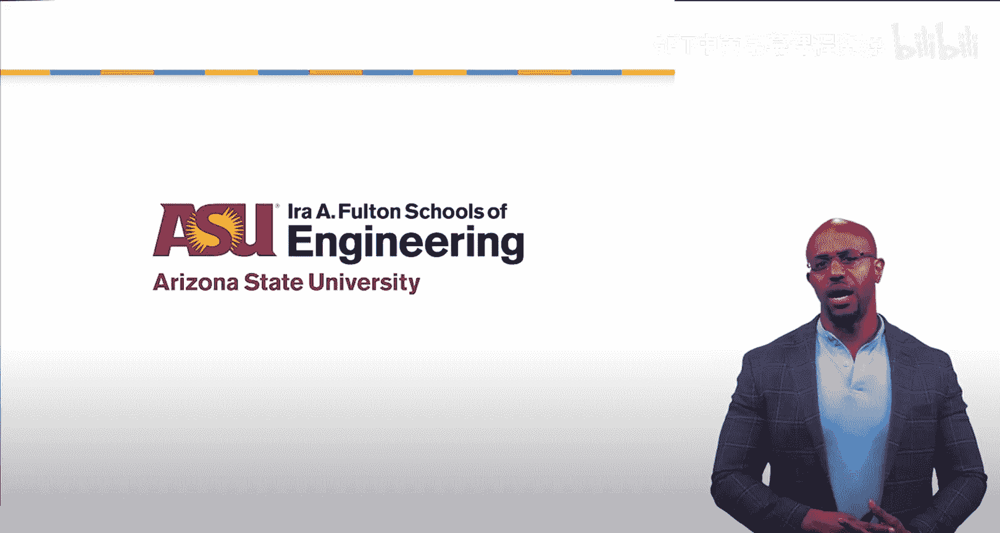
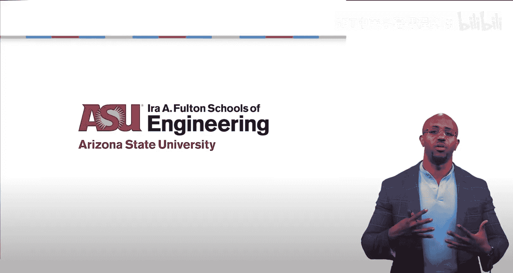
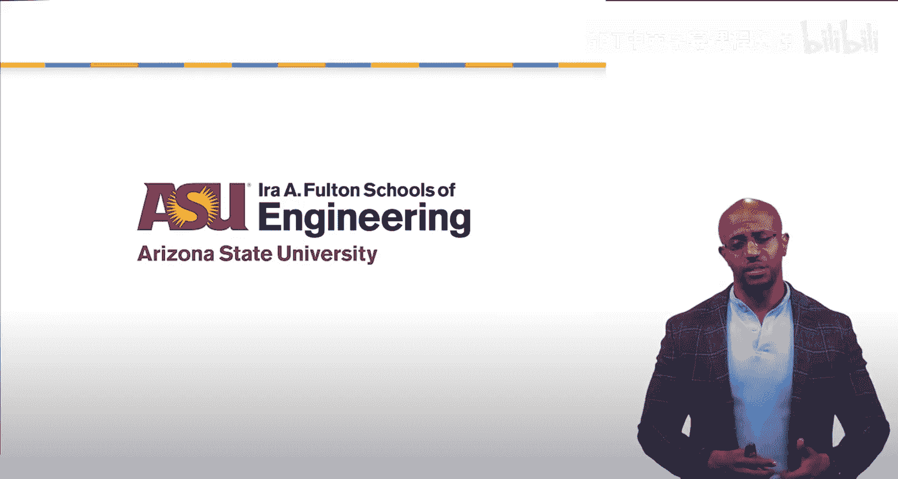

# 亚利桑那州立大学《黑暗数据迁移与架构｜Dark Data Migration and Architecture》中英字幕 p67 0_讲师介绍1.zh_en [BV1TkurzMEmm_p67]

Welcome in this video， we're going to talk a bit about my background， how I gather into dark data。

And some of the personal things that have developed me as a career professional and how I use dark data on a daily basis。

So a bit about my professional background， I have over 15 plus years of experience in the industry in corporate America as well as a few other sectors such as consulting。

 marketing， government， higher ed a bit of entrepreneurialism， I've worked primarily in Fort 500s。

 Forune 100s， my background is a myriad of positions and disciplines， I've done UI engineering。

 application engineering， intelligence architecture， data analysis， data engineering。

 project program portfolio management and currently leadership in terms of vice president and formerly a director at some of the largest companies in the United States and around the globe。

 over the last few years I got into teaching a bit more although I feel that all of us are are teachers to some extent we learned when we do better and we teach others when we do better。

 so to some extent we've always been teachers as long as we share that knowledge some of my more educational focused formal education。

Is around multiple disciplines as well， computer information systems and information management。

 I did my undergrad at Alabama State University I did my master's degree at Arizona State University I'm also a certified Gr master PmpP and a certified six Sigma master Black beltt and I did that work here at Arizona State University one thing I've done over my career is continued to grow and as many directions as possible as you're delivering projects you'll see there's a need for better project management you'll see there's a better need for there's a need for better UI engineering a better better application engineering depending on the project you're working on depending on the team there's always somewhere you can improve and there's always somewhere where there's a problem for you to solve so throughout your career long as as long as you stay focused on finding problems and solving them and helping other people grow you'll see yourself getting more experience and。

Become more competent in areas where you may have been less competent before。

When I think of my career， I started in Cleveland， I moved out here to Arizona and over the years I've grown in this area and also grown in the professional industry as well so if we take a pivot into the personal interests I was a former college track athlete。

 my days at Alabama State University， Sprinter， 100200 me D， I enjoy traveling across the globe。

 been to many places， such as Lisbon， Portugal， Paris， Madrid， Allecante， Meria。

 most of those are in Spain and then many places around South America， cities in Brazil， Me， Panama。

 Mexico， that's more Central America then out in Asia。

 Bali and other places I enjoy traveling I enjoy great weather。

 I enjoy learning and meeting people and understanding of cultures and definitely the food。

these new places that I go to but to me when it comes to traveling。

 it's all about the people and the culture and understanding how people operate and think differently and how we can get outside of the boxes that we're in right over the last few years I've developed a very deep interest in NFTs and cryptocurrencies I've made a few NFs。

 more art focused instead of utility focused over the next few years I do plan on getting into some NFTs that are more focused on utility and when we think about cryptocurrencies。

 obviously a lot of us have done investing I've invested a number of cryptocurrencies the some of the new projects that are out there such as sallana Madic and obviously the two big ones Ethereum and Bitcoin and I've always been a lifelong advocate of health and wellness。

Just following some of the guidance that。The ancient times of providers like Mark Anthony saying the healthier your body。

 the healthier your mind and the sharper you'll be so definitely an advocate for health and wellness and really。

 really took it taking some time to dive into Nfts and cryptocurrencies the pictures at the top of the slide are actually pictures that I've taken on these trips top left is Guape in Colombia and then to the right of that is a port in alacante at the Santa Barbara Castle looks over the bay it's absolutely beautiful view and it's a castle on top of a mountain built by the Moors when they ruling the Iberian peninsula in Europe and that' beautiful sunset next to that is Hio Janeiro in Brazil and that's the sunset right during summertime the sunset in their spring drop right through the sugarloaf Mountains So whichever angle you're looking at it's always a great sunset and the last one is。

a very big mall in a famous park in Lisbon， Portugal again on that Iberian peninsula but those are some of my favorite places that I've been and I just wanted to share them with you when we dive deeper into this course you'll see that exploration is key for me I'm super passionate about exploration。

Innovation and creativity those things are what fuel the world。

 those things are what solves the problems and those things are those three things are the core and the backbone of elevating yourself。

 your career， the enterprises you're with and the people that you're around and it is what builds the world that we use。

So thank you for your time and best of luck on this course。

