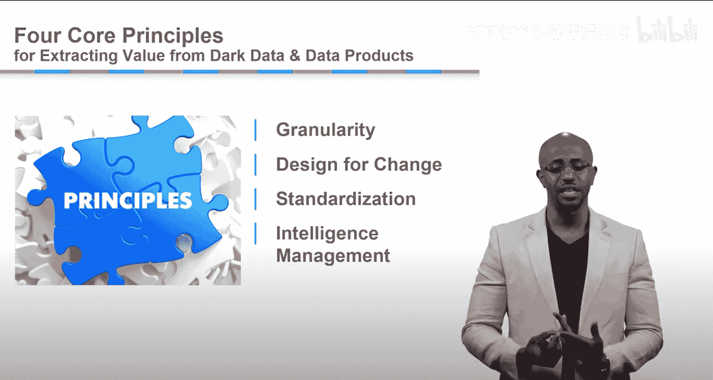
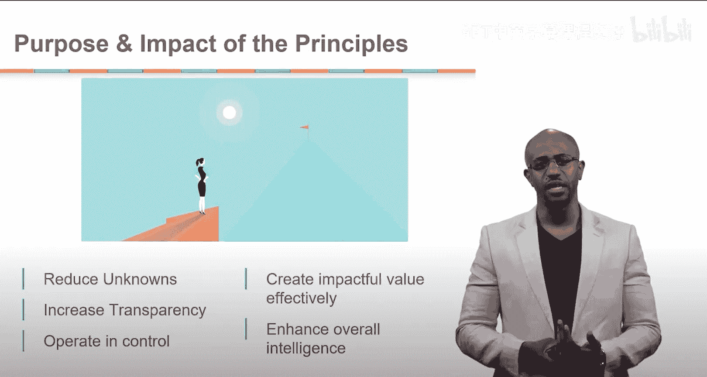
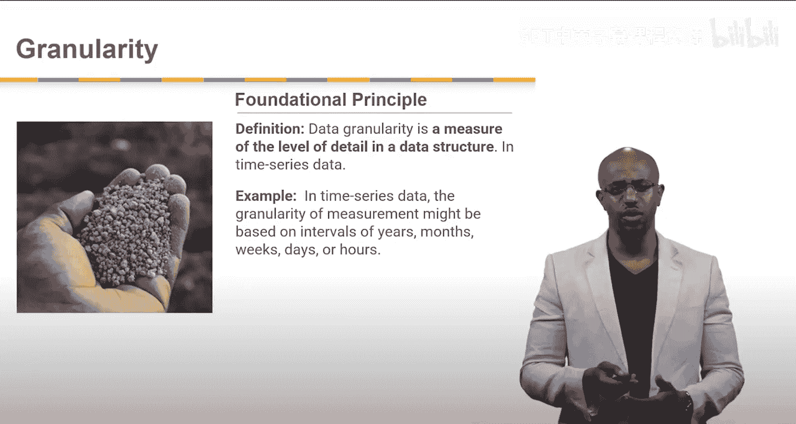
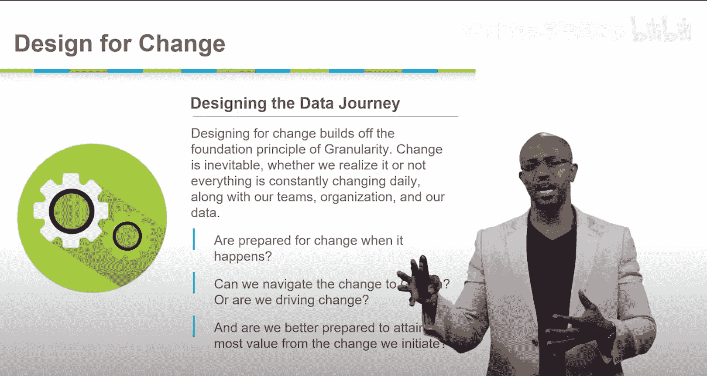
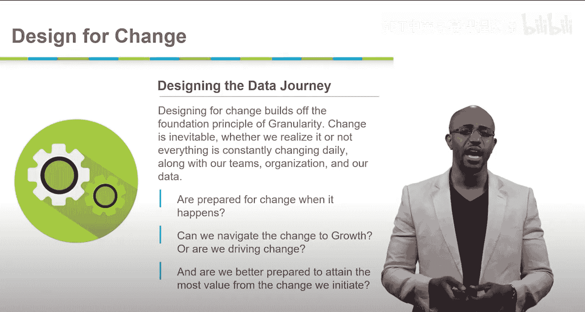
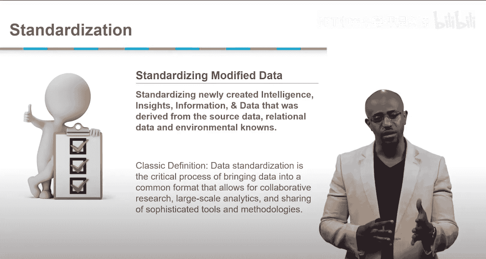
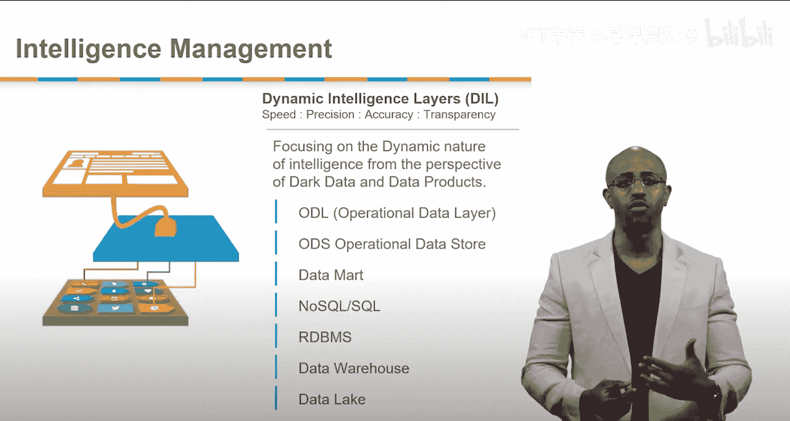

# 亚利桑那州立大学《黑暗数据迁移与架构｜Dark Data Migration and Architecture》中英字幕 p70 3_暗数据处理四原则.zh_en [BV1TkurzMEmm_p70]

Welcome in this lesson， we're going to focus on the four principles that allow us to extract value from dark data and data products。

Now these four principles， some of these you may look at them and say some of them are general data principles。

 general data structuring or architecture or even data engineering principles。

 in general yes they are， however， for the purpose of dark data and data products we're taking a slightly different spin on them because we're trying to extract value from the data and express it in data products so granularity。

 design for change， standardization and intelligence management。

As we dive into these， we want to dive into them purposefully and impactfully。So。

Our guiding light is going to be these five purpose or impact statements。

 so we need to reduce the unknowns， increase transparency， operate in control， create value。

 create impactful value effectively and enhance overall intelligence。

All five of these things help to grow business organizations and help to grow our overall intelligence as a whole and a lot of value can be extracted from dark data in the presence of creating data products so starting with granularity granularity is a foundational principle for this now this doesn't mean to say everything needs to be granular as as you're building out your systems and as your data goes through as data journey but what it does mean is the data that is essential to be granular as you begin looking at designing for change you begin looking at standardization this is that bedrock so when you're thinking about time series of data weeks。

 months days hours if you're coding a dashboard or some type of visual and you need to have that flexibility to cut through months and cut through weeks or cut through days。

 you need to be able to slice all of those data points down to whatever is the most fine grain for a time series right and that's just one example but there's many examples that will go through。

Other than more or less in some of these lessons now， designing for change。

 building upon granularity， granularity is key because you can't design for change without it。

So what happens sometimes is you're working in companies people build a system or they build some new reporting infrastructure and they haven't designed for change they may have built it specifically for a certain use case and didn't think about scalability over time this is critical because a lot of times people get themselves boxed into technical debt or boxed into something that doesn't work for a bigger purpose which is creating value and they only solve one little problem and over time that can then grow and cause more problems so it's imperative to design for change and some of the things that you want to ask yourself is are we prepared for change when it happens can we navigate the change to growth or are we driving change how do we navigate that change so that it turns into growth and not where it turns into a problem and then are we driving the change or is the change driving us。

And lastly， are we better prepared to attain the most value from the change that we initiate when we're driving change。

 these are things to think about as you're building out new infrastructures and new data journeys。

Standardization。This is key， although when you think of standardization a lot of times you think of data governance data management in general。

 when we're talking about it specifically for dark data it can be more nebulous because dark data itself is unknown so how do you standardize something that is unknown and then when you think about data products。

 those are built off of the data that you have and the dark data so I put the classical definition at the bottom but for our purpose what we're looking at is standardizing newly created intelligence insights。

 information and data that was derived from source data relational data and environmental knowns or tribal knowns。

 how do we classify and capture the information that we know to be true and how do we do that in a more standardized or process way and build out for scalability off of that and capture that information in the granular manner because granularity is that bedrock and final where we attain the value is the intelligence management。

So this one is this is more of a very interesting or vague concept right so focusing on the dynamic and nature of intelligence and you know in terms of the perspective of dark data and data products intelligence itself can get outdated。

 it can get stale it can get old so intelligence has to stay fresh it has to stay actionable。

 it has to be be something that is useful so when we think about that perspective we have these things like data lakes。

 data warehouses， RDBMS like relational related relational databases and relational database systems and they're all sitting in things that are SQL or no SQL and then as you get to the layer where we're starting to use data to make decisions you're starting to look at data mars。

 ODS is operational data stores and operational data layers these things are good but a lot of times they can be locked in and not built in a scalable manner。

嗯。One of the things I try to do is dynamic and intelligence layers these things are built for speed。

 precision and accuracy and transparency now they're not much different than any database that you would have in terms of the actual tactical nature or the actual physical nature of them but conceptually they're completely different they're built they are built to be commissioned and decommissioned rapidly to test experiments rapidly they're built to be used in the sense of。

Sentending it out two things like Tableau or Kiana or Power BI。

And then being able to expand intelligence insights。

 more metadata off of those intelligence layers and used in combination because many times you don't want to duplicate the data。

 but you want the ability to be able to create it， use it and if it's not being used。

 decommission it rapidly rather fast so these are things to think about how do you want to manage that in a standardized way in a granular way and design it for the change that's going to come about so thank you for your time。

