# 亚利桑那州立大学《黑暗数据迁移与架构｜Dark Data Migration and Architecture》中英字幕 p71 4_数据粒度对暗数据的影响.zh_en [BV1TkurzMEmm_p71]

Welcome， in this lesson， we're going to focus on finding out where in the data journey is granularity most impactful and why。

So our commitment to granularity must be solid right granularity like we were saying in the previous video is the bedrock。

 the foundation of how we'll extract value out of dark data and deliver it to data products right so we're going to be doing looking at things like data exploration。

 data structures， algorithms and data engineering all as things that come out of granularity and start beginning to extract value for the purpose of business growth and organizational growth so。

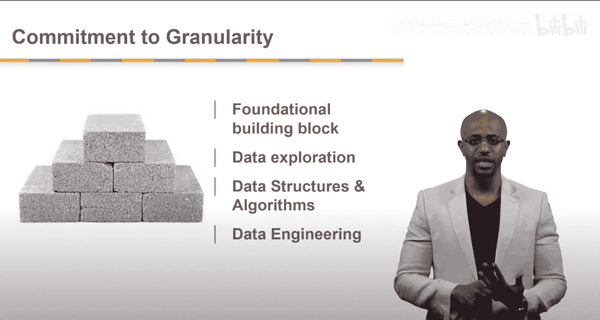

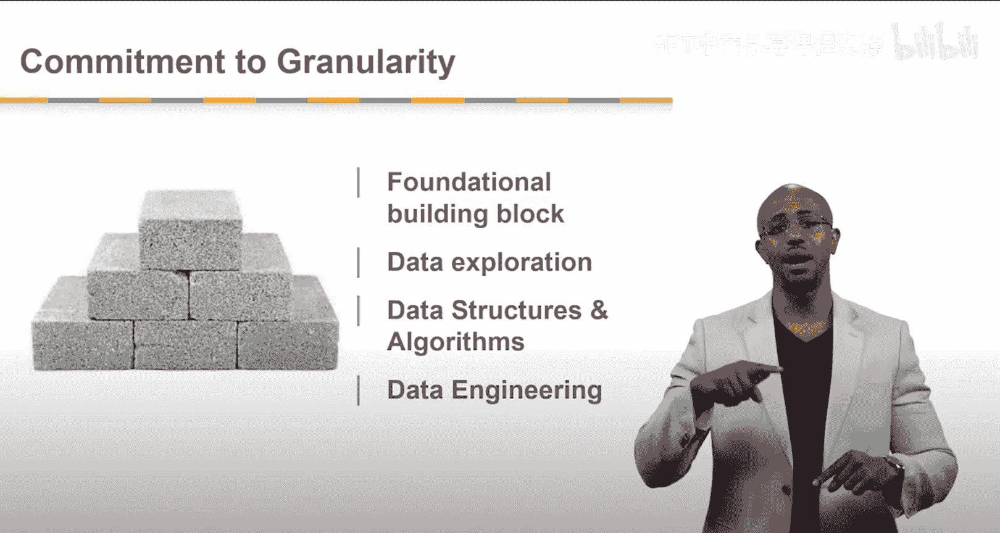

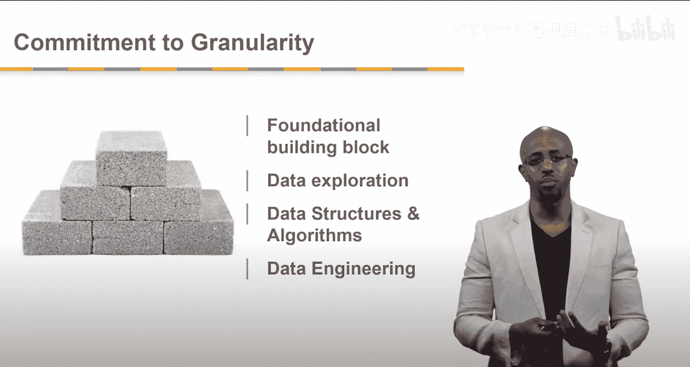

When we're thinking about being effective with granularity， we have to look at data structuring。

 engineering， enrichment and derivations。

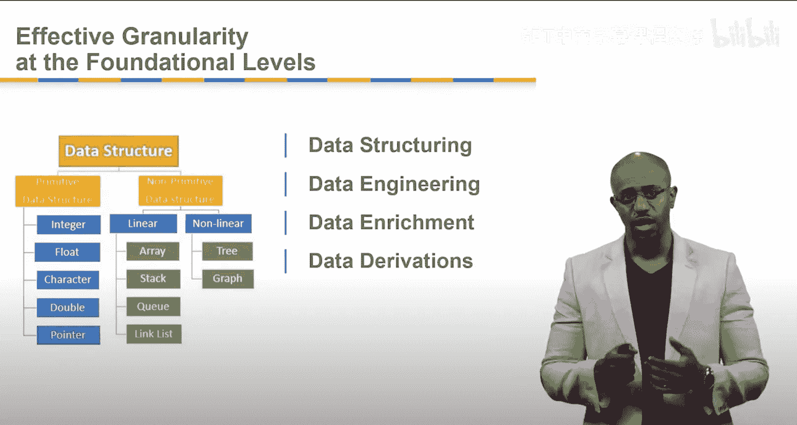

Those pieces are going to be the levels or layers to which we then continue to grow value and on the left here you just see a quick graph or a quick hierarchy chart just showing you primitive non-priitive data structures。

 just your basic stuff so when we talk about integers， floats， characters。

 doubles all those things those pieces fit inside of arrays and other things for the purpose of us。

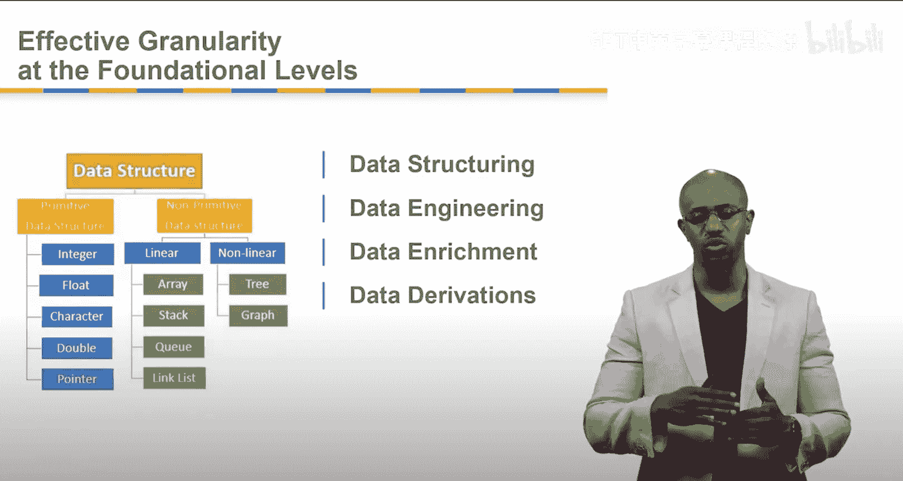

To be able to slice and dice the views of data and intelligence and create new things that we didn't know before and learn from the data itself。

 partly in machine learning， but also part how you set it up and structure it。

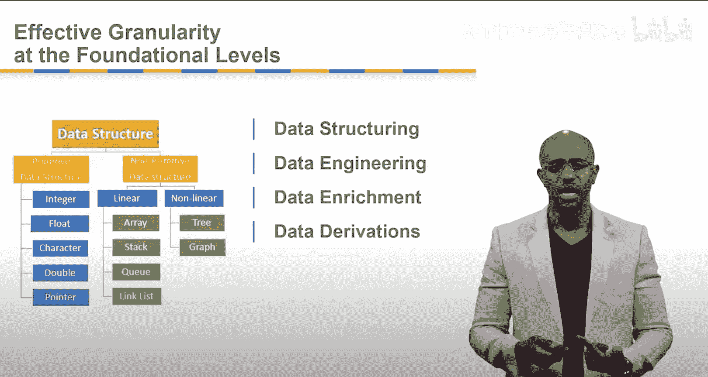

Now， where is the most opportunity for？Data to be granular it's in that generative tier right so the data that we have is captive we're already using it we're sending it across the enterprise through different systems and then as we generate derivations and enrichments and new views and new understandings of that data。

 we need to keep them as granular as possible until we get to those operational data layers and get into those rapid dynamic intelligence layers as well。

So lastly looking at this looking at our architecture diagram we took a slice of the OLAP side of the house right at the bottom you seeerarchical our hierarchical data and RDBMS Now these are things that you really don't look at as your core data set because they're typically peripheral in nature but there's many opportunities there in those most companies since they don't look at it as the core data source these are sort of your data sources that sometimes get neglected and can sometimes be often cause problems or also are missing components and pieces and haven't been thought through well so I wanted to call them out here because it's one of the things that you want to really think through because they're really a keylinpin in terms of creating new enriched values and creating new derivations now as we go up the go up the chart that。

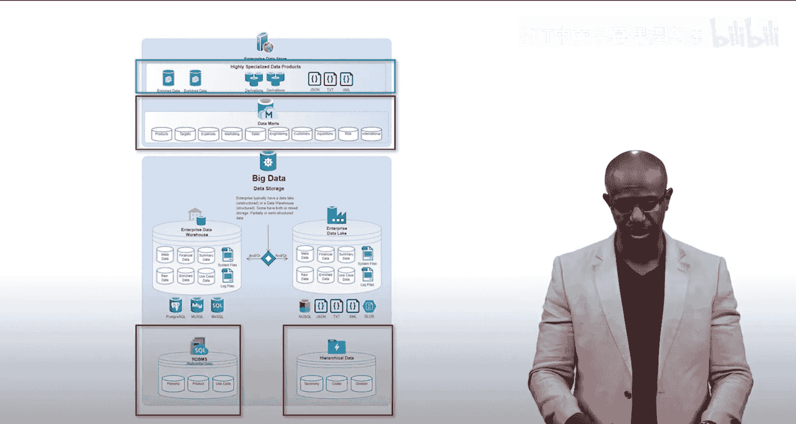

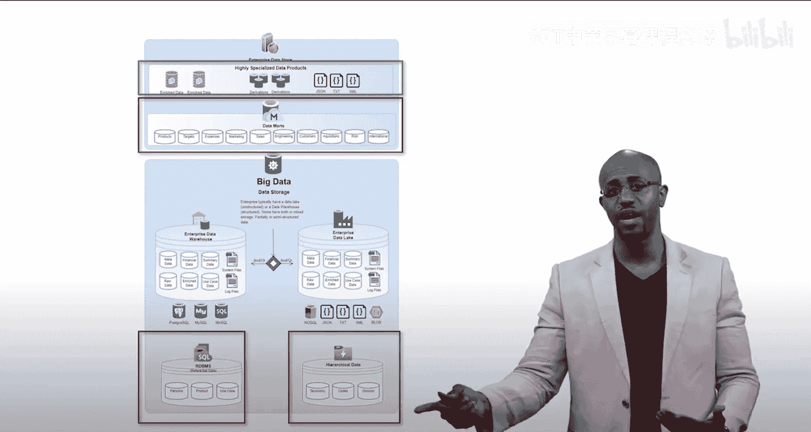

Horizontal red box where with the data marks， this is that first layer where we're pulling data out of the data store or out of the data lake or the data warehouse and we are now saying。

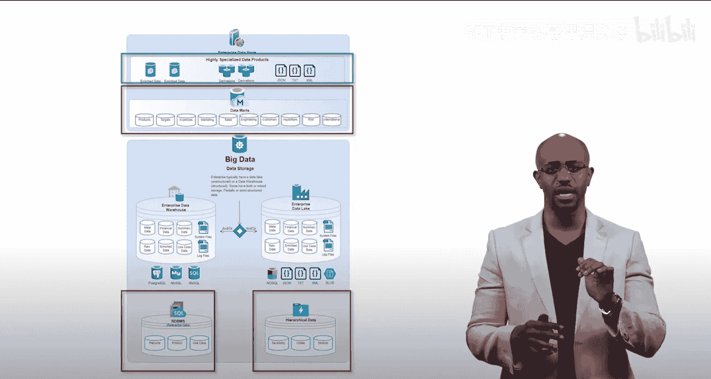

Let's store our data。All in a product table or in a targets table or in a marketing table。

 and we'd have APIs allowing folks to go access this information， pull the information out。

 but it'll be a nice granular fashion and it's key that it's like that。

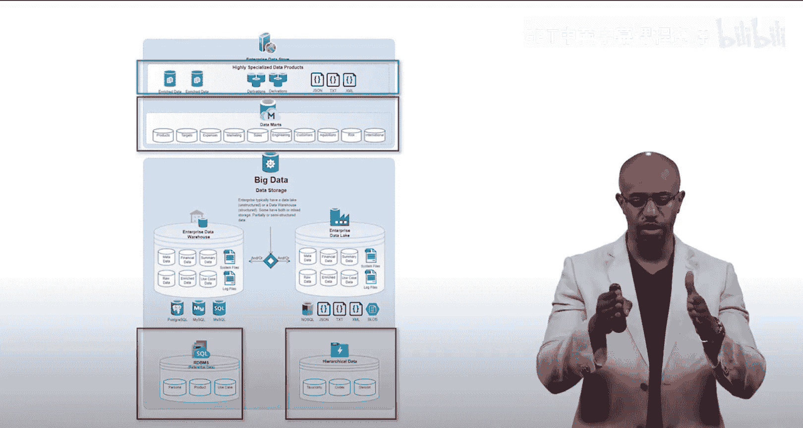

Now。When we then go up the chart to the green box at the top this is where we're getting that value right so either we're being able to create those derivations on the fly or we're using the data marks or we're using ODLs。

 they could be enriched data， they could be derivations。

 they can be JSON objects right they can be many different things but they will have a lot of different metadata attached to it based on all the different learnings and understandings that we've had and all the different calculations that we've been able to derive on the arrays and other values that have been generated。

Out of the data Mars and out of the algorithms that we've built。

 so these are the areas where it's most opportune for granularity to have its impact thank you for your time。

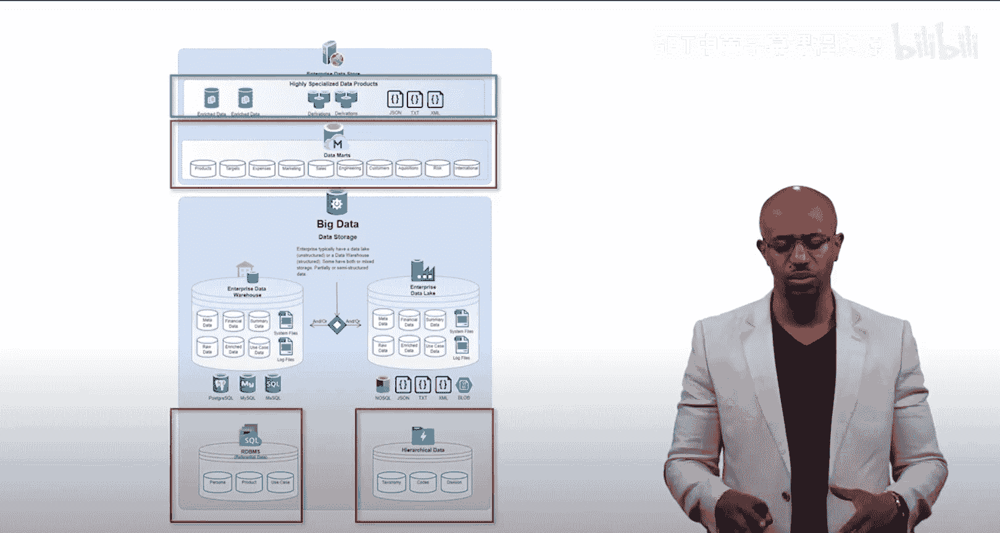