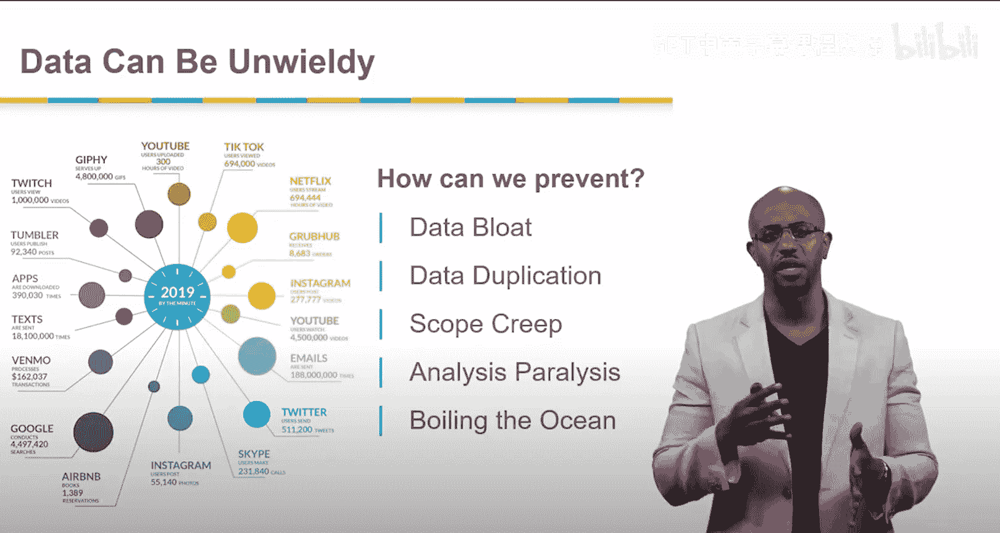
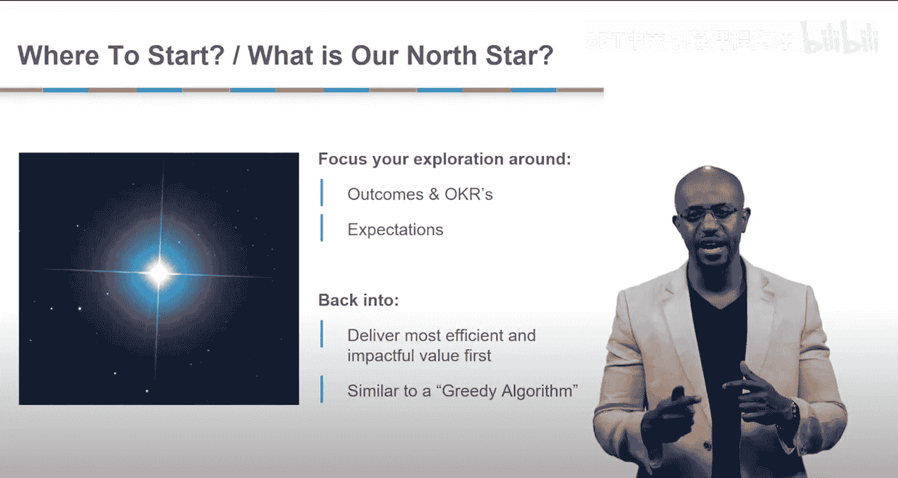
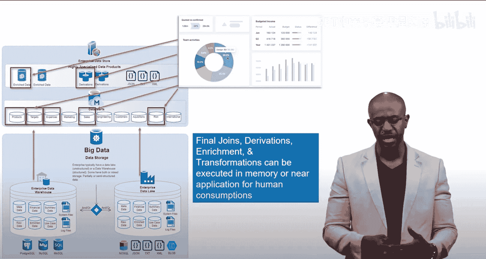

# 亚利桑那州立大学《黑暗数据迁移与架构｜Dark Data Migration and Architecture》中英字幕 p72 5_粒度思维与范围控制策略.zh_en [BV1TkurzMEmm_p72]

Welcome， in this lesson， we're going to focus the conversation around staying granular and avoiding scope creep。

Now， dark data， data in general can be unwieldy。If you work with data， you know this。

 especially if you work with data as a data scientist， analyst， data engineer。

 or just as your standard programmer， you know that at many times depending on how you do things your data can bloat you can get duplications you can duplicate data sets for actual needs and you can easily experience that scope creep or that analysis paralysis once you've been harmed by scope creep there are many different terms like boiling the ocean etc ce and a lot of times you're more experienced people will try to avoid these things however the true savant will know it's not necessarily about avoiding these things it's about how to use what you need at the right time at the right level and get the efficacy that you need so sometimes you need to understand when the change scope scopepe creep is really around unmanaged change you need to manage it when you think about analysis paralysis sometimes you need to step back and take that time to analyze the situation。

Before moving forward and we're going to talk about how we take a granular approach。

Get the change that we need， get the data that we need。

 create the intelligence that we need without necessarily boiling the ocean。

By doing it in a way where over time we can piecemeal and iteratively get the information that we need now where do we start what's our North star we always start with those outcomes OKRs and expectations what do we expect to get out of something and work backwards right so we're back into it understanding how to deliver the most efficient and impactful value first and we'll do it in a manner that's similar to the greedy algorithms where you're looking at getting as much value efficiently as possible and continuing that iterative process of adding and adding and adding to a data set so let's get the example going now looking at this example we're back on that Oap side of the house so the data is going through as journey it's been in the data lake it's been in the or the data warehouse and now how do we not blow the data and keep it granular now most of your granularity is going to sit at the data mar level the problem with pulling data directly from the data Mar level if you're going across many table。

It's your UI is going to be really slow because you're going through a lot of data and a lot of tables and you're trying to join them at the UI or at the source。

Which is why we have these specialized and highly specialized aid products in that DIL layer。

Now that's where your intelligence is going to come into play。

Now the one thing that you're typically going to always copy is whatever your key value is your IDs and things like that and you're gonna to pair those together right so when you think about the bloat that's typically where the bloat is going to take place you keep your your data sets and your derivations in that DL layer but you still call down to the data Mars for the core data that you may need now in the case where you see a dashboard or UI performing slowly you'd want to consider which pieces you actually do need to copy that are outside of those key values right so when you think about these types of。

These type of data sets or creating UIs， like you see at the top right here when you're looking at quoted versus confirmed in like a UI。

 you want to understand which derivations you can use and how you can dissect those derivations at the UI source to speed up the performance and speed up the intelligence as well as not bloating the data。

 so you have a more streamlined experience across that data journey， so to recap。Your final joins。

 derivations and enrichment transformations， all of those things can be executed in memory。

 reducing the amount of data blo， and they can be done at near application source for the purpose of human consumption。

 so looking at those the data warehouse or the data lake at the bottom。

 you go from that bottom you go up。You'd have your data structured in a granular fashion in those data mars and then that UI is going to be ping in those data marks for the core information and all those derivations you'd be pulling off of the DIL layers are those highly intelligence and highly specialized layers that are created for specific views that can be populated or depopulated at any time so you'll see more about this in the reading and in the text but this is the premise or the basis of what you're trying to do so thank you for your time。

