# 亚利桑那州立大学《黑暗数据迁移与架构｜Dark Data Migration and Architecture》中英字幕 p73 6_成长型架构设计.zh_en [BV1TkurzMEmm_p73]

Welcome， in this lesson， we're going to focus on designing with a growth mindset。

And we're gonna move that into a bit of conversation about how to design grant for change and for granularity。

 So looking at a growth mindset， some of the things you' want to focus on are avoiding pitfalls in which way to go and knowing how to set yourself up and position yourself for the change for the growth that's always going to come if you've built a useful product So looking at things like incorrect conclusions you have to familiarize yourself with the data as well as using algorithms and machine learning to help express things that you didn't know you have to understand it yourself a lot of times we can end up with misinterpreted data or poor messaging from the conclusions of the data can lead us into different directions in places that we haven't considered going but in some cases we should in some cases we shouldn't missing data sets。

 these are some of the general things missing data sets。

 additional set data sets that are needed if you're going and getting external data and enriching the data。

 how are you going to do that what's the。Procesed to which you will do that and do it in a way that provides the intelligence that's needed and sometimes as we talked about in the last course。

 poor instructions， poor guidance， being able to root that stuff out from the requirements gathering and then the unintended outcomes and things like that right being able to make sure you get the outcomes that you are intending to get and that you're moving forward in an intentional manner。

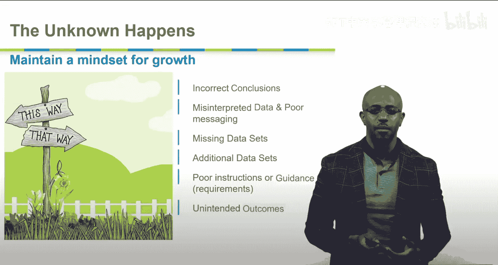

So。When you think at a high level about are we ready you have to be prepared to build a useful product。

Um when we think about these data products and we think about dark data and being able to integrate that into data products。

 if it's useful， people will ask for more， if it's useless。

 people will stop using it and stop talking about it。

Your your potential for impact is great if you've built a useful product and people will consistently ask for more different ways to use it。

 different ways to get more intelligence from it， but if it's not then you you'll see the people just sort of slide away so you must be prepared。

 you must be ready so let's talk about I want to give an example so this is a dashboard。

Sample standard dashboard standard sales dashboard with general sales metrics and when I look at something like this I think it has very little impact because it literally just gives you totals。

 it doesn't give you the ability to look deeper into the data and it doesn't give you the ability to get some intelligence in saying which channels are performing better and why which channels have performed poorly and which ones do we need to do X on so if I was a leader and I looked at this more specifically I could see last year sales I need to know sales year over year and see a trend of the growth we can see that sales have gone up by 43% when we look at the Kpis but what is the trend line that's the question and then when we see 43% what's the impact of our growth versus the market growth so we may have gone up 43% but if there's more money in the market if the market itself has gotten bigger if there's been supplemental products that has helped helped our growth as well as our competitors' growth what is our growth in relation to our actual competitors are we growing more？

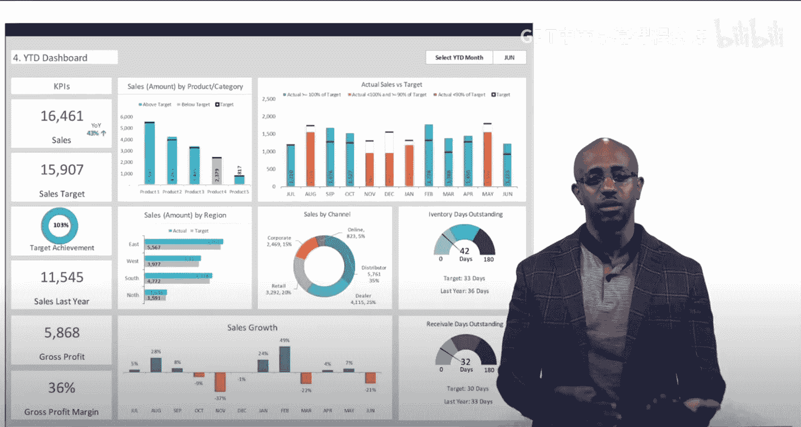

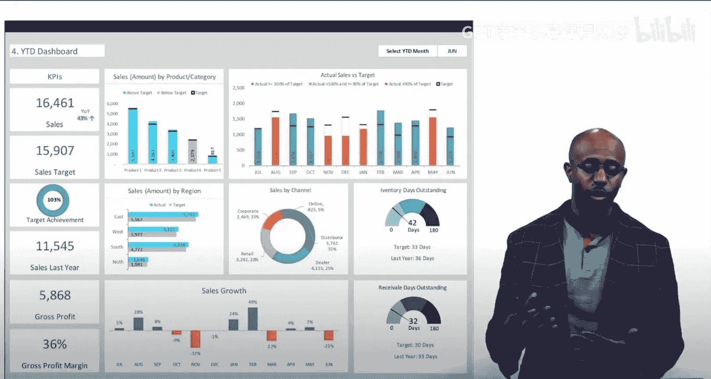

Faster or less， we're just saying the growth is。43%， right。

 that's sort of an average of a year over year。When we look at the sales versus target。

 these are some other things that we want to go over。

 you can see somewhere above and below and when I go to the next view here。

 when I look at the stuff in the red， these are things that really need more explanation and more deep dive on。

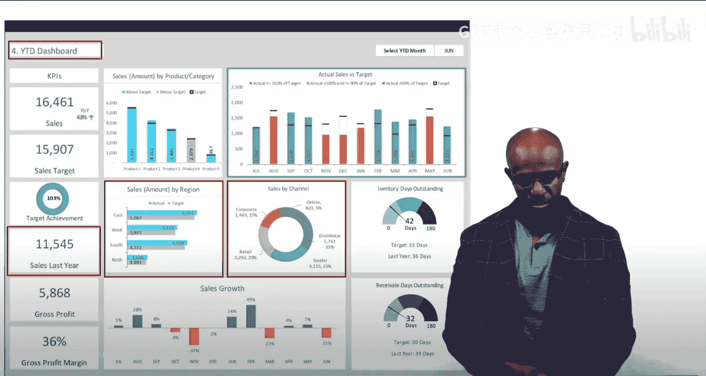

and i want to focus on the one in the green， though sales sales actual sales versus target。

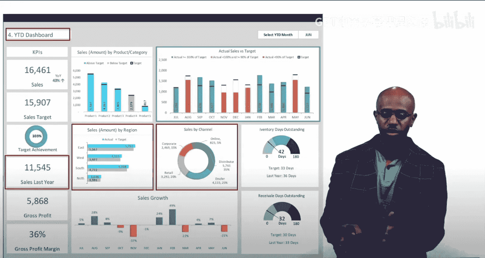

So the November and December month， those are well below target then September and October and February March。

 those are well above target My questions for the people who would be reporting up and responsible for these products and these cells would be how do we know that what we're seeing is right based on how we operate and then the second question I would say is specifically especially for November and December what went wrong and how can we fix it now it's better if I can drill down immediately and within five minutes know the problem and then go to the problem go to the person who's supposed to solve it but here we'll have to go do expiration people have to go do analysis and typically once we're doing manual analysis across wide datas you're not going come back with the right conclusion you may come back with some type of a conclusion that helps a little bit。

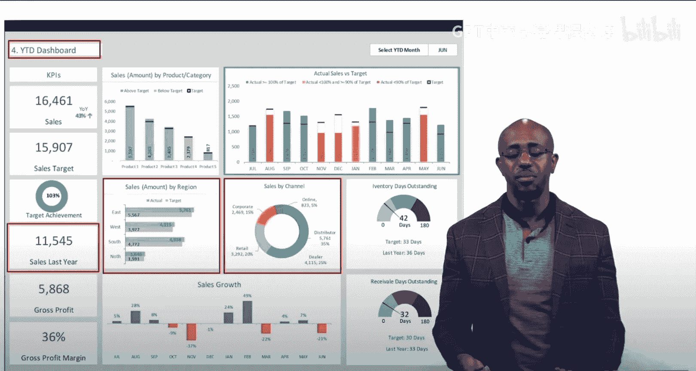

Typically， people look for one answer。But there may be many silver bullets。

 so when we're thinking about this， these are the drill downs that we just talked about November and December。

 January or February， March， and then you'd also want to look at the successes and see what made them a success。

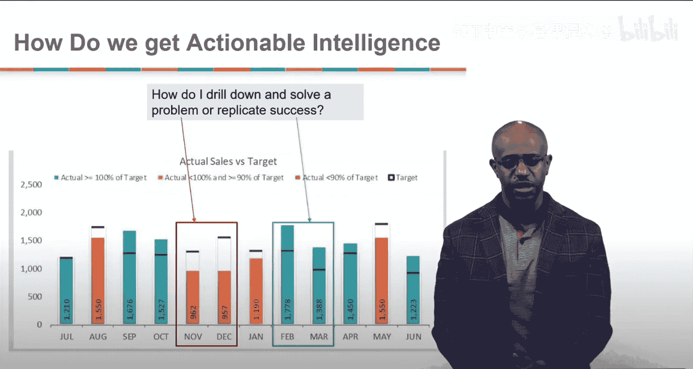

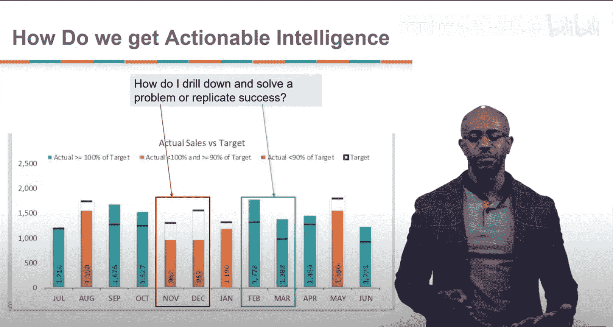

Was it simply that February March is good for our products and then November。

 December we need to focus on doing better or did something happened in the market。

 was there stimulus packages and things like that that came out， was it a rally in the market。

 was it not， what were the things that contributed to the success that we see right？

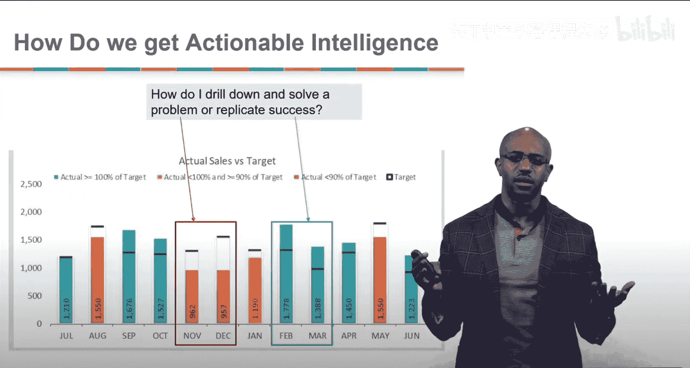

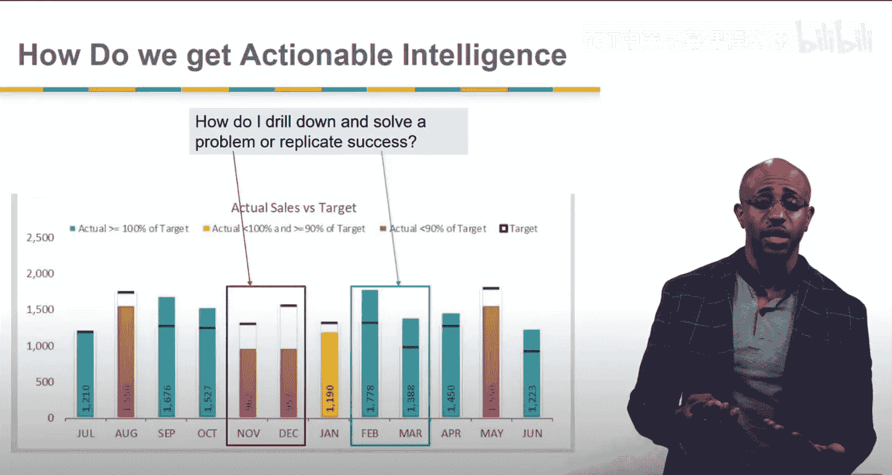

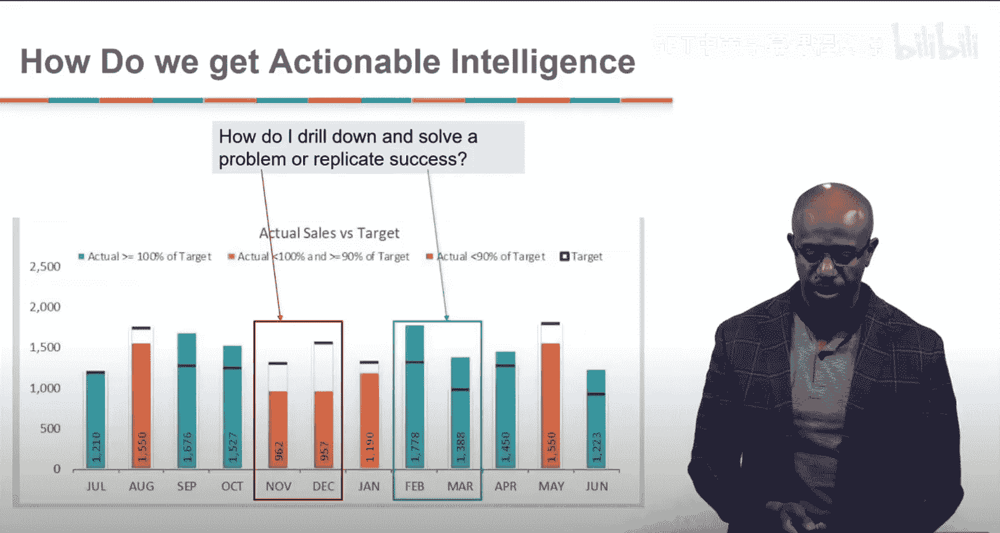

Now here's a stage data set here。Very simple， very general。 This is all dummy data。

 So when we look at it， if we're looking at just January February， March April。

 you can see that if we're looking at。

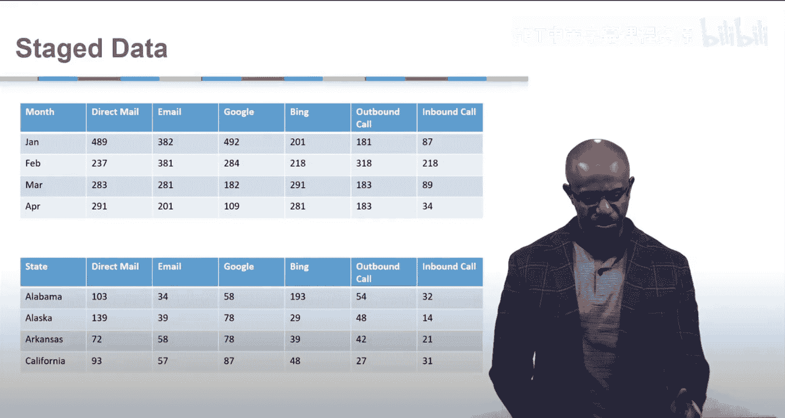

Things by channel， you see direct email， Google being outbound andbound now the reason I'm pulling this up is so we can look at how the data would have been staged for the visual that we just saw so when you're thinking about month over month people staged data something like this and we're thinking about Alabama。

 Alaska， Arkansas and California Now if somebody wanted to to do a deep dive they really couldn't because everything summarized。

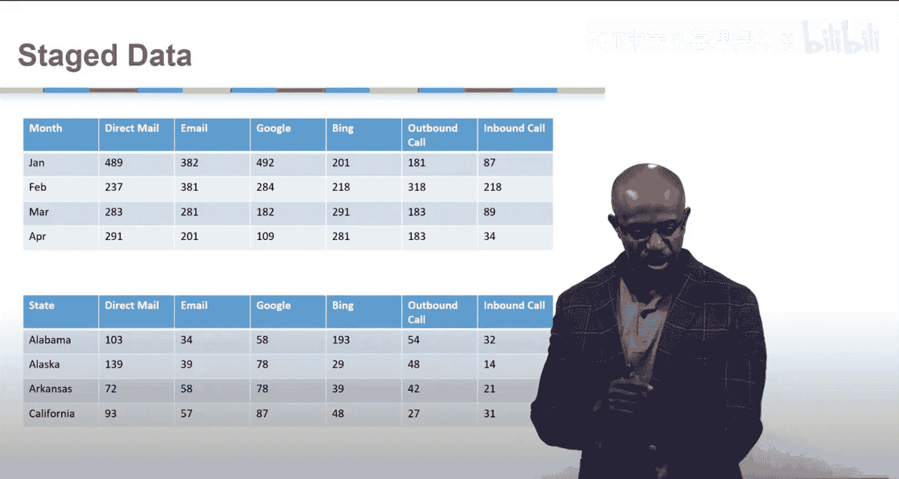

The data that the dashboard is pulling office is completely summarize we can't get in any more detail。

 we can just look at things from the month perspective from the year over year perspective from the state perspective which is stopping us from being able to do a deeper dive analysis right so this is what you see in some of the stage data in most dashboards they'll have one or two tables joined and they bubble it up right from a perspective of being able to do。

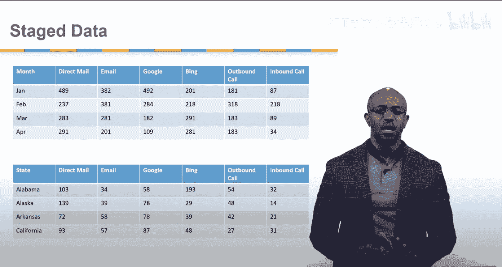

A more deep dive analysis。 this is a correct。

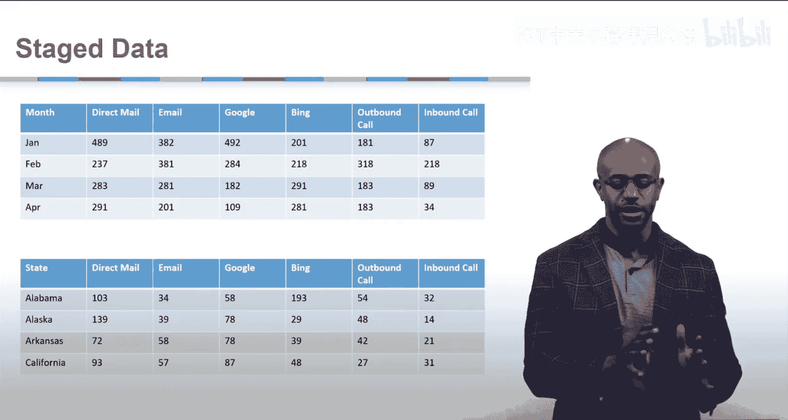

So we would look at something more like this in an ideal direction。Where we have sales。

 the sale I and each sale has all of the metrics around it。

 Now you still use a summary table to bubble up your high level analysis。

 but this would allow us to do a deep dive。 And under at the bottom of the dashboard。

 you then be able to go in， select the sections that you want whether it's a month a product a region and then you see all of the。

All of the sales that contribute to it， and in there we would then use intelligence to highlight where problem areas are or where extreme success has happened。

 and then what will cause it， we have derivations to show what caused it， right？

In this way leaders can take five minutes out of their day。

 go through what they need to see and be able to come back with the conclusions that they can。

 and this is how you look at at a high level designing for change， designing for growth。

 making products that are useful and making things that have impact， so thank you for your time。

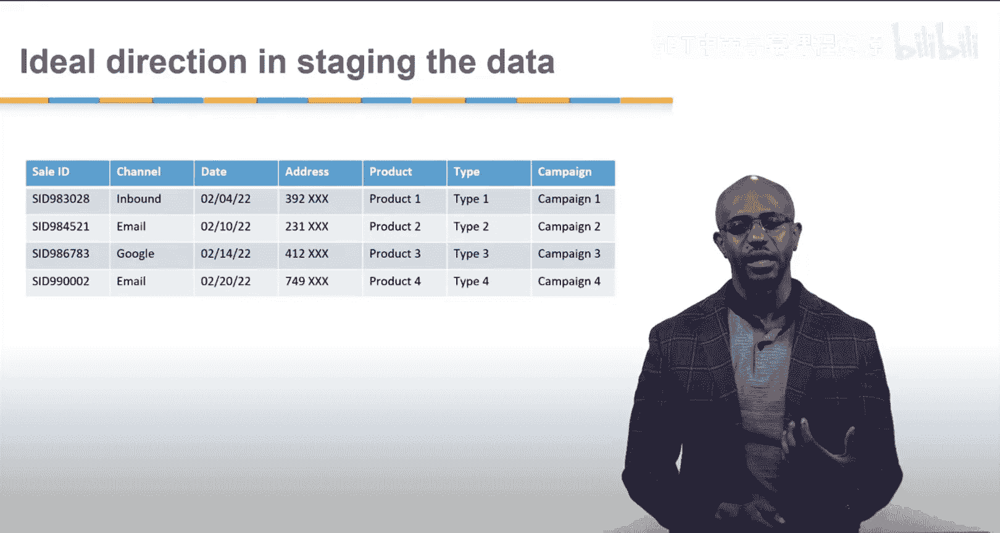