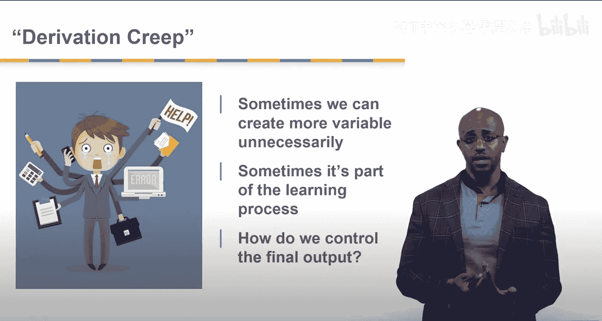
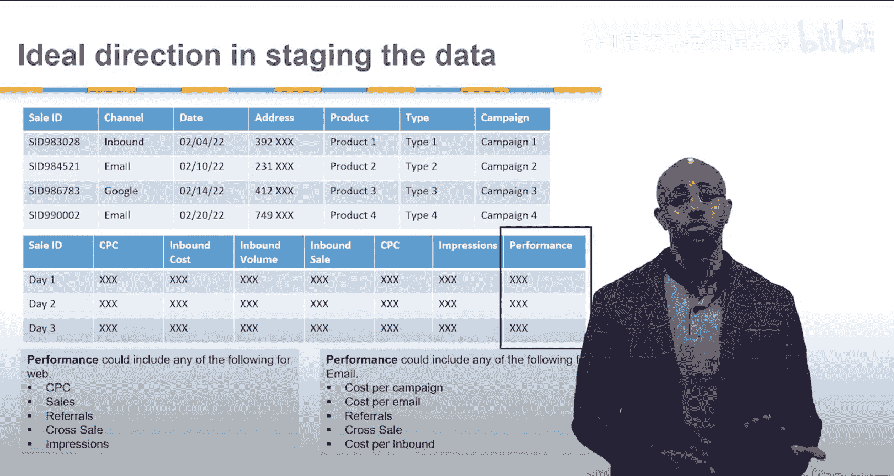
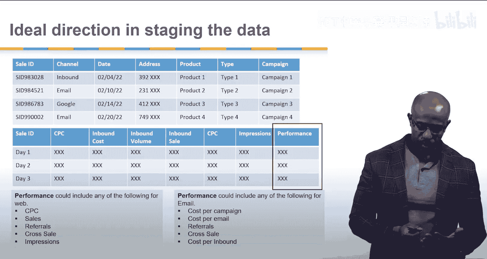
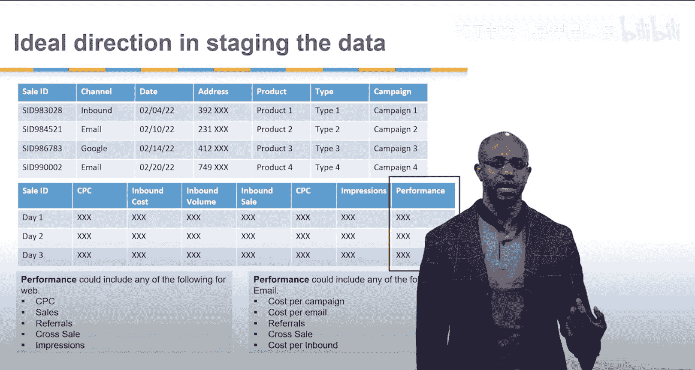
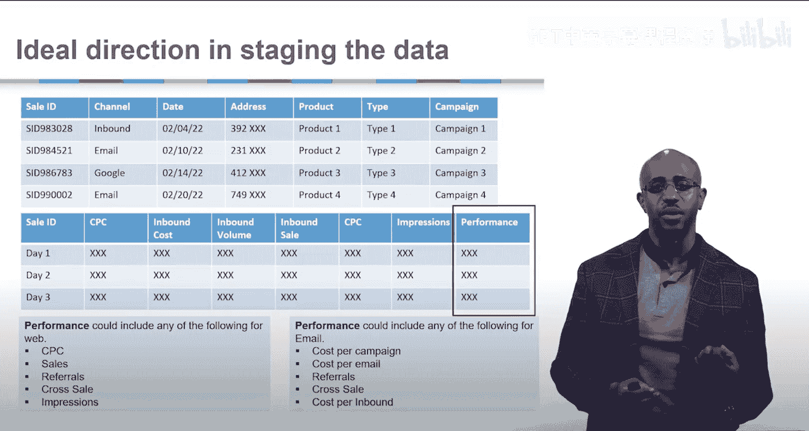
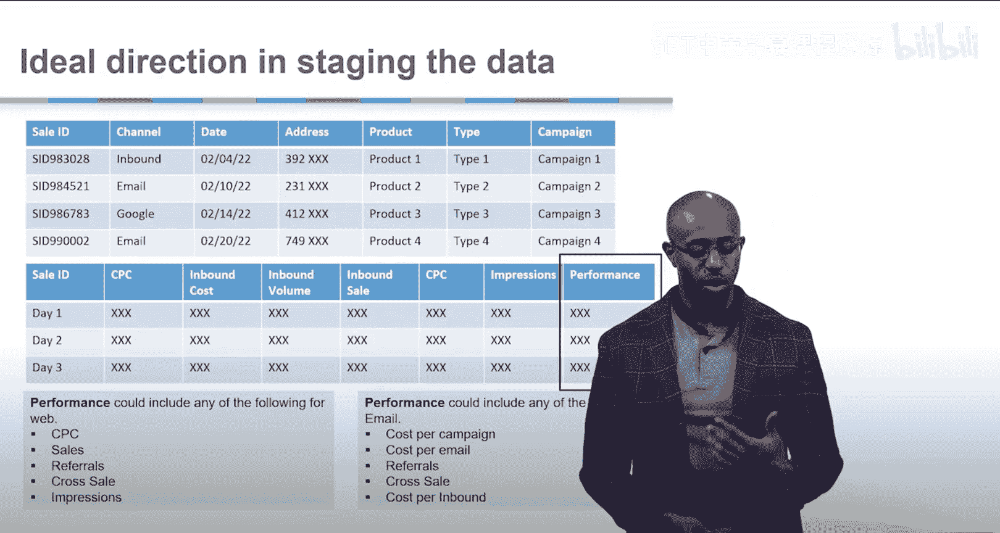
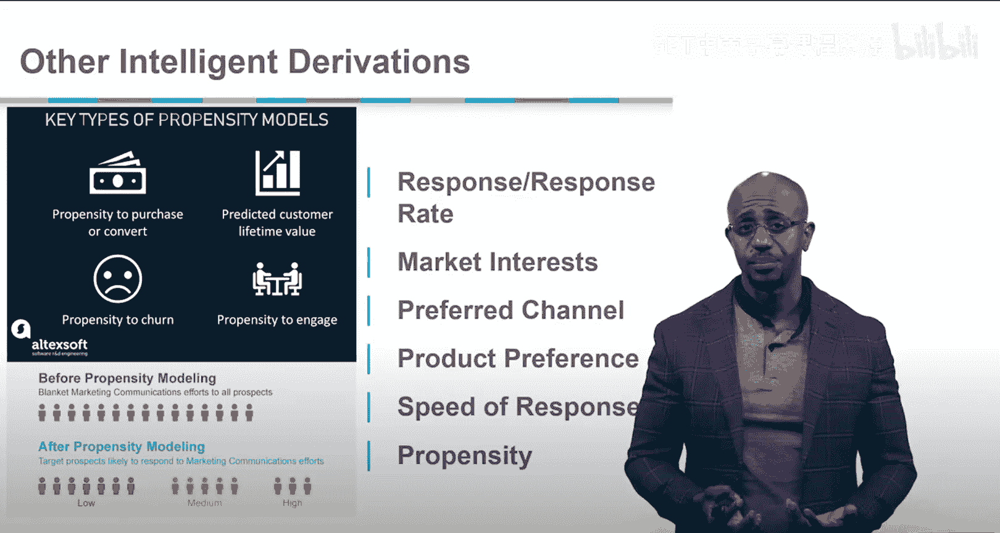

# 亚利桑那州立大学《黑暗数据迁移与架构｜Dark Data Migration and Architecture》中英字幕 p74 7_偏差预防机制.zh_en [BV1TkurzMEmm_p74]

Welcome in this lesson， we're going to focus on avoiding derivation creep while designing for change。

 Now， designing for change can be a very robust process where you can create a lot of derivations。

 You can enrich data。 You can really grow that data set to get more insights。 Now。

 you want to be careful not to。Overburden your system and grow the data too much because sometimes it can lead to performance issues。

 it could lead to confusion， it can lead to misguided outcome or misguided representation of the data now there's always going to be some level of exploration and creation of somewhat of a wide data set when you're doing the discovery process when you're trying to learn from the data when you're trying to learn the patterns but you' want to be able to figure out how to control that growth and then minimize it when you get down to that finished product right so sometimes we can create more than necessary then we have to really figure out how we want to control the output because learning is part of that process So want to just focus on the very top one I think we spoke about this in the last lesson you have the sales I and going over you just see some standard columns for each of the sales time or date you'll see in general you'll see time。

 the address of the person and with this type of data set you can from the address you can derive the city。

The county， you can derive the state， region， all of that stuff。

Now what I also want to show you is below you would take the same data set and you'd spin it a bit。

 but instead of it being by sales ID youd put it by day and you use that date to create a derivation so if you look at the top table you use date and you create a derivation column in there and it would be called date column and it would be the day ID right so for example in the table below it just says day one day two day3 you can look at that as your date ID right and then。

From there you can see CPC for the total day， inbound cost for the total day。

 all these different metrics that you would use to start identifying performance and performance is critical because when a company wants to know what campaigns they should do。

 how they should do their marketing or what products are out there。

 actually making more money and growing the bottom line。

They want to know the performance of these things。

Now the interesting thing is performance is not a data point。

 it's nothing that is going to be in the data set anywhere that says you know today this product performed at XX level or this it performed at another level right so you'd have to create performance itself from a number of other variables。

 a number of other values it would be at a very expansive derivation。

And the value itself would serve as your data product and when you look at this。

 things like CPC sales referrals cross sale impressions。

 so when the traditional view of the product's performance in the market or a campaign's performance is how much it's sold。

 whether the volume of the sales or the total dollar amount or a combination of the two。

 that's your typical view of it， however， with all the impacting factors of the modern day environment。

There are many things you want to look at。Because you could sell more of one product。

 but if your cost per click was higher， then you also have to consider Ri versus suggest sales。

 And even if you look at Ri， there's other costs to those sales besides just cost per click。

 you also have your total upfront investment The engineering that it took to build the products that allowed us to use Se to get in That's part of that total upfront investment right then when you think about it。

 you won also want to think about referrals because referrals help grow the brand image and grow the product in the long run So you don't want just sales。

 you want people talking about your product that's part of your performance right and cross sale。

 how easy is it to sell this product across other products So were you able to get a sale based off of a campaign for a different product。

That's value because you didn't have to spend money to get that money right so all of these things go into the metric of performance when you think about impression。

 same thing that's part of growing that brand image over the long haul。

So youd put together all of these metrics， create an algorithm。

 and grow and mature that algorithm over time to identify performance。

It can include many different things when you look at email performance versus web performance or even SEO performance。

So other intelligent derivations that you want to think about， propensity， propensity modeling。

 that's an industry standard， which customers have a propensity to do what。

 how do our market communications aspect， target the customers that have the highest propensity to take our product。

 how do we model them personas， all of that stuff， so you're going to think about response。

 response rate， preferred channel， product performance， speed of response， market interest。

 all these things， how interested it is the market to our product and how are we going to measure that。

When we think about the preferred channel， how are we going to measure the preferred channel。

 we can't just say which one has the most sales。Because sometimes crossSaA helps us referral helps us all those other things。

 so it's going to take a few conversations and a lot of thinking to get to the bottom of how you want to start identifying these types of data products and how you're going to use dark data data from the outside to help because part of the whole package is the actual volume of people that are there to consume our products and services so thank you for your time。

