# 亚利桑那州立大学《黑暗数据迁移与架构｜Dark Data Migration and Architecture》中英字幕 p75 8_数据产品标准化策略.zh_en [BV1TkurzMEmm_p75]

Welcome。In this lesson， we're going to focus on standardizing dark data for data products。

Now in the last lesson we focused on these three charts and we went through the sales ID and how that operates and the day ID and how that operates now I want to dive into performance a little bit more again because there are many different ways we can look at these things there's many different ways we can standardize this so when we're thinking about performance one of the things we want to think about is how do we take non-similar data types。

 non-sar data values and put them all on the same scale。

Now something like that would be we have cost per click and then we have inbound costs and then inbound volume right。

 so the inbound cost and inbound volume that's specifically for the phone channel。

And when you think about calls per click， that's specifically for the web channel。

Now you wouldn't integrate them into the same performance variable for different products。

 but you would put them in they need to be on the same scale from a perspective of reporting them out so how do you get everything on 100% scale right because you can only have 100% of effort you can only have 100% of anything。

So it can be very convoluted， right， thinking about cost per click， impressions， et cetera。

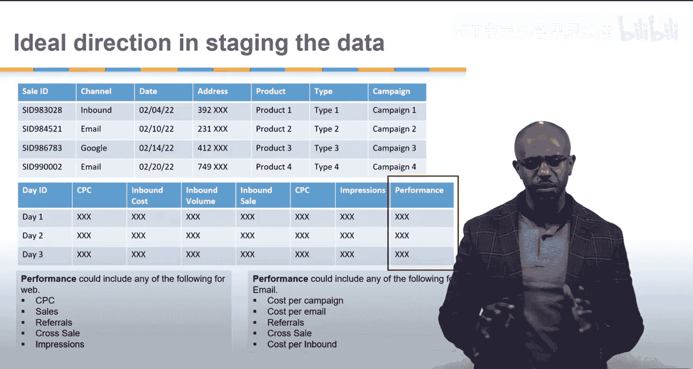

So some of the things to think about to get everything on the same scale。

 looking at everything in totality of 100% performance of search engine campaigns right so performance is not a data point。

 and when you think about it you know it may typically be sales but how do you quantify performance right how does our platforms impact the SEO itself so if we're thinking about the inbound calls if we're thinking about the performance of SEO and then we're thinking about our platforms。

 our website after it gets into the channel， you actually have to buy the product on our website。

 whatever the company's website is， so if you go through the SEO channel and how the website ist performing you're not going to be able to close that sale？

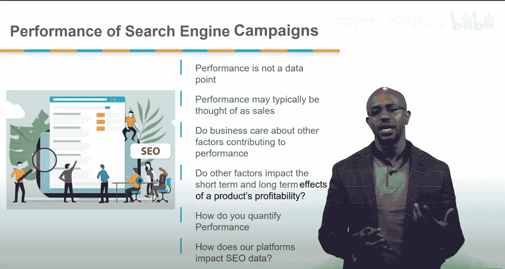

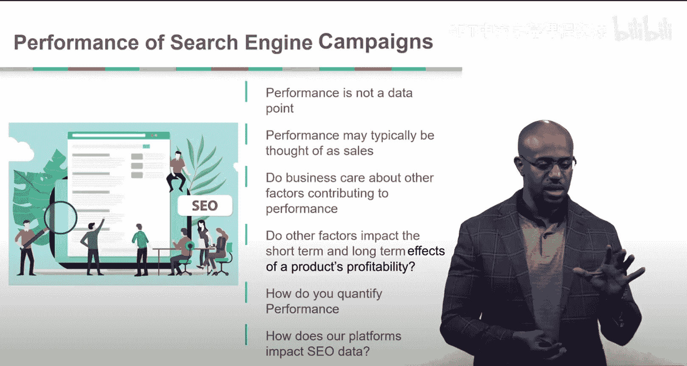

But the result would impact the SEOo channel if you're not separating the two and then putting them on that same scale。

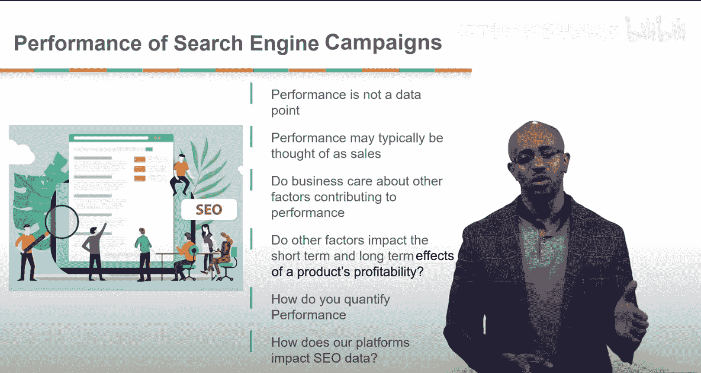

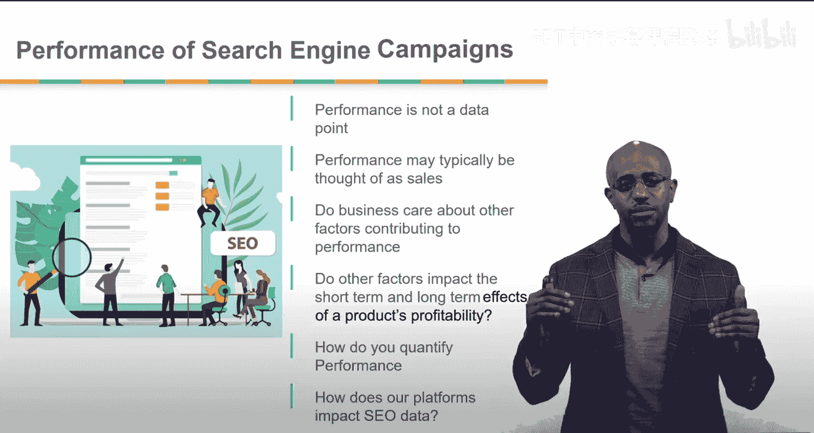

You want to be able to understand if your website performance is poor or if your search engine optimized performance is poor。

 right？

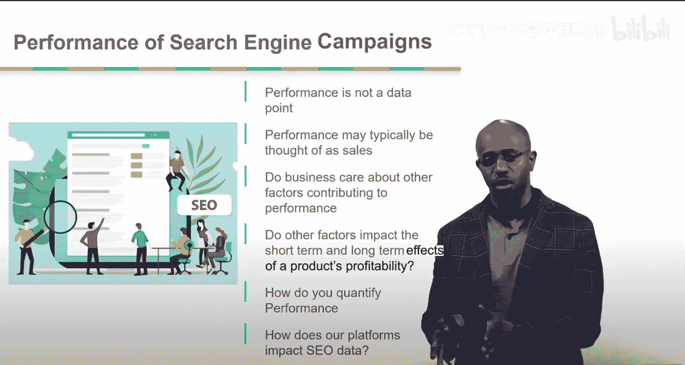

So。One of the questions is does the business care about contributing factors with the website being contributing factor。

 user experience being contributing factor and the customer journey being a contributing factor。

 these are all things you'll want to think about and really prepare and focus on as you're going through the process so I wanted to take this little infographic and go through the website performance and how it affects shopping behavior because when we think about SEO and we think about going through Google or Bing or whatever other search engine you may。

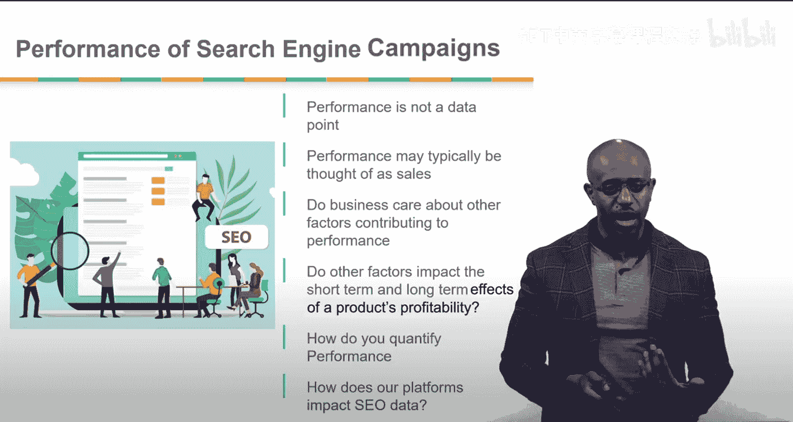

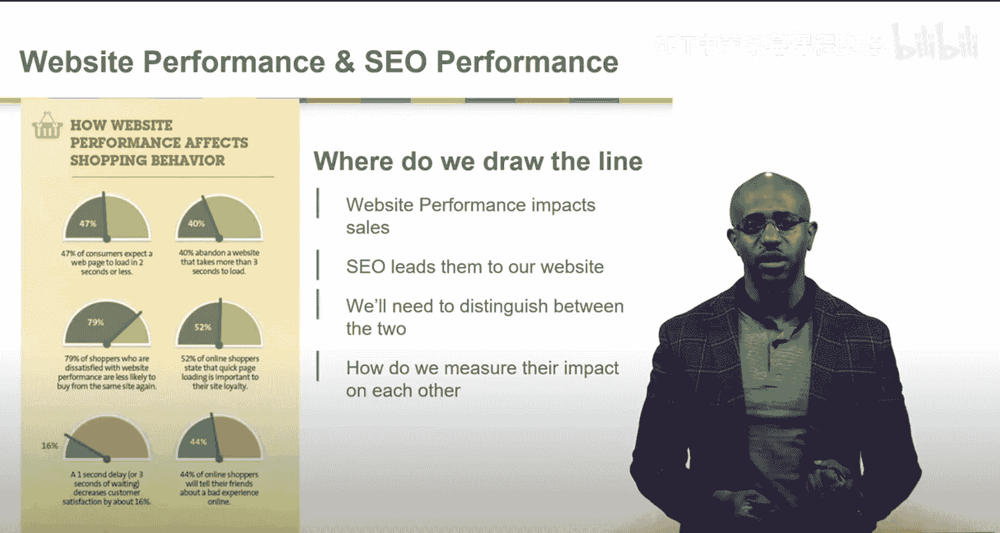

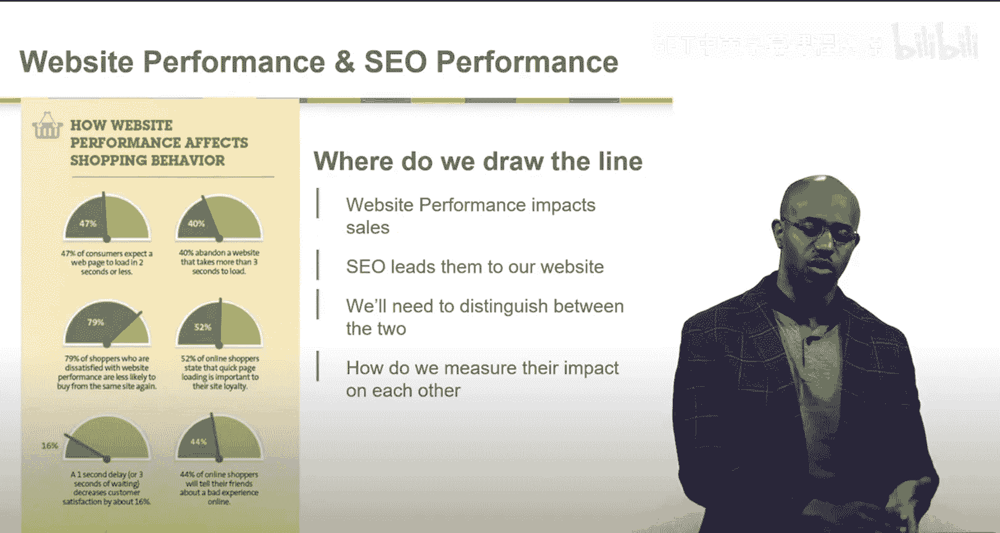

You may use。This， this infographic does a good job of breaking out the fact that。

47% of consumers expect page low time to be two seconds or less and then if you look next to it the abandonment this 40% abandonment rate on websites that take more than three seconds and you can bet if it's 5 seconds。

8 seconds，9 seconds， they're going to abandon they'll go to another competitor and buy their product there so you want to think about these things because your searching your campaign may be working very well but then when people go to buy if you have problems on the site if your availability and performance are lacking you're gonna have some challenges closing those leads and the same thing。

 79% of shoppers who are dissatisfied with website performance are less likely to buy from the site again。

You want to make sure that when people come to your site。

They are it's the ease of use type of a scenario for them your user experience is set up right the customer journey is there and that they use less clicks to get the get to the purchase these are things that you all want to think about so taking a step back and identifying where that dark data is when you think about this we traditionally we only looked at cost per click we only looked at impressions we only looked at how many sales that we had。

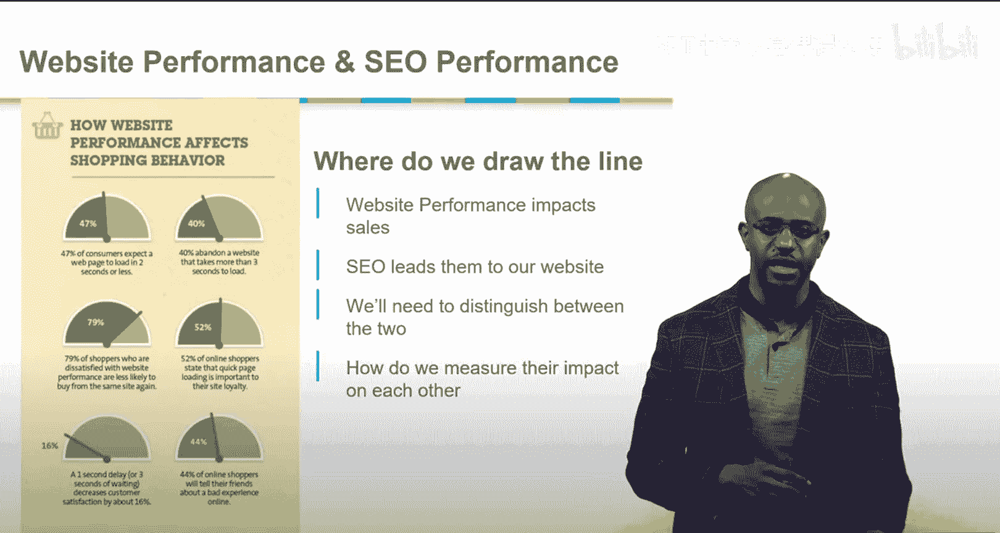

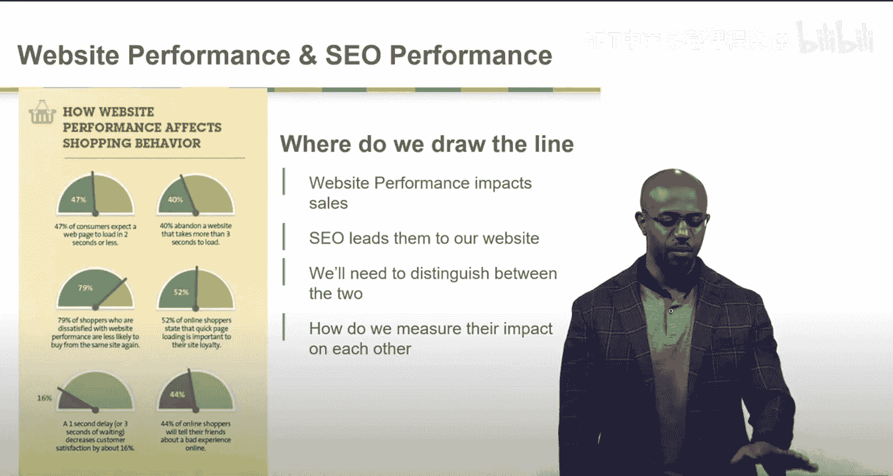

We're not thinking about how does abandonment rate impact the performance algorithm that needs to be understood and understood if we need to add it。

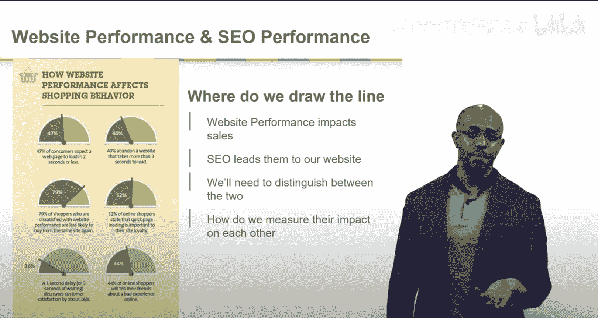

Then we need to understand if there's an exponential factor to that and how do we identify a straightforward answer and say hey this level of abandonment rate causes a number of say 50% and then next after that how do we say exponentially it has the possibility of causing 60 or 70% fail rate。

 so these are things that you'll want to think about so that you can give exact numbers and show how these different rates of abandonment。

 that different rates of availability and performance also impact SEO。

 although they should be separate also show you also want to be able to show how they tie together and where the problem actually is。

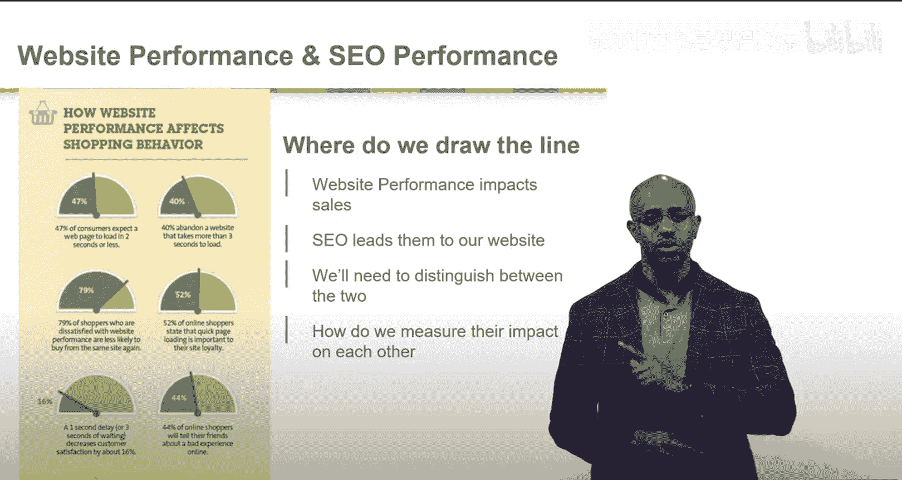

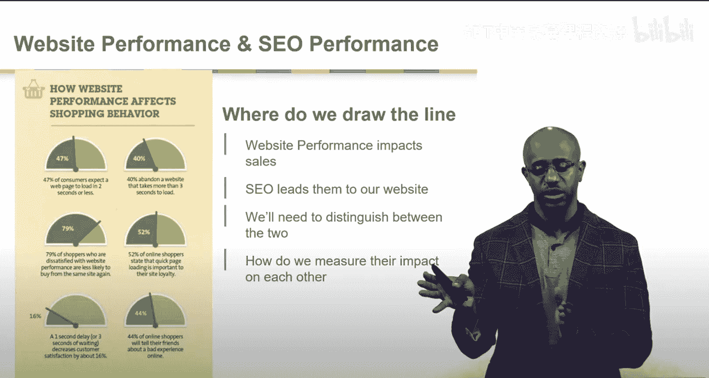

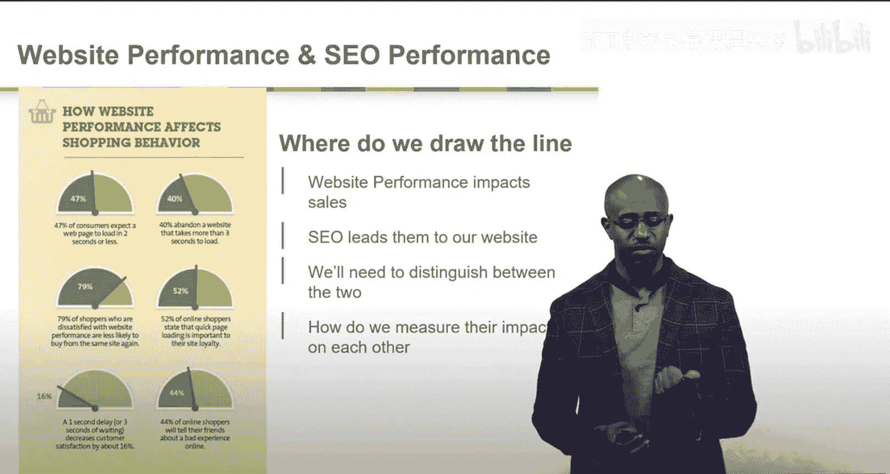

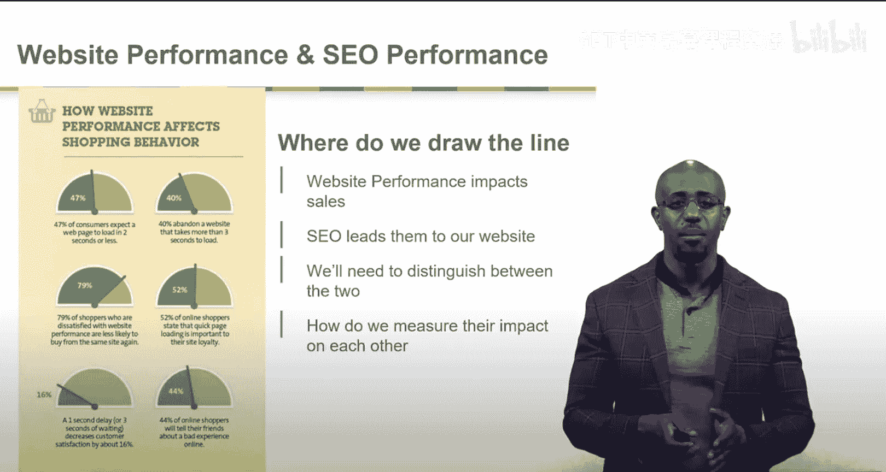

So thank you for your time。