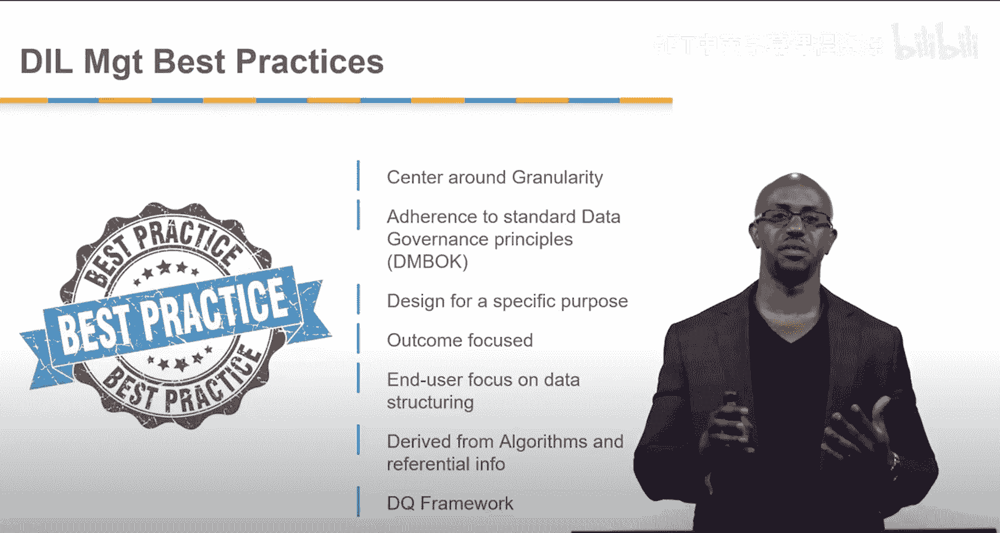
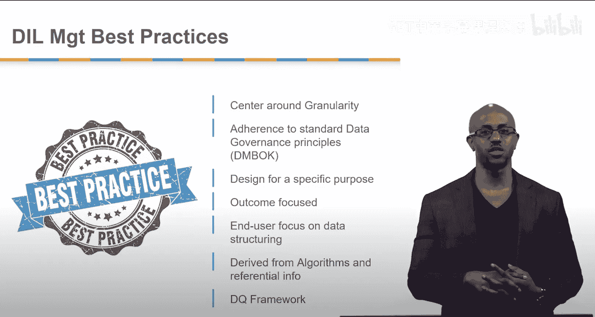
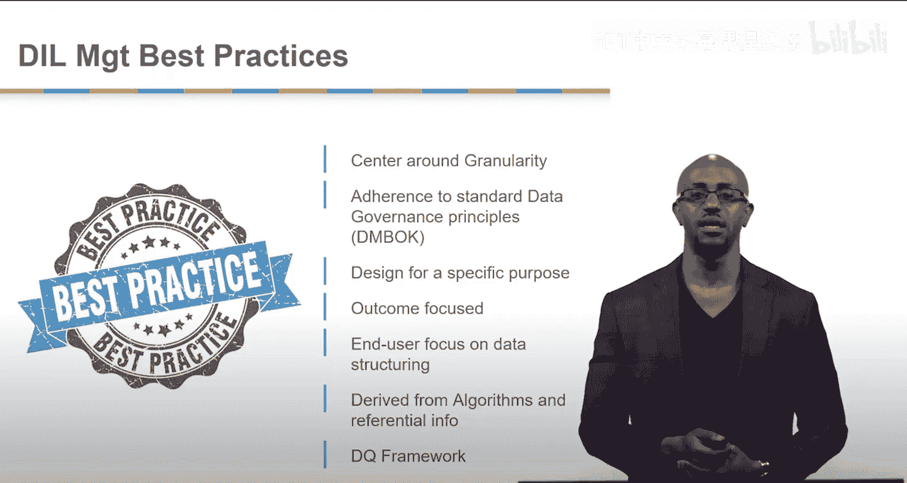
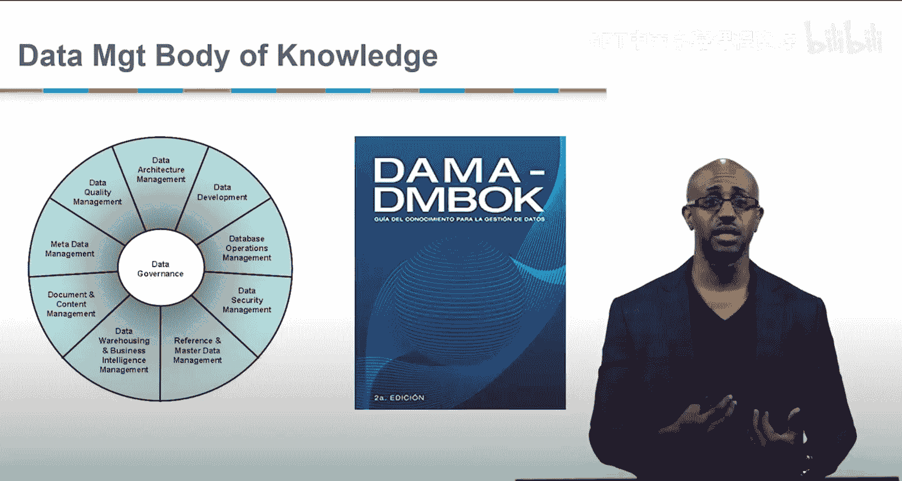
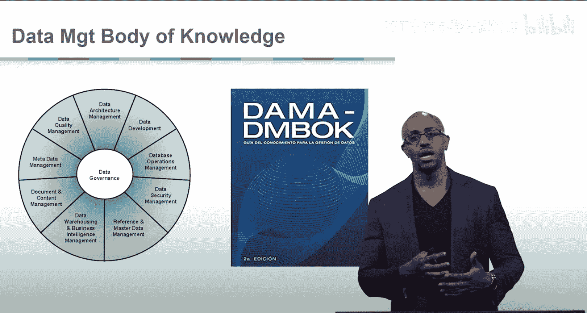
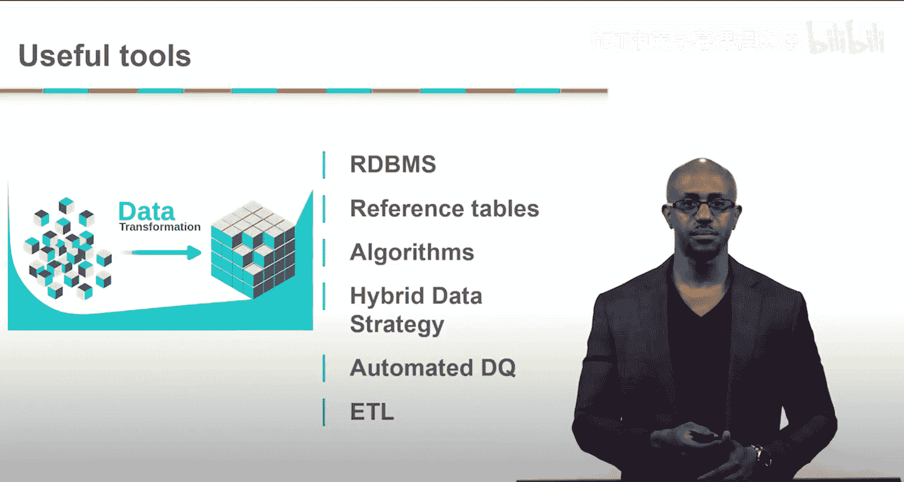
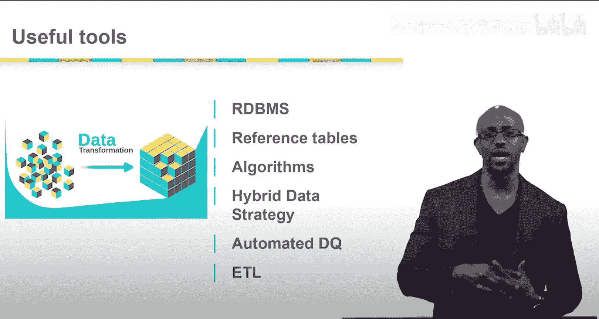
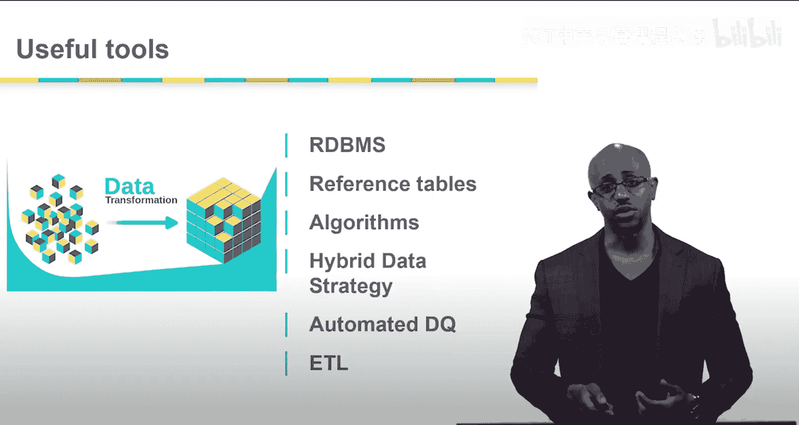

# 亚利桑那州立大学《黑暗数据迁移与架构｜Dark Data Migration and Architecture》中英字幕 p78 11_动态智能层管理最佳实践.zh_en [BV1TkurzMEmm_p78]

Welcome in this lesson we're going to focus on best best practices for managing dynamic intelligence layer so some of the things you want to focus on when you're thinking about best practices for dynamic intelligence layers are to center everything around granularity and focus that layer whichever layer you're making specifically on one object for one outcome right now that outcome will have derivatives so you want to include those derivatives under that outcome right so granularity is key next is adherence to the standard governance principles that you can find in the diba which is published by demoA DM the data management authority or organization tons of information that you can get from there and I definitely suggest you use that for general data governance principles design for that specific purpose and outcome focus like we said and then in user focus on the structuring the data so structuring the data in a dynamic intelligence layer should be focused around。

The value that you're gonna to provide for the end user okay so you want to think about how the end user is gonna to use it what the end user is expecting what does the end user not know that they need all of those types of questions you'd want to think about it because the way you structure is going to be what allows you to at the end of the day put that information that intelligence that insights out on a dashboard and then derived DILs are derived from algorithms and referenceential information so as you're building it out you'll want to make sure you have whatever reference tables set up appropriately and the right algorithms in place to help you calculate and bring to life the dark data that you're gonna be pulling out of those tables so here' here's just a sample of the data data management body of knowledge for the folks who are really focused on security governance etc and this is the simple governance will that that they use and we'll talk about this a little bit more in another lesson but a lot of it is in our data architecture。

Data development or data development warehousing， all that stuff like now some of this stuff you're not going to use in the DIL。

 but you'll need to understand it as the data comes into the DIL and a lot of it you'll use inside of it so make that make sure that you have some level of understanding of the Dmbch and these principles around data governance。

Lastly， useful tools right so as we think about useful tools to help us build a dynamic intelligence layer。

 RDBMS is always key， get your referential data set up those reference tables that are inside of that algorithms like we said earlier hybrid data strategy so when we start thinking about SQL like Postgres or MySQL versus unstructured data and Json objects in MongoDb。

 Casandra， etc cea like document type storage there is a place where。

That dynamic intelligence layer can be one of the other。

 but is going to be derived from possibly multiple types of of data storage。

 Some could be derived from nonstructured and some of it can be derived from structure So you have to have a hybrid data strategy in terms of developing it because some of the source data can be quite possibly different automated data quality。

 this is really key because you're gonna be creating new values that people don't even really understand at the moment that you create them So you need to be able to assess the data quality before it comes in and you need to be able to assess the data quality after you've done all the transformations that you need and after you've develop this new data product and ensure that data product isn't something that skews people and gets them to look at something in in that unto direction so you want to make sure that it's understandable and that it's sensible in last ETL right so your standard extract transform and load that's going to help with the automated DQ in a lot of the other pieces algorithms。

Refer tables， et cetera。Remember that these are some of the tools that you'll use to help build out that DIL and help manage it efficiently。

 especially that data Qua， so thanks for your time。

