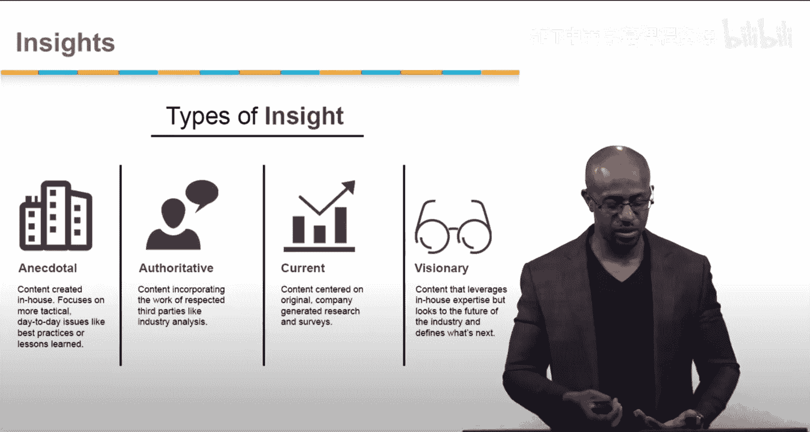
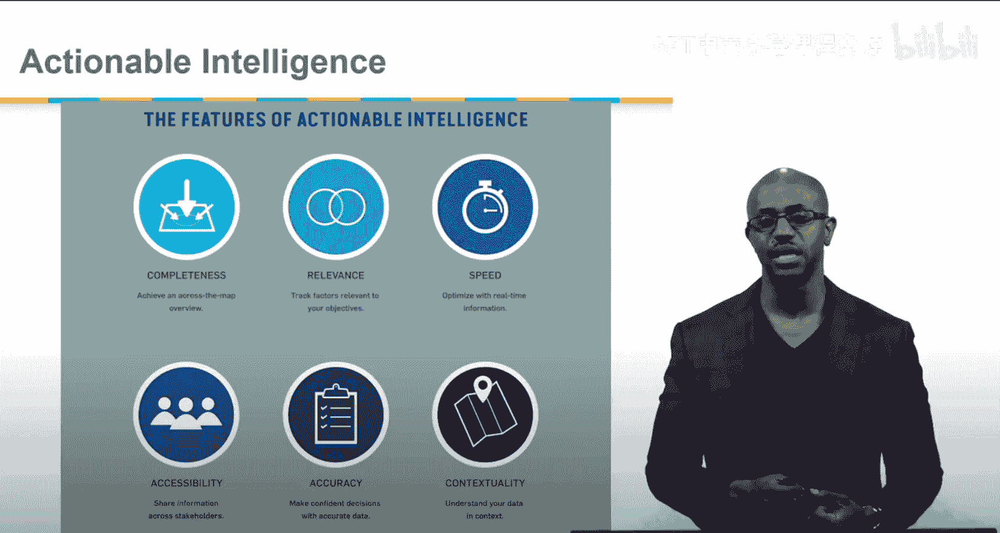

# 亚利桑那州立大学《黑暗数据迁移与架构｜Dark Data Migration and Architecture》中英字幕 p80 13_洞察与行动型智能区分.zh_en [BV1TkurzMEmm_p80]

Welcome in this lesson， we're just going to take a brief moment to distinguish between insights and actionable intelligence。

Now when you think about insights， it's really just the capacity to gain an accurate and deep intuitive understanding of a person or a thing like the way to understand something and be a little bit more insightful about what's going on that's definitely useful and it's definitely advantageous a lot of time when you finish an analysis or evaluation you get you've gained insight right actionable intelligence is different in nature right so actionable intelligence is focused on information that can give a company or anything or a person a strategic advantage over its competitors when acted upon。

The thing about actionable intelligence is that。It has to be intelligence that you can take action on。

Now we have a picture of the military here because that's a place that definitely uses a lot of actionable intelligence when they ask for entail they specifically call out that it needs to be actionable。

 they need to have ability to do something with it if they can't do anything with it。

 lives are at stake so it's definitely one of those places where this is do or die and that's where a lot of people may have some familiarity with the term actionable intelligence。

All right， so just a little bit about insights， these are a few different types of insights。

 anecdotal authoritative current and visual vision area I mean so some insights help you look in the future some allow you to understand results as they are currently some are more authoritative and sort of a way to make things happen and then some are anecdotal right some focus more on tactical and dayto- day issues right sos that's a way to look at insights and just four different opportunities of them now actionable intelligence as the name describes the core function of it is to take action。

So things like completeness， relevance， you'll see a lot of things related to data quality。

 there's completeness accuracy dimensions in data quality， conceptuality。

 there's a time component talking about speed， relevance， accessibility。

 these are all qualities of data data quality as it looks at data and then when you're thinking about actionable intelligence as long as those qualities are there just permeates right up through actionable intelligence。

 one of the things I want to also speak about is speed， speed of intelligence is Uber critical。

Because if you're taking action， can， you don't want to take action on old information。

 on old intelligence。It can be it can be very costly in the long run。

 so speed is super critical completeness， relevance， especially accuracy。

 these are things that you want to think about as you start building out dynamic intelligence as you're working with data products and as you're working with dark data so thank you for your time。

