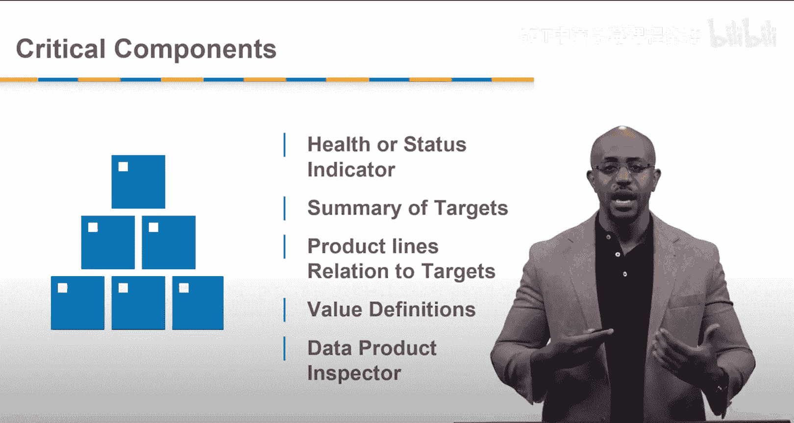
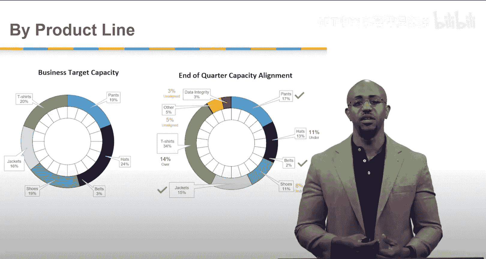
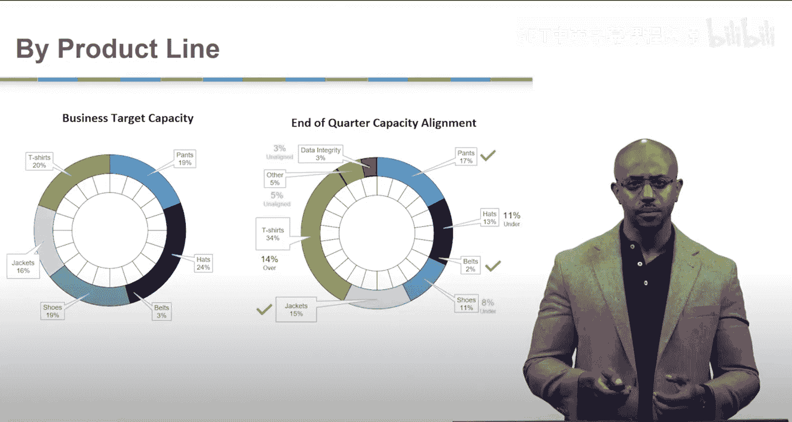
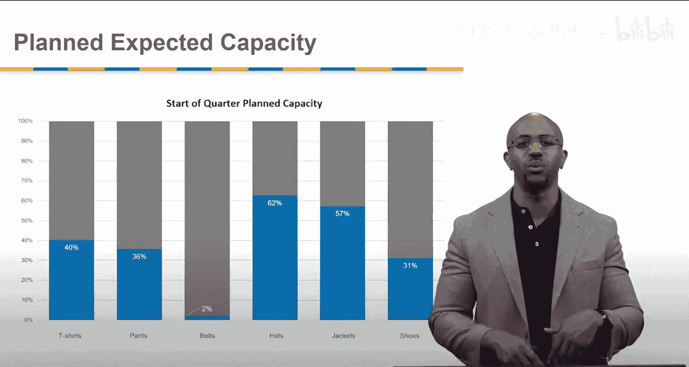

# 亚利桑那州立大学《黑暗数据迁移与架构｜Dark Data Migration and Architecture》中英字幕 p82 15_智能界面集成方案.zh_en [BV1TkurzMEmm_p82]

Welcome in this lesson we're going to deep dive into integrating intelligence into a user interface Now we're going to build on the example of the Tshirt factory and we're going to build on the example of supply and demand and engineering capacity。

Now， let's think about the human user interface and the interaction of humans as they look at dashboards。

 reporting and intelligence。One thing you're always going to think about is that humans need to go into a user interface and quickly understand the status of things and then be able to quickly understand how things are flowing and how can they problem solve so when we think about a user interface you want to start at the top with that standard status are we okay are we performing as expected and if we're not performing as expected。

Where are the places where we're underperforming and where are the places we are overperforming and if we're thinking about underperformance？

We need to look at each and every single granular line item and be able to pull out where those problem areas are so integrating that into a user interface you have to integrate your targets your KpiIs or OKRs all of those things that indicate how a business is expecting to perform and be able to quickly call those out and bubble those up to the surface because you can't go through each and every line item of data because you'll be looking at billions and trillions of roles。

 petabytes of data， terabytes all of that stuff so health or status indicators summary of targets。

 product lines and relations to targets， value definitions and product inspectors are super important when we think about building out a UI integrating that intelligence and bringing the data to life exposing that dark data。

We'd use examples like this where we have the business targets to the left and then our results at the end of the quarter on the right。

Now， looking at this equation， you can clearly see how the business wants to break out that engineering capacity towards the products that they expect to sell the most and towards the products that need that software support。

So if you're looking at the right， you see pants， they're pretty much nearly on target。

 it's a 2% variance with these types of things you want to be about plus or minus5% right and if you're 10% or more you really off target。

 so if you look at hats， it's 11% under target， they're greatly off target。

 they need to realign those teams either realign the work or realign the people you can find you would be able to find how to solve that problem。

Quite simply， looking at each and every one of those granular items and seeing which ones have been prioritized and which ones hadn't。

Looking at belts right on target， they're not doing much with belts。Shoes。

 shoes are8% under not as bad as hats but you still need some work there jackets are nearly on target and then tshirts。

 they're greatly over target so if you look at this equation it's really easy to see we need to realign some of the work on tshirts to hat。

 let's look at the teams that are working on tshirts。

And understand if some of the work should or shouldn't be prioritized or if a team or two needs to just move over to hats so they can pick up more work so the next equation would then be to look at the line items individually and see which prioritized line items are moving faster or slower through the software delivery process and lastly I want to make sure we called out when we find issues with data so this is part of that DQ check。

So there's a part that's 5% other， other isn't part of the target。

 so some of the teams are supporting work across the enterprise a little too much。

 so that's one of the things you'll want to be able to call out if you're looking at engineering capacity right then data integrity that's another piece so the teams typically are going to continuously be updating their agile management tool。

From my experience， this is something that your organization has to define itself and define what the number is。

 but typically you want to be below 2% if you can get 1% or below your good。

 you're always going have one or two percentage of error when it comes to defining capacity。

 but if you can get below 2% where you're like 1。 x， that's always pretty good。Some companies。

 if they're not really mature， they may want to start off at like five or6% work their way down。

 but if you have good data quality practices in place in good communication channels。

Along with the data quality checks， you should be able to get this number down below 2% and keep it in the ones in 1。

 x。

Moving on， this is another way to look at capacity now this is plan capacity at the start of the quarter。

 so the other one was at the end， this is at the start now this is each vertical in comparison to itself based on previous performance and expected targets at the end of the quarter。

So when a quarter starts， you're not going to have all the work identified assessed and ready to go。

 you want to be about 65 to 70% the way there， so if you look at hats。

 they're the team that's closest to having their plans better baked out 65 to 70% is where you want to 65 70。

 65 75 right in there so if you look at belts they're really low the one thing that is good about belts is since it's such little work there。

It may not be something to worry about。I'd worry more about shoes and pants and t-shirts。

 especially since we saw that t-shirts ended last quarter over budgeted by a lot right and then pants and shoes also I think it was pants that have the issue right so you want to look at those and make sure that they are performing according to standard and these are the types of things that allow you in a leadership position or even the folks on the ground to see these chart and say hey we need to realign either our people or realign our work and a lot of times it's easier just to move the work around this way the people can stay in their lane and it's not much of a change moment for the humans。

So this is how we would bake something like this into a UI and in more detail。

 obviously you'd have this in a dashboard with a number of other charts at the bottom you have that problem solving area but I wanted to take the time to dive into specific charts and specific examples and how you would work through them so thank you for your time。

