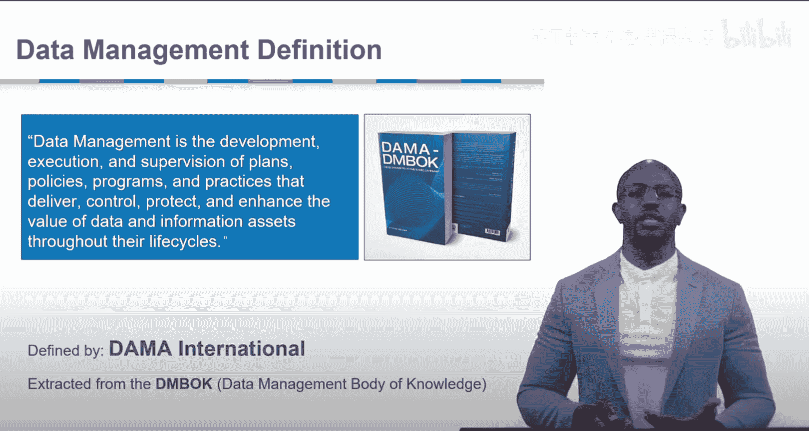
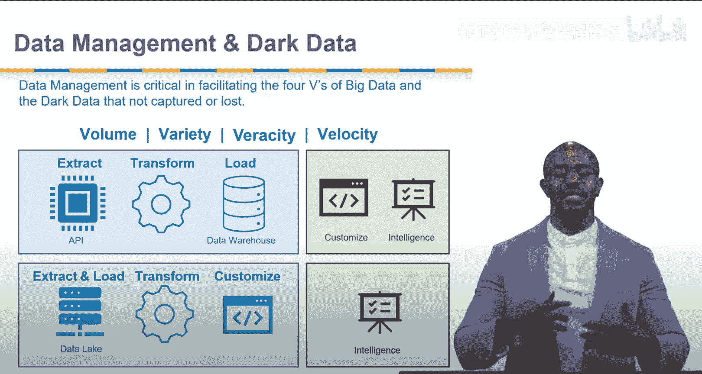
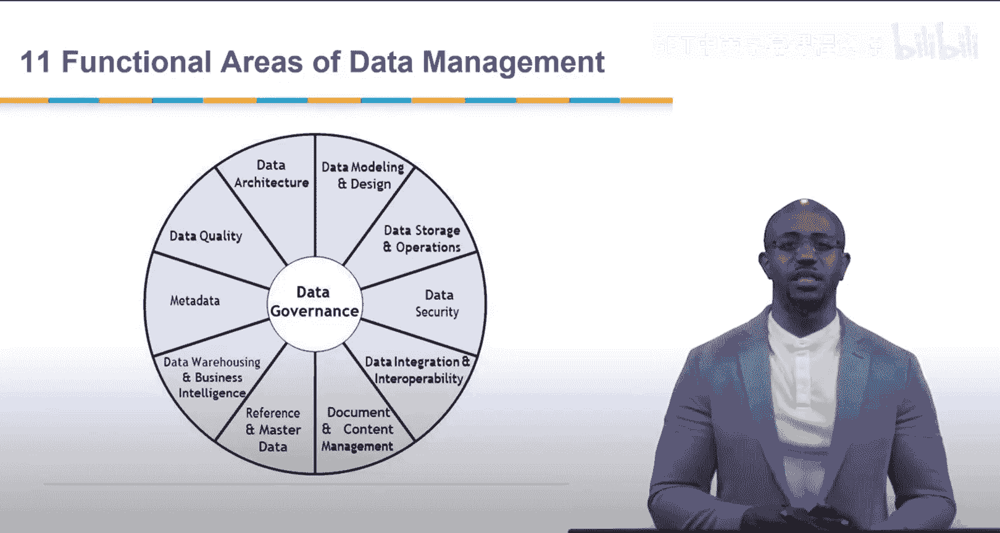
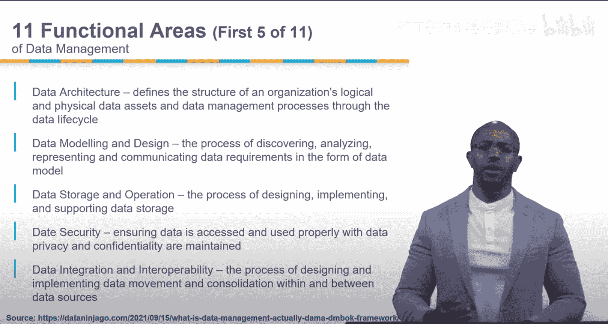
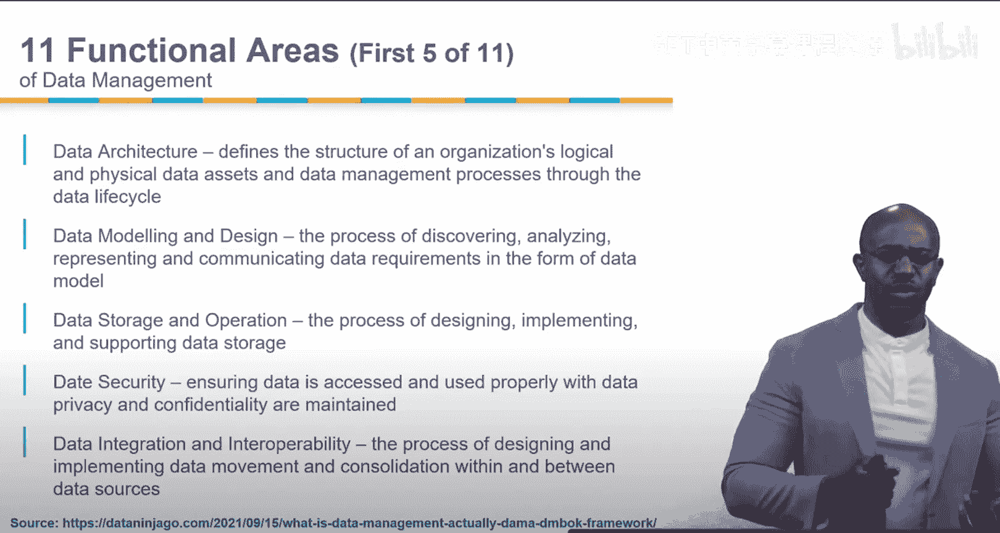
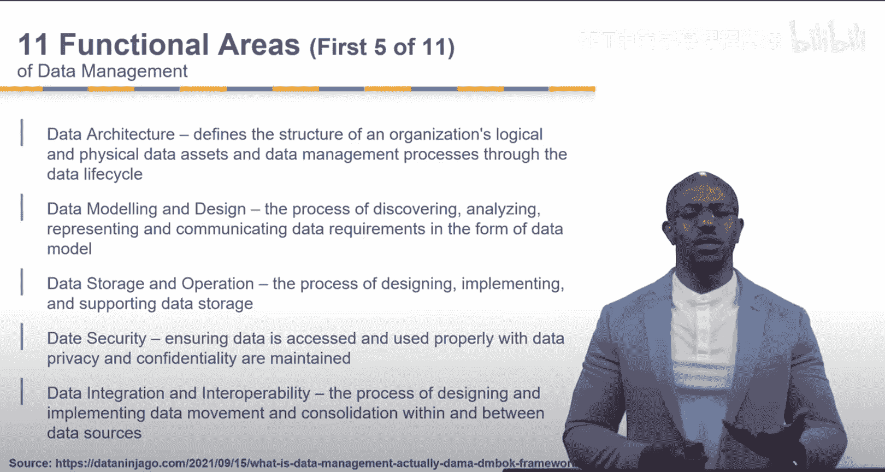
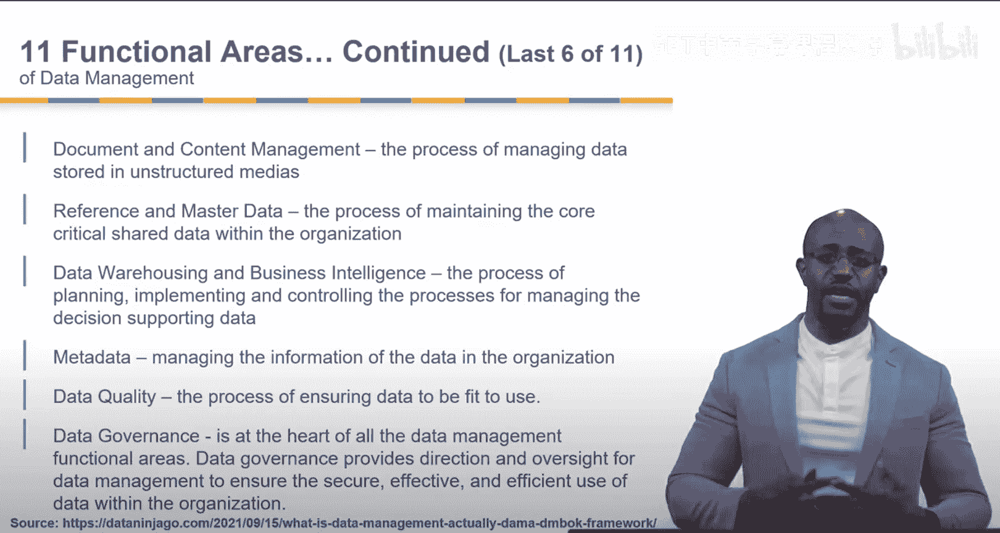

# 亚利桑那州立大学《黑暗数据迁移与架构｜Dark Data Migration and Architecture》中英字幕 p83 16_数据管理总览.zh_en [BV1TkurzMEmm_p83]

Welcome in this lesson， we're going to do an overview on data management and focus on its impact with dark data and the corresponding data products that we create from it。

Now， data management。With this definition， we went to Dma International and pulled it out of the Debach。

 the data management body of knowledgege， and it focuses around the value enhancing the value of informational assets throughout their life cycle。

 so quite simply data management is the development and execution and supervision of plans， policies。

 programs and practices that deliver control， protect and enhance the value of data and informational assets throughout their life cycle。

Now how does it relate to dark data when we think about data management。

 these two lines are very high levelve versions of the process of data coming from SOR。

 going through an ETL extract transforming load process going through a bit of customization once data scientists gets it in the green section and then going into intelligence creating new and valuable insights on dashboards and other assets that humans can digest and make better decisions so the top line is your sort of your old school data warehouse model where extract transform and load and then when you think about data lakes。

 it's more of extract load and then transform where you have your data scientists and engineers collaborating earlier in the process before you get into customization and then data scientists taking it from there moving into intelligence themselves on their dashboard both processes work very well it just depends on the volume load。

 speed of your data your SLs， how long and how fast do you need new information and updated information。

E cetera。So when I think about data management， that is how we're going to look at extracting value。

 it is the supporting mechanism that's going to let us do it in an efficient and effective manner。

Now when we're thinking about data management in this overview。

 this is pulled out of the Deok from Dma International。

 the data management organization and quite simply you see the 11 functional areas。

 all centered around data governance data governance is that supporting mechanism but data governance is not necessarily a technical thing data governance itself is more of how we take a principled approach to data management sort of that guiding light and guiding our tactical implementation of data management so we're going to dive into a little these 11。

 but we're going just go very very high level you can when you have time you can go get the Dba dive into it in detail and these segments and these set of four lessons will just focus more specifically around just giving you a high level understanding so。

These these five functional areas， these are five of the 11 data architecture modeling and design。

 storage and operation， security and and interoperability basically when you look at architecture。

 that's one of the things that over my career I've spent a lot of time dealing with modeling。

 designing and architecture because it's one of those things that sort of guides how we can access the data and how we can utilize it。

 it helps us analyze data better， it helps data get through our systems better。

 it helps the entire enterprise operate better now that's not a shortchan security storage operation and integration and interoperability right so when we think about storage and operation that's key because data can get old stale and that's when you get into the rot data right redundant and sort of non-timely data。

So thinking about storage is critical to understand how you design and implement storage and how you use data for the purpose of getting insights and value out of it right。

 so integration is critical because data flows from system to system to system and you want to make sure that you stage data in a way that allows the customers and consumers to use it as effectively as possible。

Now these last six of the 11 functional areas document content management， reference and master data。

 data warehousing and bills business intelligence， metadata， data quality and data governance。

Again with data governance at the bottom being that supporting mechanism from a theoretical perspective sort of that guiding light to guide us in the way to use data management principles to gain values we also have document and content management which is critical for the purpose of us being able to manage how the data stores it in unstructured media and reference and master data。

 we're gonna go into this a little bit in another lesson but reference in master data itself is critical because master datata defines how we use variables and values and attributes in data uniformly across an enterprise across an entire ecosystem and the reference data allows us to customize and grow that data。

 create derivations， create enrichments and do it in a more uniform manner as well metadata as well as a critical piece because metadata itself allows us to get more utilization out of data and allows us to connect data in more ways so never want to shortchange any of。

including data quality et cetera， we're going to get into that a little bit more as well。

 but these are the last six of the 11 functional areas。

 but in total all 11 are critical to the success of deriving value out of the dark data using data management Thank you for your time。

