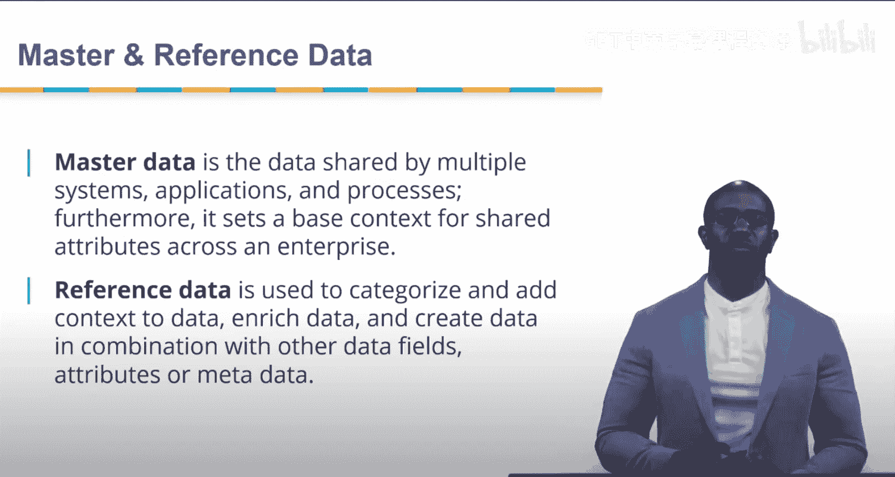
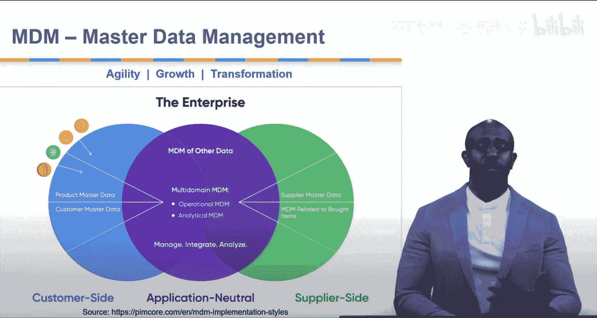
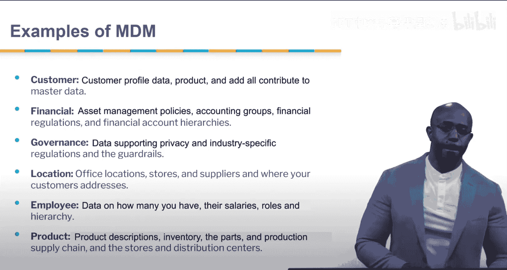
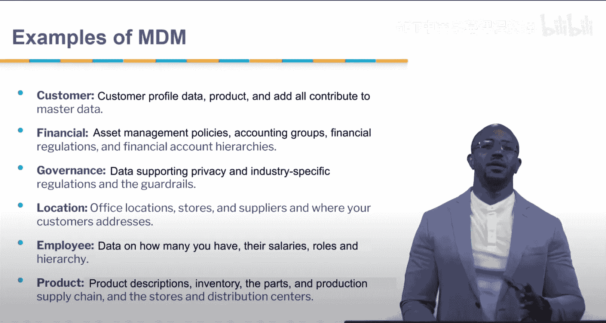
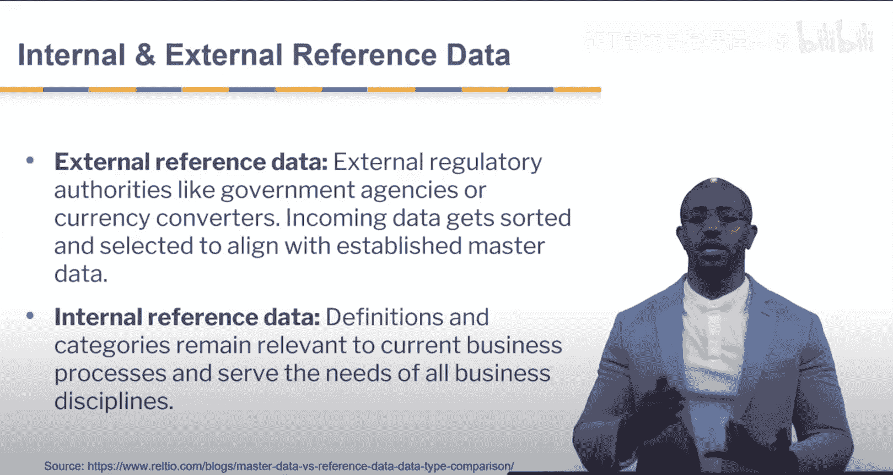
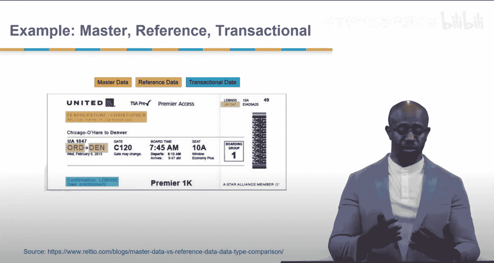
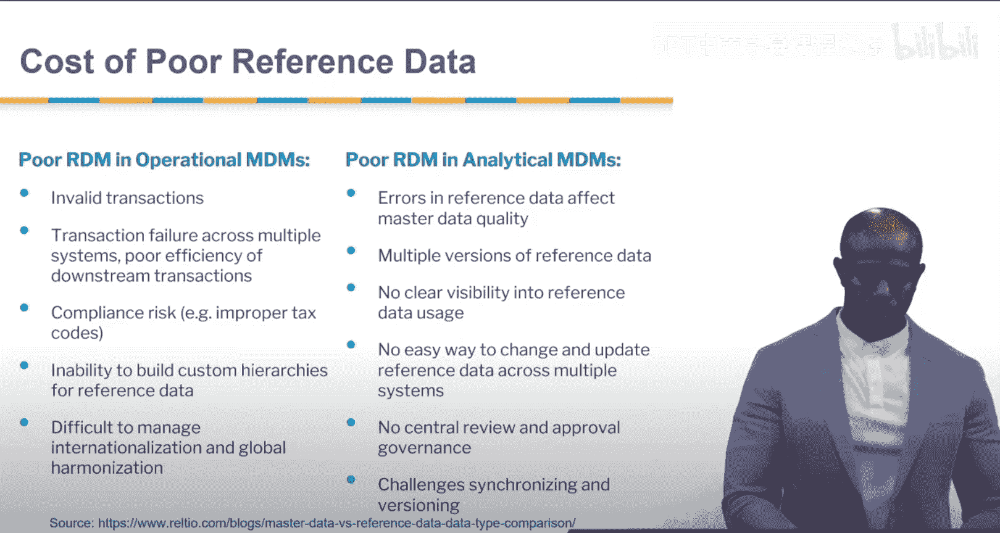
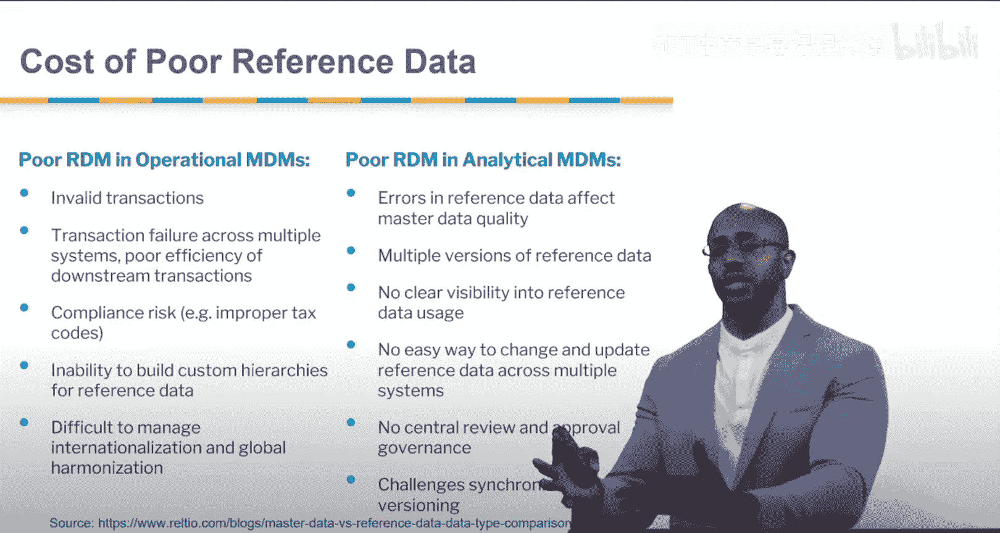
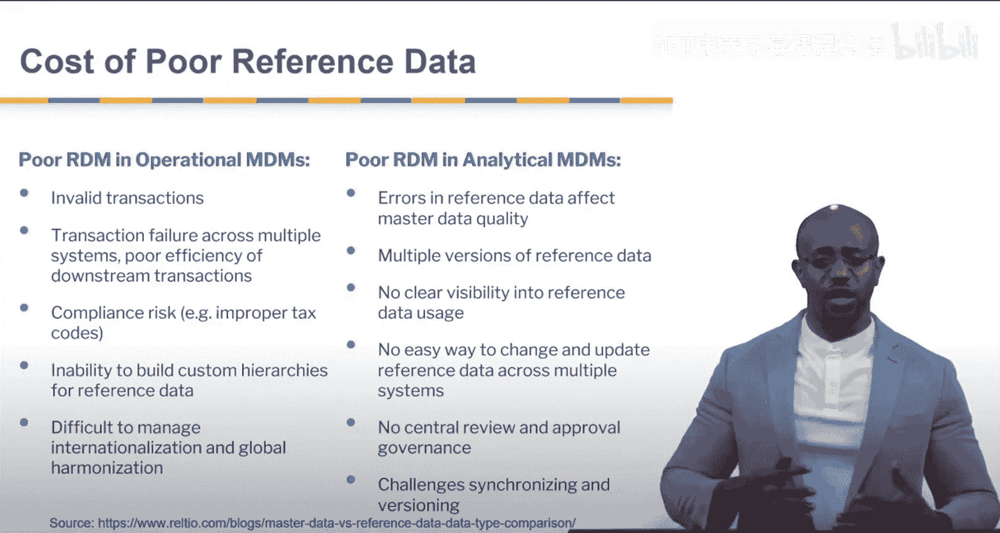

# 亚利桑那州立大学《黑暗数据迁移与架构｜Dark Data Migration and Architecture》中英字幕 p84 17_参考与主数据管理.zh_en [BV1TkurzMEmm_p84]

Welcome， in this lesson， we're going to take a slight dive into master data and reference data and talk about the relationship between these two and the relationship between dark data。

So master data is the data that shared between multiple systems thats centralized and typically a master data management system inside the construct data management overall。

 and it's used as a base context to share attributes across an enterprise now reference data is typically a subset of master data。

And it's more more overly used as a categorical way to define attributes or define new data elements and create relationships between different objects right so it's one of those things that is critical to enriching data and enriching the value that you can get from it。

Now this is a simple diagram if you take a look in the middle， you'll see MDM master data management。

 and it's a multi domainomain type of a system that's set up that most companies use as a central way to define similar data elements。

In a like manner right it's operational and analytical it has both operational analytical purposes on the operational side of the house。

 you'll have the systems and the operations of the company transactions。

 etc on the analytical side you have the big data data lakes data houses data warehouses and then deriving intelligence and decision making thereafter so on the green side you'll see supplier master data management and then related to bought items。

 data coming in and allowing us to better understand it from the supplier side and on the customer side product master data and then customer master data just two examples of how we would then categorize the data coming in。

 put it into buckets and be able to use it in the organize and stored manner。

Now， looking at the examples of MDM， these are just a few customer financial governance， location。

 employee and product。we look at something like product product descriptions。

 inventory parts and you think about products that you may have seen in a store somewhere that have a SU item or a SU code and that SU code is similar across is the same across similar products in any of the enterprises as they send them out to customers it allows them to identify products and in unique manner and it also allows them to identify if there's issues and be able to track those issues over time employee data this is huge for employee data so one of those things when you think about salaries。

 levels of companies so managers are within a certain tolerance when you look at salaries or roles or hierarchies or permissions or what they have the ability to do as well as engineers or VPs or directors so it's huge for employees when you think about governance we've talked about that a little bit along with financial and customer。

Looking at a customer data profile and how that maps to products。

 you can then start using master data management in conjunction with reference data to figure out which types of product which types of customers are attracted to which types of products and vice versa so once we get into reference data a little bit you'll see how we pull some of that reference data in and then use it for those types of purposes so let's talk about reference data a bit internal and externally they typically fall into two categories now external or regulatory authorities。

 government agencies， currency converters things like that that you use to align and you bring into the company establish with the master data and create new derivations and value from it internal referenceial data are definitions。

 a lot of definition， a lot of categories that may be specific to things like marketing customer segments。

 market segments and things like that they allow us to conduct business and a more disciplined and more productive manner and more uniform manner。

Giving the message to the consumer a more unified message as they interact with a business through the different channels。

 so both internal and external reference data is critical to success and critical to getting the value from dark data because you'll start creating new derivations and new alignments on customer segments。

 market segments， products and the relation there within。

Now moving to an example， master reference and transactional， right？Looking at this。

 this is a airplane ticket。When you get your boarding pass。

 you typically see this type of information。You'll see in green in not green， but in orange。

 this person's name along with maybe their customer ID and a few other things if they're gold or a platinum customer。

 all that have come out of the master data MDM， the master data tables now reference data is going to pop up in the form of this Orlando to Denver。

 the three call letters， orRD and DN that will probably come from an external vendor。

 our external external data source ingested and when we identify someone going from Orlando to Denver。

It will pop up on the boarding pass as such。Now looking at the transactional data。

 the confirmation date， as well as the ticket number。

 this is letting them know the details about the transaction and this specific iteration。

 so looking at this from a customer lens you wouldn't necessarily categorized information that you see you just get on your flight and go but if you're working in the enterprise you know that this type of information comes from these types of sources and some of the information where within can then be derived and created via dark data data products。

Now the cost of poor reference data， so in operations and then in analytical side。

 so we'll go to the operational side of the house， invalid transactions。

 failure in transactions and multiple transactions going across systems。

 which can cause issues with risk and compliance， inability to build custom hierarchies。

 which is really critical when you start looking at things just like you saw the example with the plane ticket。

 a gold member or a platinum member， you need to be able to establish those hierarchies between your customers。

And then difficult to manage in the global the harmonization of the data internally right。

 making things match correctly when they need to， and if they don't。

 then you're going to have more of those problems leading us to the issues on the analytical side when you're thinking about RDM。

 reference data management， the errors as it relates to the reference data that affects the master data quality。

 that's the number one issue that you sometimes can see across companies if they don't do their referential data correctly if they don't architect it correctly。

Then going into the multiple versions of reference tables。

 multiple versions of reference data when there's silos in the company and they're not speaking to each other in the manner that they should they'll end up recreating the wheel if you so to say right you also have no clear visibility in the reference data usage no central review and approval of governance there's tons of challenges with synchronization if reference data isn't set up correctly for analytical usage and then trying to glean insights from dark data that is created on the analytical side can just turn into a big swamp instead of data coming out of warehouse or a lake in a usable fashion so these are things to think about and if you want a little more detail on reference data management don't forget to pick up the diba and dive into it a little more deeper but this is just a brief overview thanks for your time。

