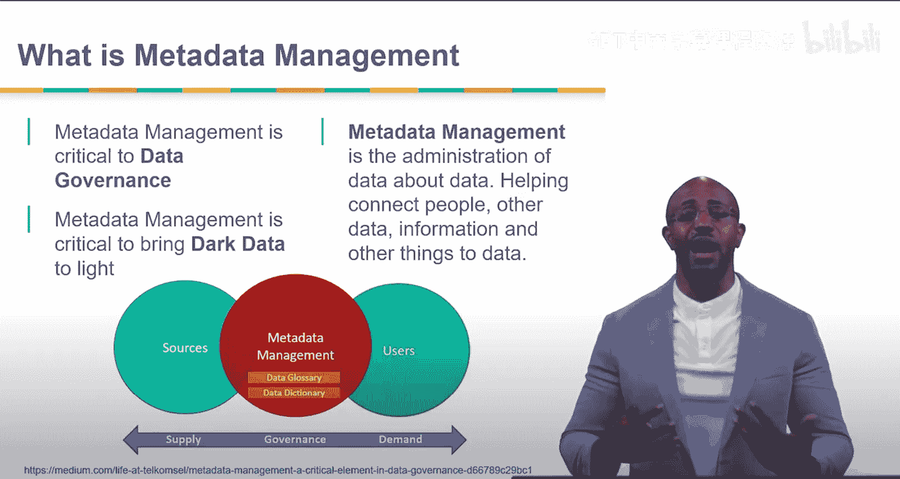
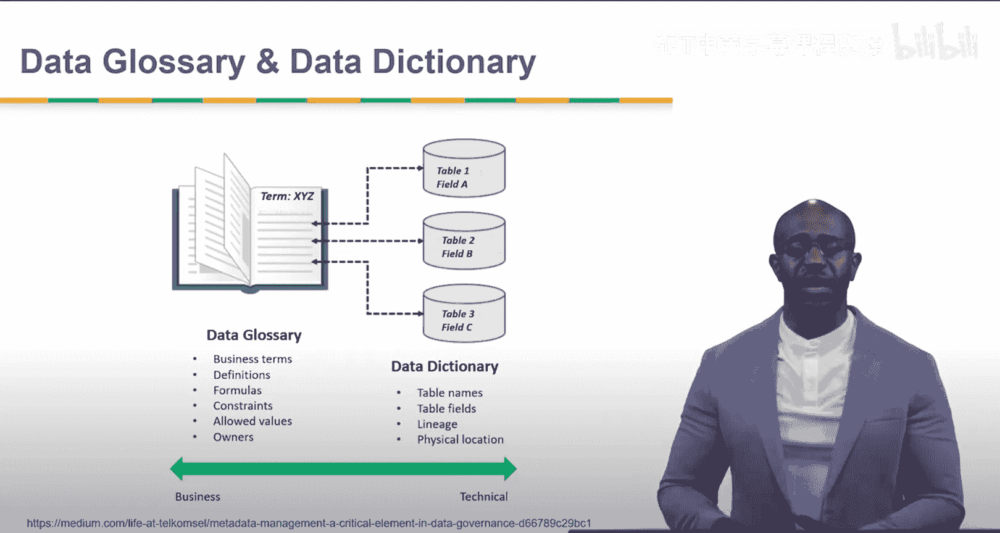
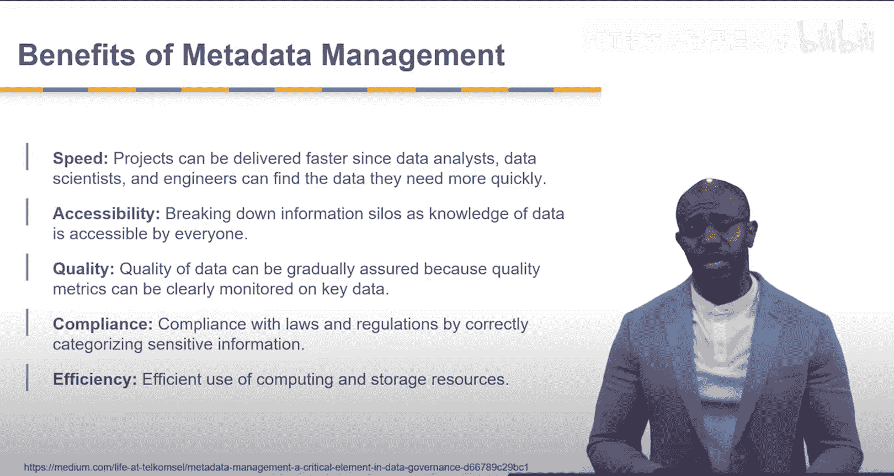

# 亚利桑那州立大学《黑暗数据迁移与架构｜Dark Data Migration and Architecture》中英字幕 p85 18_元数据管理体系.zh_en [BV1TkurzMEmm_p85]

Welcome， in this lesson， we're going to give an overview of metadata。

Now metadata management and metadata specifically is quite simply the data about data or the data around the data。

 it allows users and sources to understand the objects that is referring to better。

 it itself carries its own attributes and it allows both the demand and the supply side to utilize it。

In the best way possible under the guise of data governance right。

 so data management itself is critical for data governance。

' critical for data management in general because it would be hard to structure and categorize data without it。

Now let's talk a little bit about a data glossary in a data dictionary when you are looking at a data table or either unstructured data like maybe say JSON objects inside of a data lake。

 it's important to be able to refer to both a data glossary and a data dictionary the data glossary is going to have your business side。

Of of the details of any of the data elements and the data dictionary is going to have your technology or more or more focused more focused on the actual attributes of the elements or the objects themselves right so when you're thinking about the glossary。

 you're looking at definitions， formulas where they use for where the constraints and how you should use them right the data dictionary is more tactical in nature。

 it's about the table names， the field， the lineage， the data types， the field limitations。

 all of that stuff that goes into the technical aspect of managing and storing the data。

Let's talk about the benefits of metadata， right speed， accessibility。

 quality compliance and efficiency。If your metadata is off。

 all of this will suffer if you don't have metadata， all of this will suffer and。

In correlation to these things suffering the enterprise suffer so you speed。

 you can deliver projects faster， be more concise， you can do more analysis and the accessibility。

 can you get to the data， understand it， use it and derive insights from it if you don't understand it because the metadata is off you are going to have a challenge using the data quality。

Data can gradually decline over time if the metadata is not kept fresh and clean and structured in a way that is sensible and usable compliance and efficiency。

 compliance， you have laws and regulation depending on your industry， your enterprise。

 you have to abide by and thinking about efficiency。

 how efficient can we be with computing metadata and storing the resources etc。

 you can get more details on this and the Denbo but for now this is a brief overview so thank you for your time。

