# 亚利桑那州立大学《黑暗数据迁移与架构｜Dark Data Migration and Architecture》中英字幕 p86 19_数据质量管理机制.zh_en [BV1TkurzMEmm_p86]

Welcome， in this lesson， we're going to dive into data quality management。Now。

 DQM data quality management is critical to ensure that your data and the results that you're seeing from your data are accurate。

 effective， and something you can use for the future。

So data quality management provides a context for improving the fitness of data and is used for analysis and decision making right it's an increasingly bigger and bigger challenge the more data。

 the more volume and the faster data is moving through your system and at the bottom of this picture here if you look at the Cheevrons going across the screen this is just sort of a high level view of how data sort of gets to the decision makers and you're able to get to decisioning right so data quality is supporting this entire process from root to fruit。

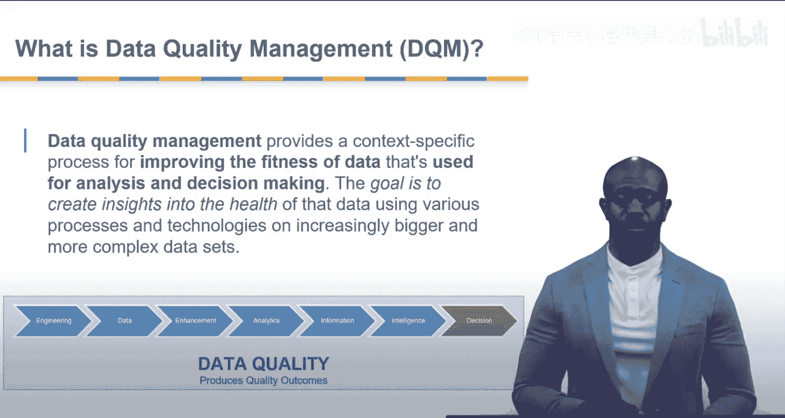

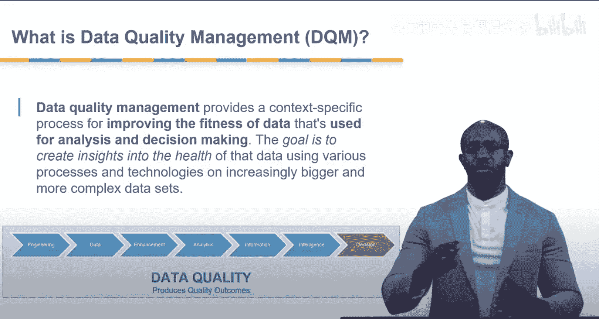

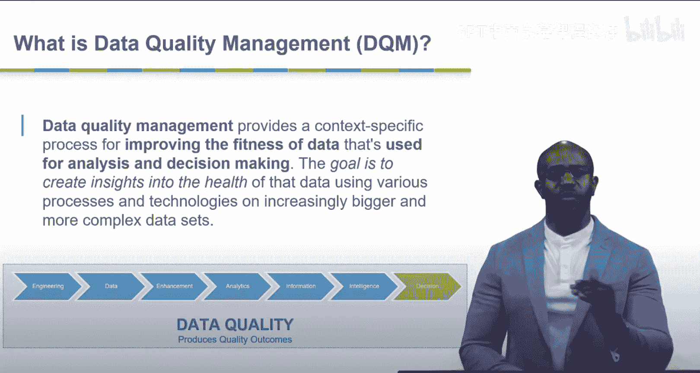

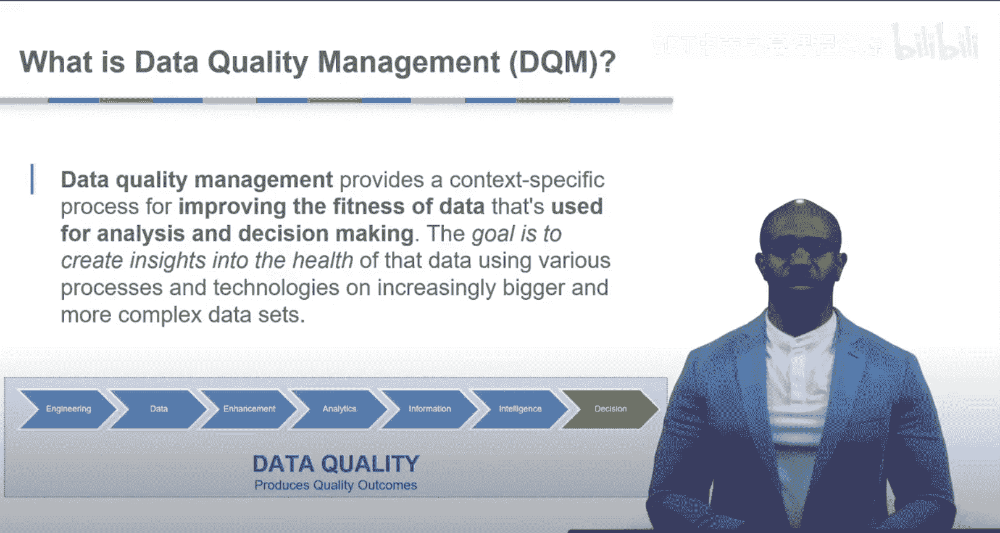

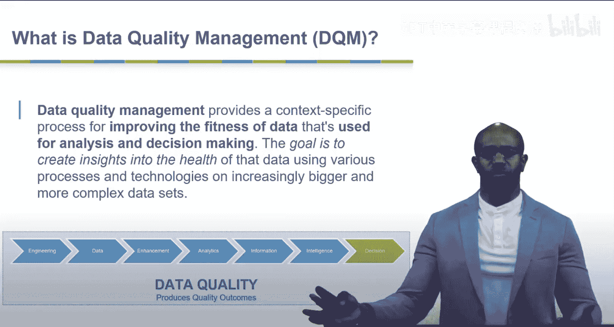

Engineering， data， enhancement， analysis， information。

 intelligence and decisioning right there's a lot that goes on in that first one engineering。

 but as you get to the end， you are then taking the data and refining and refining and getting more information and getting better intelligence until you get to the point where you can use it for optimal decision making。

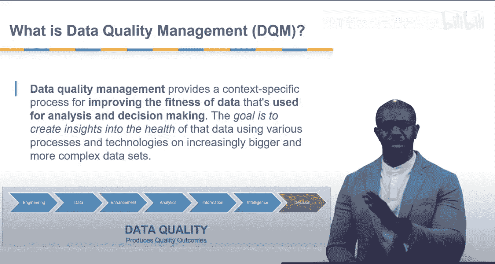

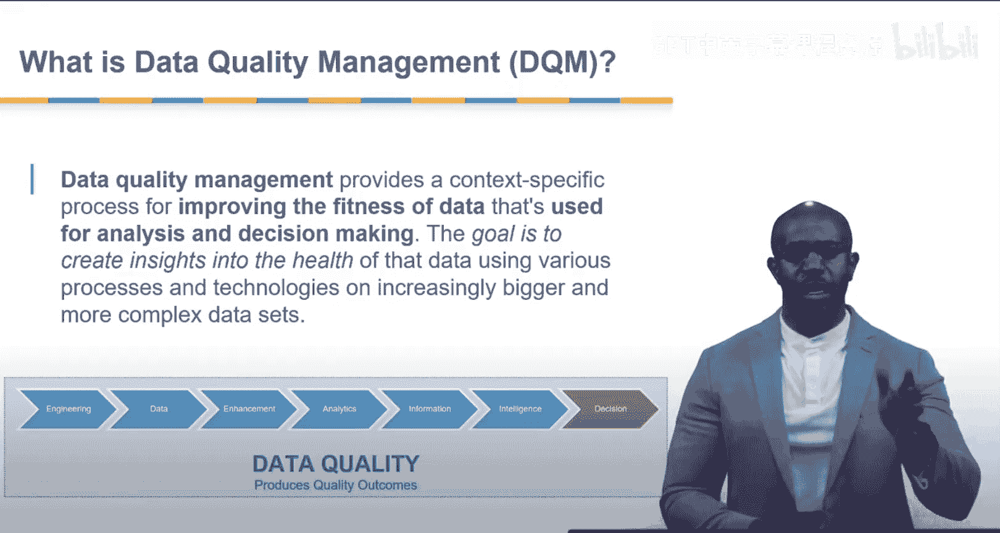

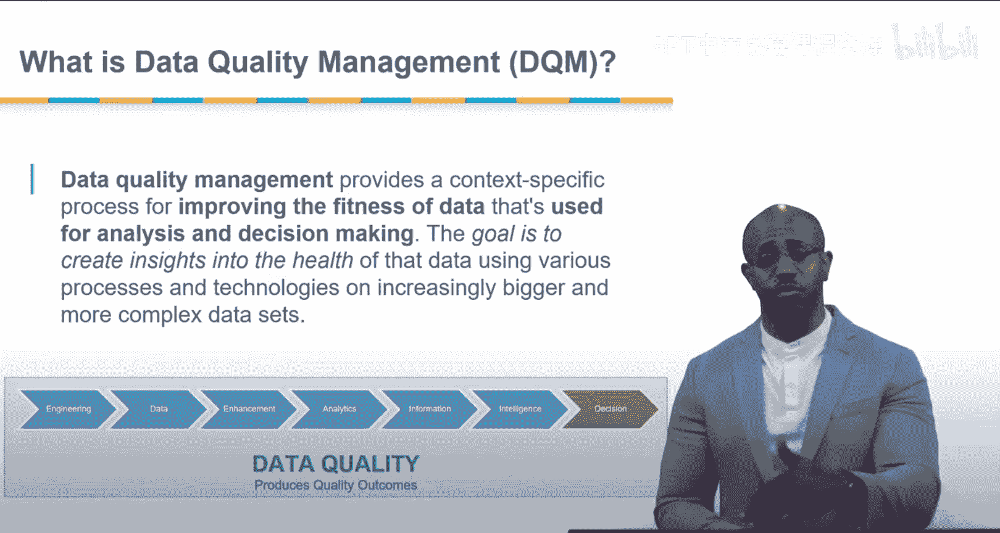

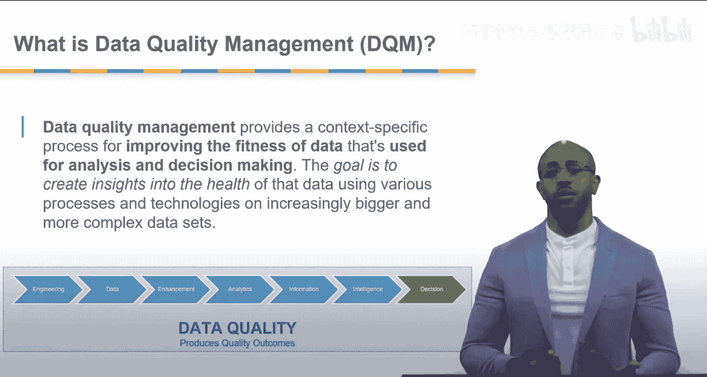

Now there are six dimensions of data quality， completeness， timeliness， consistency， uniqueness。

 validity， and accuracy。Now all six of these are super critical。

 some of these are simple to identify in terms of completeness if fields are mandatory and you have a database and you don't see the fields that are mandatory。

 you could have an issue with completeness validityity， uniqueness， consistency。

 all these other ones are extremely critical especially when you start getting into creating derivations and summarizing data so make sure you dive into these in the dimbo and then we're going into why is DQ im important。

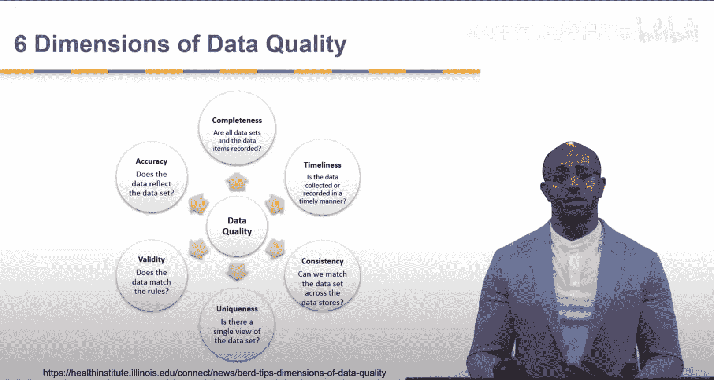

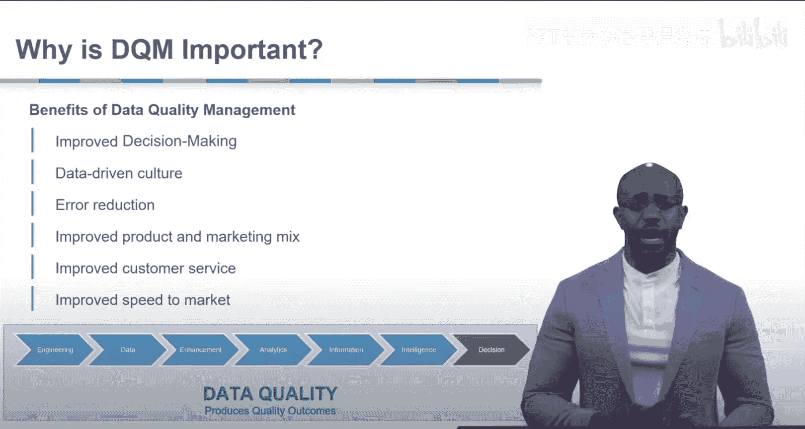

There are some serious benefits of data quality management right， improved decision making。

 creating a data driven culture， error reduction， improved product and marketing mix improve customer service and improve speed market these are just a few of the many value added components that data quality can bring you so take time go into the Denbaok understand them and understand that dark data itself is irrelevant if you cannot ensure the quality of the data that you're deriving that you're creating that you're ingesting that you are now capturing or using in light of using data quality for these purposes thank you for your time。

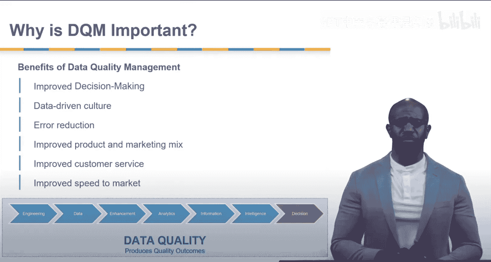

