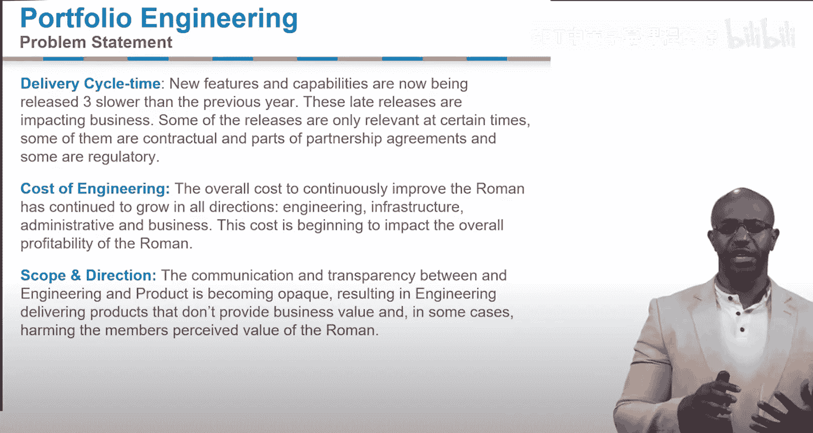
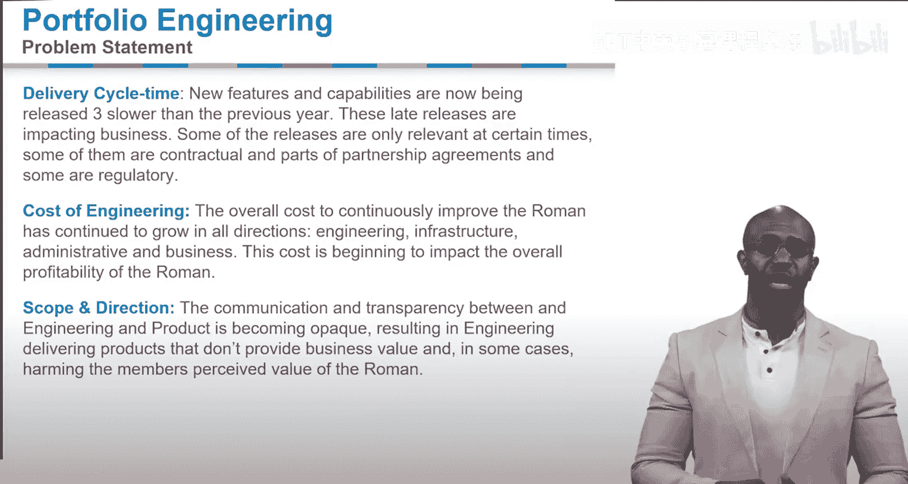
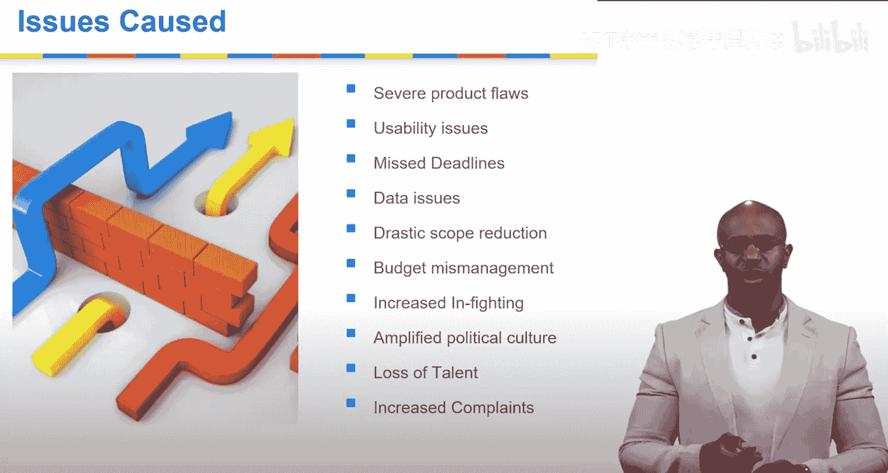

# 亚利桑那州立大学《黑暗数据迁移与架构｜Dark Data Migration and Architecture》中英字幕 p87 20_案例研究背景.zh_en [BV1TkurzMEmm_p87]

Welcome， we're on the last leg of the journey in this series of three courses for dark data and data products。

Now we're going to dive deep into a case study。About a newly formed digital company over the last few years。

 This is a fictitious company that has now crashed its way into the Fortune 500 with a bang。

 It is a fintech company。 It's called Legion digital。 Now。

 Legion digital has a diversified set of innovative products and legacy products that financial companies offer。

 bank accounts， credit cards， loans， Helocks all of that traditional stuff。

 They've also added loans to things like Bitcoinco and Ethereum to allow people to unlock the value of their digital cryptocurrency in the real world and use it for investment purposes in trying to expand their own portfolio。

 So Legion digital has grown very fast very far in a small amount of time。 Now。

 Legion digital has recently developed a brand new product。

 They wanted to capture that Pos system in the mobile device， As we know， credit cards。

 mobile devices， etc cetera。 are coming more intertwined with each other。 So Roman digital。😊。

Our Legion Digital has designed the Roman， which is a brand new mobile device， they're calling it。

What you need for the future as you move into this new world of digital first， etc ceter。

So with this new product of the Roman， this has coming to the market。

 taking a huge market share on mobile devices within one year， captured 30% of market share。

 and it's only increasing。Now this device allows its customers。

 the customers of Legion digital to quickly get access to capital as long as they are qualified。

 it also allows companies who bank with Legion digital as using their corporate card it provides them a mobile device completely for free right so it reduces corporate costs also it also allows companies to disperse these products to to their employees at minimal cost and their employees can get much benefits from it incentives etc right so it this new product in this new market there's always going to be a level of struggle with the success that you have so the greater success。

 the greater struggle Roman the Roman has started to experience a number of issues they've had a blackout for a while some of the volume of people using the device and then using it for multimedia etca has caused issues with the way the Roman and Legion digital has。

Their multi tenantant cloud infrastructure set up， they weren't ready for the level of scale and the level of success。

 blew they blew out their projections extremely fast with this new device and the companies like we said continuing to grow it is actually in the top 100 companies in the world inside of that Fortune 500。

So。That's that success in that struggle has led to at a high level these three problems in the problem statement。

 now those cascade into a number of other problems， but at a high level delivery cycle time。

 new features and capabilities。At one point， we're being released。Per sprint per month per quarter。

Now it's three times slower and it's consistently getting slower， the complexity of the product。

 the complexity of the data， the complexity of the marketing campaigns and the complexity of the offers and incentives that the companies trying its best to automate really fast is consistently growing these late releases are impacting businesses impacting business growth because have people they have people and companies trying to come on and use the products but we're not able to disperse them quite as fast because of these load issues and it's reducing the delivery cycle time。

Also， the government has started looking and seeing regulatory challenges。

 being able to track things in terms of the sales and the life cycle of the membership of the customers is also another issue now cost of engineering。

The overall cost is continuing to improve now generally and thinking directionally。

 as long as those revenues are coming in， you can support the cost。

 but these costs are bloating and bloating past the profit margins。

 so this is something Legion digital is trying to figure out how can they operate more lean and more efficient with what they have and continue the growth without having to expend tons of money on consultants and other type of engagements to solve problems。

Now scope and direction。

Communication and transparency。Its huge when you're dealing with product releases and launches。

 et cetera。Now between engineering and product， this communication has become really opaque。

 there's a lot of inf， politics are going on， people are trying to take leadership and ownership of things and in some cases they're taking leadership and ownership of things that they probably shouldn't be or probably not even capable of doing so these are some of the things that happen when communication becomes opaque and people are trying to solve problems relatively fast。

One of the other pieces is since there's opaque communication engineering is sometimes delivering on products as they are scoped。

 but the scope isn't clear so therefore the business value is not attained for those deliveries and that's a really big issue big issue because when you have a new feature or capability being released if the business value isn't there you're going have substantial problems for them customers and you have substantial problems from leadership coming down and saying hey we are not providing the value that our members are expecting to see from our products so these are the three main core problems that we're having here at Legion Digital with the new Roman device that has taken the market by storm。

All right， now providing a little more context and a little bit more deep dive into some of these issues。

 we have severe product flaws， severe usability issues along with missed deadlineads data issues。

 drastic scope reduction and this is a huge one because if we go out and advertise some new functionality to get customers and then we deliver something and the scope isn't what what the customers expected you are going to get a lot of complaints and you'll get those you'll get reduced reviews and ratings online going from five stars down to three stars to two stars and more complaints etc。

 increased infight the amplified political culture which we talked about loss of talent which is huge in companies especially when you're creating unique products that are new to the market loss of talent can be critical because if you have a key role player who may have been the backbone of developing something you have to keep that talent on staff at least until you can increase the spread of the information that that individual knows so loss of talent。

can cause real big problems as well as lastly those increased complaints so these are some of the issues that Legion digital is facing with the Roman product。

 but they have to keep moving forward and we're going to figure out how to solve this problem of using dark data and data products Thank you for your time。

