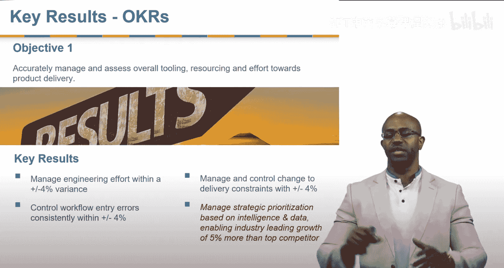
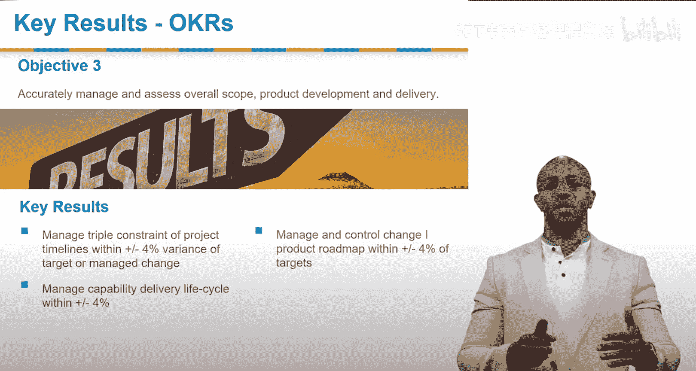
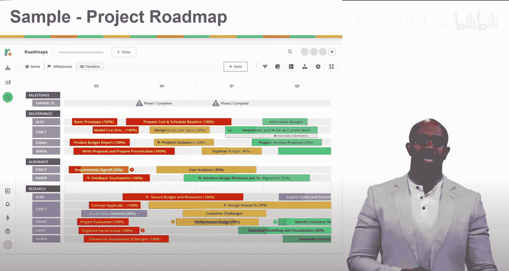

# 亚利桑那州立大学《黑暗数据迁移与架构｜Dark Data Migration and Architecture》中英字幕 p88 21_目标与关键成果体系.zh_en [BV1TkurzMEmm_p88]

Welcome， we are going to dive into the OKRs for the Legion Digital case study， specifically on the。

 the new Roman mobile device。Objective one， two， three sort of track with your old school triple constraint so objective one accurately manage and assess overall tooling resources resourcing and effort towards product delivery this is going to be key because this is going to allow us to look at the overall value stream and portfolio。

And manage our resources and engineering effort towards delivering faster。

 more efficiently and accurately。Objective two， accurately manage and forecast overall financial status and annual budget。

 so typically we get a budget we have a financial status et cea。

 but now instead of doing your traditional approaches of accounting where they take your current burn and then peanut butter it all the way to the end just spreading it out month by month。

What we'll do is we will get an accurate measurement， looking at attrition rates， hiring plans。

 skill sets， critical and strategic staffing， looking at how contractors play a role。

 how we can roll them on， roll them off， squeezing it just like ringringing the tile and getting the most out of it right to the last drop now objective three。

 accurately managing and assess overall scope， product development and delivery。

So this is that whole piece on the scope and making sure that what we deliver as a product is what we want it to be and it is delivering the value that we need。

 and we are going to extract that from dark data and data products。

So let's dive into the key results for objective one the key results will look at our managing engineering effort within plus or minus4% variance and you're gonna to notice everything is right now at plus or minus4% the idea is that once we deliver on these OKRs we will reduce that variance down till we get it to about2 and a half to 2% but right now we're going to start at4 plus or minus4 and half I believe that is attainable so managing engineering effort control workflow entry errors consistently managing control change delivery constraints a lot of this is going to require us to make adjustments to process management and if you look at this big last one that's in this sort of dark orange or reddish here manage strategic prioritization based on intelligence and data enabling industry leading growth5% more than the top competitor now this is in a different color because this is going to be a stretch result that we're going to try to attain if we can't get an MVP that will be totally fine。

We'll use it to。In our V2 or V1 of this after MVP， the reason why is because this one is going to be really difficult to get we'll have to gather a lot of outside data。

 external data government data pull that in and create an entirely entirely new suite of data products based on dark data and that data will allow us to assess how we can move forward and more nimble in the industry first we'll do our internal assessment at our house and order then we'll bring it to the entire entire market but we're gonna to focus on those first three initially because those are the ones are gonna be critical and critical for us in in this effort so just remember that fourth one is for you to consider if you want to get like if you want to look it's more like extra credit extra point type of a thing but it won't be mandatory for our exercise here。

All right， objective3， accurately manage and forecast overall financial status annual budget。

 key results manage budget within plus minus4%， just like we said。

 variance per per organization and project， so we have to look at the variance per organization per project the budget and make sure we're staying in accordance with that and ensuring that organizational budgets and project budgets align a lot of times if companies don't really align those budgets。

 you'll have some problems。Are you deriving the organizational budget from the projects。

 are you deriving the project budget from the organization and are you looking at the underlying administrative costs and infrastructure costs？

Manage financial projections within plus or  minus4% variance per organization and per project。So。

Financial projections， not only the budget now we're looking at the projections again， like we said。

 those projections sometimes get peanut buttered in your traditional accounting approach in this one。

 we're going to be looking at the hiring plans。 we're going to be looking at the attrition rates we're gonna to be looking at how are we strategically applying our budget to the hiring are we having the right mix of senior people who are more expensive and the right mix of more fresher or fresh out of college or rookie experience that may not be quite as expensive managing product costs within plus a 4% variance So the overall cost of the product at the end getting it out the door and then Ri So this is somewhat of a stretch。

 but I believe we can get it in this one So managing Ri per product inclusive of engineering costs within So this is a little bit more than what it says here on the paper when we think about the Roi costs you're thinking of the return on the investment So is it making the money that we need based off of our projections。

It's bigger than simply dollars， right， It's way bigger than dollars。 So dollars are one part of it。

 and it's typically going to be the core， but it's also the impact on the market segment that we expect。

 Are we getting impact beyond， Are we getting reach beyond our target。

 Are we also changing the way that people interact。 And is that then giving us residual。

Return on our investment right and then how is our engineering cost So we need to look beyond just the dollars and understand the impact to the environment。

 the societal impact and is that part of our RI So we have the base Ri。

 but then we have that expanded view。 Our investment is more than just dollars。

 Our investment is to inspire growth change and a change in society for the better for our products。

 right。Now， let's also look at the next objective， accurately managing assess overall scope， product。

 development and delivery， right？So this one， triple constraint of a project， time Costco。

 let's manage that， let's keep it in play now I want to make sure it is a constraint so that doesn't mean things can't change。

 it's is what's going to be the tradeoff for that change。We increase scope， okay。

 are we applying more dollars？Or are we increasing the timeline？We're reducing scope。

 are we decreasing the timeline and removing or removing dollars or a bit of both。

 how are we balancing those constraints together， so change doesn't mean that we're having scope creep or that we're out of scope。

 not managing the constraint means we're having scope creep or out of scope。Mananaage capability。

 delivery of life cycle， right？Man， I'm sorry managing the capability delivery lifecycle within plus  minus-4% so typically delivery of the capabilities is a good sweet spot between strategic and tactical or the tactical execution space so a lot of times companies will look at the capability delivery and say okay this is the lifecycle we really want to focus on managing but sometimes it may be at the feature set so instead under the capabilities are the feature set you may look at the feature set but that's going to be up to you as you do your design right as you do your design and then the way you architecture data and the data products and dark data that you want to use to either create and or use。

So then last managing control， the product roadmap within plus of4 plus or4%。So。

When that product roadmap， when we look at the product roadmap and I'm going to give you an example here。

 are you managing the control to change on that product roadmap and that is that you can tie this one in with the triple constraints so when the change happens。

 how are we looking at the constraints that we have？

Now here's a sample project roadmap and this is although it's a project roadmap this is sort of a deep dive right into the project right so this isn't specific to Legion digital or the Roman this is just a generic one so if you're looking at how they have this one set up milestones deliveries alignment research they have it bucketed in between sort of phases a segments of a project that's not bad it's okay but remember this is the project roadmap in reality we're gonna be looking at a portfolio roadmap but I wanted to dive into the details so that you could take the time and figure out how you want to set up your portfolio roadmap and then you are going to develop the automation based on the data that is provided to make this happen。

So it's set up on quarters， you could be doing program increments if you're unsafe but a lot of companies do quarters。

 quarter 1，2，34 and then going into the next year， they have the phases here and then you can see the work and how it's being done and how they're delivering based on the shading right so you can see the green sort of getting darker versus greener etc so this is a good tool or good thing to try to use to develop a product roadmap。

嗯。But right now this is a sample for the project roadmap this is at an overview of the OKRs and then how we take those OKRs and apply them into a project or portfolio or product roadmap and we're going to be using this as part of one of the management tools and we'll derive it off of the data。

Thank you for your time。