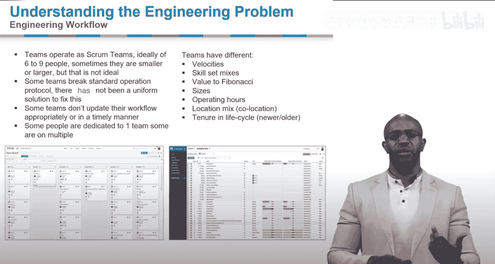
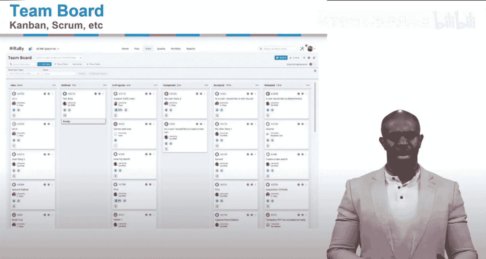
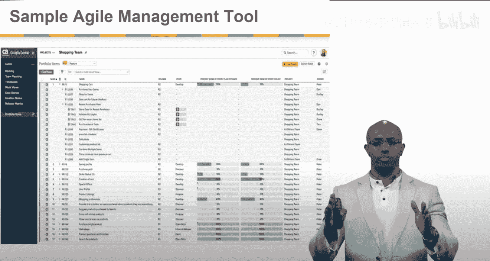
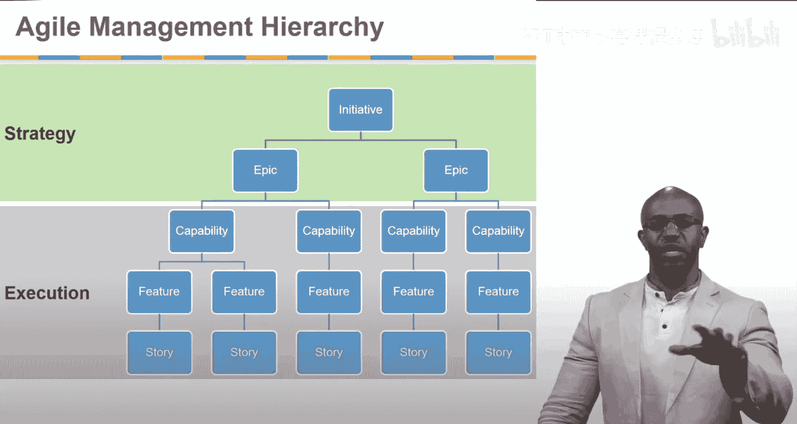
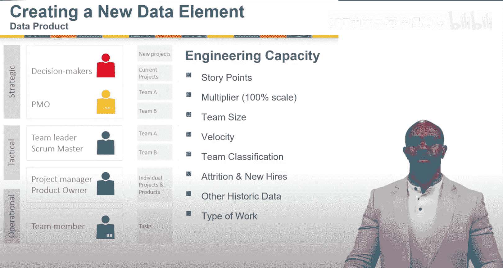
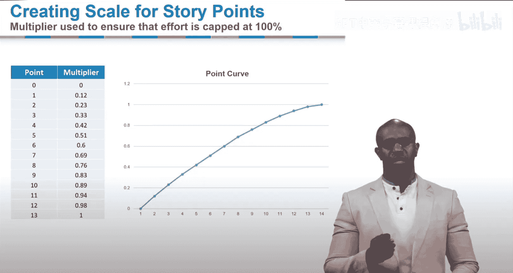

# 亚利桑那州立大学《黑暗数据迁移与架构｜Dark Data Migration and Architecture》中英字幕 p89 22_工程问题解析.zh_en [BV1TkurzMEmm_p89]

Welcome。In this lesson， we're going to deep dive into the engineering capacity problem。

So starting with the engineering workflow。Most teams operate as scrum teams。

 so there are some combine teams but primarily scrum teams。

 they're highly similar in operation in terms of sizes， they're six to nine people。

 sometimes they're larger， sometimes they're smaller but that's not ideal It's not necessarily mandatory that you make them six to9 but you definitely don't want teams of 50 people operating as one scrum team There are cases where I've seen two teams operating as one because they're on such highly relational tasks and projects which makes sense so in that case you'll see a team of like。

17 to 18 people， but it's really two teams operating as one they have。

 they'll operate with a joint scrum team， but then they'll still have their own separate scrums as well。

Scrrum teams that breakstand protocol， there is not a uniform solution to this fix， right？

So what that means is these scrum teams aren't necessarily operating with your standard scrum flow right so when you have a sprint every two weeks。

 these teams may be infrastructure teams or they may be teams that are support teams and they just take tickets and they just continuously deliver like a continuously delivering team。

There are teams that don't update their workflow appropriately。

 so this is literally just administrative tasks of engineers， most companies， their staff。

 their engineering staff don't fill out timeshes， so the only way to see their work is on these user stories。

Or tickets if they're one of these support teams so if you're looking at user stories。

 sometimes the person working that a story is applied to or that is working on a story。

 that individual may or may not be the person who's done the work and that person may have had other people to help so it's hard to identify who exactly is working on what at any time if you're centrally managing these things you pretty much have to apply stories to a team versus the stories to a person when you're looking at the management piece and when we create a solution so although we will have people tied to a story。

 we want to make sure that team is tied to it so that we can apply it so people are dedicated to more than one team this is common around the globe。

 especially when you're dealing with senior engineers and architects。Even me myself。

 when I think of the teams I manage， my senior engineers and architects。

 they need to understand what's going on with all the teams related because when we have touch points。

 I need all the best people on the team understanding where we're going and we need everybody's input because there may be pieces that we're missing right so just understand that teams are not gonna always have people solely dedicated to the team plus teams are。

Especially if you're dealing with a global company， teams are dispersed geo across the globe。

 so you may have people in India， China， America， South America， Europe， Africa， et cetera。

 so keep that in mind how do you want to manage this and does this impact overall engineering capacity towards the delivery？

The teams have different velocity， skill sets， value to Fibonacci。

 these are things that some of these things we will curtail and some of these things we will we will really put inside a rubric they have different sizes。

 operating hours， location mix and tenure like is the team newer is it older if it's newer。

Usually it will be harder to see a stable pattern in their workflow not always but usually if it's older it should be opposite usually so let me go into an example。

 this is your standard team board right when you look at this it's basically here's your stories and they move from ideation to backlog and progress。

 completed accepted revised and complete right like done has it been accepted by product and has it been done if there's any revisions let's understand those and make them happen。

Standard Agile workflow standard team dashboard。

Next this is another portion of the route the agile management tool。

 this is just a sample again this is more of the portfolio of you so you'll see features laddering up to stories and stories laddering up to tasks so this is where you'd go and look get an overall view and see where things are rolling now both of these views just provide an understanding for the teams maybe a few of the associated teams and a high level one thing to take note is that even if you look at these percentages of complete for any of these features。

They don't necessarily tell the complete story。The reason why is because some of the user stories。

 not some， but a lot of them are even created halfway through a quarter and then if something new comes up。

 you have a new story created， even in the sprint， although that's not necessarily the best practice。

 you don't want to add to a sprint， you want to complete a sprint and move the next one。

So if you see a percent complete of 30， and then we have some work coming on the side and we have to redirect if more work comes in。

That 30 can drop down to 20， and it'll be real easy for anybody to say， hey， what's going on here。

 How are we 30% complete And now we're 25%。 How are we going backwards。

 It's not that we're going backwards。We just have more work that has come in right so what is the traditional load or volume of work that comes in in a quarter or a month or a sprint or a week or whatever right so now we're starting to talk about velocity when we ask those questions so when you use these types of tools just understand sometimes the built in functionality of the tool doesn't tell the whole story。

And that's why we need to pull this data and understand things and that's where that dark data arises right so if we start thinking about that dark data and we can take historical patterns。

 we can look at a quarter， we can look at a feature pull out a few attributes and estimate within a variance plus or minus 4% what that feature or capability。

 what the capacity of that should be。And should we be basing it solely on stories or a number of variables that add to what that actual what the actual value of engineering should be for that feature or that capability so looking at this I personally when I was back in the day when I was a project manager。

 I personally would not use that percent complete。Because that percent complete is never going to be accurate。

RightIt's not going to be accurate till the project is completely done and at that time percent complete is irrelevant because it's done。

 we know it's 100% complete。So what we want to consider here is we need to figure out how to get access to that dark data。

 using that historical information， creating that product or that product element that I'm sorry that data product with the element that describes what engineer capacity is and then being able to apply it and then being able to categorize features and capabilities based on a number of variables or elements that allow us to put them into a box and say within plus or minus4%。

 this is what the size of what this thing is and based on our effort towards it。

 this is where we are。

So little quick overview of your standard agile management hierarchy。

 this type of a view is primarily for safe。Now in say if you'd also have another level at the top called themes。

 I didn't include that here just from for a few reasons for the size of the slide。

 but also depending on what tool you're using or how you're breaking it out。

You could or could not have another level right initiative E capability feature story。

 but me personally the word theme sort of throws things off。

 I prefer to use something like program or even portfolio and then that could be above an epic and below an initiative if needed either way they're words and you can figure out how you want to use them so in the strategy space that's where your decision makers primarily lie and they also rely on the opinions of the people in the execution or the tactical space。

Some organizations will have capability in the strategic space in space。

 but I prefer to put capability in the execution space or the tactical space because the capability is actually delivered。

 an E is a group of work， a program is a group of work。

 an initiative is a group of work although you can finish a program technically in engineering or in any technology programs typically continue until they're no longer used and that's a whole different thing that's no longer delivery it's no longer relevant。

So that strategy space is gonna to be initiative in E and then we go down into that execution space where we have capability feature and story and your engineers are going to primarily live in feature and story as you start looking at project managers。

 product managers and that sort of managing that first tier management layer they're going to be looking at features going up in the capabilities but they'll still be managing stories so they'll sort of be ammbexxtrous within the execution space they'll understand what's going on with Es and initiatives but they won't necessarily be in those waters making decisions on those they'll be providing context and value to leaders to help make that decisions not when you start talking about directors and then your first round of VP you're looking at that capability level and not primarily like we said they'll still have insight into features and stories but that's where they're gonna to be sort of identifying and making decisions so that's where you're gonna to start thinking about what are the capabilities in some of the features sets that build that capability that provide value for the customer and then when you go up to that epic set。

What are these big bets year over year for companies that the seed level that sea suite need to be aware of and what's the information they need to help manage and understand what they need to do？

Now， in general， engineering capacity。Now you're going to see this in some of the documentation for the course。

Sort of outlining opportunities to create this engineering capacity data element。

This is going to be a critical data product because you're going to take this data product。

And it should be something that can be pervasive all the way through every big bet of this project。

 every big element， everything dealing with time management， financial management。

 capacity management， product impact and market management， right all of those pieces。

 so when we think about engineering capacity。You're looking to start at two primary things。

 story points。And team size。Now story pointss go from。Basically from1 to 13 on the Fibonacci secret。

So the Fibonacci sequence is 1，2，3，5，8，13， and then it continues。 However， for agile。

 we want to cap it at 13。 Now， what you'll find is some teams don't even use Fibonacci。

 they may use the number 7 somewhere。 So you need to understand that that's gonna to happen and still provide a solution for that and we'll go with that with the next slide。

 Also some teams will go over 13。 I've seen some teams put 100 on a story。

 and you have to have safeguards with that。 So what we start off with something is an assessment saying if a story is 13 or higher。

 although it should be cap at 13， that literally means when 100% of effort is on this story。Right。

 and if a story does have 100 on it， it is a good practice to go to that team and say what is going on。

 we need to fix this。Furthermore， on the other side of that spectrum when you get to one。

 two and three， if it's if the story point says one in general。

 it shouldn't be more than one person working on it。

 it should be really fast but should be able to get that done matter of an hour or so right it should be very small so these are the two assumptions that we that most people would agree with if it's at the top end that means 100% of that team's work is working on this at some point like people on the team a lot of this team is touching it if it's one it should be one person really fast done all the stuff in the middle。

That's sort of up for debate and it's one of those things that people sort of have more of a debate on。

 but at those ends， people can typically agree。Now the multiplier are 100% scale。

 so that 13 equals to 100 percent。Anything over 13 is then repopulated as 13。

And that means that it's at 100% still。So I would say the statement going forward on engineering capacity is no person can actually give more than 100%。

Now we do know that there are motivational speakers out there that says give 110%， give 200%。

 et cetera， we know and that's what you want to do， you do want to give 110%。

 but in reality the reality is you only have 100% of yourself to give。So when we think of things。

 we have to cap effort at 100% and we have to cap things that are impacted by effort at 100%。

So now going into velocity， velocity is going to be one of those things that help us determine not only effort。

 but also it's going to。Be part of how we look at。Team's effort towards any feature that has multiple teams contributing to it。

Team classifications。So velocity is impacted by the team size as well。

Eelity is impacted by many things， team size， the skill sets on the team， the makeup of the team。

Does the team have more senior people， more junior people and also the type of work that the team is doing right so you want to think about all those slices and say。

 how are we going to classify these teams？Classification， A， B， C， D。

 E F all the way down right and then you can't you don't want to segment in too much because then you have like one team and a classification but the reason why is because you'll combine those velocities and use that to then spread out the actual effort and the when we look at the effort versus the actual deliverable right so velocity will help us normalize points and effort towards a deliverable now attrition and new hires that's going to be key because that's also going to impact capacity how do we manage that over time a team is not going to be six people through the whole year。

If you have a hiring plan， you want to hire up three new people on a team。

 you might get to nine people and then if people leave。

 you'll have nine you go to 8 so over the year that team size changed so you'll have to store information on that team you can decide to do it per sprint or you can decide to do it per month Now we know people do leave in the middle of a sprint or the middle of a month。

 etc。So you need to figure out what cadence is good for your monitoring of the team size because that's going to impact overall team effort and capacity because you use points and then you also use the size。

Other historic data and type of work right， so we talked about type of work is a team a。Is a team。

 a team that's doing back in engineering， are they doing Python or Java， those types of things。

 is it a data engineering team， is it a UI engineering team， is it a graphic design team。

 is it an analytics team， is it a data science team？What types of teams are there， typically your UI。

 not the UI engineering， but your design teams are typically going to be smaller than your engineering teams。

 so those teams might more consistently be teams of four people， maybe even of three。

 which is outside of that six to nine。Wwhich they'll be that team size A versus team size B or A won't be the three。

 but A will be the six to9 right so think about that and how you want to set that up Also some leaders take the stance that they look at their project manager Scrum masters。

 everybody on the team is an engineer even if they're not so they would add that to the engineering capacity That's a good argument in that that might make sense to you it may not you want to think about that sometimes they put product people as engineers in terms of understanding capacity What makes sense to you and what does your organization what would your organization look at as their engineering capacity。

You have to make that decision right I definitely understand the value of saying Sc masters and project managers are part of engineering so they should be part of the engineering value Some people draw that line at product people right so product analysts。

 product managers， those people are more on that product side so should they be part of that engineering capacity Most people think not but it could be true for you。

Now sample， looking at that story point， story point normalization and the multiplier， you look。

 you see we have zero to 13， obviously zero points means zero multiplier actually if the story has zero。

 you should probably kick it out。Tell them to fix this because why do you have a story with zero effort？

But we're just gonna put this on the scale so that we see it here right so 01 starts at 1。

2 and you see this nice curve going up right and some of the curve could possibly be distributed better or differently so it'll be up to you to decide how you want to adjust the curve if you can you'll see some slight error slight errors in here or how you want to change whatever number it's completely up to you if you want to change it but you will be provided this scale as a sample and it's completely up to you how you want to decide so if you see at the top where it says 13 that's one 100% so somebody might say well if I put 12 that's not actually 100% but it's not far from what one is on this on this picture so should that be different should the curve be higher at the top and drop down more dramatically should it be less less of a slight curve and more of more of a depth curve you'll want to think about that and you want to fix that curve to how you and your leadership views effort。

But this is the scale right， so if somebody puts a story and they put 18 that18 is redirected to 13 and 13。

 it's 100%， you're never going to go over 100%。Because there is you cannot give more than 100% effort。

So looking at the slide before this and this slide。

 where are going to figure out how we do engineering capacity。

 you'll look at the information and materials provided for you and you'll have to work through how you want to set this up because this is going to help you derive the dark data that you need simply before this points where points now points on 100% scale and points will measure out to be typically below one but or the effort will measure out to be typically below one that's just the engineering effort and once you have the velocity you put the velocity as part of the equation you'll have a completely different view of engineering effort over time and those values that set of values is going to be what you use and that's going to be your dark data that you've created and that data product which is fueled by that dark data and you'll be able to use it to map out capacity。

 financial management etc and you'll use that pervasively throughout the entire throughout this entire ecosystem and。

For this effort， the sample information is all going to be Microsoft Excel so we're going to keep keep this as a small subset we're not going to have a huge data you can take this data we'll provide it in CSV format so if you wanted to use it in like Google BigQury or other actual databases import it。

 stage it you can do that and then you can actually have a bigger database and then you can take some real life stuff use some of the small referential information and then make some adjustments but either way this is the foundation of how we're going to get started and this is the engineering problem we're going go into the financial problem next。

 thank you for your time。

