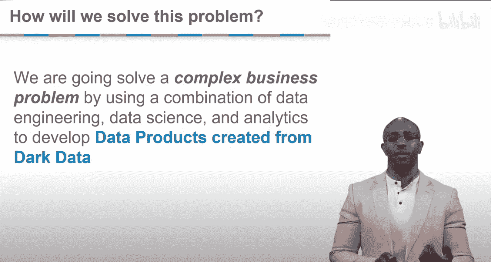
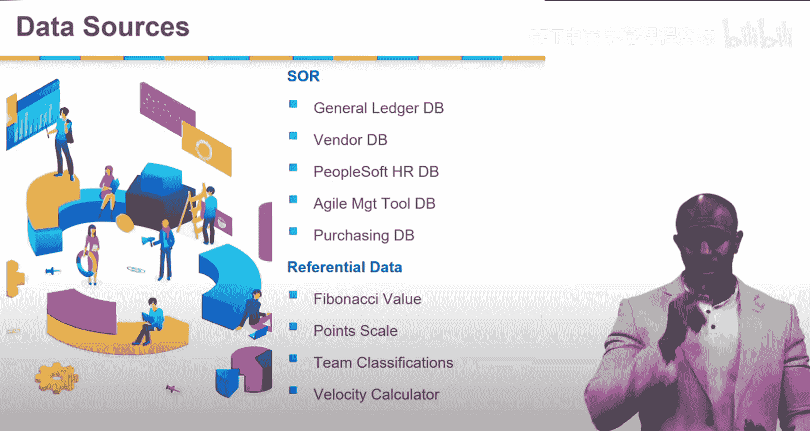
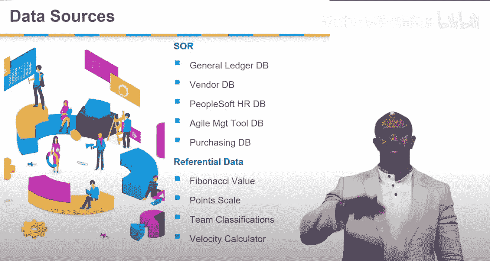
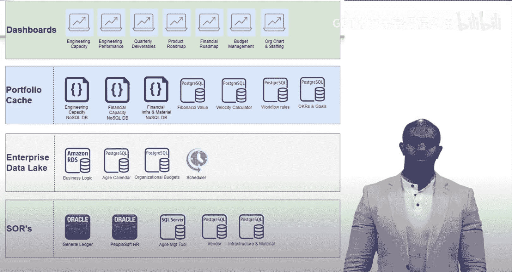

# 亚利桑那州立大学《黑暗数据迁移与架构｜Dark Data Migration and Architecture》中英字幕 p90 23_解决方案路径.zh_en [BV1TkurzMEmm_p90]

Welcome。In this lesson， we're going to deep dive into。

The underpinnings on how we will solve this problem。

 some of what's in here you're not going to actually implement。

 but it's critical for you to understand it。 So when you're doing this in Excel primarily I'm assuming most folks are going to use Excel you can use parts of Excel to replace some of the pieces that would be needed if you were to do this at a large enterprise So how will we solve this。

I'm going to go through this clear statement and then break it down for you。

We are going to solve a complex business problem by using a combination of data engineering。

 data science and analytics to develop data products created from dark data。

 one piece that was left out here because it's not going to be for certain and for us specifically since we're doing this in a small set iss going to be Excel spreadsheet。

 we are not putting in here software engineering。 however。

 if you were to do this at a Fortune 100 for certain you would be mixing software engineering in here as well All right so data engineering。

 we are going to structure data， we're going architect data and then we're going to create data。

 we're going to use data science principles we're going to use data algorithms and data structures is to create new data that was initially dark we're going to go find data that was dark we're going to use data to derive new elements we are going to enhance the data that we have and we're going to create a whole new product。

SiteThat is going to help us derive the information that we need right this product suite is going to be primarily centered around the engineering effort and that engineering effort is going to help us better understand where we're working。

 how we're working， how to reduce work and allow key decision makers to make better decisions it's going to allow engineers to make better products that's going to clear up the trends Par between the different layers of management and product to allow us to operate。

 move forward better， faster and sooner。So。When I think of this statement。

 I think of all of those needs， the entire triple constraint。

 and I think of value for the customer and I think of dark data being the foundation because these are the data elements that are not pervasive and since they're not pervasively and not well known。

 it causes tribal knowledge and it requires people to make decisions based on their gut feeling。

 which we know is not always correct。

So data sources。In general， when you're thinking of financial， you're going to think general ledger。

 the vendor database， the database that stores the vendor information， the new vendors that come on。

 the vendor rates， the vendor timeshes， all of that stuff is stored in a specific database Peopleoft HR put peopleof specifically here because most companies just peopleoft but what is your HR database your staff that's on hand right the people that are working for the company what is their blended rate or the rate that you're going to use we're going to use a blended rate for what we do we're gonna to use a blended rate for the different levels and then we're going also use that peopleoft database up against the agile management tool so that we can ensure that the team number name sizes etc cetera are accurate in the agile management tool so think about the agile management tool going into that piece so let's talk about that right？

That piece is where things become that is the base of the engineering effort so that's where things become more more transparent and come into light more in most agile management tool like we discussed there are dashboards that you can use and you can create dashboards in them but you can't create dashboards with data outside of those tools so we'll be bringing in that financial data we'll be bringing in that vendor data we'll be bringing in the HR data to shore up what's in the agile management tool and we'll export that data out and store in the database for our purposes it will all be in spreadsheet form for you so you're not gonna have to go to databases you're gonna to have it in a spreadsheet。

And then the purchasing database， things that you have purchased right which the software。

 etc all of that's gonna be again like in that spreadsheet so we're gonna to replace these databases with tables that are in the spreadsheet we'll use in a referential manner and we'll be using formulas in those tables so referential data the Fibonacci value the point scale right so those things sort of go hand in hand you saw that sample of the scaling of the points team classifications we'll have some sample team classifications for you but you will also want to consider the other values that you can do so on some of this referential data I'll have it set up where you can come in you sort of see the classifications broken out but I'll leave some of the columns either blank or I'll add some values in the header for you to think about adding more values to them which will allow you to break out classifications better right initially we'll look at the team size but also。

Skill sets match to what？So the reason why is because if somebody wanted to look at the engineering effort and capacity and they're thinking about shifting capacity to another team because one team is overloaded。

 you can't always shift work to another team because if one team is a software engineering team。

 you can't shift that over to a data science team。And you can't shift data science over to another team right so some things are collaborative and some things are not right so something to think about also velocity calculator right so we're going to put together what does velocity mean and how we're going to calculate the velocity even what we want to do to show how velocity smooths out that whole 100% scale there's other referential data but this is what we're going to focus on for now now lastly。

Like I said， everythings gonna be in a spreadsheet for you， However， if it was not in a spreadsheet。

 ideally， this will be the stack that you're looking at right you'd be looking at something similar to this in your company may be more or better or smaller right so you have if you look at the bottom row the Sos layer you have infrastructure material into agile management peopleof general ledger these are some of the systems that you're gonna pull data out of it'll go into a data lake and the data lake you'll pull information from things that are business rules and logic that is already sort of encoded in there from other teams or that you've created So there was the agile calendar that should be in there that other teams reference there should be organizational budgets。

 business logic， etc and youd have a scheduler So as you make the。

As you make the ETL process that schedule runs daily or hourly or whatever and you'd also want to have some software created to allow somebody to press a button and get a refresh some of this stuff won't be on event listening。

 some of it will be based on you making changes to some of the refer information so you want to be able to allow to get a reset。

Engineering capacity， SL。So or No SQL right so some of this stuff you're gonna put in No SQL and they'll be key value pairs because if you were to put them in a standard SQL database。

 you would bloat the tables， the tables would get really wide because you'd be putting like features capabilities etcter all in one table for our purposes since we're using spreadsheet we're going to be doing some of that so we're going be using some of this in a non ideal manner because we aren't gonna to be using JSON objects we're going to be using spreadsheets so Fibonacci value velocity carie workflow rules and OKRs and goals right。

These are all referential data that you're going be creating that you're going to be putting into the mix。

 those OKr is gonna to be critical because as you track this。

 you want to track your performance to what your targets are and then at the top layer you're gonna have the dashboards right and the dashboards is where the data science really comes in where it really kicks in so after you do all of the data engineering if you're to do this in Fortune 100 like we're saying you'd have a team of data scientists and analysts working on the data and ensuring that they're coming up with the right conclusions doing the number crunching and then automating。

 working with the data engineers and software engineers to automate what was what the outcomes and assessments were and then you have dashboards on engineering capacity engineering performance quarterly delivers product automated product roadmap。

 financial roadmap budget management or chart staffing all that's gonna be based on what goes into those SoR what goes into the a job management to a vendor infrastructure material one other thing you'll want to think about is that you'd want to some level of a。

Quality check dashboard， some people may call it like hygiene like looking at data hygiene because some things are more optional than not。

 but you want some level of data quality check and not only if the data is correct missing or accurate but also is the data sensible right so you'd want to build rules and logic in that portfolio cash that portfolio cache layer to then identify when something may be out of whack but you aren't currently sure so that would pop up in a separate dashboard that you didn't see and it say。

 hey， these are things you may want to check and you'd be able to check them。

So bringing this last lesson around to a halt。

Objectives。Back to these pieces， everything that we're doing is to solve that problem statement that I gave you at the beginning or that solution statement that I gave you at the beginning where we said this is how we're gonna solve it and we are going to go to these three objectives tooling resources and effort towards the delivery we need to make sure we can manage that and assess it overall consistently pervasively as accurate as possible objective too financial status and annual budget so financial status you want to be able to make sure you can manage the financial status the annual budget and consistently project out as well as possible so this is a very highleve objective but it's bigger than just simply looking at the historical pattern and just peanut buttering what the sprint will be across the year per month because as we've all had experience those projections are consistently off they are always off and then they're changed over the years and then politics ensue and people start saying。

Well， I mean， if we knew this， if we knew that， well， you had the patterns from last year。

 you had the hiring plan， you should have been more aware and more focused on making sure that we projected accurately。

Ojective 3。Scope， product development and delivery Ac managed assess overall right。

 so this is the last piece， that triple constraint， scope product delivery and delivery。

 product development and delivery， ensuring that the scope is correct。

 what we've developed and delivered is correct。Critical so everything that we're doing。

 although we're pulling this data， creating data products， creating dark from dark data。

 it is for the purpose of delivering value make sure I want to make sure we don't lose sight a lot of times in these types of projects we can get wrapped up in creating a new variable something cool making something sweet and we do want to do that however we want to focus on these three objectives delivered to these three objectives and make an awesome product。

Thank you for joining this course， thank you for taking the time to go through these lessons。

 wishing you the best， and I'll see you on another side。

