# 2：讲师介绍 👨‍🏫

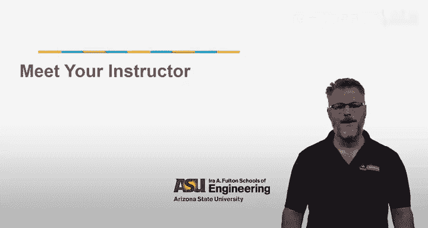

在本节课中，我们将认识本课程的讲师 Steven Osburn，了解他的专业背景、教学经历以及个人兴趣，这有助于我们理解他将如何结合丰富的实践经验来教授Python编程。

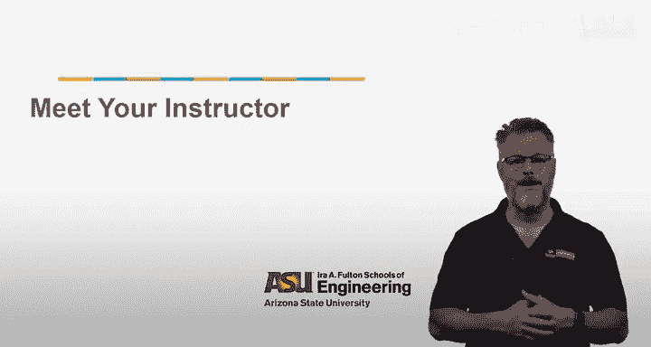

大家好，今天我将在这个视频中做一个简短的自我介绍，让大家了解我作为讲师的身份以及我的个人背景。

## 专业背景与行业经验

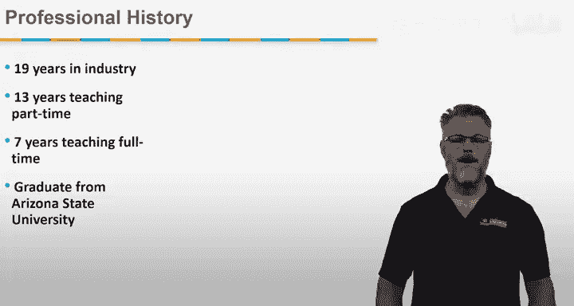

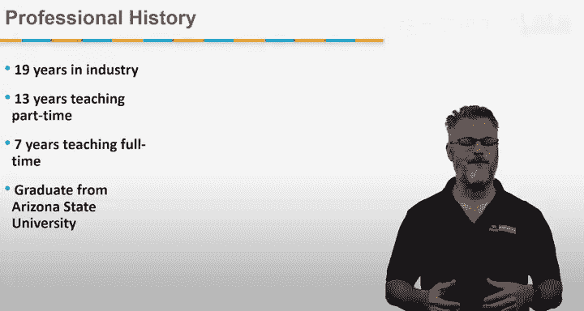

上一部分我们开始了课程介绍，本节中我们来详细了解讲师的专业背景。

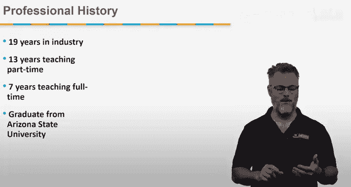

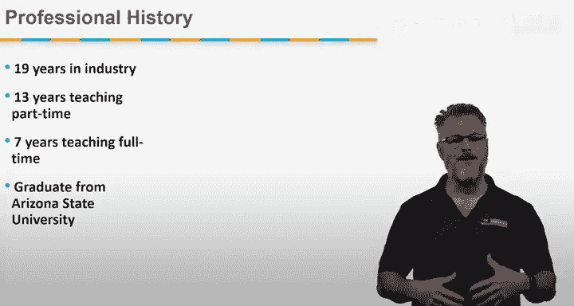

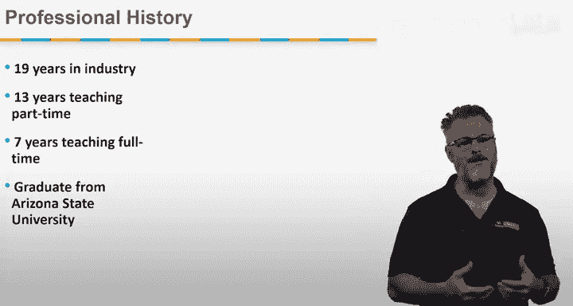

我的专业履历是，我在工业界担任系统工程师超过19年。在那段时间里，我管理并操作服务器，处理过应用程序开发，也接触过硬件接口。因此，我将编程和硬件集成的行业经验带到了我在亚利桑那州立大学的工作环境中。

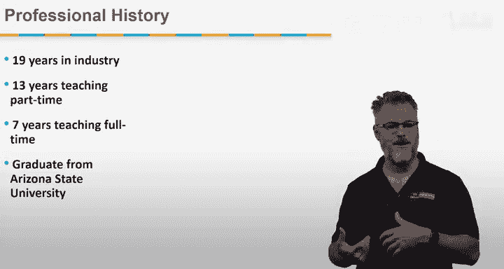

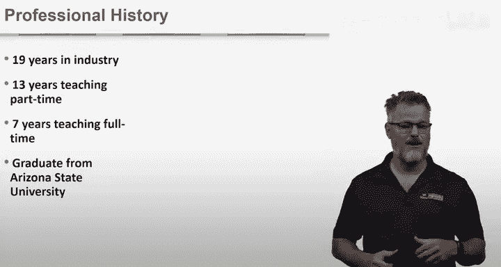

在此期间，我还在社区学院和其他机构兼职教学。

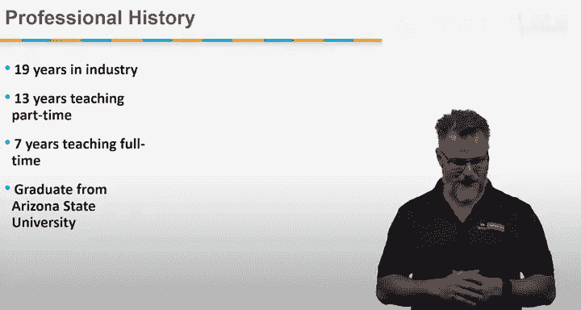

## 向全职教学的转变

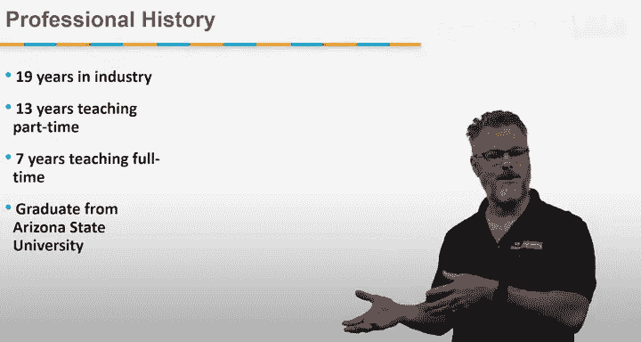

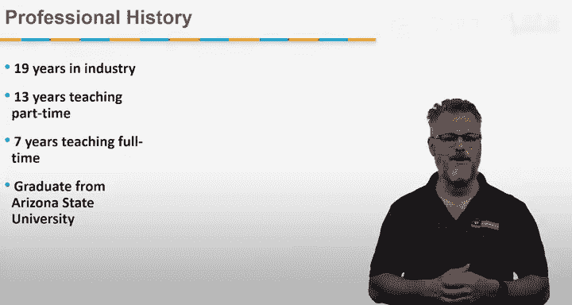

了解了讲师的行业背景后，我们来看看他如何过渡到教育领域。

在过去的七年里，我完成了从工业环境到全职教学岗位的转变。最近六年，我一直在亚利桑那州立大学任教。

我的学位是在亚利桑那州立大学获得的硕士和学士学位，专业是计算机系统工程。我上学的时间比一般人晚一些，我不是那种高中毕业后直接进入大学的典型学生。我是从高中进入军队服役，退役后才开始接受高等教育。

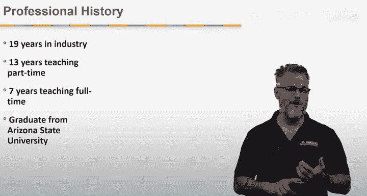

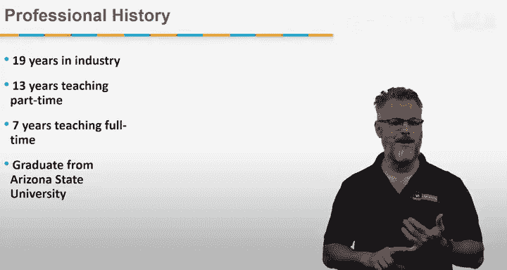

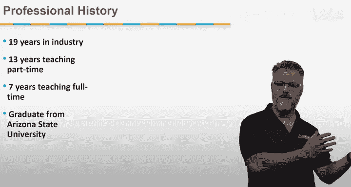

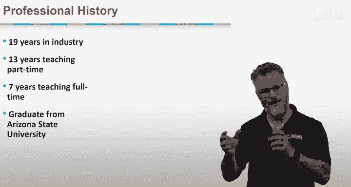

## 个人兴趣与爱好

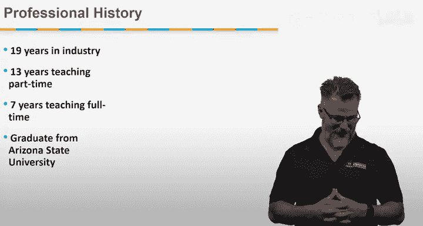

在介绍了专业和教育背景后，我们来看看讲师工作之外的生活。

我的一些个人兴趣包括户外活动。我喜欢花时间徒步旅行、旅行、划皮划艇和钓鱼。你们看到的一些照片就与此相关。

我还是一名认证的无人机飞行员，其中一张照片是几天前拍摄的日落山谷景象。当然，亚利桑那州拥有一些最令人惊叹的日落景色。所以，如果你热爱摄影并想来亚利桑那州，这里是观赏日落的绝佳地点。

另一张照片是盐河峡谷和一些马。沿着盐河划行时，你可能会遇到很多这样的野马。这张照片就是我在盐河岸边划皮划艇时拍的，当时它们正在那片区域过河，我拍到了一些很棒的照片。

关于我的旅行，有一张照片来自爱尔兰，更具体地说，是在都柏林郊外附近。我去过伦敦、德国、爱尔兰、波兰、冲绳和关岛。我去过世界上许多不同的地方。到目前为止，我必须说，对我来说最美丽的地方之一是爱尔兰。那是一个令人惊叹的游览胜地，那里的乡村风光令人叹为观止。

至于钓鱼，只要是有水的地方，我都可以去。我总是准备好鱼竿，随时愿意出去享受乐趣。

## 课程展望与总结

我期待与你们一起学习这门课程，我们将在后续的视频中再见。

本节课中，我们一起认识了本课程的讲师 Steven Osburn。我们了解到他拥有超过19年的工业界系统工程师经验，擅长服务器管理、应用开发和硬件集成，并将这些宝贵的实践经验融入了教学。他完成了从工业界到教育界的成功转型，并在亚利桑那州立大学全职任教多年。此外，他还是一位热爱户外活动、旅行和摄影的无人机飞行员。这些丰富的背景使他能够从理论和实践相结合的角度，引导大家学习Python编程。