# 3：讲师介绍 👨‍🏫

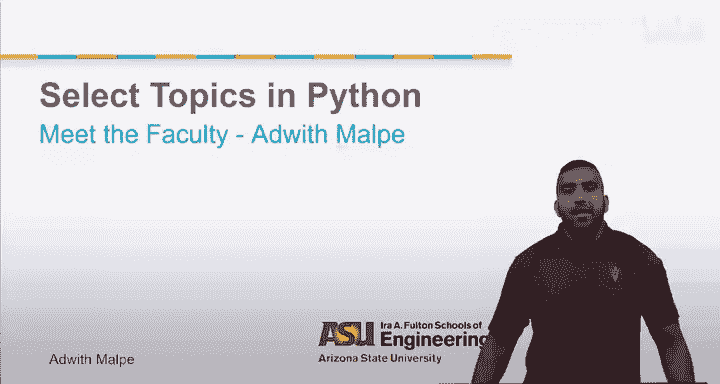

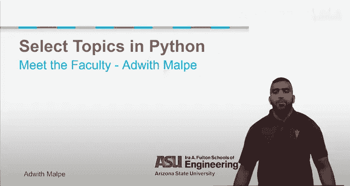

在本节课中，我们将认识本系列课程的讲师 Adwith Malpe，了解他的教育背景、专业经历以及对Python的热情。这有助于我们在后续学习中更好地理解课程内容与视角。

## 讲师背景介绍 🎓

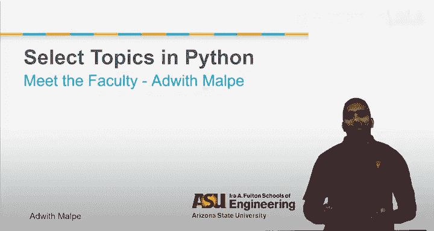

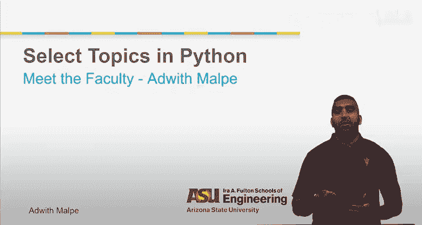

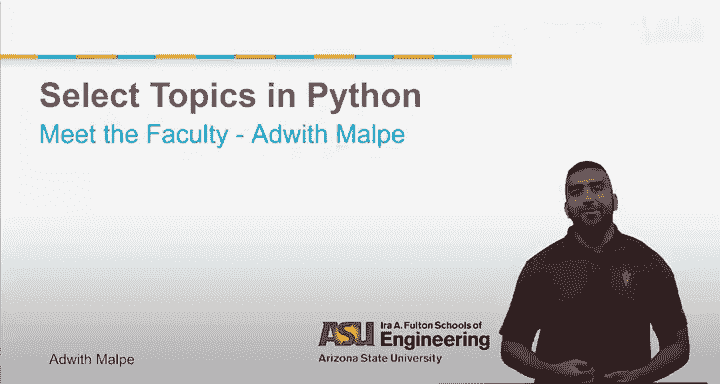

在开始任何课程之前，你可能希望了解授课教师的一些信息。因此，本节课程我将进行自我介绍。

我的名字是 Adwith Malpe。

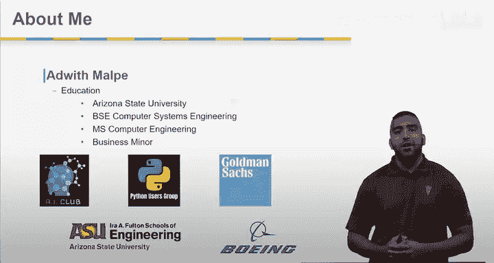

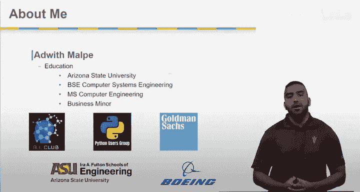

## 教育经历 🏫

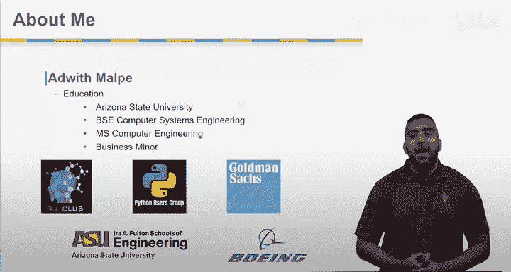

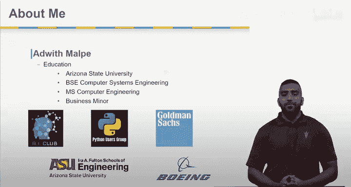

我毕业于亚利桑那州立大学。

我于2020年获得了计算机系统工程专业的工程学士学位。

随后，我于2021年12月完成了计算机工程专业的硕士学位。

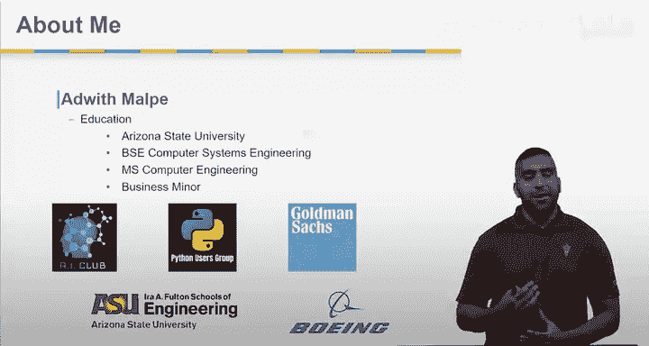

## 在校经历与对Python的热情 💻

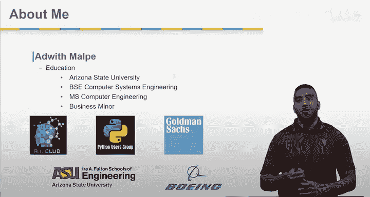

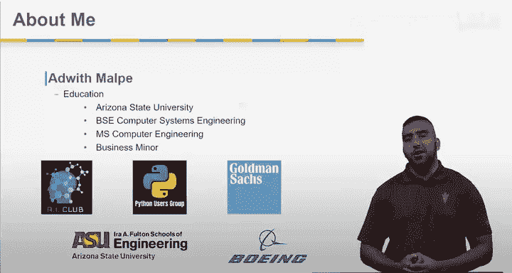

在校期间，我对Python充满热情并经常使用它。

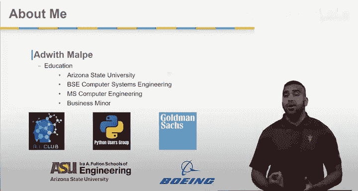

它是我在所有地方使用的最重要的编程语言技能之一。

我参与了许多学生组织，包括人工智能俱乐部和Python用户小组。在这些组织中，我得以结识许多人，向行业内的专业人士学习，并理解Python在当今社区中的重要性。我还参与了许多研讨会，在那里提升我的Python编程技能。

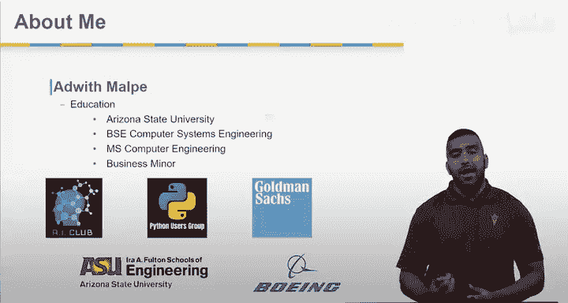

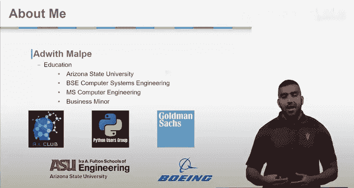

## 教学与行业经验 👨‍💻

在大学期间，我还曾担任研究生助教和本科生助教，负责教导学生如何编程，传授基础的软件工程技能等。

我也有幸在高盛担任数据分析师。我学到了许多关于如何处理数据的知识，而Python是一项强大的技能，在我的实习期间以及后来在波音公司担任软件工程师时都给了我极大的帮助。

Python确实可以应用于各个领域。因此，我拥有相当丰富的行业经验，并且非常享受我的大学时光。我很高兴能与你们一起工作。

我希望你们在接下来的四门课程中学到很多。我想强调，你们即将学习的这些关于如何用Python编码的技能和工具，在未来将对你们有极大的帮助。我非常期待与你们合作。

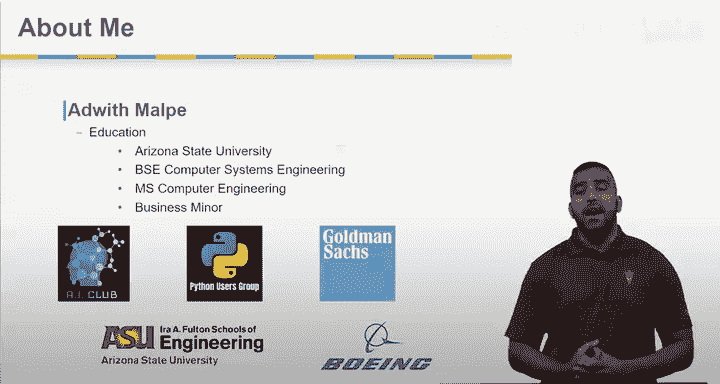

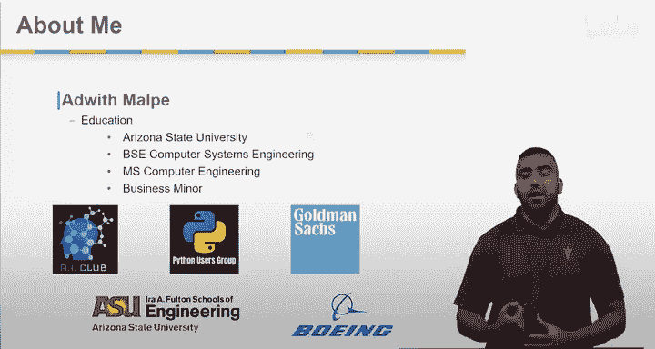

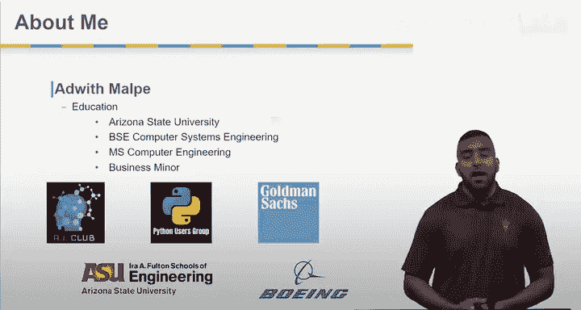

感谢。

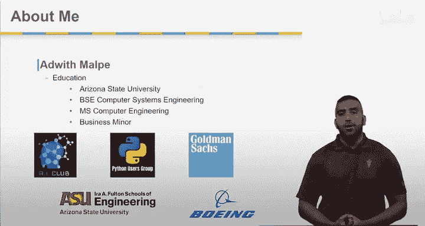

---

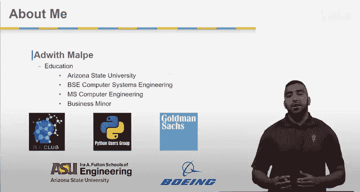

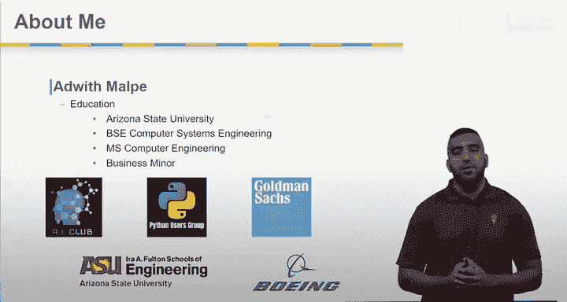

本节课中，我们一起认识了本课程的讲师Adwith Malpe，了解了他的教育背景、对Python技术的热情、丰富的教学与行业实践经验。这为我们后续跟随他学习Python奠定了良好的基础。