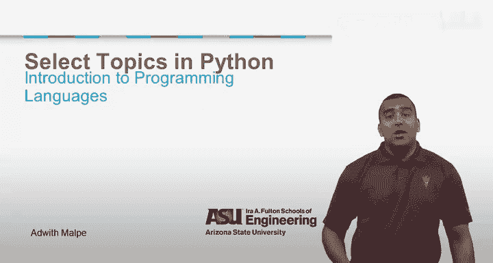
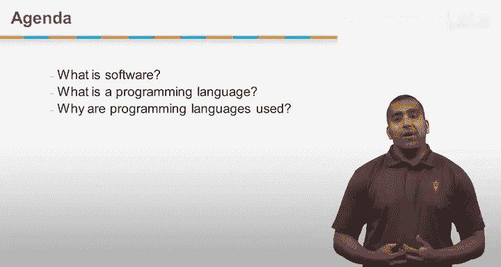
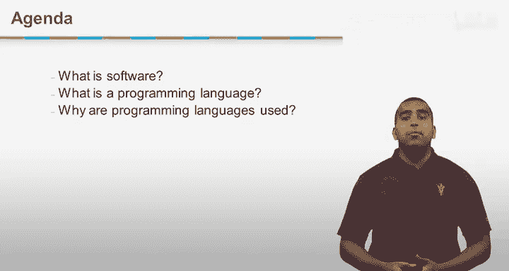
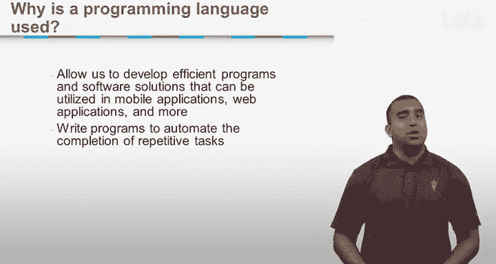
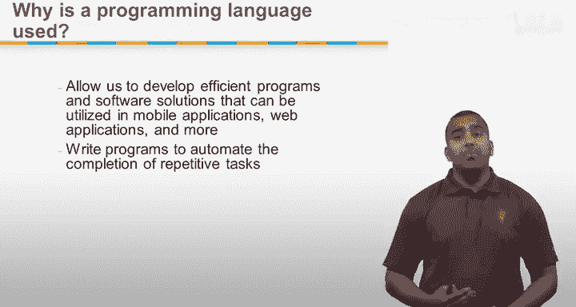
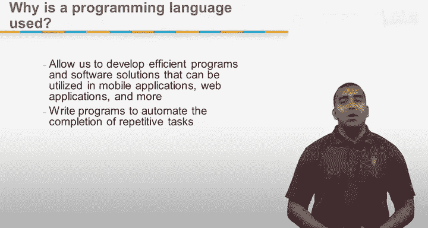
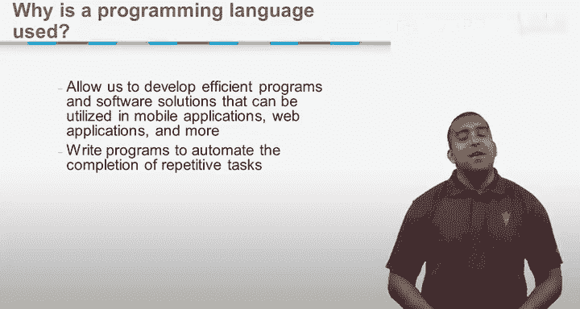

# 4：编程语言导论 🧠

在本节课中，我们将学习编程语言的基本概念。我们将探讨软件的定义、编程语言的作用以及它们在现代技术中的应用。通过本课，你将理解为什么编程语言是计算机科学的核心工具。

---

## 什么是软件？💻

软件是一组指令，计算机利用这些指令执行特定任务。计算机中所有不涉及物理组件或材料的功能部分都属于软件。

例如，视频游戏、计算机、手机、智能设备都运行在软件之上。

---

## 什么是编程语言？🔧

上一节我们介绍了软件的概念，本节中我们来看看编程语言。编程语言是一种工具，用于编写计算机遵循的指令。编程语言帮助将二进制（即0和1）翻译成人类可以理解的内容。

以下是编程语言的两个主要类别：

*   **低级编程语言**：更接近机器代码（即二进制），能高效控制计算机的功能。
*   **高级编程语言**：使用人类可理解的文本编写代码，然后这些代码被翻译成机器代码。

---

## 为什么使用编程语言？🚀

了解了编程语言是什么之后，我们来看看它们为何如此重要。编程语言使我们能够开发高效的程序和软件解决方案，这些方案可以应用于移动应用、网络应用等众多领域。

它们允许我们编写程序来自动完成重复性任务。

---

## 总结 📝

本节课中我们一起学习了软件和编程语言的基本概念。我们了解到软件是指令的集合，而编程语言是创建这些指令的工具。编程语言分为接近硬件的低级语言和更易理解的高级语言，它们共同赋能我们开发各种应用，实现任务自动化。