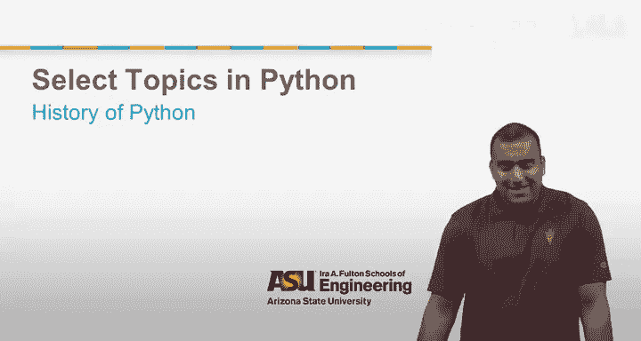
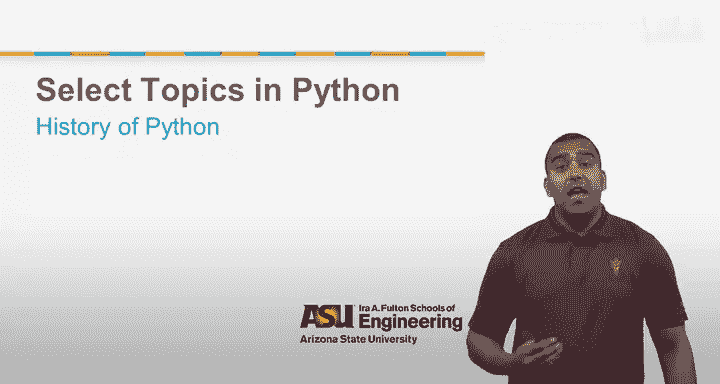
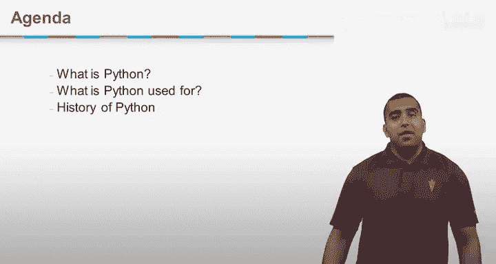
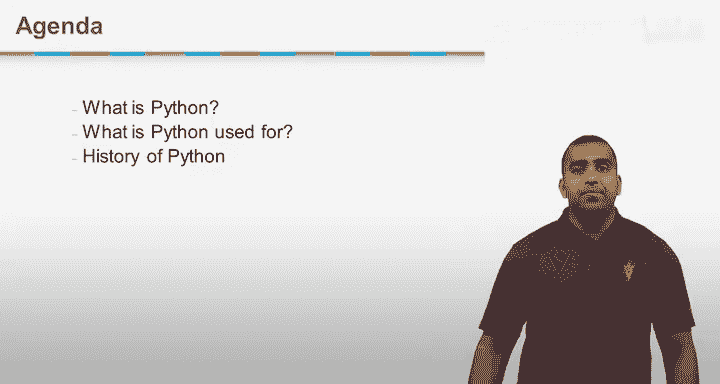
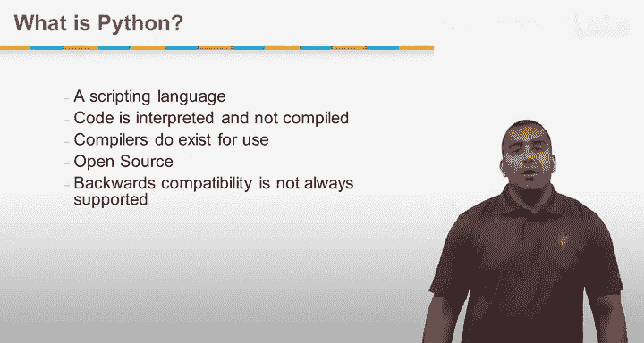
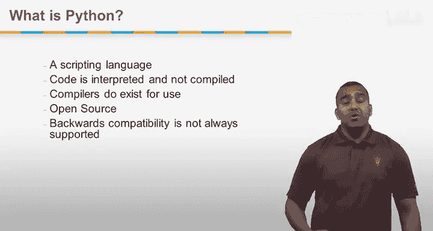
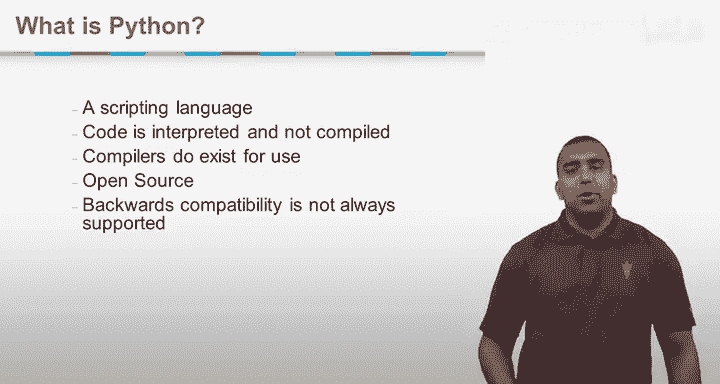
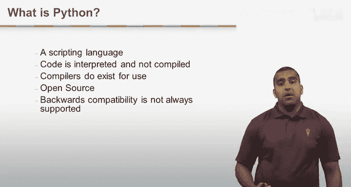
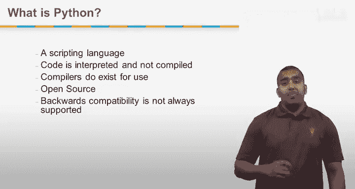
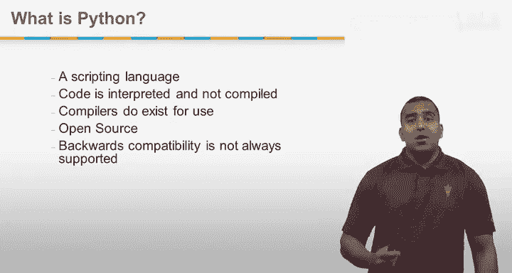

# 5：Python 发展历史 🐍📜

在本节课中，我们将学习 Python 是什么、它的主要用途以及其发展历史。通过了解这些背景知识，你能更好地理解 Python 的设计哲学和它在当今技术领域中的重要地位。

## 什么是 Python？

Python 是一种脚本语言，代码由解释器执行，而非编译执行。

虽然存在 Python 编译器，但我们主要使用解释器。

## Python 的主要优势

Python 最大的优势之一是它是**开源**的。

这意味着任何人都可以为它贡献代码，也能理解已为其创建的各种程序。

然而，Python 并不总是支持向后兼容性。

## 为什么使用脚本？

首先，什么是 Python 脚本？Python 脚本是存储在文件中的一系列命令，设计用于在命令行或 Python 交互式 shell 中运行。

编写脚本比开发编译代码快得多，这是如今我们使用脚本的一个重要原因。

脚本解决方案可以转换为编译语言。我们知道，脚本可用于开发算法、执行假设分析以及建立一次性解决方案。

## Python 发展简史

以下是关于 Python 历史的一些有趣事实。

Python 于 1991 年发布，由荷兰数学与计算机科学研究中心（CWI）的吉多·范罗苏姆（Guido van Rossum）创建。

范罗苏姆是一位荷兰程序员，拥有数学和计算机科学硕士学位。

他工作的机构，即数学与计算机科学研究中心，是一个专注于数学和理论计算机科学的研究中心。

在创建任何新的 Python 功能时，范罗苏姆通常拥有最终决定权。

目前，由 Python 指导委员会为未来的 Python 功能开发做出决策。

## Python 的广泛应用

Python 最伟大的特点之一是其广泛的应用领域。

一些应用领域包括：
*   **机器学习**（我们将在课程 4 中涵盖此主题）。
*   **网络安全**。
*   **计算机网络**。
*   **人工智能**。

---

本节课中，我们一起学习了 Python 的基本定义、其作为脚本语言和开源项目的优势，并回顾了其从 1991 年诞生至今的关键发展历程。我们还了解了 Python 在机器学习、网络安全等多个前沿领域的强大应用能力。