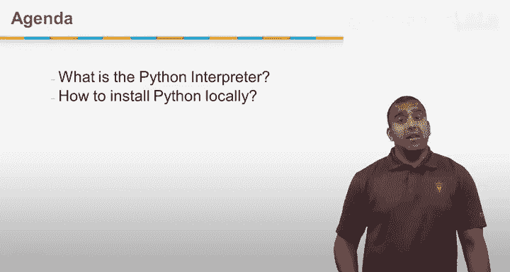
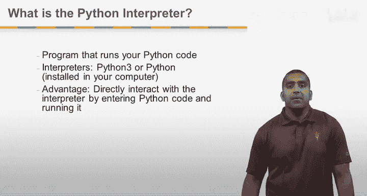
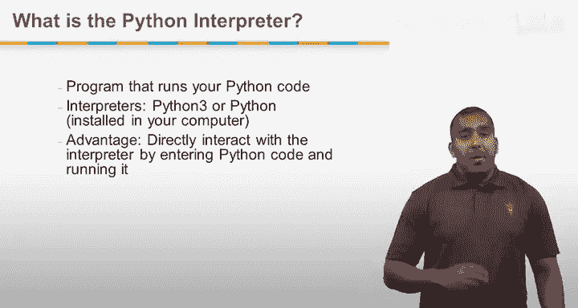
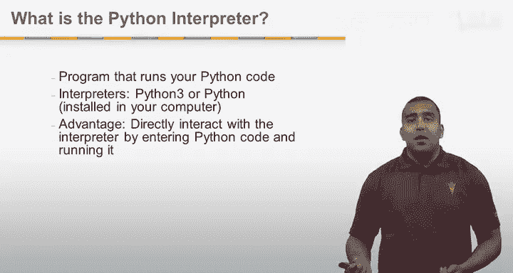
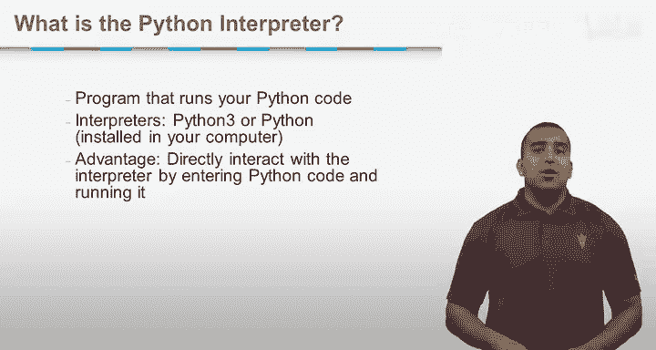
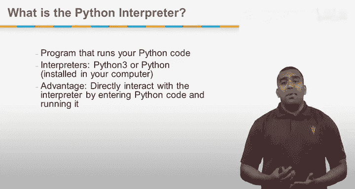
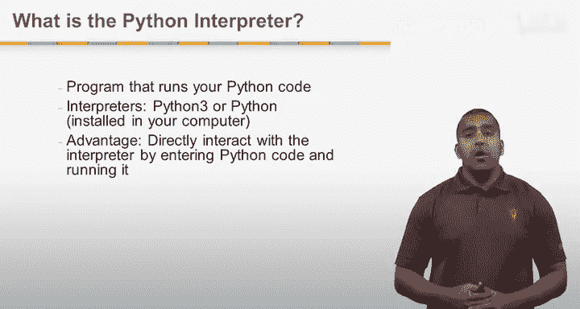

# 6：Python解释器原理 🐍

在本节课中，我们将要学习Python解释器的基本概念以及如何在本地安装Python。理解解释器是学习Python编程的重要一步，它帮助我们理解代码是如何被计算机执行的。

## 什么是Python解释器？🤔

上一节我们介绍了本节课的主题，本节中我们来看看Python解释器的具体定义。

Python解释器本质上是一个运行Python代码的程序。

可以使用的解释器版本是**Python 3**或**Python**，具体取决于您计算机上安装的版本。

拥有Python解释器的最大优势是，您可以直接与解释器交互，通过输入Python代码并立即运行它。

## 如何在本地安装Python 💻

了解了Python解释器的概念后，本节我们将探讨如何在您的计算机上安装它。

在本课中，附有一些链接，可以引导您完成在计算机上安装Python的逐步过程。

然而，在本课程的持续时间内，我们将使用一个在线IDE（集成开发环境）。

在线IDE也被称为一种编程工具，您无需下载任何软件即可开始编写代码，无需花费时间下载任何内容。

以下是一些您可能想知道的有趣事实：
*   Python在Mac操作系统上是预安装的。
*   要检查您拥有的Python版本，只需在终端中输入以下命令之一：`python3 --version` 或 `python --version`。

本课还提供了一篇关于如何根据您的操作系统安装Python的文章供您阅读。

## 总结 📝

本节课中我们一起学习了Python解释器的核心概念，它是一个执行Python代码的程序。我们还了解了在本地安装Python的基本方法，并知道在本课程中我们将主要使用便捷的在线IDE进行编程实践。