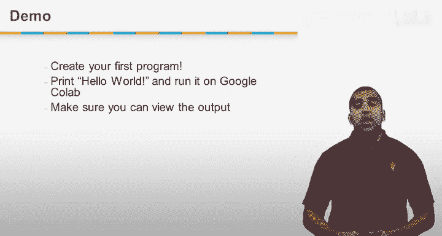
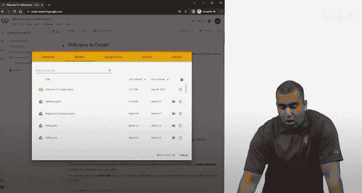
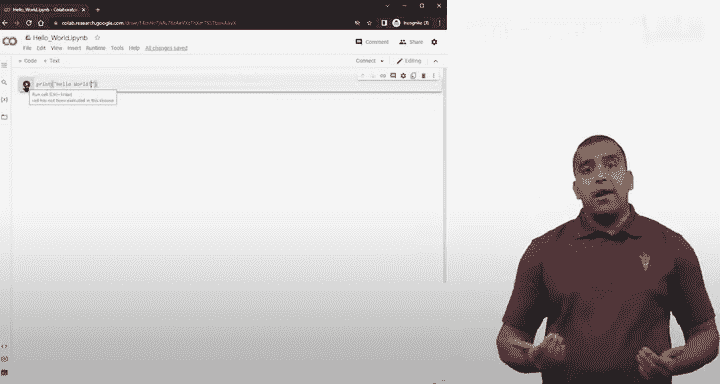
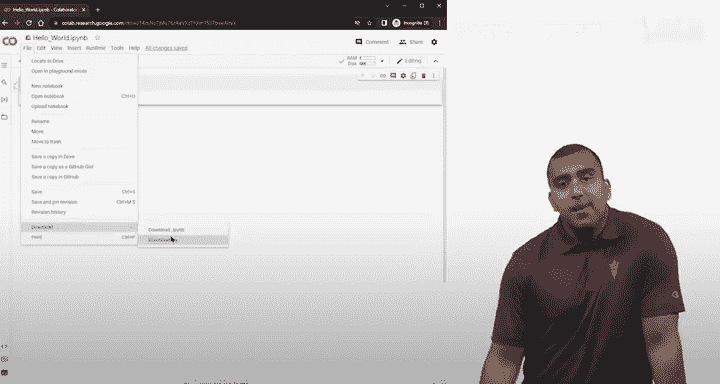
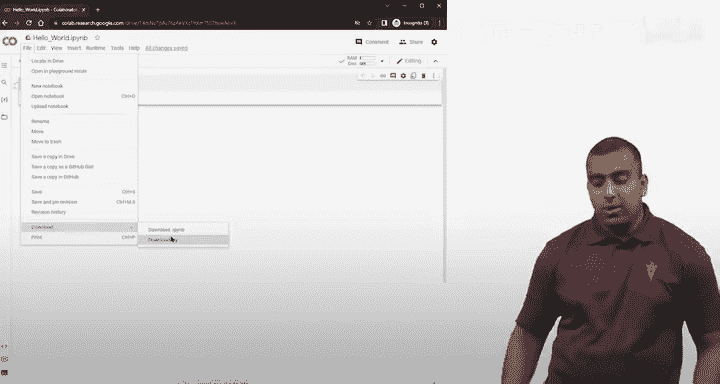
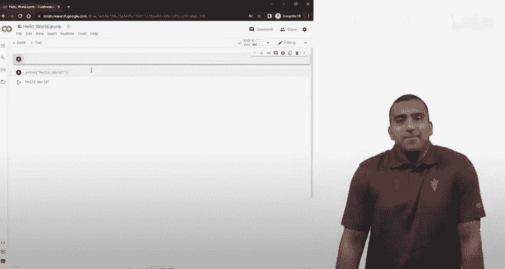

# 7：Google Colab 平台简介 🚀

在本节课中，我们将学习 Google Colab 是什么，它的主要功能，以及我们为何要使用它。最后，我们将通过一个简单的演示，展示如何在 Google Colab 中创建并运行你的第一个 Python 程序。

---

## 什么是 Google Colab？ 🤔

Google Colab 是一个在线集成开发环境，也被称为在线编程工具或开发环境。你可以在其中编写 Python 代码，而无需在本地计算机上进行任何安装或下载。

它是一个可执行的文档，允许你在 Google Drive 中编写、运行和共享代码。每个脚本或“笔记本”都是你编写代码的地方。这些笔记本连接到基于云的运行时环境，因此你无需下载任何编译器即可运行代码。你可以在本地机器上无需任何设置就执行 Python 代码。最大的好处是，你可以共享你的笔记本，向他人展示你的代码或与他们协作编写代码。

---

## Google Colab 的主要功能 ⚙️

上一节我们介绍了 Google Colab 的基本概念，本节中我们来看看它的核心功能。

以下是 Google Colab 的一些关键特性：

*   **单元格**：你可以在单元格中输入代码或描述代码块的文本。你可以将整个脚本分解为独立的单元格块，以便编写和测试单独的代码段。
*   **单元格类型**：主要有两种类型的单元格：
    *   **代码单元格**：用于编写代码。
    *   **文本单元格**：用于输入描述代码的文本。
*   **运行单元格**：
    *   按 `Ctrl + Enter` 可以运行当前选中的单元格。
    *   按 `Shift + Enter` 可以运行当前单元格，并在其下方创建一个新的单元格。
*   **执行方式**：你可以一次运行单个单元格，也可以在需要时运行整个脚本。

---

## 为什么使用 Google Colab？ 💡

了解了功能之后，我们来看看选择 Google Colab 的几个重要原因。

*   **无需配置**：开箱即用，无需复杂的本地环境设置。
*   **免费 GPU 访问**：可以免费使用图形处理器，从而更高效地处理大型数据集。
*   **易于共享**：通过 Colab 可以轻松地与他人共享你的代码和笔记本。
*   **即时输出显示**：代码执行后的输出会直接显示在对应单元格下方，无需滚动到脚本底部查看结果，非常方便。
*   **文本格式化**：文本单元格使用 Markdown 格式，这是一种纯文本文档格式，可以直接在页面上渲染出标题、段落、列表，甚至描述代码的**数学公式**。

---

## 如何使用 Google Colab？ 🛠️

现在我们已经知道了 Google Colab 的“是什么”和“为什么”，接下来我们进入实践环节，看看具体如何使用它。

以下是使用 Google Colab 的基本步骤：



1.  **登录账户**：确保你已登录 Gmail 账户。如果没有，需要先创建一个。
2.  **创建新笔记本**：点击 `File` -> `New notebook`，或直接在欢迎页面点击 `New notebook`。
3.  **重命名文件**：在页面左上角，将默认名称（如 `Untitled0.ipynb`）更改为你喜欢的文件名（例如 `Hello_World.ipynb`）。请注意，这些文件都是 `.ipynb` 格式，因为我们在使用在线 IDE。
4.  **开始编码**：在代码单元格中编写你的 Python 代码。
5.  **下载脚本（可选）**：如果你想在本地计算机上运行代码，可以点击 `File` -> `Download` -> `Download .py`，将笔记本下载为 `.py` 文件。

---


## 演示：创建第一个程序 🎬

遵循上述步骤，让我们在 Google Colab 中创建并运行一个简单的“Hello World”程序，并查看输出结果。

1.  在浏览器中打开新标签页，访问 Google Colab 并确保已登录。
2.  点击 `File` -> `New notebook`，创建一个全新的笔记本。
3.  将笔记本名称从 `Untitled1.ipynb` 改为 `Hello_World`。
4.  在第一个代码单元格中输入以下代码：
    ```python
    print("Hello World 😊")
    ```
5.  要运行此单元格，你可以：
    *   点击单元格左侧的“播放”按钮。
    *   或者，将光标置于单元格内，按键盘上的 `Ctrl + Enter`。
6.  运行后，单元格下方会立即显示输出：`Hello World 😊`。



恭喜！你已经在 Google Colab 中成功编写并运行了第一个程序。



如果你想在本地（例如使用 Visual Studio Code）运行此程序，可以点击 `File` -> `Download` -> `Download .py`，将脚本下载为 `.py` 文件，然后在本地机器上运行。

---

## 总结 📝







本节课中，我们一起学习了 Google Colab 这一强大的在线 Python 开发环境。我们了解了它的定义、核心功能（如单元格操作和即时输出），探讨了其无需配置、免费使用 GPU 和易于共享的优势，并一步步实践了如何登录、创建笔记本、编写代码以及运行程序。通过“Hello World”示例，你已掌握了在 Google Colab 中开始 Python 编程的基本流程。