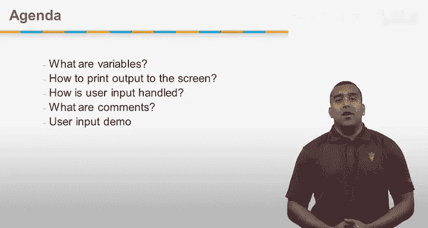
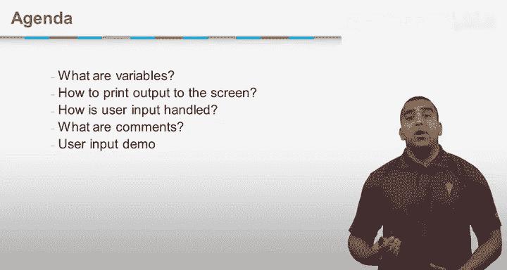
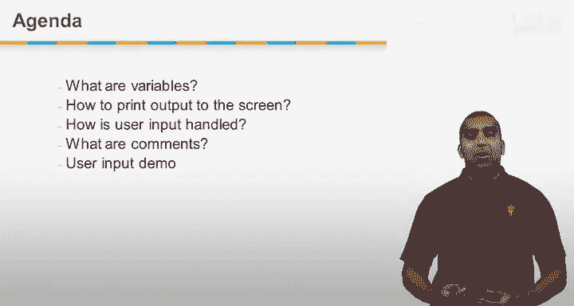
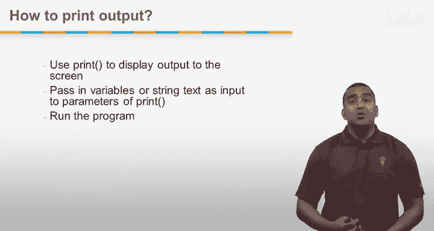
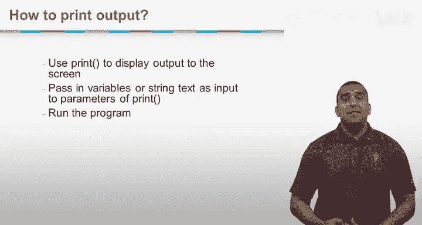
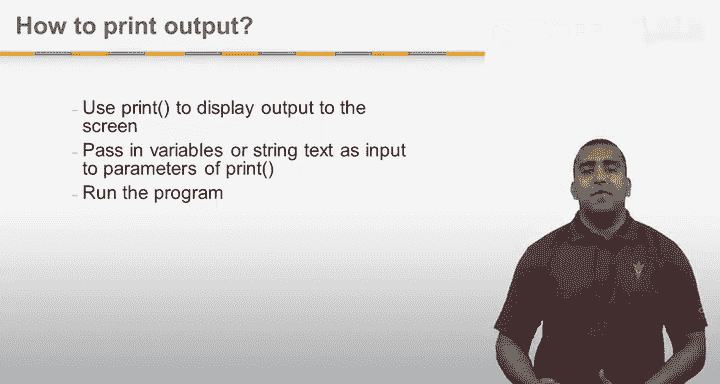
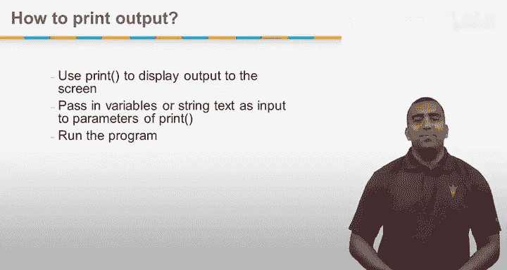
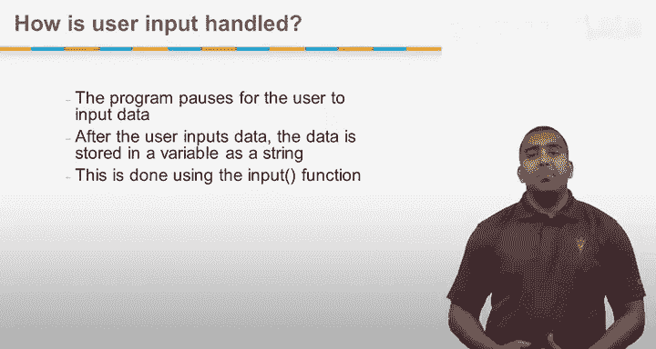
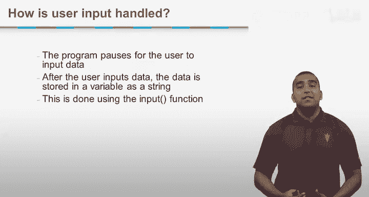

# 8：Python用户输入与屏幕输出实现 🐍

在本节课中，我们将学习Python中如何处理用户输入以及如何将信息输出到屏幕。这是编写交互式程序的基础。

## 变量是什么？🧠

上一节我们介绍了课程概述，本节中我们来看看什么是变量。

变量是用于存储数据的预留内存位置。它们根据我们赋值的类型占用相应的内存空间。

在Python中创建变量的方法如下：

以下是创建变量的基本结构：
*   **变量名 = 值**

当一个变量被创建时，Python会根据所赋的值来确定该变量的数据类型。

## 如何输出信息？💻

了解了变量的概念后，我们来看看如何将信息输出到屏幕。

使用 `print` 函数可以将输出显示到屏幕上。

以下是 `print` 函数的使用方法：
*   将变量或字符串文本作为参数传递给 `print` 函数。
*   运行程序以查看输出结果。

你将在我们的演示中更深入地理解这一点。

## 如何处理用户输入？⌨️

学会了输出，接下来我们学习如何接收用户的输入。

程序会暂停，等待用户输入数据。

用户输入数据后，数据会以字符串的形式存储在一个变量中。

这是通过 `input` 函数实现的。

## 什么是注释？📝

在编写代码时，添加注释是一个好习惯。

注释是代码行或代码块的人类可读描述。它们解释了一行代码或一个代码块在做什么。

以下是关于注释的重要信息：
*   注释有助于代码维护，并能更快地发现错误。
*   文档齐全的代码与正确运行的代码同等重要。
*   确保包含注释，以便其他程序员理解你的工作。

## 用户输入演示 🚀

现在，让我们进入演示环节。你可以看到，我提前创建了这个脚本，你可以在此课程中访问并尝试修改它。

我将脚本命名为“用户输入演示”。在这里，你可以看到我创建了注释。注释使用井号 `#` 符号来创建或表示。

请记住，注释不会执行任何操作。注释的唯一目的是让你理解代码在做什么。程序员使用注释来解释一行代码或一个代码块的功能。

这是一个示例，我包含了一系列注释，用于描述一个函数，提供函数名并包含函数功能的说明。

在下一个代码单元中，你可以看到，如果我想打印“Hello world”，我使用 `print` 函数将输出显示到屏幕上。当我运行这个单元时，它会将“Hello world”打印到屏幕上。它还会打印“Welcome to your first python program”。

现在，让我们创建一个名为 `username` 的变量。这里我们有一个名为 `username` 的变量，我们给它传递了一个字符串值“Tim”。其中“Tim”是用户名。

接下来，我们打印“Hello, Tim”。我们如何做到这一点？我们调用 `print` 函数，传递一个字符串参数“Hello”，然后是一个逗号，再传入变量 `username`。这将把“Hello Tim”打印到屏幕上。

请注意以下两个语句之间的区别。在这个 `print` 语句中，我们打印“Is this your first program”，双引号前没有空格，然后加上 `user_name`，再加上问号。如果不加空格，使用加号 `+` 连接时，它会在单词“program”后面紧接着打印用户名，中间没有空格。而如果我们使用逗号 `,`，你可以看到逗号已经考虑了空格，因此我们得到了“Hello Tim”。要确保在使用加号运算符的打印语句中包含空格，你必须确保在输入字符串后、变量前以及另一个字符串前包含空格。所以现在你可以看到这里打印的是“Is this your first program Tim”。

继续下一个例子，我们将处理用户输入。在这个例子中，我将创建一个打印语句，显示“Welcome, my name is BPP, and I'm your personal chatbot.”。在下一行代码中，我包含了一个注释，描述其功能：用户输入是使用 `input` 函数传入的。

变量 `name_of_user` 接收来自 `input` 函数的值，该函数提示用户“Enter your name here.”。传递给 `input` 的这个字符串参数或字符串值通常用于向用户显示他们应该在程序中输入什么。

运行后，你可以看到它提示用户“Enter your name here.”。我输入了我的名字，结果显示“Nice to meet you Jad”。这来自这一行代码，我打印了“Nice to meet you ”加上变量 `name_of_user` 的值。我将用户输入传递给一个变量，然后可以在这个语句中使用它来输出。

在下一行代码中，我们将创建另一个名为 `user_task` 的变量，它接收输入“What can I do for you today?”。最后，我将打印“I will (用户任务) for you today.”。这基本上是将用户输入存储到一个变量中，然后你可以使用 `print` 语句将其显示到屏幕上。

在我们的最后一个例子中，我们创建了三个变量：`first_student`、`second_student`、`third_student`，并赋予了一些名字。我们将把它们打印到屏幕上，你可以看到我在这里用逗号分隔打印了它们。

在将它们打印到屏幕上之后，我为课程名称创建了另一个变量。我通过调用 `input` 函数询问用户“Enter the course the students should take.”。用户将输入学生应该学习的课程名称。最后，我通过调用 `print` 函数将其打印到屏幕上，显示“The students will take ”，并将 `course_name` 作为参数传递给 `print` 函数，后面跟上另一个字符串“this semester.”。因此，结果应该显示“The students will take calculus this semester.”。

我强烈建议你尝试修改代码，输入你自己的参数和值，做任何你想做的事情，以确保你真正理解其工作原理。

## 总结 📚

本节课中我们一起学习了Python编程的基础交互功能。我们了解了变量作为存储数据的容器，掌握了使用 `print` 函数进行屏幕输出的方法，学会了通过 `input` 函数获取用户输入，并认识到使用 `#` 添加代码注释对于提高代码可读性和可维护性的重要性。通过实际演示，我们实践了如何创建变量、输出信息、接收用户输入并将这些元素结合起来创建简单的交互式程序。