# 9：Python变量与数据类型 🐍

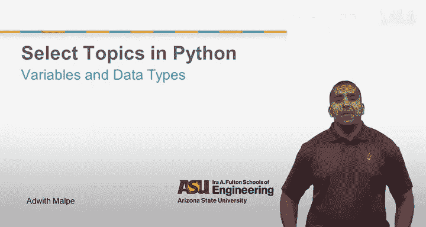

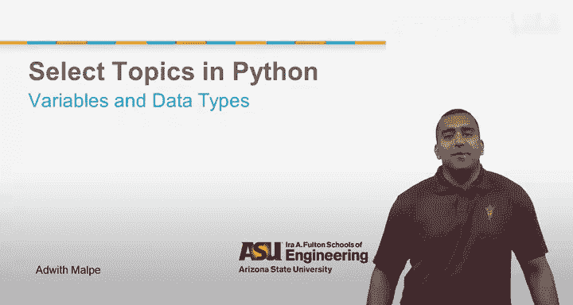

在本节课中，我们将学习Python中的变量与数据类型。理解数据类型是编程的基础，它决定了数据在程序中的存储方式和可执行的操作。

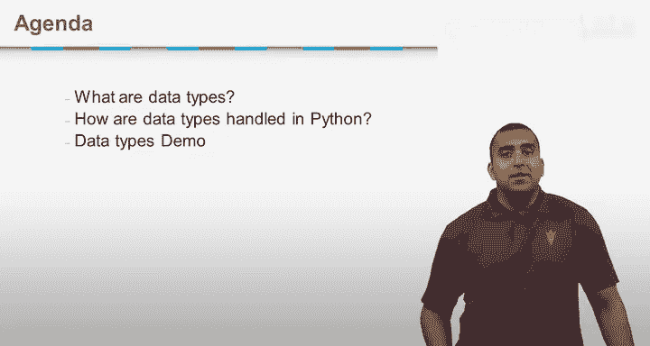

## 概述

本节课将涵盖数据类型的定义、Python如何处理数据类型，并通过一个演示来加深理解。

## 什么是数据类型？

数据类型是对数据的一种分类。它指示解释器程序员将如何使用这些数据。

Python支持的基本数据类型包括整数、浮点数、复数、字符串和布尔值。内置数据类型则更广泛，包括二进制类型、布尔类型、集合类型、映射类型、序列类型、数值类型和文本类型。为了简化，我们的演示将重点介绍基本数据类型。

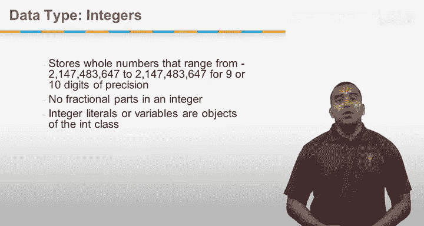

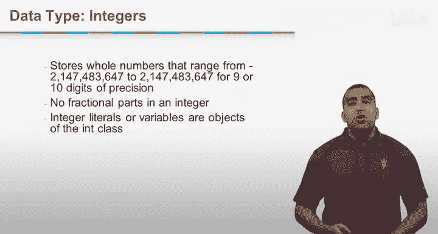

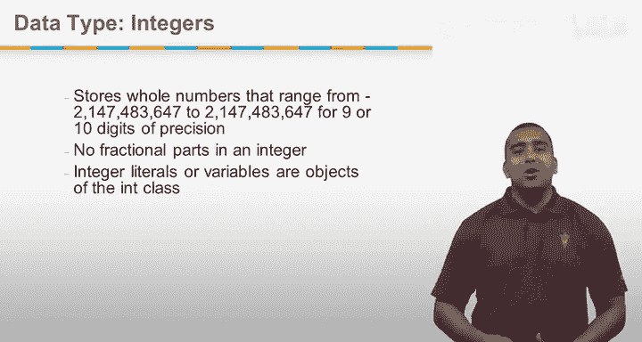

## 基本数据类型详解

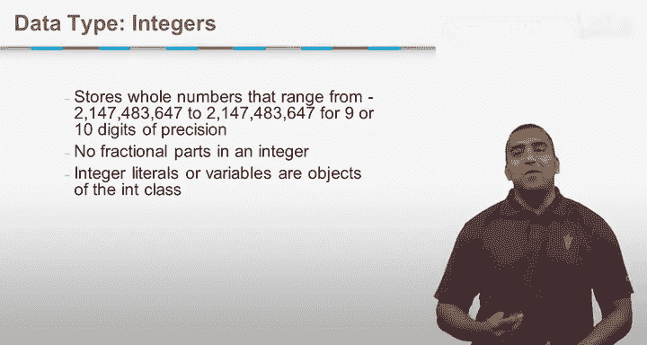

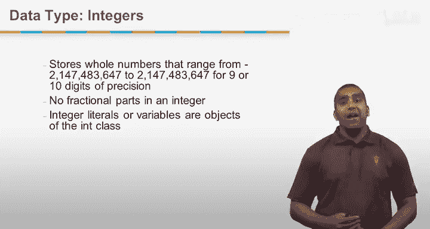

上一节我们介绍了数据类型的整体概念，本节中我们来看看几种具体的基本数据类型。

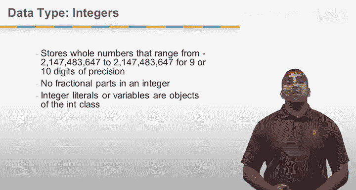

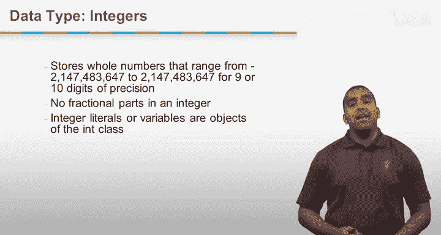

### 整数

整数是一种存储数字的数据类型，其范围大约从-2,147,483,647到2,147,483,647。整数没有小数部分。整数字面量或变量是`int`类的对象。

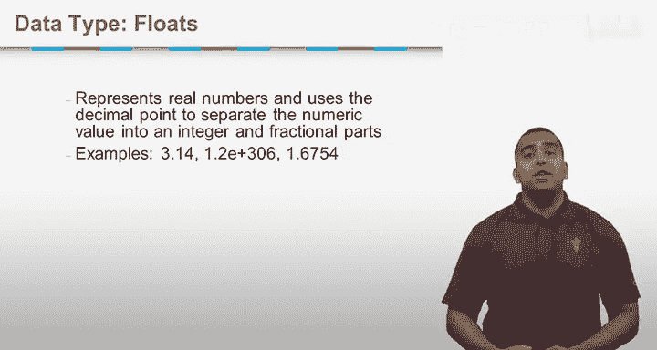

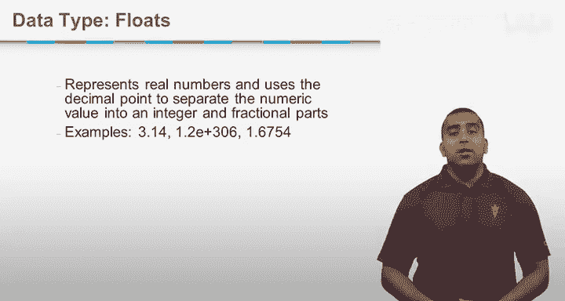

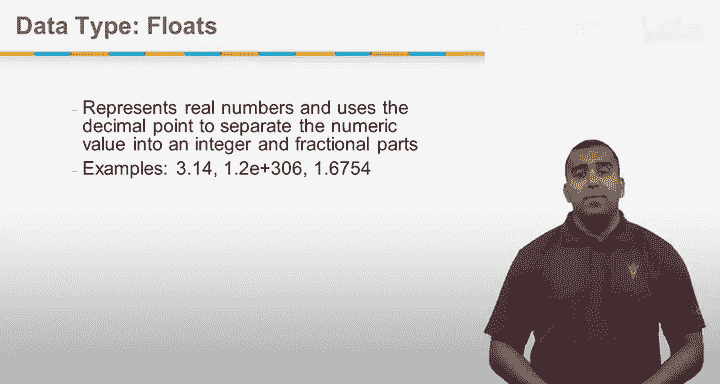

**公式示例：**
```
x = 10  # 这是一个整数
```

### 浮点数

浮点数代表实数，使用小数点将数值分为整数部分和小数部分。

**公式示例：**
```
pi = 3.14
y = 1.6754
```

### 复数

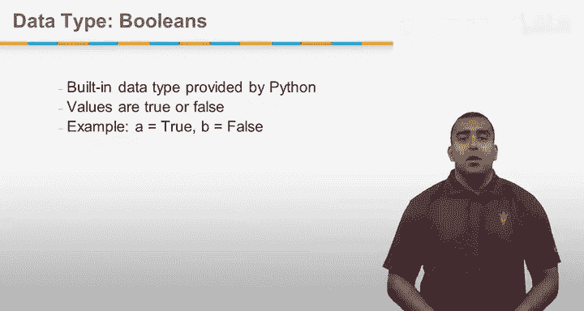

复数由两个实数构成，包含一个实部和一个虚部。在Python中，虚部通过在数字后添加`j`或`J`来表示。

**公式示例：**
```
z = 3 + 6j
```

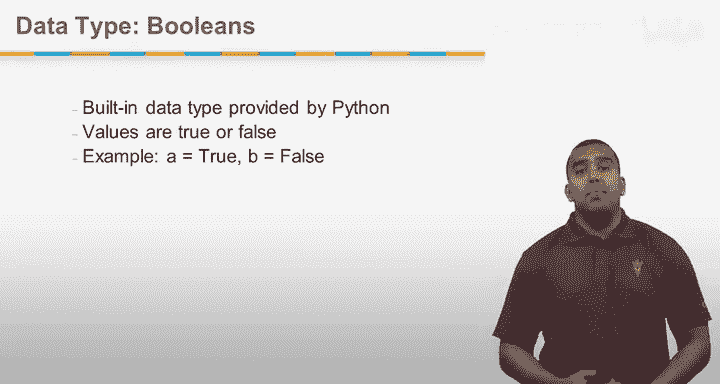

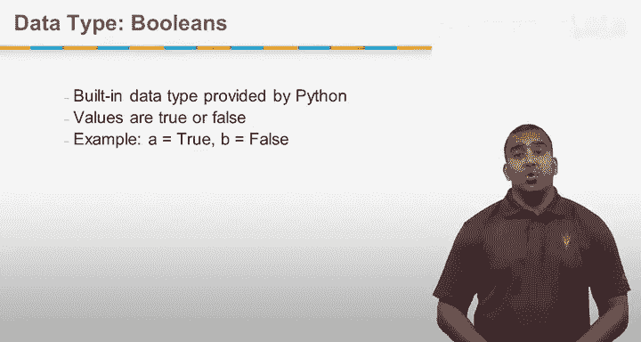

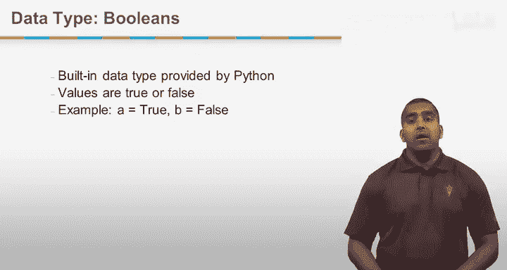

### 字符串

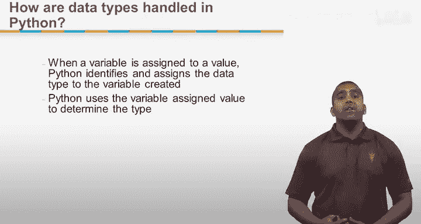

字符串是表示Unicode字符的字节序列。它是一个或多个字符的集合，可以用单引号、双引号或三引号括起来。Python中没有单独的字符数据类型，一个字符就是长度为1的字符串。

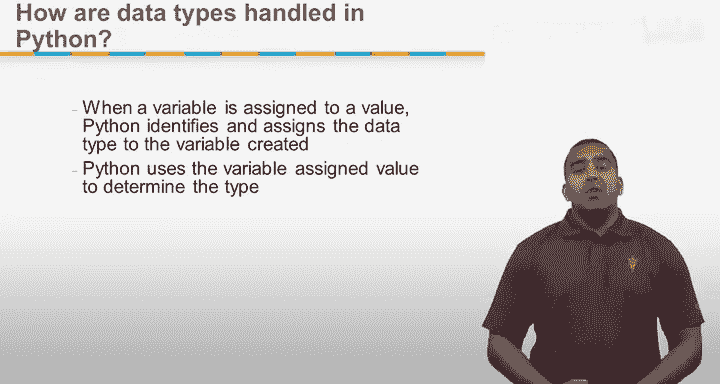

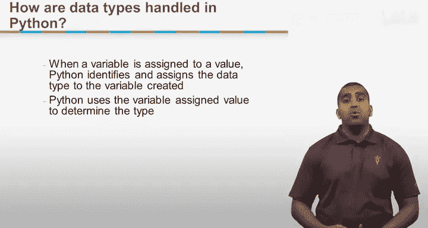

**公式示例：**
```
name = "Ad"
greeting = 'Hello World'
```

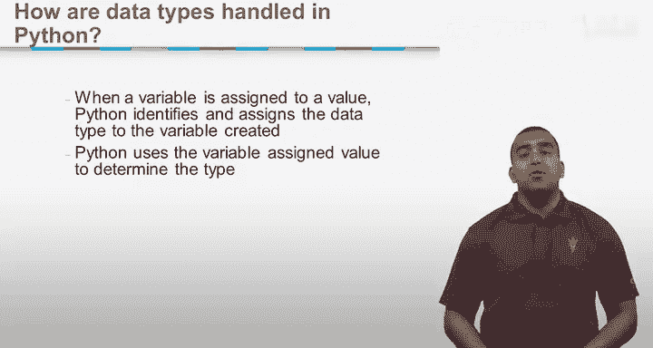

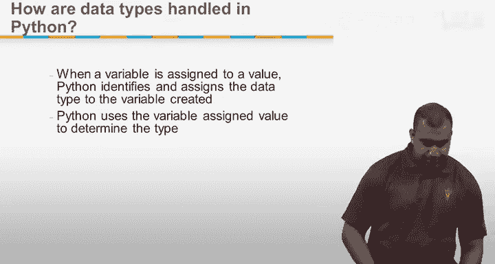

### 布尔值

布尔值是Python提供的一种内置数据类型，其值为`True`或`False`。

**公式示例：**
```
is_active = True
is_finished = False
```

## Python如何处理数据类型？

当为变量赋值时，Python会自动识别并分配相应的数据类型给该变量。Python使用变量被赋予的值来确定其类型。

## 代码演示

现在，让我们通过一个代码演示来巩固以上概念。

以下是创建不同数据类型变量并检查其类型的示例：

```python
# 定义各种数据类型的变量
integer_value = 10
float_value = 3.14
complex_value = 1.2j
large_float = 2e24
small_float = 3e-7
string_value = "Python users group"

# 打印每个变量的类型
print(integer_value, "is of type", type(integer_value))
print(float_value, "is of type", type(float_value))
print(complex_value, "is of type", type(complex_value))
print(large_float, "is of type", type(large_float))
print(small_float, "is of type", type(small_float))
print(string_value, "is of type", type(string_value))
```

运行上述代码，`type()`函数将返回每个变量对应的类，例如`<class 'int'>`、`<class 'float'>`等。

接下来，我们看看打印变量时的一个注意事项。

以下是关于类型转换和打印的示例：

```python
# 错误的尝试：直接拼接字符串和数值类型会报错
# print("The integer value is " + integer_value)  # 这行会引发 TypeError

# 正确的做法：使用类型转换（casting）
print("The integer value is " + str(integer_value))
print("The float value is " + str(float_value))
print("The complex value is " + str(complex_value))
```

在Python中，`print()`函数默认处理字符串。当需要将数值变量与其他字符串拼接时，必须使用`str()`函数将其显式转换为字符串类型，这个过程称为类型转换。

## 总结

本节课中我们一起学习了Python的核心概念——变量与数据类型。我们了解了整数、浮点数、复数、字符串和布尔值这些基本数据类型，明白了Python如何动态地处理数据类型，并通过代码演示实践了变量的创建、类型检查以及必要的类型转换操作。掌握这些是编写有效Python程序的重要一步。