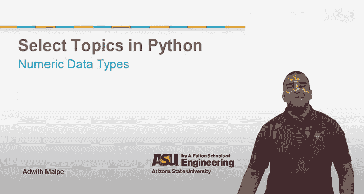
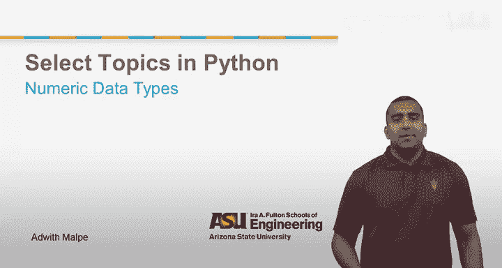
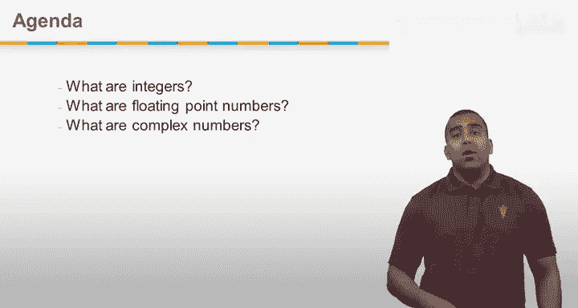
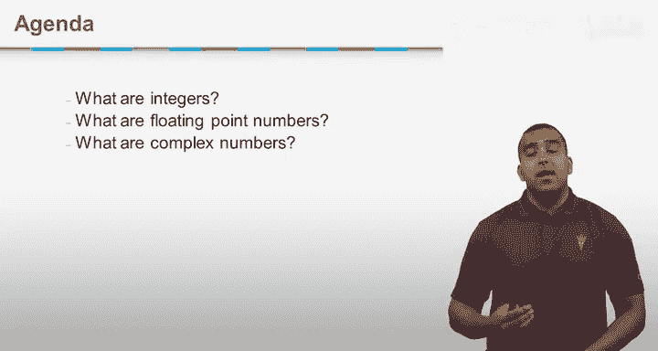

# 11：Python数值数据类型详解 🧮

在本节课中，我们将学习Python中的三种数值数据类型：整数、浮点数和复数。理解这些基础类型是进行数学运算和数据处理的第一步。

## 概述

我们将依次介绍整数、浮点数和复数的定义、特点及在Python中的表示方法。每种数据类型都有其特定的规则和用途。

## 整数（Integers）

上一节我们概述了课程内容，本节中我们来看看第一种数值类型：整数。

整数是不带小数点的数值。在Python中，所有整数字面量都属于 `int` 类。

以下是关于整数的一些关键规则：
*   整数是不带小数点的数值。
*   非零整数**不允许**以零开头（例如 `000256` 是不允许的）。
*   Python**不允许**使用逗号作为数字分隔符。
*   Python使用下划线作为大数字的可读分隔符（例如 `1_234_981`）。
*   整数可以用二进制、八进制或十六进制表示。

以下是一些整数表示的代码示例：
*   二进制：`0b11011000` （等于十进制的216）
*   八进制：`0o330`
*   十六进制：`0xD8`

## 浮点数（Floating-Point Numbers）

了解了整数后，我们来看看第二种类型：浮点数。

浮点数用于表示实数，其写法包含一个小数点来分隔整数部分和小数部分。

以下是关于浮点数的一些核心信息：
*   在Python中，浮点数表示为64位双精度值。
*   浮点数的最大值约为 **1.8 × 10³⁰⁸**。
*   任何超过最大值的数值将被表示为字符串 `inf` 或 `infinity`。

浮点数的例子包括 `3.14`、`242.31` 等。

## 复数（Complex Numbers）

最后，我们来探讨一下复数。

复数的表示形式为一个实数与一个虚数之和，其中虚数部分以后缀 `j` 表示。

关于复数需要知道的是：
*   虚数单位是 **-1的平方根**。
*   复数就是这个虚数单位的实数倍。
*   在代码中，复数写作如 `3+4j` 的形式。

## 总结

本节课中我们一起学习了Python的三种基本数值数据类型。
我们了解了**整数**（`int`）是不带小数点的数字，**浮点数**（`float`）是带有小数点的实数，而**复数**（`complex`）则包含实部和虚部（用`j`表示）。
掌握这些是进行更复杂数学计算和数据分析的基础。